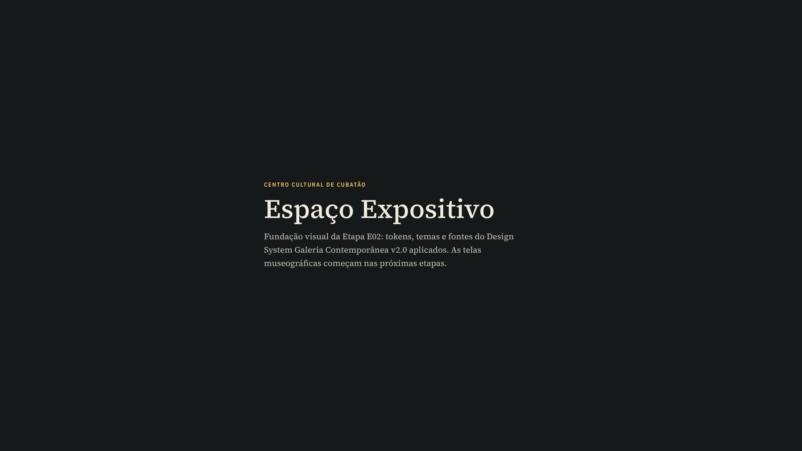
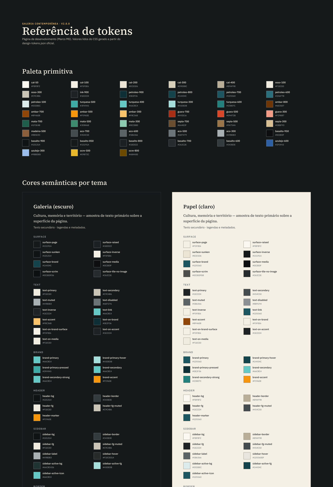
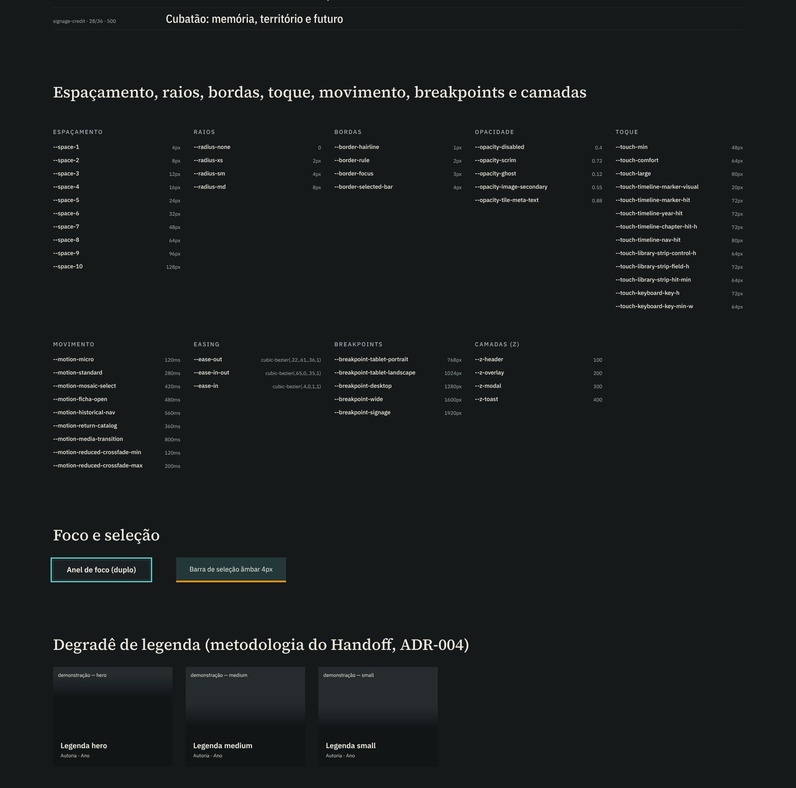

# Etapa 02 — Fundação visual (tokens)

**Fase:** 1 — Fundação tecnológica · **Data:** 16/11/2026 · **Estado:** Documentada (testada no ambiente do Claude; aguardando implementação e validação local) · **Marco:** M0
**Próxima etapa:** E03 — Contratos e dados de demonstração. **Não será iniciada sem sua aprovação.**

## 1. Objetivo

Criar o pacote `@ccc/design-tokens`: converter o `design-tokens.json` oficial em CSS Variables (temas Galeria e Papel), empacotar as fontes localmente, acrescentar os tokens complementares do Handoff e entregar uma página de referência (Marco M0) que mostra os tokens nos dois temas.

## 2. Pré-requisitos

- E01 aprovada e commitada (branch `feat/etapa-01-monorepo-toolchain` ou `main` já com ela).
- Windows 11, VS Code, PowerShell; Node 24.21.0, npm 11.19.0, Git 2.55.0.
- Documentos oficiais em `docs/design-system/` (já presentes no seu repositório).

## 3. Contexto técnico

- **Fonte da verdade:** `docs/design-system/design-tokens.json` não é editado. O gerador lê esse arquivo e `src/source/complementary-tokens.json` e escreve `src/generated/tokens.css` e `src/generated/catalog.ts` (ADR-012).
- **Complementos:** gradiente de legenda segundo o Handoff (ADR-004: platô 68 %, margem 10 px, esmaecimento 56 px, preenchimento 14 px, blocos 142/74/66 px → alturas 222/154/146 px), anel de foco duplo, barra de seleção âmbar 4 px e `surface-tile-no-image` para o Papel (hipótese, K-04).
- **Temas:** `data-theme="galeria"` (padrão, também em `:root`) e `data-theme="papel"`, com `color-scheme`.
- **Fontes:** Source Serif 4, IBM Plex Sans e IBM Plex Sans Condensed, woff2 do subconjunto latino via `@fontsource` (OFL-1.1), sem CDN (ADR-008).
- **Página de referência:** `apps/espaco-expositivo/tokens.html`, somente em desenvolvimento (não entra no `build`).
- **Node executa TypeScript:** os scripts rodam com `node scripts/build-tokens.ts` (remoção de tipos nativa, Node ≥ 22.18). Por isso `allowImportingTsExtensions` foi para o `tsconfig.base.json`.
- **Estilos do app:** apenas `var(--token)`; nenhum valor visual fixo na tela inicial.
- **Não incluído:** mosaico, legenda real e componentes (E04+); Firebase; offline.

## 4. Dependências adicionadas (versões exatas)

| Pacote | Versão | Onde | Motivo |
| --- | --- | --- | --- |
| `@fontsource/source-serif-4` | 5.3.1 | `@ccc/design-tokens` | Fonte serifada do DS (OFL-1.1) |
| `@fontsource/ibm-plex-sans` | 5.3.0 | `@ccc/design-tokens` | Fonte sans do DS (OFL-1.1) |
| `@fontsource/ibm-plex-sans-condensed` | 5.3.0 | `@ccc/design-tokens` | Fonte condensada do DS (OFL-1.1) |
| `@ccc/design-tokens` | 0.1.0 (workspace) | `@ccc/espaco-expositivo` | Consumo dos tokens |

`npm audit --omit=dev`: 0 vulnerabilidades. Os 7 avisos moderados de desenvolvimento (K-01) permanecem inalterados.

## 5. Estrutura de diretórios (após a etapa)

```text
ccc-ecossistema/
├── apps/espaco-expositivo/
│   ├── tokens.html                         (novo, só desenvolvimento)
│   └── src/
│       ├── main.tsx · App.tsx · App.module.css · App.test.tsx   (modificados)
│       ├── styles/global.css                                    (modificado)
│       └── reference/                                           (novo)
│           ├── main.tsx · TokenReference.tsx
│           └── TokenReference.module.css · TokenReference.test.tsx
├── packages/design-tokens/                 (novo)
│   ├── package.json · tsconfig.json · vitest.config.ts
│   ├── scripts/build-tokens.ts
│   └── src/
│       ├── index.ts · fonts.css · styles.css · tokens.test.ts
│       ├── build/generate.ts
│       ├── source/complementary-tokens.json
│       └── generated/tokens.css · catalog.ts   (gerados, versionados)
├── docs/decisoes/ADR-012-pipeline-de-tokens.md (novo)
└── (raiz) tsconfig.base.json · eslint.config.js · .prettierignore · package-lock.json   (modificados)
```

## 6. Arquivos

**Novos:** 18 (listados na seção 8). **Modificados:** 9 de código/configuração, mais `package-lock.json` (regenerado pelo npm; entregue no .zip), `docs/decisoes/README.md`, `docs/desenvolvimento/{progresso,pendencias}.md` e `docs/arquitetura/estrutura-monorepo.md` (estes quatro vêm prontos no .zip; resumo na seção 9). **Removidos:** nenhum.

## 7. Ordem de implementação (PowerShell, na raiz do repositório)

```powershell
git switch main
git pull
git switch -c feat/etapa-02-design-tokens

# 1) Extraia o .zip da etapa sobre a raiz do repositório, substituindo os arquivos existentes
#    (inclui package-lock.json). Se preferir, copie arquivo a arquivo a partir da seção 8.

# 2) Instale exatamente o que está no lockfile
npm ci

# 3) Confirme que os arquivos gerados estão em dia
npm run tokens:check -w @ccc/design-tokens

# 4) Verificação completa
npm run check

# 5) Veja a página de referência (Marco M0)
npm run dev -w @ccc/espaco-expositivo -- --port 5173
# abra http://localhost:5173/tokens.html  e  http://localhost:5173/
```

Para regenerar os tokens após mudar o JSON oficial: `npm run tokens:build -w @ccc/design-tokens`.

## 8. Implementação completa — conteúdo integral dos arquivos

### 8.1. Arquivos novos

### `packages/design-tokens/package.json`

```json
{
  "name": "@ccc/design-tokens",
  "version": "0.1.0",
  "private": true,
  "type": "module",
  "description": "Tokens, temas e fontes do Design System Galeria Contemporânea v2.0",
  "exports": {
    ".": "./src/index.ts",
    "./styles.css": "./src/styles.css"
  },
  "scripts": {
    "tokens:build": "node scripts/build-tokens.ts",
    "tokens:check": "node scripts/build-tokens.ts --check",
    "typecheck": "tsc --noEmit",
    "test": "vitest run"
  },
  "dependencies": {
    "@fontsource/ibm-plex-sans": "5.3.0",
    "@fontsource/ibm-plex-sans-condensed": "5.3.0",
    "@fontsource/source-serif-4": "5.3.1"
  }
}
```

### `packages/design-tokens/tsconfig.json`

```json
{
  "extends": "../../tsconfig.base.json",
  "compilerOptions": {
    "types": ["node"],
    "erasableSyntaxOnly": true
  },
  "include": ["src", "scripts", "vitest.config.ts"]
}
```

### `packages/design-tokens/vitest.config.ts`

```ts
import { defineConfig } from 'vitest/config';

export default defineConfig({
  test: {
    environment: 'node',
    include: ['src/**/*.test.ts', 'scripts/**/*.test.ts'],
  },
});
```

### `packages/design-tokens/scripts/build-tokens.ts`

```ts
import { mkdirSync, readFileSync, writeFileSync, existsSync } from 'node:fs';
import { dirname, resolve } from 'node:path';
import { generateTokens, renderCatalogModule } from '../src/build/generate.ts';
import type { OfficialTokens } from '../src/build/generate.ts';

/**
 * CLI: `node scripts/build-tokens.ts`          → gera src/generated/*
 *      `node scripts/build-tokens.ts --check`  → falha se os arquivos gerados estiverem desatualizados
 */
const packageRoot = resolve(import.meta.dirname, '..');
const officialPath = resolve(packageRoot, '../../docs/design-system/design-tokens.json');
const cssPath = resolve(packageRoot, 'src/generated/tokens.css');
const catalogPath = resolve(packageRoot, 'src/generated/catalog.ts');

const official = JSON.parse(readFileSync(officialPath, 'utf-8')) as OfficialTokens;
const { css, catalog } = generateTokens(official);
const outputs = [
  { path: cssPath, content: css },
  { path: catalogPath, content: renderCatalogModule(catalog) },
];

if (process.argv.includes('--check')) {
  const stale = outputs.filter(
    ({ path, content }) => !existsSync(path) || readFileSync(path, 'utf-8') !== content,
  );
  if (stale.length > 0) {
    console.error('Arquivos gerados desatualizados. Execute: npm run tokens:build');
    for (const { path } of stale) {
      console.error(` - ${path}`);
    }
    process.exit(1);
  }
  console.log('Tokens em dia: arquivos gerados correspondem ao design-tokens.json.');
} else {
  for (const { path, content } of outputs) {
    mkdirSync(dirname(path), { recursive: true });
    writeFileSync(path, content, 'utf-8');
    console.log(`Gerado: ${path}`);
  }
}
```

### `packages/design-tokens/src/index.ts`

```ts
import type { ThemeName } from './build/generate.ts';
import { THEME_NAMES } from './build/generate.ts';

export { tokenCatalog } from './generated/catalog.ts';
export type { TokenCatalog } from './build/generate.ts';
export type { ThemeName };

export const THEMES: readonly ThemeName[] = THEME_NAMES;

/** Tema padrão das aplicações museográficas (Decisões Vigentes: Galeria). */
export const DEFAULT_THEME: ThemeName = 'galeria';

export function isThemeName(value: unknown): value is ThemeName {
  return typeof value === 'string' && (THEME_NAMES as readonly string[]).includes(value);
}

/** Nome da variável CSS de um token (ex.: `cssVar('color-text-primary')` → `var(--color-text-primary)`). */
export function cssVar(tokenName: string): string {
  return `var(--${tokenName})`;
}
```

### `packages/design-tokens/src/build/generate.ts`

```ts
import complementary from '../source/complementary-tokens.json' with { type: 'json' };

/**
 * Gera o CSS (variáveis) e o catálogo TypeScript a partir do JSON oficial do Design System
 * e dos tokens complementares. Funções puras: sem acesso a arquivos (o CLI cuida de E/S).
 */

export const THEME_NAMES = ['galeria', 'papel'] as const;
export type ThemeName = (typeof THEME_NAMES)[number];

type JsonObject = Record<string, unknown>;

export interface OfficialTokens {
  version: string;
  color: {
    primitive: Record<string, string>;
    semantic: Record<string, Record<ThemeName, string>>;
  } & JsonObject;
  typography: {
    families: Record<string, string>;
    styles: Record<
      string,
      { fontSize: number; lineHeight: number; fontWeight: number; family: string }
    >;
    letterSpacing: Record<string, string>;
  } & JsonObject;
  spacing: Record<string, string>;
  radius: Record<string, number | string>;
  border: Record<string, number>;
  opacity: Record<string, number>;
  motion: { duration: Record<string, number>; easing: Record<string, string> };
  touch: Record<string, number>;
  mosaic: {
    area: Record<string, number | string>;
    gap: number;
    margin: number;
    'max-items-per-set': Record<string, number>;
    'hero-area-share': Record<string, number>;
    'caption-gradient-height': Record<string, number>;
  };
  inactivity: Record<string, number | string>;
  breakpoint: Record<string, number>;
  z: Record<string, number>;
}

export interface TokenCatalog {
  version: string;
  themes: readonly ThemeName[];
  colorPrimitive: string[];
  colorSemantic: string[];
  fontFamilies: string[];
  typeStyles: {
    name: string;
    family: string;
    size: number;
    line: number;
    weight: number;
  }[];
  space: string[];
  radius: string[];
  border: string[];
  opacity: string[];
  motion: string[];
  ease: string[];
  touch: string[];
  breakpoint: string[];
  z: string[];
}

export interface GeneratedTokens {
  css: string;
  catalog: TokenCatalog;
}

const px = (value: number): string => (value === 0 ? '0' : `${String(value)}px`);

type Declaration = readonly [name: string, value: string];

function declarations(
  prefix: string,
  entries: Record<string, string | number>,
  unit: 'px' | 'ms' | '',
): Declaration[] {
  return Object.entries(entries).map(([key, raw]) => {
    const value =
      typeof raw === 'number'
        ? unit === 'px'
          ? px(raw)
          : unit === 'ms'
            ? `${String(raw)}ms`
            : String(raw)
        : raw;
    return [`--${prefix}-${key}`, value] as const;
  });
}

function block(selector: string, decls: readonly Declaration[], comment?: string): string {
  const lines = decls.map(([name, value]) => `  ${name}: ${value};`);
  const head = comment ? `/* ${comment} */\n` : '';
  return `${head}${selector} {\n${lines.join('\n')}\n}\n`;
}

function assertNoDuplicates(all: readonly Declaration[]): void {
  const seen = new Set<string>();
  for (const [name] of all) {
    if (seen.has(name)) {
      throw new Error(`Token duplicado na geração: ${name}`);
    }
    seen.add(name);
  }
}

export function generateTokens(official: OfficialTokens): GeneratedTokens {
  const cg = complementary.captionGradient;
  const rootDecls: Declaration[] = [];

  // Cores primitivas
  const colorPrimitive = Object.keys(official.color.primitive);
  rootDecls.push(...declarations('color', official.color.primitive, ''));

  // Tipografia
  rootDecls.push(...declarations('font', official.typography.families, ''));
  rootDecls.push(...declarations('tracking', official.typography.letterSpacing, ''));
  const typeStyles = Object.entries(official.typography.styles).map(([name, s]) => ({
    name,
    family: s.family,
    size: s.fontSize,
    line: s.lineHeight,
    weight: s.fontWeight,
  }));
  for (const s of typeStyles) {
    rootDecls.push([`--type-${s.name}-family`, `var(--font-${s.family})`]);
    rootDecls.push([`--type-${s.name}-size`, px(s.size)]);
    rootDecls.push([`--type-${s.name}-line`, px(s.line)]);
    rootDecls.push([`--type-${s.name}-weight`, String(s.weight)]);
    rootDecls.push([
      `--type-${s.name}`,
      `${String(s.weight)} ${px(s.size)}/${px(s.line)} var(--font-${s.family})`,
    ]);
  }

  // Espaçamento, raio, borda, opacidade
  const radius = Object.fromEntries(
    Object.entries(official.radius).filter(
      (entry): entry is [string, number] => typeof entry[1] === 'number',
    ),
  );
  rootDecls.push(...declarations('space', official.spacing, ''));
  rootDecls.push(...declarations('radius', radius, 'px'));
  rootDecls.push(...declarations('border', official.border, 'px'));
  rootDecls.push(...declarations('opacity', official.opacity, ''));

  // Movimento
  rootDecls.push(...declarations('motion', official.motion.duration, 'ms'));
  rootDecls.push(...declarations('ease', official.motion.easing, ''));

  // Toque
  rootDecls.push(...declarations('touch', official.touch, 'px'));

  // Mosaico
  const { x, y, w, h } = official.mosaic.area as Record<string, number>;
  rootDecls.push(
    ['--mosaic-area-x', px(x ?? 0)],
    ['--mosaic-area-y', px(y ?? 0)],
    ['--mosaic-area-w', px(w ?? 0)],
    ['--mosaic-area-h', px(h ?? 0)],
    ['--mosaic-gap', px(official.mosaic.gap)],
    ['--mosaic-margin', px(official.mosaic.margin)],
  );
  rootDecls.push(...declarations('mosaic-max-items', official.mosaic['max-items-per-set'], ''));
  rootDecls.push(...declarations('mosaic-hero-share', official.mosaic['hero-area-share'], ''));
  const captionHeight = official.mosaic['caption-gradient-height'];
  rootDecls.push(
    ['--mosaic-caption-gradient-height-max', px(captionHeight['max-px'] ?? 0)],
    ['--mosaic-caption-gradient-height-max-share', String(captionHeight['max-share'] ?? 0)],
  );

  // Inatividade (somente valores numéricos)
  rootDecls.push(
    ...declarations(
      'inactivity',
      Object.fromEntries(
        Object.entries(official.inactivity).filter(([, v]) => typeof v === 'number'),
      ),
      '',
    ),
  );

  // Breakpoints (referência: variáveis CSS não funcionam em @media) e z-index
  rootDecls.push(...declarations('breakpoint', official.breakpoint, 'px'));
  rootDecls.push(...declarations('z', official.z, ''));

  // Complementares (ADR-004 e demais)
  const blockH = cg.textBlockHeight;
  rootDecls.push(
    ['--caption-gradient-rgb', cg.colorRgb],
    ['--caption-gradient-plateau-opacity', String(cg.plateauOpacity)],
    ['--caption-gradient-plateau-margin', px(cg.plateauMargin)],
    ['--caption-gradient-fade-length', px(cg.fadeLength)],
    ['--caption-gradient-base-padding', px(cg.basePadding)],
    ['--caption-text-margin-left', px(cg.textMarginLeft)],
    ['--caption-text-margin-right', px(cg.textMarginRight)],
    ['--caption-meta-opacity', String(cg.metaOpacity)],
    ['--caption-block-height-hero', px(blockH.hero)],
    ['--caption-block-height-medium', px(blockH.medium)],
    ['--caption-block-height-small', px(blockH.small)],
  );
  for (const size of ['hero', 'medium', 'small'] as const) {
    rootDecls.push([
      `--caption-gradient-height-${size}`,
      `calc(var(--caption-block-height-${size}) + var(--caption-gradient-base-padding) + var(--caption-gradient-plateau-margin) + var(--caption-gradient-fade-length))`,
    ]);
  }
  rootDecls.push(
    ['--focus-ring-width', px(complementary.focusRing.width)],
    ['--focus-ring-inner-color', complementary.focusRing.innerColor],
    ['--focus-ring-outer-color', `var(--color-${complementary.focusRing.outerColor})`],
    [
      '--focus-ring',
      '0 0 0 var(--focus-ring-width) var(--focus-ring-inner-color), 0 0 0 calc(var(--focus-ring-width) * 2) var(--focus-ring-outer-color)',
    ],
    ['--selected-bar-height', px(complementary.selectedBar.height)],
    ['--selected-bar-color', `var(--color-${complementary.selectedBar.color})`],
  );

  assertNoDuplicates(rootDecls);

  // Temas (cores semânticas)
  const semanticNames = Object.keys(official.color.semantic);
  const extra = complementary.semanticColors.tokens as Record<string, Record<ThemeName, string>>;
  for (const name of Object.keys(extra)) {
    if (semanticNames.includes(name)) {
      throw new Error(`Token complementar conflita com o oficial: ${name}`);
    }
  }
  const colorSemantic = [...semanticNames, ...Object.keys(extra)];

  const themeBlocks = THEME_NAMES.map((theme) => {
    const decls: Declaration[] = [['color-scheme', complementary.colorScheme[theme]]];
    for (const name of semanticNames) {
      const value = official.color.semantic[name]?.[theme];
      if (value === undefined) {
        throw new Error(`Token semântico sem valor para o tema ${theme}: ${name}`);
      }
      decls.push([`--color-${name}`, value]);
    }
    for (const [name, values] of Object.entries(extra)) {
      decls.push([`--color-${name}`, values[theme]]);
    }
    assertNoDuplicates(decls);
    const selector =
      theme === 'galeria' ? `:root,\n[data-theme='galeria']` : `[data-theme='${theme}']`;
    return block(selector, decls, `Tema ${theme}`);
  });

  const header = `/*
 * GERADO AUTOMATICAMENTE por scripts/build-tokens.ts — NÃO EDITE.
 * Fontes: docs/design-system/design-tokens.json (v${official.version}) e
 * packages/design-tokens/src/source/complementary-tokens.json (v${complementary.version}).
 * Regenerar: npm run tokens:build -w @ccc/design-tokens
 */
`;

  const css = [
    header,
    block(':root', rootDecls, 'Tokens independentes de tema'),
    ...themeBlocks,
  ].join('\n');

  const catalog: TokenCatalog = {
    version: official.version,
    themes: THEME_NAMES,
    colorPrimitive,
    colorSemantic,
    fontFamilies: Object.keys(official.typography.families),
    typeStyles,
    space: Object.keys(official.spacing),
    radius: Object.keys(radius),
    border: Object.keys(official.border),
    opacity: Object.keys(official.opacity),
    motion: Object.keys(official.motion.duration),
    ease: Object.keys(official.motion.easing),
    touch: Object.keys(official.touch),
    breakpoint: Object.keys(official.breakpoint),
    z: Object.keys(official.z),
  };

  return { css, catalog };
}

export function renderCatalogModule(catalog: TokenCatalog): string {
  return `// GERADO AUTOMATICAMENTE por scripts/build-tokens.ts — NÃO EDITE.
import type { TokenCatalog } from '../build/generate.ts';

export const tokenCatalog: TokenCatalog = ${JSON.stringify(catalog, null, 2)};
`;
}
```

### `packages/design-tokens/src/source/complementary-tokens.json`

```json
{
  "version": "2.0.0-c1",
  "note": "Tokens complementares ao design-tokens.json oficial. O JSON oficial NÃO é modificado (ADR-004). Cada grupo registra sua origem.",
  "captionGradient": {
    "source": "Handoff Técnico §3.3 e §11 (ADR-004: a metodologia do Handoff prevalece sobre as paradas percentuais do JSON)",
    "colorRgb": "8 10 11",
    "plateauOpacity": 0.68,
    "plateauMargin": 10,
    "fadeLength": 56,
    "basePadding": 14,
    "textMarginLeft": 18,
    "textMarginRight": 46,
    "textBlockHeight": { "hero": 142, "medium": 74, "small": 66 },
    "metaOpacity": 0.88
  },
  "focusRing": {
    "source": "Handoff Técnico §3.3 (anel duplo: interno rgba(8,10,11,.85) 3 px + externo turquesa-400 3 px)",
    "innerColor": "rgb(8 10 11 / 0.85)",
    "outerColor": "turquesa-400",
    "width": 3
  },
  "selectedBar": {
    "source": "design-tokens.json (color.selected-bar: âmbar-500, 4 px)",
    "color": "ambar-500",
    "height": 4
  },
  "semanticColors": {
    "source": "Decisão registrada na E02: o JSON define tile-no-image apenas para Galeria; o PDF (p. 14) e o Handoff §2 mantêm o mesmo tratamento do acervo nos dois temas",
    "tokens": {
      "surface-tile-no-image": { "galeria": "#262C2E", "papel": "#262C2E" }
    }
  },
  "colorScheme": {
    "source": "Decisão registrada na E02: informa ao navegador o esquema de cores nativo de cada tema",
    "galeria": "dark",
    "papel": "light"
  }
}
```

### `packages/design-tokens/src/fonts.css`

```css
/*
 * Fontes locais do Design System (ADR-008): arquivos woff2 do subconjunto latino, empacotados
 * pelo Vite a partir dos pacotes @fontsource (licença OFL-1.1). Nenhuma requisição externa.
 * Pesos usados pelo DS: Source Serif 4 (400/500/600), IBM Plex Sans (400/500/600),
 * IBM Plex Sans Condensed (500/600; 400 reservado como alternativa de legibilidade).
 */

/* Source Serif 4 */
@font-face {
  font-family: 'Source Serif 4';
  font-style: normal;
  font-display: swap;
  font-weight: 400;
  src: url('@fontsource/source-serif-4/files/source-serif-4-latin-400-normal.woff2') format('woff2');
}
@font-face {
  font-family: 'Source Serif 4';
  font-style: normal;
  font-display: swap;
  font-weight: 500;
  src: url('@fontsource/source-serif-4/files/source-serif-4-latin-500-normal.woff2') format('woff2');
}
@font-face {
  font-family: 'Source Serif 4';
  font-style: normal;
  font-display: swap;
  font-weight: 600;
  src: url('@fontsource/source-serif-4/files/source-serif-4-latin-600-normal.woff2') format('woff2');
}

/* IBM Plex Sans */
@font-face {
  font-family: 'IBM Plex Sans';
  font-style: normal;
  font-display: swap;
  font-weight: 400;
  src: url('@fontsource/ibm-plex-sans/files/ibm-plex-sans-latin-400-normal.woff2') format('woff2');
}
@font-face {
  font-family: 'IBM Plex Sans';
  font-style: normal;
  font-display: swap;
  font-weight: 500;
  src: url('@fontsource/ibm-plex-sans/files/ibm-plex-sans-latin-500-normal.woff2') format('woff2');
}
@font-face {
  font-family: 'IBM Plex Sans';
  font-style: normal;
  font-display: swap;
  font-weight: 600;
  src: url('@fontsource/ibm-plex-sans/files/ibm-plex-sans-latin-600-normal.woff2') format('woff2');
}

/* IBM Plex Sans Condensed */
@font-face {
  font-family: 'IBM Plex Sans Condensed';
  font-style: normal;
  font-display: swap;
  font-weight: 400;
  src: url('@fontsource/ibm-plex-sans-condensed/files/ibm-plex-sans-condensed-latin-400-normal.woff2')
    format('woff2');
}
@font-face {
  font-family: 'IBM Plex Sans Condensed';
  font-style: normal;
  font-display: swap;
  font-weight: 500;
  src: url('@fontsource/ibm-plex-sans-condensed/files/ibm-plex-sans-condensed-latin-500-normal.woff2')
    format('woff2');
}
@font-face {
  font-family: 'IBM Plex Sans Condensed';
  font-style: normal;
  font-display: swap;
  font-weight: 600;
  src: url('@fontsource/ibm-plex-sans-condensed/files/ibm-plex-sans-condensed-latin-600-normal.woff2')
    format('woff2');
}
```

### `packages/design-tokens/src/styles.css`

```css
/* Ponto de entrada de estilos do Design System: importe uma vez no app. */
@import './fonts.css';
@import './generated/tokens.css';
```

### `packages/design-tokens/src/tokens.test.ts`

```ts
import { existsSync, readFileSync } from 'node:fs';
import { resolve } from 'node:path';
import { describe, expect, it } from 'vitest';
import { generateTokens, renderCatalogModule, THEME_NAMES } from './build/generate.ts';
import type { OfficialTokens } from './build/generate.ts';
import complementary from './source/complementary-tokens.json' with { type: 'json' };
import { DEFAULT_THEME, THEMES, isThemeName, tokenCatalog } from './index.ts';

const packageRoot = resolve(import.meta.dirname, '..');
const read = (path: string): string => readFileSync(resolve(packageRoot, path), 'utf-8');

const official = JSON.parse(
  readFileSync(resolve(packageRoot, '../../docs/design-system/design-tokens.json'), 'utf-8'),
) as OfficialTokens;
const { css } = generateTokens(official);

/** Extrai o corpo de um bloco CSS pelo seletor. */
function block(source: string, selector: string): string {
  const start = source.indexOf(`${selector.replace(', ', ',\n')} {`);
  expect(start, `bloco ${selector} existe`).toBeGreaterThanOrEqual(0);
  return source.slice(start, source.indexOf('\n}', start));
}

function declaredNames(body: string): string[] {
  return [...body.matchAll(/^\s*(--[\w-]+):/gm)].map((m) => m[1] as string);
}

describe('arquivos gerados', () => {
  it('tokens.css versionado é idêntico ao regenerado a partir do JSON oficial', () => {
    expect(read('src/generated/tokens.css')).toBe(css);
  });

  it('catalog.ts versionado é idêntico ao regenerado', () => {
    expect(read('src/generated/catalog.ts')).toBe(
      renderCatalogModule(generateTokens(official).catalog),
    );
  });

  it('não possui nomes de variáveis duplicados em um mesmo bloco', () => {
    for (const selector of [":root, [data-theme='galeria']", "[data-theme='papel']"]) {
      const names = declaredNames(block(css, selector));
      expect(new Set(names).size).toBe(names.length);
    }
  });
});

describe('paridade JSON oficial ↔ CSS', () => {
  it('toda cor primitiva vira --color-<nome> com o mesmo valor', () => {
    for (const [name, value] of Object.entries(official.color.primitive)) {
      expect(css).toContain(`--color-${name}: ${value};`);
    }
  });

  it('cada tema define exatamente o mesmo conjunto de cores semânticas', () => {
    const galeria = declaredNames(block(css, ":root, [data-theme='galeria']")).filter((n) =>
      Object.keys(official.color.semantic).some((k) => n === `--color-${k}`),
    );
    const papel = declaredNames(block(css, "[data-theme='papel']")).filter((n) =>
      Object.keys(official.color.semantic).some((k) => n === `--color-${k}`),
    );
    expect(papel.sort()).toEqual(galeria.sort());
    expect(galeria.length).toBeGreaterThan(0);
  });

  it('valores semânticos de cada tema correspondem ao JSON', () => {
    const galeria = block(css, ":root, [data-theme='galeria']");
    const papel = block(css, "[data-theme='papel']");
    for (const [name, themes] of Object.entries(official.color.semantic)) {
      expect(galeria).toContain(`--color-${name}: ${themes.galeria};`);
      expect(papel).toContain(`--color-${name}: ${themes.papel};`);
    }
  });

  it('temas declaram color-scheme (Galeria escuro, Papel claro)', () => {
    expect(block(css, ":root, [data-theme='galeria']")).toContain('color-scheme: dark;');
    expect(block(css, "[data-theme='papel']")).toContain('color-scheme: light;');
  });

  it('as 33 escalas tipográficas (ou todas as do JSON) existem com tamanho, linha e peso', () => {
    const styles = Object.entries(official.typography.styles);
    expect(styles.length).toBeGreaterThan(0);
    for (const [name, s] of styles) {
      expect(css).toContain(`--type-${name}-size: ${s.fontSize}px;`);
      expect(css).toContain(`--type-${name}-line: ${s.lineHeight}px;`);
      expect(css).toContain(`--type-${name}-weight: ${s.fontWeight};`);
    }
  });

  it('pilhas de fontes são idênticas às do JSON oficial', () => {
    for (const [name, stack] of Object.entries(official.typography.families)) {
      expect(css).toContain(`--font-${name}: ${stack};`);
    }
  });

  it('espaçamentos, raios, bordas, toque e z-index correspondem ao JSON', () => {
    for (const [k, v] of Object.entries(official.spacing))
      expect(css).toContain(`--space-${k}: ${v}`);
    for (const [k, v] of Object.entries(official.touch))
      expect(css).toContain(`--touch-${k}: ${v}px;`);
    for (const [k, v] of Object.entries(official.z)) expect(css).toContain(`--z-${k}: ${v};`);
    for (const [k, v] of Object.entries(official.motion.duration))
      expect(css).toContain(`--motion-${k}: ${v}ms;`);
  });

  it('mosaico expõe área, gap e margem do JSON', () => {
    expect(css).toContain('--mosaic-gap: 10px;');
    expect(css).toContain('--mosaic-margin: 60px;');
    expect(css).toContain('--mosaic-area-w: 1800px;');
    expect(css).toContain('--mosaic-area-h: 750px;');
  });
});

describe('tokens complementares (ADR-004: metodologia do Handoff)', () => {
  it('gradiente: platô 68%, margem 10px, esmaecimento 56px, preenchimento 14px', () => {
    expect(css).toContain('--caption-gradient-plateau-opacity: 0.68;');
    expect(css).toContain('--caption-gradient-plateau-margin: 10px;');
    expect(css).toContain('--caption-gradient-fade-length: 56px;');
    expect(css).toContain('--caption-gradient-base-padding: 14px;');
  });

  it('blocos de legenda: 142 / 74 / 66 px → alturas de gradiente 222 / 154 / 146 px', () => {
    expect(css).toContain('--caption-block-height-hero: 142px;');
    expect(css).toContain('--caption-block-height-medium: 74px;');
    expect(css).toContain('--caption-block-height-small: 66px;');
    expect(142 + 14 + 10 + 56).toBe(222);
    expect(74 + 14 + 10 + 56).toBe(154);
    expect(66 + 14 + 10 + 56).toBe(146);
  });

  it('anel de foco duplo e barra de seleção âmbar 4px', () => {
    expect(css).toContain('--focus-ring-inner-color: rgb(8 10 11 / 0.85);');
    expect(css).toContain('--focus-ring-outer-color: var(--color-turquesa-400);');
    expect(css).toContain('--selected-bar-height: 4px;');
    expect(css).toContain('--selected-bar-color: var(--color-ambar-500);');
  });

  it('surface-tile-no-image existe nos dois temas', () => {
    expect(block(css, ":root, [data-theme='galeria']")).toContain('--color-surface-tile-no-image');
    expect(block(css, "[data-theme='papel']")).toContain('--color-surface-tile-no-image');
  });

  it('arquivo complementar declara versão', () => {
    expect(complementary.version).toBeTruthy();
  });
});

describe('fontes locais (ADR-008)', () => {
  const fontsCss = read('src/fonts.css');
  const urls = [...fontsCss.matchAll(/url\('([^']+)'\)/g)].map((m) => m[1] as string);

  it('referencia apenas arquivos woff2 de pacotes @fontsource, sem URLs externas', () => {
    expect(urls.length).toBeGreaterThanOrEqual(9);
    for (const url of urls) {
      expect(url).toMatch(/^@fontsource\/[\w-]+\/files\/[\w-]+\.woff2$/);
      expect(url).not.toMatch(/https?:/);
    }
  });

  it('todos os arquivos de fonte referenciados existem em node_modules', () => {
    for (const url of urls) {
      const candidates = [
        resolve(packageRoot, 'node_modules', url),
        resolve(packageRoot, '../../node_modules', url),
      ];
      expect(candidates.some(existsSync), url).toBe(true);
    }
  });

  it('as famílias declaradas em @font-face aparecem nas pilhas do JSON oficial', () => {
    const families = new Set(
      [...fontsCss.matchAll(/font-family:\s*'([^']+)'/g)].map((m) => m[1] as string),
    );
    const stacks = Object.values(official.typography.families).join(' ');
    for (const f of families) expect(stacks).toContain(f);
  });

  it('nenhum CSS gerado contém URLs externas', () => {
    expect(css).not.toMatch(/https?:\/\//);
  });
});

describe('API pública', () => {
  it('expõe temas e tema padrão Galeria', () => {
    expect(THEMES).toEqual(THEME_NAMES);
    expect(DEFAULT_THEME).toBe('galeria');
  });

  it('isThemeName valida entradas', () => {
    expect(isThemeName('papel')).toBe(true);
    expect(isThemeName('galeria')).toBe(true);
    expect(isThemeName('claro')).toBe(false);
    expect(isThemeName(undefined)).toBe(false);
  });

  it('catálogo reflete a versão e os estilos do JSON oficial', () => {
    expect(tokenCatalog.version).toBe(official.version);
    expect(tokenCatalog.typeStyles).toHaveLength(Object.keys(official.typography.styles).length);
  });
});
```

### `packages/design-tokens/src/generated/tokens.css`

```css
/*
 * GERADO AUTOMATICAMENTE por scripts/build-tokens.ts — NÃO EDITE.
 * Fontes: docs/design-system/design-tokens.json (v2.0.0) e
 * packages/design-tokens/src/source/complementary-tokens.json (v2.0.0-c1).
 * Regenerar: npm run tokens:build -w @ccc/design-tokens
 */

/* Tokens independentes de tema */
:root {
  --color-cal-50: #FBF8F2;
  --color-cal-100: #F5F0E6;
  --color-cal-200: #ECE5D6;
  --color-cal-300: #D9D0BC;
  --color-cal-400: #B9AF98;
  --color-osso-100: #F1ECE0;
  --color-osso-300: #C9C4B6;
  --color-ink-900: #1E2224;
  --color-petroleo-900: #0E2F36;
  --color-petroleo-800: #14434C;
  --color-petroleo-700: #1D5560;
  --color-petroleo-600: #2A6F7B;
  --color-petroleo-100: #DCEBEC;
  --color-turquesa-500: #3FA9A5;
  --color-turquesa-400: #66C8C4;
  --color-turquesa-300: #A5DEDB;
  --color-turquesa-600: #23807C;
  --color-ambar-800: #6E3507;
  --color-ambar-700: #8F4608;
  --color-ambar-500: #F5960E;
  --color-ambar-300: #F8C36B;
  --color-guara-700: #A92E16;
  --color-guara-500: #D9472B;
  --color-guara-300: #F29B87;
  --color-mata-700: #1F5E4B;
  --color-mata-500: #3D8A6E;
  --color-mata-300: #8CCBB0;
  --color-sepia-700: #6A4E2F;
  --color-sepia-500: #9A754A;
  --color-sepia-300: #D8BF93;
  --color-madeira-500: #8B5E3C;
  --color-aco-700: #454C50;
  --color-aco-600: #5B6366;
  --color-aco-500: #6B7479;
  --color-aco-300: #A9B0B3;
  --color-basalto-950: #0C0E0F;
  --color-basalto-900: #101314;
  --color-basalto-850: #15191A;
  --color-basalto-800: #1B2022;
  --color-basalto-700: #262C2E;
  --color-basalto-600: #343B3E;
  --color-azulejo-600: #2F5FA3;
  --color-azulejo-300: #9BBDEB;
  --color-ocre-500: #E9B72C;
  --color-ocre-800: #6B4A00;
  --font-display: "Source Serif 4", "Source Serif Pro", Georgia, "Times New Roman", serif;
  --font-sans: "IBM Plex Sans", system-ui, "Segoe UI", Arial, sans-serif;
  --font-condensed: "IBM Plex Sans Condensed", "IBM Plex Sans", system-ui, "Arial Narrow", sans-serif;
  --tracking-display: -0.02em;
  --tracking-title: -0.01em;
  --tracking-caps: 0.10em;
  --tracking-eyebrow: 0.14em;
  --tracking-body: 0;
  --type-display-xl-family: var(--font-display);
  --type-display-xl-size: 88px;
  --type-display-xl-line: 92px;
  --type-display-xl-weight: 500;
  --type-display-xl: 500 88px/92px var(--font-display);
  --type-display-lg-family: var(--font-display);
  --type-display-lg-size: 64px;
  --type-display-lg-line: 68px;
  --type-display-lg-weight: 500;
  --type-display-lg: 500 64px/68px var(--font-display);
  --type-title-xl-family: var(--font-display);
  --type-title-xl-size: 48px;
  --type-title-xl-line: 54px;
  --type-title-xl-weight: 500;
  --type-title-xl: 500 48px/54px var(--font-display);
  --type-title-lg-family: var(--font-display);
  --type-title-lg-size: 38px;
  --type-title-lg-line: 44px;
  --type-title-lg-weight: 500;
  --type-title-lg: 500 38px/44px var(--font-display);
  --type-title-md-family: var(--font-display);
  --type-title-md-size: 30px;
  --type-title-md-line: 38px;
  --type-title-md-weight: 600;
  --type-title-md: 600 30px/38px var(--font-display);
  --type-title-sm-family: var(--font-display);
  --type-title-sm-size: 24px;
  --type-title-sm-line: 32px;
  --type-title-sm-weight: 600;
  --type-title-sm: 600 24px/32px var(--font-display);
  --type-tile-title-hero-family: var(--font-display);
  --type-tile-title-hero-size: 36px;
  --type-tile-title-hero-line: 40px;
  --type-tile-title-hero-weight: 500;
  --type-tile-title-hero: 500 36px/40px var(--font-display);
  --type-tile-title-family: var(--font-sans);
  --type-tile-title-size: 21px;
  --type-tile-title-line: 26px;
  --type-tile-title-weight: 500;
  --type-tile-title: 500 21px/26px var(--font-sans);
  --type-tile-title-small-family: var(--font-sans);
  --type-tile-title-small-size: 18px;
  --type-tile-title-small-line: 22px;
  --type-tile-title-small-weight: 500;
  --type-tile-title-small: 500 18px/22px var(--font-sans);
  --type-tile-meta-family: var(--font-condensed);
  --type-tile-meta-size: 14px;
  --type-tile-meta-line: 18px;
  --type-tile-meta-weight: 500;
  --type-tile-meta: 500 14px/18px var(--font-condensed);
  --type-reading-lg-family: var(--font-display);
  --type-reading-lg-size: 24px;
  --type-reading-lg-line: 40px;
  --type-reading-lg-weight: 400;
  --type-reading-lg: 400 24px/40px var(--font-display);
  --type-reading-family: var(--font-display);
  --type-reading-size: 20px;
  --type-reading-line: 32px;
  --type-reading-weight: 400;
  --type-reading: 400 20px/32px var(--font-display);
  --type-quote-family: var(--font-display);
  --type-quote-size: 34px;
  --type-quote-line: 46px;
  --type-quote-weight: 400;
  --type-quote: 400 34px/46px var(--font-display);
  --type-caption-editorial-family: var(--font-sans);
  --type-caption-editorial-size: 16px;
  --type-caption-editorial-line: 24px;
  --type-caption-editorial-weight: 400;
  --type-caption-editorial: 400 16px/24px var(--font-sans);
  --type-body-touch-family: var(--font-sans);
  --type-body-touch-size: 20px;
  --type-body-touch-line: 30px;
  --type-body-touch-weight: 400;
  --type-body-touch: 400 20px/30px var(--font-sans);
  --type-body-family: var(--font-sans);
  --type-body-size: 16px;
  --type-body-line: 24px;
  --type-body-weight: 400;
  --type-body: 400 16px/24px var(--font-sans);
  --type-body-dense-family: var(--font-sans);
  --type-body-dense-size: 14px;
  --type-body-dense-line: 20px;
  --type-body-dense-weight: 400;
  --type-body-dense: 400 14px/20px var(--font-sans);
  --type-label-family: var(--font-sans);
  --type-label-size: 14px;
  --type-label-line: 20px;
  --type-label-weight: 500;
  --type-label: 500 14px/20px var(--font-sans);
  --type-label-touch-family: var(--font-sans);
  --type-label-touch-size: 18px;
  --type-label-touch-line: 24px;
  --type-label-touch-weight: 500;
  --type-label-touch: 500 18px/24px var(--font-sans);
  --type-button-family: var(--font-sans);
  --type-button-size: 18px;
  --type-button-line: 24px;
  --type-button-weight: 600;
  --type-button: 600 18px/24px var(--font-sans);
  --type-button-dense-family: var(--font-sans);
  --type-button-dense-size: 14px;
  --type-button-dense-line: 20px;
  --type-button-dense-weight: 600;
  --type-button-dense: 600 14px/20px var(--font-sans);
  --type-eyebrow-family: var(--font-condensed);
  --type-eyebrow-size: 14px;
  --type-eyebrow-line: 16px;
  --type-eyebrow-weight: 600;
  --type-eyebrow: 600 14px/16px var(--font-condensed);
  --type-meta-family: var(--font-condensed);
  --type-meta-size: 14px;
  --type-meta-line: 18px;
  --type-meta-weight: 500;
  --type-meta: 500 14px/18px var(--font-condensed);
  --type-year-family: var(--font-display);
  --type-year-size: 40px;
  --type-year-line: 40px;
  --type-year-weight: 600;
  --type-year: 600 40px/40px var(--font-display);
  --type-year-touch-family: var(--font-display);
  --type-year-touch-size: 32px;
  --type-year-touch-line: 36px;
  --type-year-touch-weight: 600;
  --type-year-touch: 600 32px/36px var(--font-display);
  --type-year-sm-family: var(--font-display);
  --type-year-sm-size: 24px;
  --type-year-sm-line: 24px;
  --type-year-sm-weight: 600;
  --type-year-sm: 600 24px/24px var(--font-display);
  --type-data-xl-family: var(--font-sans);
  --type-data-xl-size: 72px;
  --type-data-xl-line: 72px;
  --type-data-xl-weight: 600;
  --type-data-xl: 600 72px/72px var(--font-sans);
  --type-data-lg-family: var(--font-sans);
  --type-data-lg-size: 44px;
  --type-data-lg-line: 44px;
  --type-data-lg-weight: 600;
  --type-data-lg: 600 44px/44px var(--font-sans);
  --type-data-md-family: var(--font-sans);
  --type-data-md-size: 28px;
  --type-data-md-line: 32px;
  --type-data-md-weight: 600;
  --type-data-md: 600 28px/32px var(--font-sans);
  --type-data-sm-family: var(--font-sans);
  --type-data-sm-size: 14px;
  --type-data-sm-line: 20px;
  --type-data-sm-weight: 500;
  --type-data-sm: 500 14px/20px var(--font-sans);
  --type-signage-title-family: var(--font-display);
  --type-signage-title-size: 96px;
  --type-signage-title-line: 100px;
  --type-signage-title-weight: 500;
  --type-signage-title: 500 96px/100px var(--font-display);
  --type-signage-body-family: var(--font-display);
  --type-signage-body-size: 44px;
  --type-signage-body-line: 62px;
  --type-signage-body-weight: 400;
  --type-signage-body: 400 44px/62px var(--font-display);
  --type-signage-credit-family: var(--font-condensed);
  --type-signage-credit-size: 28px;
  --type-signage-credit-line: 36px;
  --type-signage-credit-weight: 500;
  --type-signage-credit: 500 28px/36px var(--font-condensed);
  --space-1: 4px;
  --space-2: 8px;
  --space-3: 12px;
  --space-4: 16px;
  --space-5: 24px;
  --space-6: 32px;
  --space-7: 48px;
  --space-8: 64px;
  --space-9: 96px;
  --space-10: 128px;
  --radius-none: 0;
  --radius-xs: 2px;
  --radius-sm: 4px;
  --radius-md: 8px;
  --border-hairline: 1px;
  --border-rule: 2px;
  --border-focus: 3px;
  --border-selected-bar: 4px;
  --opacity-disabled: 0.4;
  --opacity-scrim: 0.72;
  --opacity-ghost: 0.12;
  --opacity-image-secondary: 0.55;
  --opacity-tile-meta-text: 0.88;
  --motion-micro: 120ms;
  --motion-standard: 280ms;
  --motion-mosaic-select: 420ms;
  --motion-ficha-open: 480ms;
  --motion-historical-nav: 560ms;
  --motion-return-catalog: 360ms;
  --motion-media-transition: 800ms;
  --motion-reduced-crossfade-min: 120ms;
  --motion-reduced-crossfade-max: 200ms;
  --ease-out: cubic-bezier(.22,.61,.36,1);
  --ease-in-out: cubic-bezier(.65,0,.35,1);
  --ease-in: cubic-bezier(.4,0,1,1);
  --touch-min: 48px;
  --touch-comfort: 64px;
  --touch-large: 80px;
  --touch-timeline-marker-visual: 20px;
  --touch-timeline-marker-hit: 72px;
  --touch-timeline-year-hit: 72px;
  --touch-timeline-chapter-hit-h: 72px;
  --touch-timeline-nav-hit: 80px;
  --touch-library-strip-control-h: 64px;
  --touch-library-strip-field-h: 72px;
  --touch-library-strip-hit-min: 64px;
  --touch-keyboard-key-h: 72px;
  --touch-keyboard-key-min-w: 64px;
  --mosaic-area-x: 60px;
  --mosaic-area-y: 150px;
  --mosaic-area-w: 1800px;
  --mosaic-area-h: 750px;
  --mosaic-gap: 10px;
  --mosaic-margin: 60px;
  --mosaic-max-items-espaco-expositivo: 8;
  --mosaic-max-items-biblioteca: 9;
  --mosaic-max-items-futuro: 8;
  --mosaic-hero-share-default-min: 0.28;
  --mosaic-hero-share-default-max: 0.45;
  --mosaic-caption-gradient-height-max: 250px;
  --mosaic-caption-gradient-height-max-share: 0.64;
  --inactivity-idle-seconds: 120;
  --inactivity-warning-seconds: 20;
  --breakpoint-tablet-portrait: 768px;
  --breakpoint-tablet-landscape: 1024px;
  --breakpoint-desktop: 1280px;
  --breakpoint-wide: 1600px;
  --breakpoint-signage: 1920px;
  --z-header: 100;
  --z-overlay: 200;
  --z-modal: 300;
  --z-toast: 400;
  --caption-gradient-rgb: 8 10 11;
  --caption-gradient-plateau-opacity: 0.68;
  --caption-gradient-plateau-margin: 10px;
  --caption-gradient-fade-length: 56px;
  --caption-gradient-base-padding: 14px;
  --caption-text-margin-left: 18px;
  --caption-text-margin-right: 46px;
  --caption-meta-opacity: 0.88;
  --caption-block-height-hero: 142px;
  --caption-block-height-medium: 74px;
  --caption-block-height-small: 66px;
  --caption-gradient-height-hero: calc(var(--caption-block-height-hero) + var(--caption-gradient-base-padding) + var(--caption-gradient-plateau-margin) + var(--caption-gradient-fade-length));
  --caption-gradient-height-medium: calc(var(--caption-block-height-medium) + var(--caption-gradient-base-padding) + var(--caption-gradient-plateau-margin) + var(--caption-gradient-fade-length));
  --caption-gradient-height-small: calc(var(--caption-block-height-small) + var(--caption-gradient-base-padding) + var(--caption-gradient-plateau-margin) + var(--caption-gradient-fade-length));
  --focus-ring-width: 3px;
  --focus-ring-inner-color: rgb(8 10 11 / 0.85);
  --focus-ring-outer-color: var(--color-turquesa-400);
  --focus-ring: 0 0 0 var(--focus-ring-width) var(--focus-ring-inner-color), 0 0 0 calc(var(--focus-ring-width) * 2) var(--focus-ring-outer-color);
  --selected-bar-height: 4px;
  --selected-bar-color: var(--color-ambar-500);
}

/* Tema galeria */
:root,
[data-theme='galeria'] {
  color-scheme: dark;
  --color-surface-page: #15191A;
  --color-surface-raised: #1B2022;
  --color-surface-sunken: #101314;
  --color-surface-inverse: #F5F0E6;
  --color-surface-brand: #14434C;
  --color-surface-media: #0C0E0F;
  --color-surface-scrim: #0C0E0FD6;
  --color-text-primary: #F1ECE0;
  --color-text-secondary: #C9C4B6;
  --color-text-muted: #A9B0B3;
  --color-text-disabled: #6B7276;
  --color-text-inverse: #1E2224;
  --color-text-link: #66C8C4;
  --color-text-accent: #F8C36B;
  --color-text-on-brand: #0E2F36;
  --color-text-on-brand-surface: #F5F0E6;
  --color-text-on-accent: #1E2224;
  --color-text-on-media: #F1ECE0;
  --color-brand-primary: #66C8C4;
  --color-brand-primary-hover: #A5DEDB;
  --color-brand-primary-pressed: #3FA9A5;
  --color-brand-secondary: #66C8C4;
  --color-brand-secondary-strong: #66C8C4;
  --color-brand-accent: #F5960E;
  --color-header-bg: #101314;
  --color-header-border: #343B3E;
  --color-header-fg: #F1ECE0;
  --color-header-fg-muted: #C9C4B6;
  --color-header-marker: #F5960E;
  --color-sidebar-bg: #101314;
  --color-sidebar-border: #343B3E;
  --color-sidebar-fg: #F1ECE0;
  --color-sidebar-fg-muted: #C9C4B6;
  --color-sidebar-label: #A9B0B3;
  --color-sidebar-hover: #F1ECE014;
  --color-sidebar-active-bg: #66C8C426;
  --color-sidebar-active-fg: #A5DEDB;
  --color-sidebar-active-icon: #66C8C4;
  --color-border-subtle: #262C2E;
  --color-border-default: #343B3E;
  --color-border-strong: #7C8386;
  --color-border-focus: #66C8C4;
  --color-state-hover: #F1ECE014;
  --color-state-pressed: #F1ECE024;
  --color-state-selected-bg: #66C8C42E;
  --color-state-selected-border: #66C8C4;
  --color-state-disabled-bg: #F1ECE00F;
  --color-success-fg: #8CCBB0;
  --color-success-bg: #8CCBB033;
  --color-warning-fg: #E9B72C;
  --color-warning-bg: #E9B72C26;
  --color-error-fg: #F29B87;
  --color-error-bg: #F29B8730;
  --color-info-fg: #9BBDEB;
  --color-info-bg: #9BBDEB2E;
  --color-marker-memoria: #D8BF93;
  --color-marker-industria: #A9B0B3;
  --color-marker-natureza: #8CCBB0;
  --color-marker-cultura: #9BBDEB;
  --color-marker-futuro: #66C8C4;
  --color-chart-1: #66C8C4;
  --color-chart-2: #F5960E;
  --color-chart-3: #8CCBB0;
  --color-chart-4: #D8BF93;
  --color-chart-5: #9BBDEB;
  --color-chart-grid: #262C2E;
  --color-surface-tile-no-image: #262C2E;
}

/* Tema papel */
[data-theme='papel'] {
  color-scheme: light;
  --color-surface-page: #F5F0E6;
  --color-surface-raised: #FBF8F2;
  --color-surface-sunken: #ECE5D6;
  --color-surface-inverse: #15191A;
  --color-surface-brand: #1D5560;
  --color-surface-media: #0C0E0F;
  --color-surface-scrim: #0C0E0FB8;
  --color-text-primary: #1E2224;
  --color-text-secondary: #454C50;
  --color-text-muted: #5B6366;
  --color-text-disabled: #8B9194;
  --color-text-inverse: #F5F0E6;
  --color-text-link: #1D5560;
  --color-text-accent: #8F4608;
  --color-text-on-brand: #F5F0E6;
  --color-text-on-brand-surface: #F5F0E6;
  --color-text-on-accent: #1E2224;
  --color-text-on-media: #F1ECE0;
  --color-brand-primary: #1D5560;
  --color-brand-primary-hover: #14434C;
  --color-brand-primary-pressed: #0E2F36;
  --color-brand-secondary: #66C8C4;
  --color-brand-secondary-strong: #23807C;
  --color-brand-accent: #F5960E;
  --color-header-bg: #FBF8F2;
  --color-header-border: #B9AF98;
  --color-header-fg: #1E2224;
  --color-header-fg-muted: #454C50;
  --color-header-marker: #1D5560;
  --color-sidebar-bg: #FBF8F2;
  --color-sidebar-border: #B9AF98;
  --color-sidebar-fg: #1E2224;
  --color-sidebar-fg-muted: #454C50;
  --color-sidebar-label: #5B6366;
  --color-sidebar-hover: #1D55600F;
  --color-sidebar-active-bg: #DCEBEC;
  --color-sidebar-active-fg: #14434C;
  --color-sidebar-active-icon: #1D5560;
  --color-border-subtle: #D9D0BC;
  --color-border-default: #B9AF98;
  --color-border-strong: #7F7867;
  --color-border-focus: #14434C;
  --color-state-hover: #1D55600F;
  --color-state-pressed: #1D556022;
  --color-state-selected-bg: #DCEBEC;
  --color-state-selected-border: #1D5560;
  --color-state-disabled-bg: #1E22240D;
  --color-success-fg: #1F5E4B;
  --color-success-bg: #1F5E4B1A;
  --color-warning-fg: #6B4A00;
  --color-warning-bg: #E9B72C33;
  --color-error-fg: #A92E16;
  --color-error-bg: #A92E161A;
  --color-info-fg: #2F5FA3;
  --color-info-bg: #2F5FA31A;
  --color-marker-memoria: #9A754A;
  --color-marker-industria: #6B7479;
  --color-marker-natureza: #3D8A6E;
  --color-marker-cultura: #2F5FA3;
  --color-marker-futuro: #23807C;
  --color-chart-1: #1D5560;
  --color-chart-2: #F5960E;
  --color-chart-3: #3D8A6E;
  --color-chart-4: #9A754A;
  --color-chart-5: #2F5FA3;
  --color-chart-grid: #D9D0BC;
  --color-surface-tile-no-image: #262C2E;
}
```

### `packages/design-tokens/src/generated/catalog.ts`

```ts
// GERADO AUTOMATICAMENTE por scripts/build-tokens.ts — NÃO EDITE.
import type { TokenCatalog } from '../build/generate.ts';

export const tokenCatalog: TokenCatalog = {
  "version": "2.0.0",
  "themes": [
    "galeria",
    "papel"
  ],
  "colorPrimitive": [
    "cal-50",
    "cal-100",
    "cal-200",
    "cal-300",
    "cal-400",
    "osso-100",
    "osso-300",
    "ink-900",
    "petroleo-900",
    "petroleo-800",
    "petroleo-700",
    "petroleo-600",
    "petroleo-100",
    "turquesa-500",
    "turquesa-400",
    "turquesa-300",
    "turquesa-600",
    "ambar-800",
    "ambar-700",
    "ambar-500",
    "ambar-300",
    "guara-700",
    "guara-500",
    "guara-300",
    "mata-700",
    "mata-500",
    "mata-300",
    "sepia-700",
    "sepia-500",
    "sepia-300",
    "madeira-500",
    "aco-700",
    "aco-600",
    "aco-500",
    "aco-300",
    "basalto-950",
    "basalto-900",
    "basalto-850",
    "basalto-800",
    "basalto-700",
    "basalto-600",
    "azulejo-600",
    "azulejo-300",
    "ocre-500",
    "ocre-800"
  ],
  "colorSemantic": [
    "surface-page",
    "surface-raised",
    "surface-sunken",
    "surface-inverse",
    "surface-brand",
    "surface-media",
    "surface-scrim",
    "text-primary",
    "text-secondary",
    "text-muted",
    "text-disabled",
    "text-inverse",
    "text-link",
    "text-accent",
    "text-on-brand",
    "text-on-brand-surface",
    "text-on-accent",
    "text-on-media",
    "brand-primary",
    "brand-primary-hover",
    "brand-primary-pressed",
    "brand-secondary",
    "brand-secondary-strong",
    "brand-accent",
    "header-bg",
    "header-border",
    "header-fg",
    "header-fg-muted",
    "header-marker",
    "sidebar-bg",
    "sidebar-border",
    "sidebar-fg",
    "sidebar-fg-muted",
    "sidebar-label",
    "sidebar-hover",
    "sidebar-active-bg",
    "sidebar-active-fg",
    "sidebar-active-icon",
    "border-subtle",
    "border-default",
    "border-strong",
    "border-focus",
    "state-hover",
    "state-pressed",
    "state-selected-bg",
    "state-selected-border",
    "state-disabled-bg",
    "success-fg",
    "success-bg",
    "warning-fg",
    "warning-bg",
    "error-fg",
    "error-bg",
    "info-fg",
    "info-bg",
    "marker-memoria",
    "marker-industria",
    "marker-natureza",
    "marker-cultura",
    "marker-futuro",
    "chart-1",
    "chart-2",
    "chart-3",
    "chart-4",
    "chart-5",
    "chart-grid",
    "surface-tile-no-image"
  ],
  "fontFamilies": [
    "display",
    "sans",
    "condensed"
  ],
  "typeStyles": [
    {
      "name": "display-xl",
      "family": "display",
      "size": 88,
      "line": 92,
      "weight": 500
    },
    {
      "name": "display-lg",
      "family": "display",
      "size": 64,
      "line": 68,
      "weight": 500
    },
    {
      "name": "title-xl",
      "family": "display",
      "size": 48,
      "line": 54,
      "weight": 500
    },
    {
      "name": "title-lg",
      "family": "display",
      "size": 38,
      "line": 44,
      "weight": 500
    },
    {
      "name": "title-md",
      "family": "display",
      "size": 30,
      "line": 38,
      "weight": 600
    },
    {
      "name": "title-sm",
      "family": "display",
      "size": 24,
      "line": 32,
      "weight": 600
    },
    {
      "name": "tile-title-hero",
      "family": "display",
      "size": 36,
      "line": 40,
      "weight": 500
    },
    {
      "name": "tile-title",
      "family": "sans",
      "size": 21,
      "line": 26,
      "weight": 500
    },
    {
      "name": "tile-title-small",
      "family": "sans",
      "size": 18,
      "line": 22,
      "weight": 500
    },
    {
      "name": "tile-meta",
      "family": "condensed",
      "size": 14,
      "line": 18,
      "weight": 500
    },
    {
      "name": "reading-lg",
      "family": "display",
      "size": 24,
      "line": 40,
      "weight": 400
    },
    {
      "name": "reading",
      "family": "display",
      "size": 20,
      "line": 32,
      "weight": 400
    },
    {
      "name": "quote",
      "family": "display",
      "size": 34,
      "line": 46,
      "weight": 400
    },
    {
      "name": "caption-editorial",
      "family": "sans",
      "size": 16,
      "line": 24,
      "weight": 400
    },
    {
      "name": "body-touch",
      "family": "sans",
      "size": 20,
      "line": 30,
      "weight": 400
    },
    {
      "name": "body",
      "family": "sans",
      "size": 16,
      "line": 24,
      "weight": 400
    },
    {
      "name": "body-dense",
      "family": "sans",
      "size": 14,
      "line": 20,
      "weight": 400
    },
    {
      "name": "label",
      "family": "sans",
      "size": 14,
      "line": 20,
      "weight": 500
    },
    {
      "name": "label-touch",
      "family": "sans",
      "size": 18,
      "line": 24,
      "weight": 500
    },
    {
      "name": "button",
      "family": "sans",
      "size": 18,
      "line": 24,
      "weight": 600
    },
    {
      "name": "button-dense",
      "family": "sans",
      "size": 14,
      "line": 20,
      "weight": 600
    },
    {
      "name": "eyebrow",
      "family": "condensed",
      "size": 14,
      "line": 16,
      "weight": 600
    },
    {
      "name": "meta",
      "family": "condensed",
      "size": 14,
      "line": 18,
      "weight": 500
    },
    {
      "name": "year",
      "family": "display",
      "size": 40,
      "line": 40,
      "weight": 600
    },
    {
      "name": "year-touch",
      "family": "display",
      "size": 32,
      "line": 36,
      "weight": 600
    },
    {
      "name": "year-sm",
      "family": "display",
      "size": 24,
      "line": 24,
      "weight": 600
    },
    {
      "name": "data-xl",
      "family": "sans",
      "size": 72,
      "line": 72,
      "weight": 600
    },
    {
      "name": "data-lg",
      "family": "sans",
      "size": 44,
      "line": 44,
      "weight": 600
    },
    {
      "name": "data-md",
      "family": "sans",
      "size": 28,
      "line": 32,
      "weight": 600
    },
    {
      "name": "data-sm",
      "family": "sans",
      "size": 14,
      "line": 20,
      "weight": 500
    },
    {
      "name": "signage-title",
      "family": "display",
      "size": 96,
      "line": 100,
      "weight": 500
    },
    {
      "name": "signage-body",
      "family": "display",
      "size": 44,
      "line": 62,
      "weight": 400
    },
    {
      "name": "signage-credit",
      "family": "condensed",
      "size": 28,
      "line": 36,
      "weight": 500
    }
  ],
  "space": [
    "1",
    "2",
    "3",
    "4",
    "5",
    "6",
    "7",
    "8",
    "9",
    "10"
  ],
  "radius": [
    "none",
    "xs",
    "sm",
    "md"
  ],
  "border": [
    "hairline",
    "rule",
    "focus",
    "selected-bar"
  ],
  "opacity": [
    "disabled",
    "scrim",
    "ghost",
    "image-secondary",
    "tile-meta-text"
  ],
  "motion": [
    "micro",
    "standard",
    "mosaic-select",
    "ficha-open",
    "historical-nav",
    "return-catalog",
    "media-transition",
    "reduced-crossfade-min",
    "reduced-crossfade-max"
  ],
  "ease": [
    "out",
    "in-out",
    "in"
  ],
  "touch": [
    "min",
    "comfort",
    "large",
    "timeline-marker-visual",
    "timeline-marker-hit",
    "timeline-year-hit",
    "timeline-chapter-hit-h",
    "timeline-nav-hit",
    "library-strip-control-h",
    "library-strip-field-h",
    "library-strip-hit-min",
    "keyboard-key-h",
    "keyboard-key-min-w"
  ],
  "breakpoint": [
    "tablet-portrait",
    "tablet-landscape",
    "desktop",
    "wide",
    "signage"
  ],
  "z": [
    "header",
    "overlay",
    "modal",
    "toast"
  ]
};
```

### `apps/espaco-expositivo/tokens.html`

```html
<!doctype html>
<html lang="pt-BR">
  <head>
    <meta charset="UTF-8" />
    <meta name="viewport" content="width=device-width, initial-scale=1.0" />
    <title>Referência de tokens — Galeria Contemporânea v2.0</title>
  </head>
  <body>
    <div id="root"></div>
    <script type="module" src="/src/reference/main.tsx"></script>
  </body>
</html>
```

### `apps/espaco-expositivo/src/reference/main.tsx`

```tsx
import { StrictMode } from 'react';
import { createRoot } from 'react-dom/client';
import '@ccc/design-tokens/styles.css';
import '../styles/global.css';
import { TokenReference } from './TokenReference';

const container = document.getElementById('root');

if (!container) {
  throw new Error('Elemento #root não encontrado em tokens.html.');
}

createRoot(container).render(
  <StrictMode>
    <TokenReference />
  </StrictMode>,
);
```

### `apps/espaco-expositivo/src/reference/TokenReference.tsx`

```tsx
import { useEffect, useRef, useState } from 'react';
import { THEMES, tokenCatalog } from '@ccc/design-tokens';
import type { ThemeName } from '@ccc/design-tokens';
import styles from './TokenReference.module.css';

/**
 * Página de referência dos tokens (apenas desenvolvimento: `tokens.html`, fora do build de produção).
 * Mostra os tokens reais lidos do CSS gerado; não duplica valores no código.
 */

const THEME_LABEL: Record<ThemeName, string> = {
  galeria: 'Galeria (escuro)',
  papel: 'Papel (claro)',
};

const SEMANTIC_GROUPS = [
  'surface',
  'text',
  'brand',
  'border',
  'state',
  'header',
  'sidebar',
] as const;

function groupOf(name: string): string {
  const first = name.split('-')[0] ?? name;
  return (SEMANTIC_GROUPS as readonly string[]).includes(first) ? first : 'outros';
}

function useComputedValue(cssVarName: string): [React.RefObject<HTMLElement | null>, string] {
  const ref = useRef<HTMLElement | null>(null);
  const [value, setValue] = useState('');
  useEffect(() => {
    if (ref.current) {
      setValue(getComputedStyle(ref.current).getPropertyValue(cssVarName).trim());
    }
  }, [cssVarName]);
  return [ref, value];
}

function Swatch({ cssVarName, label }: { cssVarName: string; label: string }) {
  const [ref, value] = useComputedValue(cssVarName);
  return (
    <li className={styles.swatch} ref={ref as React.RefObject<HTMLLIElement>}>
      <span
        className={styles.chip}
        style={{ background: `var(${cssVarName})` }}
        aria-hidden="true"
      />
      <span className={styles.swatchText}>
        <span className={styles.token}>{label}</span>
        <span className={styles.value}>{value}</span>
      </span>
    </li>
  );
}

function ThemePanel({ theme }: { theme: ThemeName }) {
  const groups = new Map<string, string[]>();
  for (const name of tokenCatalog.colorSemantic) {
    const g = groupOf(name);
    groups.set(g, [...(groups.get(g) ?? []), name]);
  }
  return (
    <section className={styles.panel} data-theme={theme} aria-label={`Tema ${THEME_LABEL[theme]}`}>
      <h3 className={styles.panelTitle}>{THEME_LABEL[theme]}</h3>
      <p className={styles.sample}>
        Cultura, memória e território — amostra de texto primário sobre a superfície da página.
      </p>
      <p className={styles.sampleSecondary}>Texto secundário · legendas e metadados.</p>
      {[...groups.entries()].map(([group, names]) => (
        <div key={group}>
          <h4 className={styles.groupTitle}>{group}</h4>
          <ul className={styles.swatches}>
            {names.map((n) => (
              <Swatch key={n} cssVarName={`--color-${n}`} label={n} />
            ))}
          </ul>
        </div>
      ))}
    </section>
  );
}

function FocusAndSelection() {
  return (
    <div className={styles.demoRow}>
      <button type="button" className={`${styles.demoButton} ${styles.focusDemo}`}>
        Anel de foco (duplo)
      </button>
      <div className={styles.selectedDemo}>
        <span>Barra de seleção âmbar 4px</span>
      </div>
    </div>
  );
}

function CaptionGradientDemo() {
  return (
    <div className={styles.captionRow}>
      {(['hero', 'medium', 'small'] as const).map((size) => (
        <figure key={size} className={styles.tile} data-size={size}>
          <div className={styles.captionGradient} data-size={size}>
            <p className={styles.captionTitle}>Legenda {size}</p>
            <p className={styles.captionMeta}>Autoria · Ano</p>
          </div>
          <figcaption className={styles.tileLabel}>demonstração — {size}</figcaption>
        </figure>
      ))}
    </div>
  );
}

export function TokenReference() {
  return (
    <main className={styles.page}>
      <header className={styles.header}>
        <p className={styles.eyebrow}>Galeria Contemporânea · v{tokenCatalog.version}</p>
        <h1 className={styles.title}>Referência de tokens</h1>
        <p className={styles.lead}>
          Página de desenvolvimento (Marco M0). Valores lidos do CSS gerado a partir do
          design-tokens.json oficial.
        </p>
      </header>

      <section aria-labelledby="sec-primitives">
        <h2 id="sec-primitives" className={styles.sectionTitle}>
          Paleta primitiva
        </h2>
        <ul className={styles.swatches}>
          {tokenCatalog.colorPrimitive.map((n) => (
            <Swatch key={n} cssVarName={`--color-${n}`} label={n} />
          ))}
        </ul>
      </section>

      <section aria-labelledby="sec-themes">
        <h2 id="sec-themes" className={styles.sectionTitle}>
          Cores semânticas por tema
        </h2>
        <div className={styles.panels}>
          {THEMES.map((t) => (
            <ThemePanel key={t} theme={t} />
          ))}
        </div>
      </section>

      <section aria-labelledby="sec-type">
        <h2 id="sec-type" className={styles.sectionTitle}>
          Escala tipográfica ({tokenCatalog.typeStyles.length} estilos)
        </h2>
        <ul className={styles.typeList}>
          {tokenCatalog.typeStyles.map((s) => (
            <li key={s.name} className={styles.typeRow}>
              <span className={styles.typeMeta}>
                {s.name} · {s.size}/{s.line} · {s.weight}
              </span>
              <span style={{ font: `var(--type-${s.name})` }}>
                Cubatão: memória, território e futuro
              </span>
            </li>
          ))}
        </ul>
      </section>

      <section aria-labelledby="sec-scales">
        <h2 id="sec-scales" className={styles.sectionTitle}>
          Espaçamento, raios, bordas, toque, movimento, breakpoints e camadas
        </h2>
        <div className={styles.scales}>
          <ScaleList title="Espaçamento" prefix="space" names={tokenCatalog.space} />
          <ScaleList title="Raios" prefix="radius" names={tokenCatalog.radius} />
          <ScaleList title="Bordas" prefix="border" names={tokenCatalog.border} />
          <ScaleList title="Opacidade" prefix="opacity" names={tokenCatalog.opacity} />
          <ScaleList title="Toque" prefix="touch" names={tokenCatalog.touch} />
          <ScaleList title="Movimento" prefix="motion" names={tokenCatalog.motion} />
          <ScaleList title="Easing" prefix="ease" names={tokenCatalog.ease} />
          <ScaleList title="Breakpoints" prefix="breakpoint" names={tokenCatalog.breakpoint} />
          <ScaleList title="Camadas (z)" prefix="z" names={tokenCatalog.z} />
        </div>
      </section>

      <section aria-labelledby="sec-states">
        <h2 id="sec-states" className={styles.sectionTitle}>
          Foco e seleção
        </h2>
        <FocusAndSelection />
      </section>

      <section aria-labelledby="sec-caption">
        <h2 id="sec-caption" className={styles.sectionTitle}>
          Degradê de legenda (metodologia do Handoff, ADR-004)
        </h2>
        <CaptionGradientDemo />
      </section>
    </main>
  );
}

function ScaleList({ title, prefix, names }: { title: string; prefix: string; names: string[] }) {
  return (
    <div>
      <h3 className={styles.groupTitle}>{title}</h3>
      <ul className={styles.scaleList}>
        {names.map((n) => (
          <ScaleItem key={n} cssVarName={`--${prefix}-${n}`} />
        ))}
      </ul>
    </div>
  );
}

function ScaleItem({ cssVarName }: { cssVarName: string }) {
  const [ref, value] = useComputedValue(cssVarName);
  return (
    <li ref={ref as React.RefObject<HTMLLIElement>} className={styles.scaleItem}>
      <span className={styles.token}>{cssVarName}</span>
      <span className={styles.value}>{value}</span>
    </li>
  );
}
```

### `apps/espaco-expositivo/src/reference/TokenReference.module.css`

```css
.page {
  display: grid;
  gap: var(--space-10);
  padding: var(--space-10) var(--space-10);
  background: var(--color-surface-page);
  color: var(--color-text-primary);
  font: var(--type-body);
}

.eyebrow {
  margin: 0;
  color: var(--color-text-accent);
  font: var(--type-eyebrow);
  letter-spacing: var(--tracking-eyebrow);
  text-transform: uppercase;
}

.title {
  margin: 0;
  font: var(--type-display-lg);
}

.lead {
  margin: 0;
  max-width: 62ch;
  color: var(--color-text-secondary);
}

.sectionTitle {
  margin: 0 0 var(--space-6);
  font: var(--type-title-lg);
}

.groupTitle {
  margin: var(--space-6) 0 var(--space-3);
  color: var(--color-text-muted);
  font: var(--type-label);
  text-transform: uppercase;
  letter-spacing: var(--tracking-eyebrow);
}

.panels {
  display: grid;
  grid-template-columns: repeat(auto-fit, minmax(30rem, 1fr));
  gap: var(--space-8);
}

.panel {
  padding: var(--space-8);
  background: var(--color-surface-page);
  color: var(--color-text-primary);
  border: var(--border-hairline) solid var(--color-border-default);
}

.panelTitle {
  margin: 0 0 var(--space-4);
  font: var(--type-title-md);
}

.sample {
  margin: 0;
  font: var(--type-reading);
}

.sampleSecondary {
  margin: var(--space-2) 0 0;
  color: var(--color-text-secondary);
}

.swatches {
  display: grid;
  grid-template-columns: repeat(auto-fill, minmax(14rem, 1fr));
  gap: var(--space-3) var(--space-5);
  margin: 0;
  padding: 0;
  list-style: none;
}

.swatch {
  display: flex;
  align-items: center;
  gap: var(--space-3);
}

.chip {
  flex: none;
  width: 2.5rem;
  height: 2.5rem;
  border: var(--border-hairline) solid var(--color-border-strong);
}

.swatchText {
  display: grid;
  min-width: 0;
}

.token {
  font: var(--type-label);
  overflow-wrap: anywhere;
}

.value {
  color: var(--color-text-muted);
  font: var(--type-caption-editorial);
  font-size: 0.75rem;
  overflow-wrap: anywhere;
}

.typeList,
.scaleList {
  margin: 0;
  padding: 0;
  list-style: none;
}

.typeRow {
  display: grid;
  grid-template-columns: 16rem 1fr;
  align-items: baseline;
  gap: var(--space-4);
  padding: var(--space-2) 0;
  border-bottom: var(--border-hairline) solid var(--color-border-subtle);
}

.typeMeta {
  color: var(--color-text-muted);
  font-size: 0.75rem;
}

.scales {
  display: grid;
  grid-template-columns: repeat(auto-fit, minmax(16rem, 1fr));
  gap: var(--space-6);
}

.scaleItem {
  display: flex;
  justify-content: space-between;
  gap: var(--space-3);
  padding: var(--space-1) 0;
}

.demoRow {
  display: flex;
  flex-wrap: wrap;
  gap: var(--space-8);
  align-items: center;
}

.demoButton {
  min-height: var(--touch-min);
  padding: 0 var(--space-6);
  background: var(--color-surface-raised);
  color: var(--color-text-primary);
  border: var(--border-hairline) solid var(--color-border-default);
  font: var(--type-button);
}

.focusDemo {
  box-shadow: var(--focus-ring);
  outline: none;
}

.selectedDemo {
  padding: var(--space-4) var(--space-6);
  background: var(--color-state-selected-bg);
  border-bottom: var(--selected-bar-height) solid var(--selected-bar-color);
}

.captionRow {
  display: flex;
  flex-wrap: wrap;
  gap: var(--space-6);
}

.tile {
  position: relative;
  display: flex;
  align-items: flex-end;
  width: 18rem;
  height: 15rem;
  margin: 0;
  overflow: hidden;
  background: var(--color-surface-tile-no-image);
  border-radius: var(--radius-none, 0);
}

.tileLabel {
  position: absolute;
  top: var(--space-2);
  left: var(--space-3);
  color: var(--color-text-on-media);
  font-size: 0.75rem;
}

.captionGradient {
  display: flex;
  flex-direction: column;
  justify-content: flex-end;
  box-sizing: border-box;
  width: 100%;
  padding: var(--caption-gradient-base-padding) var(--caption-text-margin-right)
    var(--caption-gradient-base-padding) var(--caption-text-margin-left);
  color: var(--color-text-on-media);
  background: linear-gradient(
    to top,
    rgb(var(--caption-gradient-rgb) / var(--caption-gradient-plateau-opacity)) 0
      calc(100% - var(--caption-gradient-fade-length)),
    rgb(var(--caption-gradient-rgb) / 0) 100%
  );
}

.captionGradient[data-size='hero'] {
  height: var(--caption-gradient-height-hero);
}

.captionGradient[data-size='medium'] {
  height: var(--caption-gradient-height-medium);
}

.captionGradient[data-size='small'] {
  height: var(--caption-gradient-height-small);
}

.captionTitle {
  margin: 0;
  font: var(--type-button);
}

.captionMeta {
  margin: 0;
  opacity: var(--caption-meta-opacity);
  font-size: 0.75rem;
}
```

### `apps/espaco-expositivo/src/reference/TokenReference.test.tsx`

```tsx
import { render, screen, within } from '@testing-library/react';
import { describe, expect, it } from 'vitest';
import { tokenCatalog } from '@ccc/design-tokens';
import { TokenReference } from './TokenReference';

describe('TokenReference', () => {
  it('exibe o título e a versão do Design System', () => {
    render(<TokenReference />);

    expect(
      screen.getByRole('heading', { level: 1, name: 'Referência de tokens' }),
    ).toBeInTheDocument();
    expect(screen.getByText(new RegExp(`v${tokenCatalog.version}`))).toBeInTheDocument();
  });

  it('renderiza os dois temas lado a lado com o atributo data-theme', () => {
    render(<TokenReference />);

    const galeria = screen.getByRole('region', { name: /Galeria/ });
    const papel = screen.getByRole('region', { name: /Papel/ });
    expect(galeria).toHaveAttribute('data-theme', 'galeria');
    expect(papel).toHaveAttribute('data-theme', 'papel');
  });

  it('lista todas as cores primitivas e semânticas em cada tema', () => {
    render(<TokenReference />);

    const primitives = screen.getByRole('region', { name: 'Paleta primitiva' });
    expect(within(primitives).getAllByRole('listitem')).toHaveLength(
      tokenCatalog.colorPrimitive.length,
    );
    const galeria = screen.getByRole('region', { name: /Galeria/ });
    expect(within(galeria).getAllByRole('listitem')).toHaveLength(
      tokenCatalog.colorSemantic.length,
    );
  });

  it('lista todos os estilos tipográficos', () => {
    render(<TokenReference />);

    const type = screen.getByRole('region', { name: /Escala tipográfica/ });
    expect(within(type).getAllByRole('listitem')).toHaveLength(tokenCatalog.typeStyles.length);
  });

  it('rotula o degradê de legenda como demonstração', () => {
    render(<TokenReference />);

    expect(screen.getAllByText(/demonstração —/)).toHaveLength(3);
  });
});
```

### `docs/decisoes/ADR-012-pipeline-de-tokens.md`

````md
# ADR-012 — Pipeline de tokens (JSON oficial → CSS) e decisões da E02

- **Status:** Aceita (implementada na E02; aguardando validação local)
- **Data:** 16/11/2026

## Contexto

O Design System oficial entrega `design-tokens.json`. As aplicações usam CSS Modules e CSS Variables. O JSON não cobre alguns valores necessários (gradiente de legenda segundo o Handoff, anel de foco, barra de seleção, superfície de tile sem imagem no tema Papel).

## Decisões

1. **JSON oficial permanece intocado** em `docs/design-system/design-tokens.json`. Um gerador (`packages/design-tokens/scripts/build-tokens.ts`) o converte em `src/generated/tokens.css` e `src/generated/catalog.ts`.
2. **Complementos** (ADR-004 e itens abaixo) ficam em `src/source/complementary-tokens.json`, versionados à parte e mesclados na geração.
3. **Arquivos gerados são versionados** e protegidos por teste de paridade (`tokens:check` e testes Vitest): falha se divergirem do JSON.
4. **Temas:** `:root, [data-theme='galeria']` (padrão) e `[data-theme='papel']`; cada um declara `color-scheme`. Os dois definem exatamente o mesmo conjunto de tokens semânticos (testado).
5. **`surface-tile-no-image` no tema Papel:** o JSON não define o valor. **Hipótese provisória:** reutilizar `#262C2E` (mesmo do Galeria), pois o tile mostra legenda clara sobre fundo escuro nos dois temas. Revalidar na E04.
6. **Anel de foco duplo** (interno `rgb(8 10 11 / 0.85)` 3 px + externo `turquesa-400` 3 px) via `box-shadow`; **barra de seleção** `ambar-500` 4 px.
7. **Inatividade:** somente valores numéricos do JSON viram variáveis (120 s / 20 s); regras e tetos seguem pendentes para a E07 (ADR-005).
8. **Fontes:** `@font-face` próprio, somente woff2, a partir de `@fontsource/*/files` (ADR-008). Nenhuma URL externa (testado no CSS e conferido no `dist`).
9. **Página de referência** `tokens.html` é exclusiva de desenvolvimento: não entra no build de produção.
10. **TypeScript:** `allowImportingTsExtensions` passa para `tsconfig.base.json` (o pacote é consumido como fonte e os scripts rodam direto no Node com remoção de tipos).

## Consequências

- Alterar o JSON oficial exige rodar `npm run tokens:build -w @ccc/design-tokens` e commitar os gerados.
- Os itens 5 e 6 são interpretações; se o Design System for revisado, atualizar o arquivo de complementos.
````

### 8.2. Arquivos modificados

`package-lock.json`: regenerado pelo npm (inclui o pacote `@ccc/design-tokens` e as três fontes); use o arquivo do .zip.

### `tsconfig.base.json`

```json
{
  "$schema": "https://json.schemastore.org/tsconfig",
  "compilerOptions": {
    "target": "ES2022",
    "lib": ["ES2023", "DOM", "DOM.Iterable"],
    "module": "ESNext",
    "moduleResolution": "bundler",
    "moduleDetection": "force",
    "jsx": "react-jsx",
    "strict": true,
    "noUncheckedIndexedAccess": true,
    "noImplicitOverride": true,
    "noFallthroughCasesInSwitch": true,
    "noUnusedLocals": true,
    "noUnusedParameters": true,
    "exactOptionalPropertyTypes": true,
    "verbatimModuleSyntax": true,
    "isolatedModules": true,
    "resolveJsonModule": true,
    "skipLibCheck": true,
    "noEmit": true,
    "allowImportingTsExtensions": true
  }
}
```

### `eslint.config.js`

```
import js from '@eslint/js';
import tseslint from 'typescript-eslint';
import reactHooks from 'eslint-plugin-react-hooks';
import globals from 'globals';

export default tseslint.config(
  {
    ignores: [
      '**/dist/**',
      '**/coverage/**',
      '**/node_modules/**',
      'docs/**',
      'packages/design-tokens/src/generated/**',
    ],
  },
  js.configs.recommended,
  ...tseslint.configs.recommendedTypeChecked,
  {
    languageOptions: {
      parserOptions: {
        projectService: {
          allowDefaultProject: ['eslint.config.js'],
        },
        tsconfigRootDir: import.meta.dirname,
      },
    },
    rules: {
      '@typescript-eslint/no-explicit-any': 'error',
      '@typescript-eslint/consistent-type-imports': 'error',
      '@typescript-eslint/no-unused-vars': ['error', { argsIgnorePattern: '^_' }],
    },
  },
  {
    files: ['apps/**/src/**/*.{ts,tsx}', 'packages/**/src/**/*.{ts,tsx}'],
    languageOptions: { globals: globals.browser },
    plugins: { 'react-hooks': reactHooks },
    rules: {
      ...reactHooks.configs.recommended.rules,
    },
  },
  {
    files: ['**/*.config.{js,ts}', '**/scripts/**/*.ts', 'packages/design-tokens/src/**/*.ts'],
    languageOptions: { globals: globals.node },
  },
  {
    files: ['eslint.config.js'],
    ...tseslint.configs.disableTypeChecked,
  },
);
```

### `.prettierignore`

```
node_modules
dist
coverage
package-lock.json
docs/design-system
docs/desenvolvimento/etapas
packages/design-tokens/src/generated
```

### `apps/espaco-expositivo/package.json`

```json
{
  "name": "@ccc/espaco-expositivo",
  "version": "0.1.0",
  "private": true,
  "type": "module",
  "scripts": {
    "dev": "vite",
    "build": "tsc --noEmit && vite build",
    "preview": "vite preview",
    "typecheck": "tsc --noEmit",
    "test": "vitest run",
    "test:watch": "vitest"
  },
  "devDependencies": {
    "@types/react": "19.3.0",
    "@types/react-dom": "19.3.0",
    "@vitejs/plugin-react": "6.3.0",
    "vite": "8.3.8"
  },
  "dependencies": {
    "@ccc/design-tokens": "0.1.0",
    "react": "19.3.1",
    "react-dom": "19.3.1"
  }
}
```

### `apps/espaco-expositivo/src/main.tsx`

```tsx
import { StrictMode } from 'react';
import { createRoot } from 'react-dom/client';
import '@ccc/design-tokens/styles.css';
import { App } from './App';
import './styles/global.css';

const container = document.getElementById('root');

if (!container) {
  throw new Error('Elemento #root não encontrado em index.html.');
}

createRoot(container).render(
  <StrictMode>
    <App />
  </StrictMode>,
);
```

### `apps/espaco-expositivo/src/App.tsx`

```tsx
import styles from './App.module.css';

export function App() {
  return (
    <main className={styles.root}>
      <p className={styles.eyebrow}>Centro Cultural de Cubatão</p>
      <h1 className={styles.title}>Espaço Expositivo</h1>
      <p className={styles.note}>
        Fundação visual da Etapa E02: tokens, temas e fontes do Design System Galeria Contemporânea
        v2.0 aplicados. As telas museográficas começam nas próximas etapas.
      </p>
    </main>
  );
}
```

### `apps/espaco-expositivo/src/App.module.css`

```css
.root {
  display: grid;
  min-height: 100%;
  place-content: center;
  gap: var(--space-4);
  padding: var(--space-10);
}

.eyebrow {
  margin: 0;
  color: var(--color-text-accent);
  font: var(--type-eyebrow);
  letter-spacing: var(--tracking-eyebrow);
  text-transform: uppercase;
}

.title {
  margin: 0;
  font: var(--type-display-lg);
}

.note {
  margin: 0;
  max-width: 62ch;
  color: var(--color-text-secondary);
  font: var(--type-reading);
}
```

### `apps/espaco-expositivo/src/App.test.tsx`

```tsx
import { render, screen } from '@testing-library/react';
import { describe, expect, it } from 'vitest';
import { App } from './App';

describe('App (fundação visual E02)', () => {
  it('exibe o título principal da aplicação', () => {
    render(<App />);

    expect(
      screen.getByRole('heading', { level: 1, name: 'Espaço Expositivo' }),
    ).toBeInTheDocument();
  });

  it('expõe a região principal para tecnologias assistivas', () => {
    render(<App />);

    expect(screen.getByRole('main')).toBeInTheDocument();
  });

  it('informa que a fundação visual está aplicada', () => {
    render(<App />);

    expect(screen.getByText(/Fundação visual da Etapa E02/)).toBeInTheDocument();
  });
});
```

### `apps/espaco-expositivo/src/styles/global.css`

```css
/*
 * Estilos globais do aplicativo. Valores visuais vêm exclusivamente dos tokens do Design System
 * (@ccc/design-tokens/styles.css, importado no ponto de entrada de cada página).
 */
*,
*::before,
*::after {
  box-sizing: border-box;
}

html,
body,
#root {
  height: 100%;
  margin: 0;
}

body {
  background: var(--color-surface-page);
  color: var(--color-text-primary);
  font: var(--type-body);
}

:focus-visible {
  outline: none;
  box-shadow: var(--focus-ring);
}
```

## 9. Documentação atualizada

- `docs/decisoes/ADR-012-pipeline-de-tokens.md` (novo, seção 8.1) e linha correspondente em `docs/decisoes/README.md`.
- `docs/desenvolvimento/progresso.md`: E01 aprovada; E02 documentada; M0 entregue (aguardando validação local); resultados de teste da E02.
- `docs/desenvolvimento/pendencias.md`: problemas conhecidos K-04 a K-07.
- `docs/arquitetura/estrutura-monorepo.md`: `packages/` contém `design-tokens`.
Esses quatro arquivos estão no .zip com o conteúdo final.

## 10. Explicações técnicas

1. **Por que gerar CSS em vez de escrevê-lo à mão:** o JSON oficial é a fonte da verdade; o teste de paridade impede divergência silenciosa.
2. **Por que versionar os gerados:** o app funciona sem executar o gerador; `tokens:check` e os testes garantem que estão atualizados.
3. **Por que `data-theme` e não classe:** atributo semântico, único valor por elemento; painéis lado a lado na página de referência usam escopo local sem JavaScript.
4. **Gradiente:** alturas calculadas com `calc()` a partir de tokens (bloco + preenchimento + margem + esmaecimento); a aplicação real com `min(tile, …)` é da E04.
5. **Anel de foco:** `box-shadow` duplo (interno escuro + externo turquesa), aplicado globalmente em `:focus-visible`.
6. **Fontes:** `font-display: swap`; o Vite copia somente os woff2 usados para `dist/assets` com hash.
7. **Valores nunca em hexadecimal nos módulos CSS:** a página de referência lê o valor calculado (`getComputedStyle`) apenas para exibir o texto.

## 11. Testes executados e resultados reais

Ambiente do Claude (Linux). Nada foi executado em Windows/PowerShell.

| Verificação | Node 24.21.0 / npm 11.19.0 | Node 22.23.4 / npm 10.9.9 |
| --- | --- | --- |
| `npm ci` em cópia limpa | Aprovado | (usou a instalação anterior) |
| `npm run typecheck` | Aprovado | Aprovado |
| `npm run lint` | Aprovado (0 erros) | Aprovado |
| `npm run format:check` | Aprovado | Aprovado |
| `npm run test` — app | 2 arquivos, **8/8** aprovados | 8/8 |
| `npm run test` — design-tokens | 1 arquivo, **23/23** aprovados | 23/23 |
| `npm run build` | Aprovado (9 woff2, 1 CSS 16,9 kB, 1 JS 220 kB) | Aprovado |
| `npm run tokens:check` | Aprovado | Aprovado |
| `npm audit --omit=dev` | 0 vulnerabilidades | — |

**Testes do pacote (23):** arquivos gerados idênticos ao regenerado; sem nomes duplicados; paridade JSON↔CSS (cores primitivas, semânticas por tema, tipografia, famílias, espaçamento/toque/z/movimento); `color-scheme`; mosaico; complementos do ADR-004 (68 %, 10, 56, 14; blocos 142/74/66; alturas 222/154/146); foco e barra; `surface-tile-no-image` nos dois temas; fontes só woff2 de `@fontsource`, arquivos existentes, famílias presentes nas pilhas oficiais, sem URLs externas; API pública.
**Testes do app (8):** 3 do App; 5 da página de referência (título/versão, dois temas, contagens de cores primitivas/semânticas, 33 estilos, rótulo "demonstração").

**Verificações do `dist`:** sem referências `http` no CSS; apenas `url(/assets/*.woff2)`; `tokens.html` não é gerado no build.

## 12. Validação visual

Capturas em Chrome headless (Linux), 1920 px de largura, comparadas por observação com o Design System (paleta, tipografia e temas). Arquivos em `docs/desenvolvimento/etapas/assets/etapa-02/`:

- `app-galeria.png` — tela inicial com tokens aplicados (Galeria).
- `tokens-topo-temas.png` — paleta primitiva, cores semânticas Galeria × Papel, início da escala tipográfica.
- `tokens-escalas-foco-legenda.png` — escalas, foco duplo, barra de seleção e degradê de legenda.





**Resultado:** os dois temas renderizam com superfícies, textos e cores de marca coerentes; as fontes carregam localmente; a escala mostra os 33 estilos. **Não validado:** comparação página a página com o PDF oficial por sobreposição, contraste medido, renderização no Windows e em tablet (K-06, K-07). Um defeito de alinhamento da demonstração de legenda foi encontrado na primeira captura e corrigido antes desta entrega.

## 13. Problemas conhecidos

Ver `docs/desenvolvimento/pendencias.md`: K-04 (valor Papel de `surface-tile-no-image`), K-05 (peso 400 do Condensed), K-06 (contraste não medido), K-07 (validação só em Chrome/Linux). Persistem K-01 a K-03 da E01.

## 14. Problemas comuns

| Sintoma | Causa provável | Solução |
| --- | --- | --- |
| `tokens:check` falha | JSON oficial ou complementos alterados | `npm run tokens:build -w @ccc/design-tokens` e commitar os gerados |
| Fontes aparecem diferentes | Cache ou `npm ci` incompleto | Apagar `node_modules`, `npm ci`, recarregar com Ctrl+F5 |
| `node scripts/build-tokens.ts` falha com erro de sintaxe | Node < 22.18 | Usar Node 24 (`.nvmrc`) |
| `/tokens.html` retorna 404 no `preview` | Página só existe no servidor de desenvolvimento | Usar `npm run dev -w ...` |
| Aviso de fim de linha no Git | CRLF | Já tratado por `.gitattributes` (LF) |

## 15. Checklist de implementação local

- [ ] Branch `feat/etapa-02-design-tokens` criada a partir da `main` com a E01.
- [ ] Arquivos do .zip aplicados (incluindo `package-lock.json`).
- [ ] `npm ci` sem erros.
- [ ] `npm run tokens:check -w @ccc/design-tokens` OK.
- [ ] `npm run check` OK (31 testes).
- [ ] `http://localhost:5173/` exibe fundo escuro Galeria e fontes Source Serif/IBM Plex.
- [ ] `http://localhost:5173/tokens.html` exibe os painéis Galeria e Papel lado a lado.
- [ ] Rede do navegador (F12 → Network) sem requisições externas de fontes.
- [ ] Foco por teclado (Tab) mostra o anel duplo.
- [ ] Comparação visual com o PDF do Design System registrada (anote divergências).

## 16. Critérios de aceite

1. Tokens do JSON oficial disponíveis como CSS Variables nos temas Galeria e Papel, com paridade testada.
2. Fontes locais, somente woff2, sem URL externa.
3. Tokens complementares conforme ADR-004 e ADR-012.
4. Página de referência (M0) exibindo paleta, tipografia, escalas, foco, seleção e legenda nos dois temas.
5. `npm run check` aprovado localmente; nenhuma regressão da E01.
6. Divergências com o Design System registradas (se houver) antes da E03.

## 17. Versionamento (sugestão — você executa)

```powershell
git add .
git status
git commit -m "feat(tokens): pacote design-tokens com temas Galeria/Papel, fontes locais e página de referência" -m "Gera tokens.css e catalog.ts a partir do design-tokens.json oficial, adiciona tokens complementares (ADR-004), fontes @fontsource e testes de paridade. ADR-012."
git push -u origin feat/etapa-02-design-tokens
# após aprovação e merge:
git tag -a m0-tokens -m "Marco M0: tokens renderizados nos dois temas"
```

## 18. Próxima etapa

**E03 — Contratos e dados de demonstração** (`packages/types`, `packages/data-access`, dados demo rotulados; ADR-007 e ADR-009). Aguardando sua validação e aprovação da E02.
