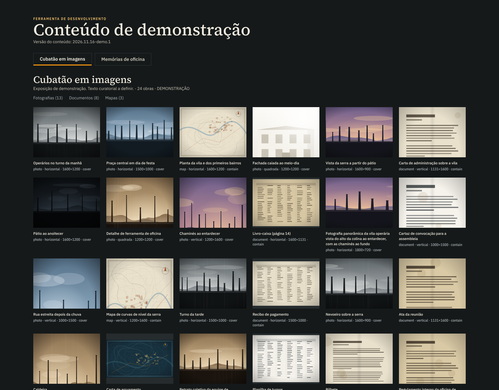
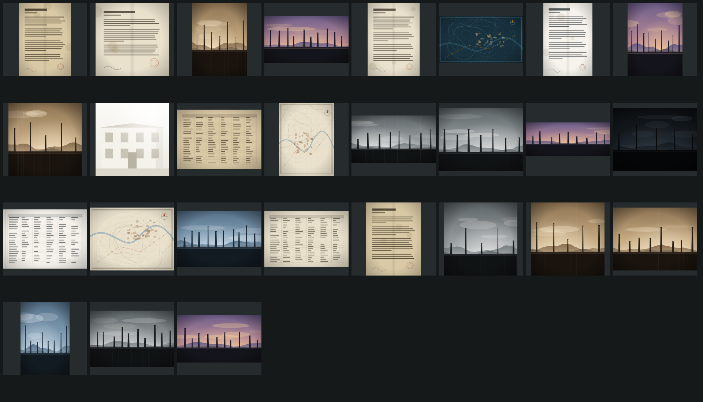

# Etapa 03 — Contratos e dados de demonstração

**Fase:** 1 — Fundação tecnológica · **Data:** 16/11/2026 · **Estado:** Documentada (testada no ambiente do Claude; aguardando implementação e validação local)
**Próxima etapa:** E04 — Mosaico e legenda. **Não será iniciada sem sua aprovação.**

## 1. Objetivo

Entregar os contratos de dados (`@ccc/types`), o repositório assíncrono local (`@ccc/data-access`, com `resolveAssetUrl`) e duas exposições de demonstração (24 e 6 obras, imagens procedurais, rotuladas como demonstração), de modo que o aplicativo **troque de exposição apenas com dados**. Critério do roadmap: duas exposições carregam sem alterar código.

## 2. Pré-requisitos

- E02 aprovada e mesclada na `main` (confirmado por você).
- Windows 11, VS Code, PowerShell; Node 24.21.0, npm 11.19.0, Git 2.55.0.
- Árvore de trabalho limpa (`git status`) antes de aplicar os arquivos.

## 3. Contexto técnico

- **Requisitos que a etapa atende:** ADR-007 (repositório assíncrono, `resolveAssetUrl`, estados de arquivo, manifesto com versão e checksum), ADR-009 (imagens procedurais rotuladas), N-04 (parcial) e N-11 (tipos de obra).
- **Onde ficam os dados:** `apps/espaco-expositivo/public/content/` (`index.json`, `manifest.json`, `<exposição>/exhibition.json`, imagens). São arquivos estáticos publicados com o app.
- **Decisões novas:** ADR-013 (seção 8.1 e `docs/decisoes/`). Principais: validadores à mão, `null` explícito, `alt` obrigatório, `resolveAssetUrl` que nunca lança, SVG procedural determinístico, tipos de evento/equipamento adiados (N-26).
- **Referências visuais usadas:** páginas 38–40 do PDF (catálogo de demonstração, ficha, artista, "sem imagem") para escolher campos e casos de teste. O catálogo do PDF mostra "Todos 24 · Fotografias · Documentos · Mapas"; o demo segue essa estrutura.
- **Não incluído:** componentes visuais (E04+), Firebase, offline real (E13), mídias de vídeo/áudio (N-23), tipos de evento e configuração de equipamento (N-26).

## 4. Dependências

Nenhum pacote externo novo. Entram dois workspaces internos:

| Pacote | Versão | Onde é usado | Motivo |
| --- | --- | --- | --- |
| `@ccc/types` | 0.1.0 (workspace) | `@ccc/data-access`, `@ccc/espaco-expositivo` | Contratos e validadores |
| `@ccc/data-access` | 0.1.0 (workspace) | `@ccc/espaco-expositivo` | Repositório e `resolveAssetUrl` |

`npm audit --omit=dev`: 0 vulnerabilidades.

## 5. Estrutura de diretórios (após a etapa)

```text
ccc-ecossistema/
├── apps/espaco-expositivo/
│   ├── content.html                                (novo, só desenvolvimento)
│   ├── package.json · tsconfig.json                (modificados)
│   ├── public/content/                             (novo: 40 arquivos: 35 SVG, 2 exhibition.json, index, manifest, LICENCAS)
│   │   ├── index.json · manifest.json · LICENCAS.md
│   │   ├── cubatao-em-imagens/  exhibition.json + images/ (27 SVG)
│   │   └── memorias-de-oficina/ exhibition.json + images/ (8 SVG)
│   ├── scripts/demo-content/art.ts · catalog.ts · generate.ts   (novo)
│   └── src/
│       ├── content/demo-content.test.ts            (novo)
│       └── content-inspector/ main.tsx · ContentInspector.tsx/.module.css/.test.tsx   (novo)
├── packages/
│   ├── types/        package.json · tsconfig.json · vitest.config.ts · src/{index,asset,exhibition,work-kinds,validation}.ts · validation.test.ts
│   └── data-access/  package.json · tsconfig.json · vitest.config.ts · src/{index,repository,local-repository}.ts · repository.test.ts
├── docs/decisoes/ADR-013-contratos-e-repositorio-local.md   (novo)
└── (raiz) .prettierignore · package-lock.json       (modificados)
```

## 6. Arquivos

**Novos:** 31 arquivos de código, dados e documentação transcritos na seção 8.1 (conteúdo integral), mais 35 imagens SVG geradas (ver nota abaixo), 2 capturas de tela e este documento. **Modificados:** `apps/espaco-expositivo/package.json`, `apps/espaco-expositivo/tsconfig.json`, `.prettierignore`, `package-lock.json` (regenerado pelo npm; no .zip) e a documentação (`README.md`, `CLAUDE.md`, `docs/arquitetura/estrutura-monorepo.md`, `docs/decisoes/README.md`, `docs/desenvolvimento/progresso.md`, `docs/desenvolvimento/pendencias.md`, no .zip). **Removidos:** nenhum.

**Nota sobre as 35 imagens SVG** (`public/content/*/images/*.svg`, ~675 kB): são **geradas** por `art.ts`/`catalog.ts` e vão no .zip. Não são transcritas aqui porque são saída determinística do script (`npm run content:generate` reproduz os mesmos bytes; `content:check` e o teste de determinismo comprovam). Lista: ata-da-reuniao.svg, bilhete.svg, caldeira.svg, capa.svg, carta-de-administracao-sobre-a-vila.svg, carta-de-arruamento.svg, cartaz-de-convocacao.svg, chamines-ao-entardecer.svg, detalhe-de-ferramenta-de-oficina.svg, fachada-caiada-ao-meio-dia.svg, livro-caixa-pagina-14.svg, mapa-de-curvas-de-nivel-da-serra.svg, nevoeiro-sobre-a-serra.svg, operarios-no-turno-da-manha.svg, panorama-da-vila-operaria.svg, patio-ao-anoitecer.svg, planilha-de-turnos.svg, planta-da-vila-e-dos-primeiros-bairros.svg, praca-central-em-dia-de-festa.svg, recibo-de-pagamento.svg, regulamento-interno-da-oficina.svg, retrato-autoria-a.svg, retrato-autoria-c.svg, retrato-coletivo-da-equipe.svg, rua-estreita-depois-da-chuva.svg, turno-da-tarde.svg, vista-da-serra-a-partir-do-patio.svg, bancada-ao-fim-do-dia.svg, capa.svg, ferramentas-penduradas.svg, ordem-de-servico.svg, planta-da-oficina.svg, registro-de-pecas.svg, retrato-autoria-d.svg, telhado-e-chamine.svg.

## 7. Ordem de implementação (PowerShell, na raiz do repositório)

```powershell
git switch main
git pull
git status                                   # deve estar limpo
git switch -c feat/etapa-03-contratos-dados

# 1) Extraia o .zip da etapa sobre a raiz do repositório, substituindo os arquivos existentes
#    (inclui package-lock.json e as imagens SVG).

# 2) Instale exatamente o que está no lockfile (há dois workspaces novos)
npm ci

# 3) Confirme que os tokens e o conteúdo de demonstração estão em dia
npm run tokens:check -w @ccc/design-tokens
npm run content:check -w @ccc/espaco-expositivo

# 4) Verificação completa
npm run check

# 5) Inspecione o conteúdo no navegador
npm run dev -w @ccc/espaco-expositivo -- --port 5173
# abra http://localhost:5173/content.html (alterne entre as duas exposições)
```

Para regenerar o conteúdo de demonstração: `npm run content:generate -w @ccc/espaco-expositivo`.

## 8. Implementação completa — conteúdo integral dos arquivos

### 8.1. Arquivos novos

### `packages/types/package.json`

```json
{
  "name": "@ccc/types",
  "version": "0.1.0",
  "private": true,
  "type": "module",
  "description": "Contratos de dados e validadores do ecossistema digital do Centro Cultural de Cubatão",
  "exports": {
    ".": "./src/index.ts"
  },
  "scripts": {
    "typecheck": "tsc --noEmit",
    "test": "vitest run"
  }
}
```

### `packages/types/tsconfig.json`

```json
{
  "extends": "../../tsconfig.base.json",
  "include": ["src", "vitest.config.ts"]
}
```

### `packages/types/vitest.config.ts`

```ts
import { defineConfig } from 'vitest/config';

export default defineConfig({
  test: {
    environment: 'node',
    include: ['src/**/*.test.ts'],
  },
});
```

### `packages/types/src/index.ts`

```ts
export type {
  AssetId,
  AssetResolution,
  AssetStatus,
  ContentIndex,
  ContentIndexEntry,
  ContentManifest,
  ManifestAsset,
  UnavailableAssetStatus,
} from './asset.ts';
export type {
  Artwork,
  Category,
  Credit,
  Exhibition,
  ExhibitionAbout,
  FocalPoint,
  ImageFit,
  ImageRef,
  Person,
  Playback,
  WorkKind,
} from './exhibition.ts';
export type { ValidationIssue, ValidationResult } from './validation.ts';
export {
  checkExhibitionIntegrity,
  validateContentIndex,
  validateExhibition,
  validateManifest,
} from './validation.ts';
export { WORK_KINDS } from './work-kinds.ts';
```

### `packages/types/src/asset.ts`

```ts
/** Identificador estável de um arquivo (imagem, vídeo, áudio, legenda). Ex.: `cubatao-em-imagens/obra-01`. */
export type AssetId = string;

/**
 * Estado de um arquivo para quem o consome (ADR-007).
 * - `available`: pronto para uso (há URL).
 * - `offline-unavailable`: o registro existe, mas o arquivo ainda não está neste equipamento.
 * - `failed`: o arquivo devia estar disponível e não pôde ser resolvido.
 * - `unpublished`: existe só na administração; nunca deve ser exibido ao visitante.
 */
export type AssetStatus = 'available' | 'offline-unavailable' | 'failed' | 'unpublished';

export type UnavailableAssetStatus = Exclude<AssetStatus, 'available'>;

export type AssetResolution =
  { status: 'available'; url: string } | { status: UnavailableAssetStatus; reason: string };

/** Entrada do manifesto de conteúdo: descreve um arquivo e permite verificar sua integridade. */
export interface ManifestAsset {
  id: AssetId;
  /** Caminho relativo à raiz do conteúdo (nunca absoluto, nunca com `..`). */
  path: string;
  mimeType: string;
  bytes: number;
  /** SHA-256 em hexadecimal minúsculo (64 caracteres). */
  sha256: string;
  published: boolean;
}

/** Manifesto versionado de uma publicação de conteúdo. */
export interface ContentManifest {
  schemaVersion: 1;
  /** Versão do conteúdo (ex.: `2026.11.16-demo.1`). Muda quando qualquer arquivo ou dado muda. */
  contentVersion: string;
  /** Instante de geração, ISO 8601. */
  generatedAt: string;
  assets: ManifestAsset[];
}

export interface ContentIndexEntry {
  id: string;
  title: string;
  /** Caminho do `exhibition.json`, relativo à raiz do conteúdo. */
  path: string;
}

/** Lista de exposições publicadas em um equipamento. Trocar de exposição = alterar este arquivo e os dados. */
export interface ContentIndex {
  schemaVersion: 1;
  defaultExhibitionId: string;
  exhibitions: ContentIndexEntry[];
}
```

### `packages/types/src/exhibition.ts`

```ts
import type { AssetId } from './asset.ts';

export type ImageFit = 'cover' | 'contain';

/** Ponto focal da imagem, em proporção (0 a 1) da largura e da altura. Usado com `object-position`. */
export interface FocalPoint {
  x: number;
  y: number;
}

/** Referência a uma imagem. O texto alternativo é obrigatório (acessibilidade). */
export interface ImageRef {
  assetId: AssetId;
  width: number;
  height: number;
  alt: string;
  focalPoint?: FocalPoint;
  /** Preferência de enquadramento; ausente = decisão do componente. */
  fit?: ImageFit;
}

/** Tipos de obra/mídia (proposta N-11). `audio` e `video` exigem `playback`. */
export type WorkKind = 'photo' | 'document' | 'map' | 'audio' | 'video';

export interface Playback {
  assetId: AssetId;
  durationSeconds: number;
  captionsAssetId: AssetId | null;
}

export interface Person {
  id: string;
  name: string;
  biography: string;
  /** `null` = sem retrato (estado "sem imagem"). */
  portrait: ImageRef | null;
}

export interface Category {
  id: string;
  label: string;
}

export interface Artwork {
  id: string;
  kind: WorkKind;
  title: string;
  categoryId: string;
  personIds: string[];
  description: string;
  /** Texto livre (ex.: "c. 1950"). `null` = a definir. */
  dateLabel: string | null;
  sourceLabel: string | null;
  creditLabel: string | null;
  /** `null` = sem imagem (estado "sem imagem"). */
  image: ImageRef | null;
  /** Obrigatório para `audio` e `video`; `null` nos demais. */
  playback: Playback | null;
  /** Posição na exposição (0, 1, 2…), usada para ordenar os conjuntos. */
  order: number;
  /** `false` = existe só na administração e não é exibido ao visitante. */
  published: boolean;
}

export interface Credit {
  role: string;
  name: string;
}

export interface ExhibitionAbout {
  paragraphs: string[];
  credits: Credit[];
}

export interface Exhibition {
  schemaVersion: 1;
  id: string;
  title: string;
  subtitle: string | null;
  /** Texto curto da abertura. */
  summary: string;
  /** `true` = conteúdo fictício de demonstração (ADR-009). */
  demo: boolean;
  cover: ImageRef | null;
  about: ExhibitionAbout;
  categories: Category[];
  people: Person[];
  artworks: Artwork[];
}
```

### `packages/types/src/work-kinds.ts`

```ts
import type { WorkKind } from './exhibition.ts';

export const WORK_KINDS: readonly WorkKind[] = ['photo', 'document', 'map', 'audio', 'video'];
```

### `packages/types/src/validation.ts`

```ts
import type {
  AssetId,
  ContentIndex,
  ContentIndexEntry,
  ContentManifest,
  ManifestAsset,
} from './asset.ts';
import type {
  Artwork,
  Category,
  Credit,
  Exhibition,
  ExhibitionAbout,
  FocalPoint,
  ImageFit,
  ImageRef,
  Person,
  Playback,
  WorkKind,
} from './exhibition.ts';
import { WORK_KINDS } from './work-kinds.ts';

/**
 * Validadores de contrato escritos à mão (sem biblioteca): o conjunto de contratos é pequeno e o
 * ganho de uma dependência de validação não compensa agora. Cada validador recebe `unknown`
 * (JSON lido do disco ou da rede) e devolve o valor tipado ou a lista completa de problemas.
 */

export interface ValidationIssue {
  /** Caminho do campo, ex.: `artworks[3].image.width`. */
  path: string;
  message: string;
}

export type ValidationResult<T> = { ok: true; value: T } | { ok: false; issues: ValidationIssue[] };

type JsonObject = Record<string, unknown>;

interface Context {
  issues: ValidationIssue[];
}

const SLUG = /^[a-z0-9]+(?:-[a-z0-9]+)*$/;
const ASSET_ID = /^[a-z0-9]+(?:[a-z0-9_-]*[a-z0-9])?(?:\/[a-z0-9]+(?:[a-z0-9_-]*[a-z0-9])?)*$/;
const SHA256 = /^[0-9a-f]{64}$/;
const ISO_DATE = /^\d{4}-\d{2}-\d{2}T\d{2}:\d{2}:\d{2}(?:\.\d+)?Z$/;

function report(context: Context, path: string, message: string): void {
  context.issues.push({ path, message });
}

function finish<T>(context: Context, value: T): ValidationResult<T> {
  return context.issues.length === 0 ? { ok: true, value } : { ok: false, issues: context.issues };
}

function asObject(context: Context, value: unknown, path: string): JsonObject | null {
  if (typeof value === 'object' && value !== null && !Array.isArray(value)) {
    return value as JsonObject;
  }
  report(context, path, 'deve ser um objeto');
  return null;
}

function readText(context: Context, source: JsonObject, key: string, path: string): string {
  const value = source[key];
  if (typeof value === 'string' && value.trim() !== '') {
    return value;
  }
  report(context, `${path}.${key}`, 'deve ser um texto não vazio');
  return '';
}

/** Texto opcional: `null` é válido; ausente não é (o contrato exige `null` explícito). */
function readNullableText(
  context: Context,
  source: JsonObject,
  key: string,
  path: string,
): string | null {
  const value = source[key];
  if (value === null) {
    return null;
  }
  if (typeof value === 'string' && value.trim() !== '') {
    return value;
  }
  report(context, `${path}.${key}`, 'deve ser um texto não vazio ou null');
  return null;
}

function readSlug(context: Context, source: JsonObject, key: string, path: string): string {
  const value = readText(context, source, key, path);
  if (value !== '' && !SLUG.test(value)) {
    report(context, `${path}.${key}`, 'deve conter apenas minúsculas, números e hífens');
  }
  return value;
}

function readBoolean(context: Context, source: JsonObject, key: string, path: string): boolean {
  const value = source[key];
  if (typeof value === 'boolean') {
    return value;
  }
  report(context, `${path}.${key}`, 'deve ser verdadeiro ou falso');
  return false;
}

function readInteger(
  context: Context,
  source: JsonObject,
  key: string,
  path: string,
  minimum: number,
): number {
  const value = source[key];
  if (typeof value === 'number' && Number.isInteger(value) && value >= minimum) {
    return value;
  }
  report(
    context,
    `${path}.${key}`,
    `deve ser um número inteiro maior ou igual a ${String(minimum)}`,
  );
  return minimum;
}

function readArray(context: Context, source: JsonObject, key: string, path: string): unknown[] {
  const value = source[key];
  if (Array.isArray(value)) {
    return value as unknown[];
  }
  report(context, `${path}.${key}`, 'deve ser uma lista');
  return [];
}

function readAssetId(context: Context, source: JsonObject, key: string, path: string): AssetId {
  const value = readText(context, source, key, path);
  if (value !== '' && !ASSET_ID.test(value)) {
    report(context, `${path}.${key}`, 'identificador de arquivo inválido');
  }
  return value;
}

function checkUnique(context: Context, ids: string[], path: string): void {
  const seen = new Set<string>();
  for (const id of ids) {
    if (id !== '' && seen.has(id)) {
      report(context, path, `identificador duplicado: ${id}`);
    }
    seen.add(id);
  }
}

function readFocalPoint(
  context: Context,
  source: JsonObject,
  path: string,
): FocalPoint | undefined {
  const raw = source['focalPoint'];
  if (raw === undefined) {
    return undefined;
  }
  const point = asObject(context, raw, `${path}.focalPoint`);
  if (!point) {
    return undefined;
  }
  const x = point['x'];
  const y = point['y'];
  const valid = (n: unknown): n is number => typeof n === 'number' && n >= 0 && n <= 1;
  if (!valid(x) || !valid(y)) {
    report(context, `${path}.focalPoint`, 'x e y devem estar entre 0 e 1');
    return undefined;
  }
  return { x, y };
}

function readImage(context: Context, raw: unknown, path: string): ImageRef | null {
  const source = asObject(context, raw, path);
  if (!source) {
    return null;
  }
  const image: ImageRef = {
    assetId: readAssetId(context, source, 'assetId', path),
    width: readInteger(context, source, 'width', path, 1),
    height: readInteger(context, source, 'height', path, 1),
    alt: readText(context, source, 'alt', path),
  };
  const focalPoint = readFocalPoint(context, source, path);
  if (focalPoint) {
    image.focalPoint = focalPoint;
  }
  const fit = source['fit'];
  if (fit !== undefined) {
    if (fit === 'cover' || fit === 'contain') {
      image.fit = fit satisfies ImageFit;
    } else {
      report(context, `${path}.fit`, 'deve ser "cover" ou "contain"');
    }
  }
  return image;
}

function readNullableImage(
  context: Context,
  source: JsonObject,
  key: string,
  path: string,
): ImageRef | null {
  const raw = source[key];
  if (raw === null) {
    return null;
  }
  if (raw === undefined) {
    report(context, `${path}.${key}`, 'campo obrigatório (use null quando não houver imagem)');
    return null;
  }
  return readImage(context, raw, `${path}.${key}`);
}

function readPlayback(
  context: Context,
  source: JsonObject,
  key: string,
  path: string,
): Playback | null {
  const raw = source[key];
  if (raw === null) {
    return null;
  }
  if (raw === undefined) {
    report(context, `${path}.${key}`, 'campo obrigatório (use null quando não houver mídia)');
    return null;
  }
  const playbackPath = `${path}.${key}`;
  const playback = asObject(context, raw, playbackPath);
  if (!playback) {
    return null;
  }
  const duration = playback['durationSeconds'];
  if (typeof duration !== 'number' || !(duration > 0)) {
    report(context, `${playbackPath}.durationSeconds`, 'deve ser um número maior que zero');
  }
  const captions = playback['captionsAssetId'];
  if (captions !== null && typeof captions !== 'string') {
    report(context, `${playbackPath}.captionsAssetId`, 'deve ser um identificador ou null');
  }
  return {
    assetId: readAssetId(context, playback, 'assetId', playbackPath),
    durationSeconds: typeof duration === 'number' ? duration : 0,
    captionsAssetId: typeof captions === 'string' ? captions : null,
  };
}

function readStringList(context: Context, source: JsonObject, key: string, path: string): string[] {
  const items = readArray(context, source, key, path);
  const result: string[] = [];
  items.forEach((item, index) => {
    if (typeof item === 'string' && item.trim() !== '') {
      result.push(item);
    } else {
      report(context, `${path}.${key}[${String(index)}]`, 'deve ser um texto não vazio');
    }
  });
  return result;
}

function readPerson(context: Context, raw: unknown, path: string): Person {
  const source = asObject(context, raw, path) ?? {};
  return {
    id: readSlug(context, source, 'id', path),
    name: readText(context, source, 'name', path),
    biography: readText(context, source, 'biography', path),
    portrait: readNullableImage(context, source, 'portrait', path),
  };
}

function readCategory(context: Context, raw: unknown, path: string): Category {
  const source = asObject(context, raw, path) ?? {};
  return {
    id: readSlug(context, source, 'id', path),
    label: readText(context, source, 'label', path),
  };
}

function readKind(context: Context, source: JsonObject, path: string): WorkKind {
  const value = source['kind'];
  const found = WORK_KINDS.find((kind) => kind === value);
  if (found) {
    return found;
  }
  report(context, `${path}.kind`, `deve ser um destes valores: ${WORK_KINDS.join(', ')}`);
  return 'photo';
}

function readArtwork(context: Context, raw: unknown, path: string): Artwork {
  const source = asObject(context, raw, path) ?? {};
  const kind = readKind(context, source, path);
  const playback = readPlayback(context, source, 'playback', path);
  const needsPlayback = kind === 'audio' || kind === 'video';
  if (needsPlayback && playback === null && source['playback'] === null) {
    report(context, `${path}.playback`, `obras do tipo ${kind} exigem playback`);
  }
  if (!needsPlayback && playback !== null) {
    report(context, `${path}.playback`, `obras do tipo ${kind} não devem ter playback`);
  }
  return {
    id: readSlug(context, source, 'id', path),
    kind,
    title: readText(context, source, 'title', path),
    categoryId: readSlug(context, source, 'categoryId', path),
    personIds: readStringList(context, source, 'personIds', path),
    description: readText(context, source, 'description', path),
    dateLabel: readNullableText(context, source, 'dateLabel', path),
    sourceLabel: readNullableText(context, source, 'sourceLabel', path),
    creditLabel: readNullableText(context, source, 'creditLabel', path),
    image: readNullableImage(context, source, 'image', path),
    playback,
    order: readInteger(context, source, 'order', path, 0),
    published: readBoolean(context, source, 'published', path),
  };
}

function readCredit(context: Context, raw: unknown, path: string): Credit {
  const source = asObject(context, raw, path) ?? {};
  return {
    role: readText(context, source, 'role', path),
    name: readText(context, source, 'name', path),
  };
}

function readAbout(context: Context, raw: unknown, path: string): ExhibitionAbout {
  const source = asObject(context, raw, path) ?? {};
  const paragraphs = readStringList(context, source, 'paragraphs', path);
  const credits = readArray(context, source, 'credits', path).map((item, index) =>
    readCredit(context, item, `${path}.credits[${String(index)}]`),
  );
  return { paragraphs, credits };
}

/** Valida o conteúdo de um `exhibition.json`, inclusive referências internas (categorias e pessoas). */
export function validateExhibition(input: unknown): ValidationResult<Exhibition> {
  const context: Context = { issues: [] };
  const source = asObject(context, input, '$') ?? {};

  if (source['schemaVersion'] !== 1) {
    report(context, '$.schemaVersion', 'versão de esquema não suportada (esperado 1)');
  }

  const categories = readArray(context, source, 'categories', '$').map((item, index) =>
    readCategory(context, item, `$.categories[${String(index)}]`),
  );
  const people = readArray(context, source, 'people', '$').map((item, index) =>
    readPerson(context, item, `$.people[${String(index)}]`),
  );
  const artworks = readArray(context, source, 'artworks', '$').map((item, index) =>
    readArtwork(context, item, `$.artworks[${String(index)}]`),
  );

  checkUnique(
    context,
    categories.map((c) => c.id),
    '$.categories',
  );
  checkUnique(
    context,
    people.map((p) => p.id),
    '$.people',
  );
  checkUnique(
    context,
    artworks.map((a) => a.id),
    '$.artworks',
  );

  const categoryIds = new Set(categories.map((c) => c.id));
  const personIds = new Set(people.map((p) => p.id));
  artworks.forEach((artwork, index) => {
    const path = `$.artworks[${String(index)}]`;
    if (artwork.categoryId !== '' && !categoryIds.has(artwork.categoryId)) {
      report(context, `${path}.categoryId`, `categoria inexistente: ${artwork.categoryId}`);
    }
    for (const personId of artwork.personIds) {
      if (!personIds.has(personId)) {
        report(context, `${path}.personIds`, `pessoa inexistente: ${personId}`);
      }
    }
  });

  const exhibition: Exhibition = {
    schemaVersion: 1,
    id: readSlug(context, source, 'id', '$'),
    title: readText(context, source, 'title', '$'),
    subtitle: readNullableText(context, source, 'subtitle', '$'),
    summary: readText(context, source, 'summary', '$'),
    demo: readBoolean(context, source, 'demo', '$'),
    cover: readNullableImage(context, source, 'cover', '$'),
    about: readAbout(context, source['about'], '$.about'),
    categories,
    people,
    artworks,
  };
  return finish(context, exhibition);
}

function readManifestAsset(context: Context, raw: unknown, path: string): ManifestAsset {
  const source = asObject(context, raw, path) ?? {};
  const assetPath = readText(context, source, 'path', path);
  if (
    assetPath !== '' &&
    (assetPath.startsWith('/') ||
      assetPath.includes('..') ||
      assetPath.includes('\\') ||
      /^[a-z][a-z0-9+.-]*:/i.test(assetPath))
  ) {
    report(
      context,
      `${path}.path`,
      'deve ser um caminho relativo, sem "..", "\\" ou esquema (http:)',
    );
  }
  const sha256 = readText(context, source, 'sha256', path);
  if (sha256 !== '' && !SHA256.test(sha256)) {
    report(context, `${path}.sha256`, 'deve ter 64 caracteres hexadecimais minúsculos');
  }
  return {
    id: readAssetId(context, source, 'id', path),
    path: assetPath,
    mimeType: readText(context, source, 'mimeType', path),
    bytes: readInteger(context, source, 'bytes', path, 0),
    sha256,
    published: readBoolean(context, source, 'published', path),
  };
}

/** Valida o manifesto de conteúdo (versão, data e arquivos com integridade). */
export function validateManifest(input: unknown): ValidationResult<ContentManifest> {
  const context: Context = { issues: [] };
  const source = asObject(context, input, '$') ?? {};
  if (source['schemaVersion'] !== 1) {
    report(context, '$.schemaVersion', 'versão de esquema não suportada (esperado 1)');
  }
  const generatedAt = readText(context, source, 'generatedAt', '$');
  if (generatedAt !== '' && !ISO_DATE.test(generatedAt)) {
    report(
      context,
      '$.generatedAt',
      'deve ser uma data ISO 8601 em UTC (ex.: 2026-11-16T12:00:00Z)',
    );
  }
  const assets = readArray(context, source, 'assets', '$').map((item, index) =>
    readManifestAsset(context, item, `$.assets[${String(index)}]`),
  );
  checkUnique(
    context,
    assets.map((a) => a.id),
    '$.assets',
  );
  checkUnique(
    context,
    assets.map((a) => a.path),
    '$.assets (caminhos)',
  );
  const manifest: ContentManifest = {
    schemaVersion: 1,
    contentVersion: readText(context, source, 'contentVersion', '$'),
    generatedAt,
    assets,
  };
  return finish(context, manifest);
}

/** Valida o índice de exposições publicadas. */
export function validateContentIndex(input: unknown): ValidationResult<ContentIndex> {
  const context: Context = { issues: [] };
  const source = asObject(context, input, '$') ?? {};
  if (source['schemaVersion'] !== 1) {
    report(context, '$.schemaVersion', 'versão de esquema não suportada (esperado 1)');
  }
  const exhibitions = readArray(context, source, 'exhibitions', '$').map(
    (item, index): ContentIndexEntry => {
      const path = `$.exhibitions[${String(index)}]`;
      const entry = asObject(context, item, path) ?? {};
      const entryPath = readText(context, entry, 'path', path);
      if (
        entryPath.startsWith('/') ||
        entryPath.includes('..') ||
        /^[a-z][a-z0-9+.-]*:/i.test(entryPath)
      ) {
        report(
          context,
          `${path}.path`,
          'deve ser um caminho relativo, sem ".." ou esquema (http:)',
        );
      }
      return {
        id: readSlug(context, entry, 'id', path),
        title: readText(context, entry, 'title', path),
        path: entryPath,
      };
    },
  );
  if (exhibitions.length === 0) {
    report(context, '$.exhibitions', 'deve conter ao menos uma exposição');
  }
  checkUnique(
    context,
    exhibitions.map((e) => e.id),
    '$.exhibitions',
  );
  const defaultExhibitionId = readSlug(context, source, 'defaultExhibitionId', '$');
  if (defaultExhibitionId !== '' && !exhibitions.some((e) => e.id === defaultExhibitionId)) {
    report(context, '$.defaultExhibitionId', `exposição inexistente: ${defaultExhibitionId}`);
  }
  const index: ContentIndex = { schemaVersion: 1, defaultExhibitionId, exhibitions };
  return finish(context, index);
}

/**
 * Confere se todos os arquivos referenciados por uma exposição existem no manifesto e têm o tipo
 * de mídia esperado (imagem para `ImageRef`; áudio/vídeo para `playback`).
 */
export function checkExhibitionIntegrity(
  exhibition: Exhibition,
  manifest: ContentManifest,
): ValidationIssue[] {
  const issues: ValidationIssue[] = [];
  const assets = new Map(manifest.assets.map((asset) => [asset.id, asset]));

  const checkReference = (
    assetId: AssetId,
    path: string,
    expected: 'image/' | 'audio/ ou video/' | 'text/',
  ): void => {
    const asset = assets.get(assetId);
    if (!asset) {
      issues.push({ path, message: `arquivo ausente do manifesto: ${assetId}` });
      return;
    }
    const matches =
      expected === 'image/'
        ? asset.mimeType.startsWith('image/')
        : expected === 'text/'
          ? asset.mimeType.startsWith('text/')
          : asset.mimeType.startsWith('audio/') || asset.mimeType.startsWith('video/');
    if (!matches) {
      issues.push({
        path,
        message: `tipo de arquivo inesperado (${asset.mimeType}); esperado ${expected}`,
      });
    }
  };

  if (exhibition.cover) {
    checkReference(exhibition.cover.assetId, '$.cover.assetId', 'image/');
  }
  exhibition.people.forEach((person, index) => {
    if (person.portrait) {
      checkReference(
        person.portrait.assetId,
        `$.people[${String(index)}].portrait.assetId`,
        'image/',
      );
    }
  });
  exhibition.artworks.forEach((artwork, index) => {
    const path = `$.artworks[${String(index)}]`;
    if (artwork.image) {
      checkReference(artwork.image.assetId, `${path}.image.assetId`, 'image/');
    }
    if (artwork.playback) {
      checkReference(artwork.playback.assetId, `${path}.playback.assetId`, 'audio/ ou video/');
      if (artwork.playback.captionsAssetId !== null) {
        checkReference(
          artwork.playback.captionsAssetId,
          `${path}.playback.captionsAssetId`,
          'text/',
        );
      }
    }
  });
  return issues;
}
```

### `packages/types/src/validation.test.ts`

```ts
import { describe, expect, it } from 'vitest';
import type { ContentManifest } from './asset.ts';
import {
  checkExhibitionIntegrity,
  validateContentIndex,
  validateExhibition,
  validateManifest,
} from './validation.ts';

const SHA = 'a'.repeat(64);

function rawExhibition(): Record<string, unknown> {
  return {
    schemaVersion: 1,
    id: 'exposicao-teste',
    title: 'Exposição de teste',
    subtitle: null,
    summary: 'Resumo.',
    demo: true,
    cover: { assetId: 'teste/capa', width: 1600, height: 900, alt: 'Capa' },
    about: { paragraphs: ['Texto.'], credits: [{ role: 'Curadoria', name: 'A definir' }] },
    categories: [{ id: 'fotografias', label: 'Fotografias' }],
    people: [{ id: 'pessoa-a', name: 'Pessoa A', biography: 'Biografia.', portrait: null }],
    artworks: [
      {
        id: 'obra-01',
        kind: 'photo',
        title: 'Obra 1',
        categoryId: 'fotografias',
        personIds: ['pessoa-a'],
        description: 'Descrição.',
        dateLabel: null,
        sourceLabel: null,
        creditLabel: 'Crédito',
        image: {
          assetId: 'teste/obra-01',
          width: 1200,
          height: 800,
          alt: 'Texto alternativo',
          focalPoint: { x: 0.5, y: 0.4 },
          fit: 'cover',
        },
        playback: null,
        order: 0,
        published: true,
      },
    ],
  };
}

function manifest(): ContentManifest {
  const asset = (id: string, mimeType = 'image/svg+xml') => ({
    id,
    path: `${id}.svg`,
    mimeType,
    bytes: 10,
    sha256: SHA,
    published: true,
  });
  return {
    schemaVersion: 1,
    contentVersion: 'teste.1',
    generatedAt: '2026-11-16T12:00:00Z',
    assets: [asset('teste/capa'), asset('teste/obra-01')],
  };
}

function issuesOf(raw: unknown): string[] {
  const result = validateExhibition(raw);
  return result.ok ? [] : result.issues.map((i) => `${i.path}: ${i.message}`);
}

describe('validateExhibition', () => {
  it('aceita uma exposição válida', () => {
    const result = validateExhibition(rawExhibition());
    expect(result.ok).toBe(true);
    if (result.ok) {
      expect(result.value.artworks[0]?.image?.focalPoint).toEqual({ x: 0.5, y: 0.4 });
    }
  });

  it('rejeita entradas que não são objetos', () => {
    expect(issuesOf(null)).toContain('$: deve ser um objeto');
    expect(issuesOf([])).toContain('$: deve ser um objeto');
    expect(issuesOf('texto')).toContain('$: deve ser um objeto');
  });

  it('rejeita versão de esquema desconhecida', () => {
    const raw = { ...rawExhibition(), schemaVersion: 2 };
    expect(issuesOf(raw).join('\n')).toContain('$.schemaVersion');
  });

  it('aponta título ausente e id fora do padrão', () => {
    const raw = { ...rawExhibition(), title: ' ', id: 'Id Inválido' };
    const issues = issuesOf(raw).join('\n');
    expect(issues).toContain('$.title');
    expect(issues).toContain('$.id');
  });

  it('exige null explícito para imagem ausente', () => {
    const raw = rawExhibition();
    const artworks = raw['artworks'] as Record<string, unknown>[];
    delete artworks[0]?.['image'];
    expect(issuesOf(raw).join('\n')).toContain('$.artworks[0].image: campo obrigatório');
  });

  it('aceita obra sem imagem (image: null)', () => {
    const raw = rawExhibition();
    const artworks = raw['artworks'] as Record<string, unknown>[];
    if (artworks[0]) artworks[0]['image'] = null;
    expect(validateExhibition(raw).ok).toBe(true);
  });

  it('exige texto alternativo e dimensões positivas', () => {
    const raw = rawExhibition();
    const artworks = raw['artworks'] as Record<string, unknown>[];
    if (artworks[0]) {
      artworks[0]['image'] = { assetId: 'teste/obra-01', width: 0, height: 800, alt: '' };
    }
    const issues = issuesOf(raw).join('\n');
    expect(issues).toContain('image.width');
    expect(issues).toContain('image.alt');
  });

  it('rejeita ponto focal fora de 0–1 e fit inválido', () => {
    const raw = rawExhibition();
    const artworks = raw['artworks'] as Record<string, unknown>[];
    if (artworks[0]) {
      artworks[0]['image'] = {
        assetId: 'teste/obra-01',
        width: 10,
        height: 10,
        alt: 'a',
        focalPoint: { x: 1.2, y: 0.5 },
        fit: 'fill',
      };
    }
    const issues = issuesOf(raw).join('\n');
    expect(issues).toContain('focalPoint');
    expect(issues).toContain('image.fit');
  });

  it('rejeita tipo de obra desconhecido', () => {
    const raw = rawExhibition();
    const artworks = raw['artworks'] as Record<string, unknown>[];
    if (artworks[0]) artworks[0]['kind'] = 'escultura';
    expect(issuesOf(raw).join('\n')).toContain('$.artworks[0].kind');
  });

  it('exige playback para vídeo e o proíbe para foto', () => {
    const video = rawExhibition();
    const videoWorks = video['artworks'] as Record<string, unknown>[];
    if (videoWorks[0]) videoWorks[0]['kind'] = 'video';
    expect(issuesOf(video).join('\n')).toContain('exigem playback');

    const photo = rawExhibition();
    const photoWorks = photo['artworks'] as Record<string, unknown>[];
    if (photoWorks[0]) {
      photoWorks[0]['playback'] = {
        assetId: 'teste/video',
        durationSeconds: 10,
        captionsAssetId: null,
      };
    }
    expect(issuesOf(photo).join('\n')).toContain('não devem ter playback');
  });

  it('aceita vídeo com playback válido', () => {
    const raw = rawExhibition();
    const artworks = raw['artworks'] as Record<string, unknown>[];
    if (artworks[0]) {
      artworks[0]['kind'] = 'video';
      artworks[0]['playback'] = {
        assetId: 'teste/video',
        durationSeconds: 74,
        captionsAssetId: 'teste/legenda',
      };
    }
    expect(validateExhibition(raw).ok).toBe(true);
  });

  it('rejeita referências a categoria e pessoa inexistentes', () => {
    const raw = rawExhibition();
    const artworks = raw['artworks'] as Record<string, unknown>[];
    if (artworks[0]) {
      artworks[0]['categoryId'] = 'mapas';
      artworks[0]['personIds'] = ['pessoa-x'];
    }
    const issues = issuesOf(raw).join('\n');
    expect(issues).toContain('categoria inexistente: mapas');
    expect(issues).toContain('pessoa inexistente: pessoa-x');
  });

  it('rejeita identificadores duplicados', () => {
    const raw = rawExhibition();
    const artworks = raw['artworks'] as Record<string, unknown>[];
    if (artworks[0]) artworks.push({ ...artworks[0] });
    expect(issuesOf(raw).join('\n')).toContain('identificador duplicado: obra-01');
  });

  it('exige ordem inteira não negativa e flag de publicação', () => {
    const raw = rawExhibition();
    const artworks = raw['artworks'] as Record<string, unknown>[];
    if (artworks[0]) {
      artworks[0]['order'] = -1;
      artworks[0]['published'] = 'sim';
    }
    const issues = issuesOf(raw).join('\n');
    expect(issues).toContain('order');
    expect(issues).toContain('published');
  });

  it('relata todos os problemas de uma vez, com caminho', () => {
    const raw = { ...rawExhibition(), title: '', summary: '' };
    const issues = issuesOf(raw);
    expect(issues.length).toBeGreaterThanOrEqual(2);
  });
});

describe('validateManifest', () => {
  it('aceita um manifesto válido', () => {
    expect(validateManifest(manifest()).ok).toBe(true);
  });

  it('rejeita caminhos absolutos, com ".." ou com esquema', () => {
    for (const path of ['/etc/passwd', '../fora.svg', 'https://exemplo.com/a.svg', 'a\\b.svg']) {
      const m = manifest();
      const first = m.assets[0];
      if (first) first.path = path;
      expect(validateManifest(m).ok, path).toBe(false);
    }
  });

  it('rejeita checksum inválido, data inválida e ids duplicados', () => {
    const m = manifest();
    const [first, second] = m.assets;
    if (first && second) {
      first.sha256 = 'XYZ';
      second.id = first.id;
    }
    m.generatedAt = 'ontem';
    const result = validateManifest(m);
    expect(result.ok).toBe(false);
    if (!result.ok) {
      const text = result.issues.map((i) => i.path).join('\n');
      expect(text).toContain('sha256');
      expect(text).toContain('generatedAt');
      expect(text).toContain('$.assets');
    }
  });
});

describe('validateContentIndex', () => {
  const index = {
    schemaVersion: 1,
    defaultExhibitionId: 'a',
    exhibitions: [
      { id: 'a', title: 'A', path: 'a/exhibition.json' },
      { id: 'b', title: 'B', path: 'b/exhibition.json' },
    ],
  };

  it('aceita um índice válido', () => {
    expect(validateContentIndex(index).ok).toBe(true);
  });

  it('rejeita exposição padrão inexistente e lista vazia', () => {
    expect(validateContentIndex({ ...index, defaultExhibitionId: 'z' }).ok).toBe(false);
    expect(validateContentIndex({ ...index, exhibitions: [] }).ok).toBe(false);
  });

  it('rejeita caminhos que saem da raiz do conteúdo', () => {
    const bad = { ...index, exhibitions: [{ id: 'a', title: 'A', path: '../a.json' }] };
    expect(validateContentIndex(bad).ok).toBe(false);
  });
});

describe('checkExhibitionIntegrity', () => {
  it('não encontra problemas quando todos os arquivos existem', () => {
    const result = validateExhibition(rawExhibition());
    expect(result.ok).toBe(true);
    if (result.ok) {
      expect(checkExhibitionIntegrity(result.value, manifest())).toEqual([]);
    }
  });

  it('aponta arquivo ausente do manifesto e tipo de arquivo inesperado', () => {
    const result = validateExhibition(rawExhibition());
    if (!result.ok) throw new Error('fixture inválida');
    const m = manifest();
    m.assets = m.assets.filter((a) => a.id !== 'teste/capa');
    const second = m.assets[0];
    if (second) second.mimeType = 'video/mp4';
    const text = checkExhibitionIntegrity(result.value, m)
      .map((i) => i.message)
      .join('\n');
    expect(text).toContain('arquivo ausente do manifesto: teste/capa');
    expect(text).toContain('tipo de arquivo inesperado');
  });
});
```

### `packages/data-access/package.json`

```json
{
  "name": "@ccc/data-access",
  "version": "0.1.0",
  "private": true,
  "type": "module",
  "description": "Acesso assíncrono ao conteúdo das exposições (repositório local em JSON; resolução de arquivos)",
  "exports": {
    ".": "./src/index.ts"
  },
  "scripts": {
    "typecheck": "tsc --noEmit",
    "test": "vitest run"
  },
  "dependencies": {
    "@ccc/types": "0.1.0"
  }
}
```

### `packages/data-access/tsconfig.json`

```json
{
  "extends": "../../tsconfig.base.json",
  "include": ["src", "vitest.config.ts"]
}
```

### `packages/data-access/vitest.config.ts`

```ts
import { defineConfig } from 'vitest/config';

export default defineConfig({
  test: {
    environment: 'node',
    include: ['src/**/*.test.ts'],
  },
});
```

### `packages/data-access/src/index.ts`

```ts
export { RepositoryError } from './repository.ts';
export type { ExhibitionRepository, RepositoryErrorCode } from './repository.ts';
export { createLocalRepository } from './local-repository.ts';
export type { JsonFetcher, LocalRepositoryOptions } from './local-repository.ts';
```

### `packages/data-access/src/repository.ts`

```ts
import type {
  AssetId,
  AssetResolution,
  ContentIndex,
  Exhibition,
  ValidationIssue,
} from '@ccc/types';

/**
 * Contrato de acesso ao conteúdo (ADR-007). Os componentes dependem somente desta interface:
 * a implementação local (JSON) pode ser trocada por IndexedDB/Cache Storage ou Firebase sem
 * alterar a apresentação.
 */
export interface ExhibitionRepository {
  /** Exposições publicadas neste equipamento e a exposição padrão. */
  listExhibitions(): Promise<ContentIndex>;
  /** Versão do conteúdo publicado (do manifesto). */
  getContentVersion(): Promise<string>;
  /**
   * Carrega uma exposição validada. Entrega somente obras publicadas, ordenadas por `order`.
   * @throws RepositoryError (`not-found`, `invalid-content` ou `load-failed`).
   */
  loadExhibition(exhibitionId: string): Promise<Exhibition>;
  /** Resolve um arquivo para uma URL utilizável ou para um estado indisponível (nunca lança). */
  resolveAssetUrl(assetId: AssetId): Promise<AssetResolution>;
}

export type RepositoryErrorCode = 'not-found' | 'invalid-content' | 'load-failed';

export class RepositoryError extends Error {
  readonly code: RepositoryErrorCode;
  readonly issues: ValidationIssue[];

  constructor(code: RepositoryErrorCode, message: string, issues: ValidationIssue[] = []) {
    super(message);
    this.name = 'RepositoryError';
    this.code = code;
    this.issues = issues;
  }
}
```

### `packages/data-access/src/local-repository.ts`

```ts
import type {
  AssetId,
  AssetResolution,
  ContentIndex,
  ContentManifest,
  Exhibition,
  ManifestAsset,
  ValidationIssue,
} from '@ccc/types';
import {
  checkExhibitionIntegrity,
  validateContentIndex,
  validateExhibition,
  validateManifest,
} from '@ccc/types';
import { RepositoryError } from './repository.ts';
import type { ExhibitionRepository } from './repository.ts';

/** Lê e interpreta um JSON. Deve lançar erro se a leitura falhar. */
export type JsonFetcher = (url: string) => Promise<unknown>;

export interface LocalRepositoryOptions {
  /** URL (ou caminho) da raiz do conteúdo, ex.: `/content/`. A barra final é opcional. */
  baseUrl: string;
  /** Substitui o `fetch` padrão (testes, outros ambientes). */
  fetchJson?: JsonFetcher;
  /**
   * Informa se o arquivo está disponível neste equipamento. Por padrão todo arquivo publicado é
   * considerado disponível; a camada offline (E13+) fornecerá a implementação real.
   */
  isAssetAvailable?: (asset: ManifestAsset) => boolean | Promise<boolean>;
}

const defaultFetchJson: JsonFetcher = async (url) => {
  const response = await fetch(url);
  if (!response.ok) {
    throw new Error(`HTTP ${String(response.status)} ao ler ${url}`);
  }
  return (await response.json()) as unknown;
};

function normalizeBaseUrl(baseUrl: string): string {
  return baseUrl.endsWith('/') ? baseUrl : `${baseUrl}/`;
}

function describeIssues(issues: ValidationIssue[]): string {
  return issues
    .slice(0, 5)
    .map((issue) => `${issue.path}: ${issue.message}`)
    .join('; ');
}

/** Guarda a promessa enquanto ela é bem-sucedida; uma falha não fica em cache (permite nova tentativa). */
function memoize<T>(load: () => Promise<T>): () => Promise<T> {
  let cached: Promise<T> | null = null;
  return () => {
    cached ??= load().catch((error: unknown) => {
      cached = null;
      throw error;
    });
    return cached;
  };
}

/**
 * Repositório que lê `index.json`, `manifest.json` e os `exhibition.json` a partir de uma raiz de
 * conteúdo local (pasta publicada junto ao aplicativo). Não conhece Firebase, IndexedDB nem React.
 */
export function createLocalRepository(options: LocalRepositoryOptions): ExhibitionRepository {
  const baseUrl = normalizeBaseUrl(options.baseUrl);
  const fetchJson = options.fetchJson ?? defaultFetchJson;
  const isAssetAvailable = options.isAssetAvailable ?? (() => true);
  const exhibitions = new Map<string, Promise<Exhibition>>();

  const read = async (relativePath: string, what: string): Promise<unknown> => {
    try {
      return await fetchJson(`${baseUrl}${relativePath}`);
    } catch (error) {
      const detail = error instanceof Error ? error.message : String(error);
      throw new RepositoryError('load-failed', `Não foi possível ler ${what}: ${detail}`);
    }
  };

  const getIndex = memoize(async (): Promise<ContentIndex> => {
    const result = validateContentIndex(await read('index.json', 'o índice de exposições'));
    if (!result.ok) {
      throw new RepositoryError(
        'invalid-content',
        `Índice de exposições inválido: ${describeIssues(result.issues)}`,
        result.issues,
      );
    }
    return result.value;
  });

  const getManifest = memoize(async (): Promise<ContentManifest> => {
    const result = validateManifest(await read('manifest.json', 'o manifesto de conteúdo'));
    if (!result.ok) {
      throw new RepositoryError(
        'invalid-content',
        `Manifesto inválido: ${describeIssues(result.issues)}`,
        result.issues,
      );
    }
    return result.value;
  });

  const fetchExhibition = async (exhibitionId: string): Promise<Exhibition> => {
    const index = await getIndex();
    const entry = index.exhibitions.find((candidate) => candidate.id === exhibitionId);
    if (!entry) {
      throw new RepositoryError('not-found', `Exposição não encontrada: ${exhibitionId}`);
    }
    const validated = validateExhibition(await read(entry.path, `a exposição ${exhibitionId}`));
    if (!validated.ok) {
      throw new RepositoryError(
        'invalid-content',
        `Exposição ${exhibitionId} inválida: ${describeIssues(validated.issues)}`,
        validated.issues,
      );
    }
    const exhibition = validated.value;
    if (exhibition.id !== entry.id) {
      throw new RepositoryError(
        'invalid-content',
        `O índice aponta ${entry.id}, mas o arquivo declara ${exhibition.id}.`,
      );
    }
    const integrity = checkExhibitionIntegrity(exhibition, await getManifest());
    if (integrity.length > 0) {
      throw new RepositoryError(
        'invalid-content',
        `Exposição ${exhibitionId} com referências inválidas: ${describeIssues(integrity)}`,
        integrity,
      );
    }
    const artworks = exhibition.artworks
      .filter((artwork) => artwork.published)
      .sort((a, b) => a.order - b.order || a.id.localeCompare(b.id));
    return { ...exhibition, artworks };
  };

  return {
    listExhibitions: getIndex,

    async getContentVersion() {
      return (await getManifest()).contentVersion;
    },

    loadExhibition(exhibitionId) {
      let pending = exhibitions.get(exhibitionId);
      if (!pending) {
        pending = fetchExhibition(exhibitionId).catch((error: unknown) => {
          exhibitions.delete(exhibitionId);
          throw error;
        });
        exhibitions.set(exhibitionId, pending);
      }
      return pending;
    },

    async resolveAssetUrl(assetId: AssetId): Promise<AssetResolution> {
      let manifest: ContentManifest;
      try {
        manifest = await getManifest();
      } catch {
        return { status: 'failed', reason: 'manifesto de conteúdo indisponível' };
      }
      const asset = manifest.assets.find((candidate) => candidate.id === assetId);
      if (!asset) {
        return { status: 'failed', reason: 'arquivo não consta no manifesto' };
      }
      if (!asset.published) {
        return { status: 'unpublished', reason: 'arquivo ainda não publicado' };
      }
      if (!(await isAssetAvailable(asset))) {
        return {
          status: 'offline-unavailable',
          reason: 'arquivo ainda não está neste equipamento',
        };
      }
      return { status: 'available', url: `${baseUrl}${encodeURI(asset.path)}` };
    },
  };
}
```

### `packages/data-access/src/repository.test.ts`

```ts
import { describe, expect, it, vi } from 'vitest';
import type { ContentManifest, Exhibition } from '@ccc/types';
import { RepositoryError, createLocalRepository } from './index.ts';
import type { JsonFetcher } from './index.ts';

const SHA = 'b'.repeat(64);

type RawArtwork = Record<string, unknown>;

function buildExhibition(id: string, workCount: number, overrides: Partial<RawArtwork>[] = []) {
  const artworks: RawArtwork[] = Array.from({ length: workCount }, (_, i) => ({
    id: `obra-${String(i + 1).padStart(2, '0')}`,
    kind: 'photo',
    title: `Obra ${String(i + 1)}`,
    categoryId: 'fotografias',
    personIds: [],
    description: 'Descrição.',
    dateLabel: null,
    sourceLabel: null,
    creditLabel: null,
    image: {
      assetId: `${id}/obra-${String(i + 1).padStart(2, '0')}`,
      width: 1200,
      height: 800,
      alt: 'Texto alternativo',
    },
    playback: null,
    order: i,
    published: true,
    ...overrides[i],
  }));
  return {
    schemaVersion: 1,
    id,
    title: `Exposição ${id}`,
    subtitle: null,
    summary: 'Resumo.',
    demo: true,
    cover: null,
    about: { paragraphs: ['Texto.'], credits: [] },
    categories: [{ id: 'fotografias', label: 'Fotografias' }],
    people: [],
    artworks,
  };
}

function buildManifest(ids: string[], extra: Partial<ContentManifest['assets'][number]>[] = []) {
  return {
    schemaVersion: 1,
    contentVersion: '2026.11.16-teste.1',
    generatedAt: '2026-11-16T12:00:00Z',
    assets: ids.map((id, i) => ({
      id,
      path: `${id}.svg`,
      mimeType: 'image/svg+xml',
      bytes: 100,
      sha256: SHA,
      published: true,
      ...extra[i],
    })),
  };
}

function assetIds(exhibitionId: string, count: number): string[] {
  return Array.from(
    { length: count },
    (_, i) => `${exhibitionId}/obra-${String(i + 1).padStart(2, '0')}`,
  );
}

function memoryFetcher(files: Record<string, unknown>): JsonFetcher & ReturnType<typeof vi.fn> {
  return vi.fn((url: string) => {
    if (url in files) return Promise.resolve(files[url]);
    return Promise.reject(new Error(`HTTP 404 ao ler ${url}`));
  });
}

function standardFiles(): Record<string, unknown> {
  return {
    '/content/index.json': {
      schemaVersion: 1,
      defaultExhibitionId: 'um',
      exhibitions: [
        { id: 'um', title: 'Um', path: 'um/exhibition.json' },
        { id: 'tres', title: 'Três', path: 'tres/exhibition.json' },
        { id: 'oito', title: 'Oito', path: 'oito/exhibition.json' },
      ],
    },
    '/content/manifest.json': buildManifest([
      ...assetIds('um', 1),
      ...assetIds('tres', 3),
      ...assetIds('oito', 8),
    ]),
    '/content/um/exhibition.json': buildExhibition('um', 1),
    '/content/tres/exhibition.json': buildExhibition('tres', 3),
    '/content/oito/exhibition.json': buildExhibition('oito', 8),
  };
}

describe('createLocalRepository — carregamento', () => {
  it('lista as exposições e informa a padrão', async () => {
    const repository = createLocalRepository({
      baseUrl: '/content/',
      fetchJson: memoryFetcher(standardFiles()),
    });

    const index = await repository.listExhibitions();

    expect(index.defaultExhibitionId).toBe('um');
    expect(index.exhibitions.map((e) => e.id)).toEqual(['um', 'tres', 'oito']);
  });

  it('carrega exposições com 1, 3 e 8 obras sem alterar código (apenas dados)', async () => {
    const repository = createLocalRepository({
      baseUrl: '/content',
      fetchJson: memoryFetcher(standardFiles()),
    });

    const counts: Record<string, number> = {};
    for (const entry of (await repository.listExhibitions()).exhibitions) {
      const exhibition: Exhibition = await repository.loadExhibition(entry.id);
      counts[entry.id] = exhibition.artworks.length;
    }

    expect(counts).toEqual({ um: 1, tres: 3, oito: 8 });
  });

  it('aceita baseUrl com ou sem barra final', async () => {
    const files = standardFiles();
    for (const baseUrl of ['/content', '/content/']) {
      const repository = createLocalRepository({ baseUrl, fetchJson: memoryFetcher(files) });
      await expect(repository.getContentVersion()).resolves.toBe('2026.11.16-teste.1');
    }
  });

  it('entrega apenas obras publicadas, ordenadas por order', async () => {
    const files = standardFiles();
    files['/content/tres/exhibition.json'] = buildExhibition('tres', 3, [
      { order: 2 },
      { published: false },
      { order: 0 },
    ]);
    const repository = createLocalRepository({
      baseUrl: '/content/',
      fetchJson: memoryFetcher(files),
    });

    const exhibition = await repository.loadExhibition('tres');

    expect(exhibition.artworks.map((a) => a.id)).toEqual(['obra-03', 'obra-01']);
  });

  it('usa o identificador como desempate na ordenação', async () => {
    const files = standardFiles();
    files['/content/tres/exhibition.json'] = buildExhibition('tres', 3, [
      { order: 1 },
      { order: 1 },
      { order: 0 },
    ]);
    const repository = createLocalRepository({
      baseUrl: '/content/',
      fetchJson: memoryFetcher(files),
    });

    const exhibition = await repository.loadExhibition('tres');

    expect(exhibition.artworks.map((a) => a.id)).toEqual(['obra-03', 'obra-01', 'obra-02']);
  });

  it('reaproveita índice, manifesto e exposições já lidos', async () => {
    const fetchJson = memoryFetcher(standardFiles());
    const repository = createLocalRepository({ baseUrl: '/content/', fetchJson });

    await repository.loadExhibition('um');
    await repository.loadExhibition('um');
    await repository.listExhibitions();
    await repository.getContentVersion();

    const urls = fetchJson.mock.calls.map((call) => call[0] as string);
    expect(urls.sort()).toEqual([
      '/content/index.json',
      '/content/manifest.json',
      '/content/um/exhibition.json',
    ]);
  });
});

describe('createLocalRepository — erros', () => {
  it('lança not-found para exposição fora do índice', async () => {
    const repository = createLocalRepository({
      baseUrl: '/content/',
      fetchJson: memoryFetcher(standardFiles()),
    });

    await expect(repository.loadExhibition('inexistente')).rejects.toMatchObject({
      name: 'RepositoryError',
      code: 'not-found',
    });
  });

  it('lança load-failed quando o arquivo não pode ser lido e permite nova tentativa', async () => {
    const files = standardFiles();
    const missing = files['/content/um/exhibition.json'];
    delete files['/content/um/exhibition.json'];
    const repository = createLocalRepository({
      baseUrl: '/content/',
      fetchJson: memoryFetcher(files),
    });

    await expect(repository.loadExhibition('um')).rejects.toMatchObject({ code: 'load-failed' });

    files['/content/um/exhibition.json'] = missing;
    await expect(repository.loadExhibition('um')).resolves.toMatchObject({ id: 'um' });
  });

  it('lança invalid-content com a lista de problemas', async () => {
    const files = standardFiles();
    files['/content/um/exhibition.json'] = { ...buildExhibition('um', 1), title: '' };
    const repository = createLocalRepository({
      baseUrl: '/content/',
      fetchJson: memoryFetcher(files),
    });

    const error = await repository.loadExhibition('um').catch((e: unknown) => e);

    expect(error).toBeInstanceOf(RepositoryError);
    expect((error as RepositoryError).code).toBe('invalid-content');
    expect((error as RepositoryError).issues.map((i) => i.path)).toContain('$.title');
  });

  it('lança invalid-content quando o arquivo referenciado não está no manifesto', async () => {
    const files = standardFiles();
    files['/content/manifest.json'] = buildManifest(
      assetIds('tres', 3).concat(assetIds('oito', 8)),
    );
    const repository = createLocalRepository({
      baseUrl: '/content/',
      fetchJson: memoryFetcher(files),
    });

    await expect(repository.loadExhibition('um')).rejects.toMatchObject({
      code: 'invalid-content',
    });
  });

  it('lança invalid-content quando o id do arquivo difere do índice', async () => {
    const files = standardFiles();
    files['/content/um/exhibition.json'] = buildExhibition('outra', 1);
    const repository = createLocalRepository({
      baseUrl: '/content/',
      fetchJson: memoryFetcher(files),
    });

    await expect(repository.loadExhibition('um')).rejects.toMatchObject({
      code: 'invalid-content',
    });
  });

  it('lança invalid-content para índice e manifesto malformados', async () => {
    const files = standardFiles();
    files['/content/index.json'] = { schemaVersion: 1, defaultExhibitionId: 'x', exhibitions: [] };
    const repository = createLocalRepository({
      baseUrl: '/content/',
      fetchJson: memoryFetcher(files),
    });
    await expect(repository.listExhibitions()).rejects.toMatchObject({ code: 'invalid-content' });

    const files2 = standardFiles();
    files2['/content/manifest.json'] = { schemaVersion: 1 };
    const repository2 = createLocalRepository({
      baseUrl: '/content/',
      fetchJson: memoryFetcher(files2),
    });
    await expect(repository2.getContentVersion()).rejects.toMatchObject({
      code: 'invalid-content',
    });
  });
});

describe('createLocalRepository — resolveAssetUrl', () => {
  it('devolve a URL de um arquivo disponível', async () => {
    const repository = createLocalRepository({
      baseUrl: '/content',
      fetchJson: memoryFetcher(standardFiles()),
    });

    await expect(repository.resolveAssetUrl('um/obra-01')).resolves.toEqual({
      status: 'available',
      url: '/content/um/obra-01.svg',
    });
  });

  it('informa failed para arquivo desconhecido', async () => {
    const repository = createLocalRepository({
      baseUrl: '/content/',
      fetchJson: memoryFetcher(standardFiles()),
    });

    await expect(repository.resolveAssetUrl('nao/existe')).resolves.toMatchObject({
      status: 'failed',
    });
  });

  it('informa failed (sem lançar) quando o manifesto não pode ser lido', async () => {
    const files = standardFiles();
    delete files['/content/manifest.json'];
    const repository = createLocalRepository({
      baseUrl: '/content/',
      fetchJson: memoryFetcher(files),
    });

    await expect(repository.resolveAssetUrl('um/obra-01')).resolves.toMatchObject({
      status: 'failed',
    });
  });

  it('informa unpublished para arquivo não publicado', async () => {
    const files = standardFiles();
    files['/content/manifest.json'] = buildManifest(
      [...assetIds('um', 1), ...assetIds('tres', 3), ...assetIds('oito', 8)],
      [{ published: false }],
    );
    const repository = createLocalRepository({
      baseUrl: '/content/',
      fetchJson: memoryFetcher(files),
    });

    await expect(repository.resolveAssetUrl('um/obra-01')).resolves.toMatchObject({
      status: 'unpublished',
    });
  });

  it('informa offline-unavailable quando o equipamento ainda não tem o arquivo', async () => {
    const repository = createLocalRepository({
      baseUrl: '/content/',
      fetchJson: memoryFetcher(standardFiles()),
      isAssetAvailable: (asset) => asset.id !== 'um/obra-01',
    });

    await expect(repository.resolveAssetUrl('um/obra-01')).resolves.toMatchObject({
      status: 'offline-unavailable',
    });
    await expect(repository.resolveAssetUrl('tres/obra-01')).resolves.toMatchObject({
      status: 'available',
    });
  });

  it('aceita disponibilidade assíncrona', async () => {
    const repository = createLocalRepository({
      baseUrl: '/content/',
      fetchJson: memoryFetcher(standardFiles()),
      isAssetAvailable: () => Promise.resolve(false),
    });

    await expect(repository.resolveAssetUrl('um/obra-01')).resolves.toMatchObject({
      status: 'offline-unavailable',
    });
  });
});
```

### `apps/espaco-expositivo/scripts/demo-content/art.ts`

```ts
/**
 * Imagens procedurais de demonstração (ADR-009): SVG determinístico gerado a partir de uma semente.
 * Sem filtros SVG (rápido em tablets), sem texto, sem material de terceiros. Mesma entrada = mesmo arquivo.
 */

export type Motif = 'skyline' | 'facade' | 'letter' | 'ledger' | 'map';

export type Palette =
  'dusk' | 'mist' | 'blue' | 'night' | 'sepia' | 'paper' | 'aged' | 'clean' | 'blueprint';

export interface ArtSpec {
  motif: Motif;
  palette: Palette;
  width: number;
  height: number;
  seed: number;
}

type Random = () => number;

/** Gerador pseudoaleatório determinístico (mulberry32). */
function createRandom(seed: number): Random {
  let state = seed >>> 0;
  return () => {
    state = (state + 0x6d2b79f5) >>> 0;
    let t = state;
    t = Math.imul(t ^ (t >>> 15), t | 1);
    t ^= t + Math.imul(t ^ (t >>> 7), t | 61);
    return ((t ^ (t >>> 14)) >>> 0) / 4294967296;
  };
}

/** Arredonda para uma casa decimal e devolve texto curto. */
function n(value: number): string {
  return String(Math.round(value * 10) / 10);
}

function between(random: Random, min: number, max: number): number {
  return min + random() * (max - min);
}

interface SkyPalette {
  sky: [string, string, string];
  far: string;
  near: string;
  ink: string;
  ground: string;
  glow: string;
}

const SKY: Record<'dusk' | 'mist' | 'blue' | 'night' | 'sepia', SkyPalette> = {
  dusk: {
    sky: ['#E9A46A', '#B98A93', '#6F5F8C'],
    far: '#6B5E86',
    near: '#3F3A52',
    ink: '#1F1D2B',
    ground: '#14141C',
    glow: '#FFD9A0',
  },
  mist: {
    sky: ['#D8D8D6', '#9AA0A2', '#5C6366'],
    far: '#7C8386',
    near: '#4A5154',
    ink: '#1B1F21',
    ground: '#101314',
    glow: '#F2F2F0',
  },
  blue: {
    sky: ['#C7D8E4', '#8AA6BC', '#56728A'],
    far: '#5F7C93',
    near: '#3A5266',
    ink: '#1E2B36',
    ground: '#121B22',
    glow: '#EAF2F8',
  },
  night: {
    sky: ['#26303A', '#161C22', '#0C0F12'],
    far: '#161C22',
    near: '#0F1317',
    ink: '#07090B',
    ground: '#050607',
    glow: '#3A4650',
  },
  sepia: {
    sky: ['#EADCC0', '#C9AE86', '#8E7352'],
    far: '#8E7352',
    near: '#5E4B35',
    ink: '#2B2118',
    ground: '#1B140E',
    glow: '#FFF1D6',
  },
};

interface PaperPalette {
  bg: string;
  ink: string;
  accent: string;
  line: string;
  water: string;
}

const PAPER: Record<'paper' | 'aged' | 'clean' | 'blueprint', PaperPalette> = {
  paper: { bg: '#E9E1CC', ink: '#4A4034', accent: '#B5532B', line: '#6B5E45', water: '#8FA9B5' },
  aged: { bg: '#D9C9A5', ink: '#3E3426', accent: '#8E3B22', line: '#6A5A3C', water: '#8C9FA6' },
  clean: { bg: '#F6F3EC', ink: '#3A3F42', accent: '#9E3D22', line: '#7C8386', water: '#9DB4BE' },
  blueprint: {
    bg: '#17303D',
    ink: '#8CB8C9',
    accent: '#F5960E',
    line: '#8CB8C9',
    water: '#2D5566',
  },
};

function skyPalette(palette: Palette): SkyPalette {
  if (
    palette === 'dusk' ||
    palette === 'mist' ||
    palette === 'blue' ||
    palette === 'night' ||
    palette === 'sepia'
  ) {
    return SKY[palette];
  }
  return SKY.mist;
}

function paperPalette(palette: Palette): PaperPalette {
  if (palette === 'paper' || palette === 'aged' || palette === 'clean' || palette === 'blueprint') {
    return PAPER[palette];
  }
  return PAPER.paper;
}

function grain(random: Random, width: number, height: number, count: number): string {
  const cells: string[] = [];
  for (let i = 0; i < count; i += 1) {
    const color = random() < 0.5 ? '#000' : '#fff';
    const x = n(random() * width);
    const y = n(random() * height);
    const opacity = String(Math.round(between(random, 4, 13)) / 100);
    cells.push(
      `<rect x="${x}" y="${y}" width="2" height="2" fill="${color}" opacity="${opacity}"/>`,
    );
  }
  return cells.join('');
}

function vignette(id: string, strength: number): string {
  return `<radialGradient id="${id}" cx="50%" cy="50%" r="75%"><stop offset="55%" stop-color="#000" stop-opacity="0"/><stop offset="100%" stop-color="#000" stop-opacity="${String(strength)}"/></radialGradient>`;
}

function ridge(
  random: Random,
  width: number,
  baseY: number,
  amplitude: number,
  bottom: number,
): string {
  const steps = 24;
  const phaseA = random() * Math.PI * 2;
  const phaseB = random() * Math.PI * 2;
  const points: string[] = [`0,${n(bottom)}`];
  for (let i = 0; i <= steps; i += 1) {
    const x = (width * i) / steps;
    const y =
      baseY +
      Math.sin((i / steps) * Math.PI * 2 * 1.3 + phaseA) * amplitude +
      Math.sin((i / steps) * Math.PI * 2 * 3.1 + phaseB) * amplitude * 0.45 +
      (random() - 0.5) * amplitude * 0.35;
    points.push(`${n(x)},${n(y)}`);
  }
  points.push(`${n(width)},${n(bottom)}`);
  return points.join(' ');
}

function skyline(spec: ArtSpec, random: Random): string {
  const { width, height } = spec;
  const p = skyPalette(spec.palette);
  const horizon = height * between(random, 0.64, 0.72);
  const parts: string[] = [];

  parts.push(
    `<defs><linearGradient id="sky" x1="0" y1="0" x2="0" y2="1"><stop offset="0" stop-color="${p.sky[2]}"/><stop offset="0.55" stop-color="${p.sky[1]}"/><stop offset="1" stop-color="${p.sky[0]}"/></linearGradient>` +
      `<radialGradient id="glow" cx="${n(between(random, 0.3, 0.7))}" cy="0.78" r="0.55"><stop offset="0" stop-color="${p.glow}" stop-opacity="0.75"/><stop offset="1" stop-color="${p.glow}" stop-opacity="0"/></radialGradient>` +
      `<linearGradient id="haze" x1="0" y1="0" x2="0" y2="1"><stop offset="0" stop-color="${p.glow}" stop-opacity="0"/><stop offset="0.6" stop-color="${p.glow}" stop-opacity="0.32"/><stop offset="1" stop-color="${p.glow}" stop-opacity="0"/></linearGradient>` +
      vignette('vig', 0.5) +
      `</defs>`,
  );
  parts.push(`<rect width="${String(width)}" height="${String(height)}" fill="url(#sky)"/>`);
  parts.push(`<rect width="${String(width)}" height="${String(height)}" fill="url(#glow)"/>`);

  const clouds = 3 + Math.floor(random() * 3);
  for (let i = 0; i < clouds; i += 1) {
    parts.push(
      `<ellipse cx="${n(random() * width)}" cy="${n(height * between(random, 0.12, 0.5))}" rx="${n(width * between(random, 0.12, 0.3))}" ry="${n(height * between(random, 0.025, 0.06))}" fill="${p.glow}" opacity="${n(between(random, 0.12, 0.3))}"/>`,
    );
  }

  parts.push(
    `<polygon points="${ridge(random, width, horizon - height * 0.07, height * 0.035, horizon + 4)}" fill="${p.far}"/>`,
  );
  parts.push(
    `<polygon points="${ridge(random, width, horizon - height * 0.015, height * 0.02, horizon + 4)}" fill="${p.near}"/>`,
  );
  parts.push(
    `<rect y="${n(horizon - height * 0.1)}" width="${String(width)}" height="${n(height * 0.2)}" fill="url(#haze)"/>`,
  );

  const count = 5 + Math.floor(random() * 6);
  for (let i = 0; i < count; i += 1) {
    const x =
      width * (0.07 + (0.86 * i) / (count - 1)) + between(random, -width * 0.02, width * 0.02);
    const w = width * between(random, 0.012, 0.026);
    const top = horizon - height * between(random, 0.14, 0.4);
    const base = horizon + 6;
    parts.push(
      `<polygon points="${n(x)},${n(base)} ${n(x + w)},${n(base)} ${n(x + w * 0.82)},${n(top)} ${n(x + w * 0.18)},${n(top)}" fill="${p.ink}"/>`,
    );
    parts.push(
      `<rect x="${n(x + w * 0.08)}" y="${n(top - height * 0.012)}" width="${n(w * 0.84)}" height="${n(height * 0.012)}" fill="${p.ink}"/>`,
    );
  }

  parts.push(
    `<rect y="${n(horizon + height * 0.025)}" width="${String(width)}" height="${n(height - horizon - height * 0.025)}" fill="${p.ground}"/>`,
  );
  parts.push(
    `<rect y="${n(horizon)}" width="${String(width)}" height="${n(height * 0.025)}" fill="${p.ink}"/>`,
  );

  if (spec.palette === 'mist' || spec.palette === 'sepia') {
    for (let i = 0; i < 14; i += 1) {
      const x = random() * width;
      parts.push(
        `<rect x="${n(x)}" width="${n(between(random, 1, 3))}" height="${String(height)}" fill="#fff" opacity="${n(between(random, 0.05, 0.16))}"/>`,
      );
    }
  }
  parts.push(grain(random, width, height, 220));
  parts.push(`<rect width="${String(width)}" height="${String(height)}" fill="url(#vig)"/>`);
  return parts.join('');
}

function facade(spec: ArtSpec, random: Random): string {
  const { width, height } = spec;
  const parts: string[] = [];
  parts.push(
    `<defs><linearGradient id="sky" x1="0" y1="0" x2="0" y2="1"><stop offset="0" stop-color="#FBFAF6"/><stop offset="1" stop-color="#ECE9E0"/></linearGradient>` +
      `<radialGradient id="glare" cx="0.75" cy="0.15" r="0.6"><stop offset="0" stop-color="#fff" stop-opacity="0.9"/><stop offset="1" stop-color="#fff" stop-opacity="0"/></radialGradient></defs>`,
  );
  parts.push(`<rect width="${String(width)}" height="${String(height)}" fill="url(#sky)"/>`);
  const left = width * 0.08;
  const right = width * 0.92;
  const roofY = height * 0.28;
  const wallTop = height * 0.34;
  const ground = height * 0.9;
  parts.push(
    `<polygon points="${n(left - width * 0.02)},${n(wallTop)} ${n(width / 2)},${n(roofY)} ${n(right + width * 0.02)},${n(wallTop)}" fill="#D2CCBF"/>`,
  );
  parts.push(
    `<rect x="${n(left)}" y="${n(wallTop)}" width="${n(right - left)}" height="${n(ground - wallTop)}" fill="#F5F2EB"/>`,
  );
  parts.push(
    `<rect x="${n(right - width * 0.1)}" y="${n(wallTop)}" width="${n(width * 0.1)}" height="${n(ground - wallTop)}" fill="#000" opacity="0.05"/>`,
  );
  const cols = 4;
  const rows = 2;
  for (let r = 0; r < rows; r += 1) {
    for (let c = 0; c < cols; c += 1) {
      const w = width * 0.1;
      const h = height * 0.13;
      const x = left + (right - left) * ((c + 0.5) / cols) - w / 2;
      const y = wallTop + height * 0.07 + r * height * 0.22;
      parts.push(
        `<rect x="${n(x - 5)}" y="${n(y - 5)}" width="${n(w + 10)}" height="${n(h + 10)}" fill="#E4DFD2"/>`,
      );
      parts.push(`<rect x="${n(x)}" y="${n(y)}" width="${n(w)}" height="${n(h)}" fill="#C9C4B6"/>`);
    }
  }
  const doorW = width * 0.12;
  parts.push(
    `<rect x="${n(width / 2 - doorW / 2)}" y="${n(ground - height * 0.22)}" width="${n(doorW)}" height="${n(height * 0.22)}" fill="#B9B3A3"/>`,
  );
  parts.push(
    `<rect y="${n(ground)}" width="${String(width)}" height="${n(height - ground)}" fill="#DDD8CC"/>`,
  );
  parts.push(`<rect width="${String(width)}" height="${String(height)}" fill="url(#glare)"/>`);
  parts.push(grain(random, width, height, 90));
  return parts.join('');
}

function textLines(
  random: Random,
  p: PaperPalette,
  x: number,
  y: number,
  w: number,
  lineHeight: number,
  lines: number,
): string {
  const rows: string[] = [];
  let paragraphLeft = 4 + Math.floor(random() * 4);
  for (let i = 0; i < lines; i += 1) {
    paragraphLeft -= 1;
    const last = paragraphLeft === 0;
    const share = last ? between(random, 0.3, 0.6) : between(random, 0.86, 1);
    rows.push(
      `<rect x="${n(x)}" y="${n(y + i * lineHeight)}" width="${n(w * share)}" height="${n(lineHeight * 0.42)}" fill="${p.ink}" opacity="${n(between(random, 0.5, 0.78))}"/>`,
    );
    if (last) {
      paragraphLeft = 4 + Math.floor(random() * 4);
      i += 1;
    }
  }
  return rows.join('');
}

function letter(spec: ArtSpec, random: Random): string {
  const { width, height } = spec;
  const p = paperPalette(spec.palette);
  const parts: string[] = [];
  parts.push(
    `<defs>${vignette('age', 0.28)}<linearGradient id="fold" x1="0" y1="0" x2="1" y2="0"><stop offset="0" stop-color="#000" stop-opacity="0"/><stop offset="0.5" stop-color="#000" stop-opacity="0.07"/><stop offset="1" stop-color="#000" stop-opacity="0"/></linearGradient></defs>`,
  );
  parts.push(`<rect width="${String(width)}" height="${String(height)}" fill="${p.bg}"/>`);
  const margin = Math.min(width, height) * 0.11;
  const textWidth = width - margin * 2;
  parts.push(
    `<rect x="${n(margin)}" y="${n(margin)}" width="${n(textWidth * 0.55)}" height="${n(height * 0.03)}" fill="${p.ink}" opacity="0.85"/>`,
  );
  parts.push(
    `<rect x="${n(margin)}" y="${n(margin + height * 0.05)}" width="${n(textWidth * 0.3)}" height="${n(height * 0.014)}" fill="${p.ink}" opacity="0.6"/>`,
  );
  const lineHeight = height * 0.027;
  const lines = Math.floor((height - margin * 3.2 - height * 0.12) / lineHeight);
  parts.push(textLines(random, p, margin, margin + height * 0.11, textWidth, lineHeight, lines));
  const sealX = width - margin - Math.min(width, height) * 0.09;
  const sealY = height - margin - Math.min(width, height) * 0.07;
  const sealR = Math.min(width, height) * 0.06;
  parts.push(
    `<circle cx="${n(sealX)}" cy="${n(sealY)}" r="${n(sealR)}" fill="none" stroke="${p.accent}" stroke-width="5" opacity="0.7"/>`,
  );
  parts.push(
    `<circle cx="${n(sealX)}" cy="${n(sealY)}" r="${n(sealR * 0.68)}" fill="none" stroke="${p.accent}" stroke-width="3" opacity="0.6"/>`,
  );
  parts.push(
    `<path d="M${n(margin)} ${n(height - margin)} q ${n(width * 0.06)} ${n(-height * 0.05)} ${n(width * 0.12)} 0 t ${n(width * 0.12)} 0" fill="none" stroke="${p.ink}" stroke-width="4" opacity="0.7"/>`,
  );
  for (let i = 0; i < 3; i += 1) {
    parts.push(
      `<circle cx="${n(random() * width)}" cy="${n(random() * height)}" r="${n(Math.min(width, height) * between(random, 0.03, 0.09))}" fill="#7A5A2B" opacity="${n(between(random, 0.05, 0.1))}"/>`,
    );
  }
  parts.push(
    `<rect x="${n(width * 0.46)}" width="${n(width * 0.08)}" height="${String(height)}" fill="url(#fold)"/>`,
  );
  parts.push(grain(random, width, height, 120));
  parts.push(`<rect width="${String(width)}" height="${String(height)}" fill="url(#age)"/>`);
  return parts.join('');
}

function ledger(spec: ArtSpec, random: Random): string {
  const { width, height } = spec;
  const p = paperPalette(spec.palette);
  const parts: string[] = [];
  parts.push(`<defs>${vignette('age', 0.3)}</defs>`);
  parts.push(`<rect width="${String(width)}" height="${String(height)}" fill="${p.bg}"/>`);
  const margin = Math.min(width, height) * 0.08;
  const cols = 6;
  const rows = 22;
  const tableW = width - margin * 2;
  const tableH = height - margin * 2;
  const colW = tableW / cols;
  const rowH = tableH / rows;
  parts.push(
    `<rect x="${n(margin)}" y="${n(margin)}" width="${n(tableW)}" height="${n(rowH * 1.4)}" fill="${p.ink}" opacity="0.18"/>`,
  );
  for (let r = 0; r <= rows; r += 1) {
    parts.push(
      `<line x1="${n(margin)}" x2="${n(margin + tableW)}" y1="${n(margin + r * rowH)}" y2="${n(margin + r * rowH)}" stroke="${p.line}" stroke-width="2" opacity="0.45"/>`,
    );
  }
  for (let c = 0; c <= cols; c += 1) {
    parts.push(
      `<line x1="${n(margin + c * colW)}" x2="${n(margin + c * colW)}" y1="${n(margin)}" y2="${n(margin + tableH)}" stroke="${p.line}" stroke-width="2" opacity="0.45"/>`,
    );
  }
  parts.push(
    `<line x1="${n(margin * 0.6)}" x2="${n(margin * 0.6)}" y1="0" y2="${String(height)}" stroke="${p.accent}" stroke-width="3" opacity="0.6"/>`,
  );
  for (let r = 1; r < rows; r += 1) {
    for (let c = 0; c < cols; c += 1) {
      if (random() < 0.12) continue;
      const w = colW * (c === 0 ? between(random, 0.4, 0.8) : between(random, 0.25, 0.6));
      parts.push(
        `<rect x="${n(margin + c * colW + colW * 0.12)}" y="${n(margin + r * rowH + rowH * 0.3)}" width="${n(w)}" height="${n(rowH * 0.36)}" fill="${p.ink}" opacity="${n(between(random, 0.45, 0.75))}"/>`,
      );
    }
  }
  parts.push(grain(random, width, height, 110));
  parts.push(`<rect width="${String(width)}" height="${String(height)}" fill="url(#age)"/>`);
  return parts.join('');
}

function contour(random: Random, cx: number, cy: number, radius: number): string {
  const points: string[] = [];
  const phaseA = random() * Math.PI * 2;
  const phaseB = random() * Math.PI * 2;
  const steps = 44;
  for (let i = 0; i < steps; i += 1) {
    const angle = (i / steps) * Math.PI * 2;
    const r =
      radius *
      (1 +
        0.16 * Math.sin(angle * 3 + phaseA) +
        0.09 * Math.sin(angle * 5 + phaseB) +
        (random() - 0.5) * 0.03);
    points.push(`${n(cx + Math.cos(angle) * r * 1.25)},${n(cy + Math.sin(angle) * r)}`);
  }
  return points.join(' ');
}

function map(spec: ArtSpec, random: Random): string {
  const { width, height } = spec;
  const p = paperPalette(spec.palette);
  const parts: string[] = [];
  parts.push(`<defs>${vignette('age', spec.palette === 'blueprint' ? 0.35 : 0.25)}</defs>`);
  parts.push(`<rect width="${String(width)}" height="${String(height)}" fill="${p.bg}"/>`);
  const grid = Math.min(width, height) / 10;
  for (let x = grid; x < width; x += grid) {
    parts.push(
      `<line x1="${n(x)}" x2="${n(x)}" y1="0" y2="${String(height)}" stroke="${p.line}" stroke-width="1" opacity="0.22"/>`,
    );
  }
  for (let y = grid; y < height; y += grid) {
    parts.push(
      `<line x1="0" x2="${String(width)}" y1="${n(y)}" y2="${n(y)}" stroke="${p.line}" stroke-width="1" opacity="0.22"/>`,
    );
  }
  const centers = 2 + Math.floor(random() * 2);
  for (let c = 0; c < centers; c += 1) {
    const cx = width * between(random, 0.2, 0.8);
    const cy = height * between(random, 0.25, 0.75);
    const base = Math.min(width, height) * between(random, 0.05, 0.09);
    for (let k = 1; k <= 7; k += 1) {
      parts.push(
        `<polygon points="${contour(random, cx, cy, base * k)}" fill="none" stroke="${p.line}" stroke-width="${k % 4 === 0 ? '3' : '1.6'}" opacity="${k % 4 === 0 ? '0.55' : '0.34'}"/>`,
      );
    }
  }
  const riverY = height * between(random, 0.3, 0.7);
  const river =
    `M-20 ${n(riverY)} C ${n(width * 0.25)} ${n(riverY - height * 0.25)}, ${n(width * 0.4)} ${n(riverY + height * 0.3)}, ${n(width * 0.58)} ${n(riverY)} ` +
    `S ${n(width * 0.88)} ${n(riverY - height * 0.2)}, ${n(width + 20)} ${n(riverY + height * 0.08)}`;
  parts.push(
    `<path d="${river}" fill="none" stroke="${p.water}" stroke-width="${n(width * 0.016)}" stroke-linecap="round" opacity="0.9"/>`,
  );
  parts.push(
    `<path d="${river}" fill="none" stroke="${p.bg}" stroke-width="${n(width * 0.004)}" stroke-linecap="round" opacity="0.7"/>`,
  );
  parts.push(
    `<polyline points="${n(width * 0.08)},${n(height * 0.88)} ${n(width * 0.35)},${n(height * 0.62)} ${n(width * 0.6)},${n(height * 0.7)} ${n(width * 0.92)},${n(height * 0.4)}" fill="none" stroke="${p.accent}" stroke-width="5" stroke-dasharray="18 12" opacity="0.8"/>`,
  );
  const clusterX = width * between(random, 0.35, 0.65);
  const clusterY = height * between(random, 0.3, 0.6);
  for (let i = 0; i < 42; i += 1) {
    const w = width * between(random, 0.012, 0.03);
    const h = height * between(random, 0.012, 0.03);
    const x = clusterX + (random() - 0.5) * width * 0.34;
    const y = clusterY + (random() - 0.5) * height * 0.3;
    parts.push(
      `<rect x="${n(x)}" y="${n(y)}" width="${n(w)}" height="${n(h)}" fill="${p.accent}" fill-opacity="0.28" stroke="${p.line}" stroke-width="1.5"/>`,
    );
  }
  const compassX = width * 0.88;
  const compassY = height * 0.14;
  const compassR = Math.min(width, height) * 0.05;
  parts.push(
    `<circle cx="${n(compassX)}" cy="${n(compassY)}" r="${n(compassR)}" fill="none" stroke="${p.line}" stroke-width="3"/>`,
  );
  parts.push(
    `<polygon points="${n(compassX)},${n(compassY - compassR * 1.3)} ${n(compassX + compassR * 0.3)},${n(compassY)} ${n(compassX - compassR * 0.3)},${n(compassY)}" fill="${p.accent}"/>`,
  );
  parts.push(
    `<line x1="${n(compassX - compassR)}" x2="${n(compassX + compassR)}" y1="${n(compassY)}" y2="${n(compassY)}" stroke="${p.line}" stroke-width="3"/>`,
  );
  const inset = Math.min(width, height) * 0.03;
  parts.push(
    `<rect x="${n(inset)}" y="${n(inset)}" width="${n(width - inset * 2)}" height="${n(height - inset * 2)}" fill="none" stroke="${p.line}" stroke-width="4"/>`,
  );
  parts.push(
    `<rect x="${n(inset * 1.5)}" y="${n(inset * 1.5)}" width="${n(width - inset * 3)}" height="${n(height - inset * 3)}" fill="none" stroke="${p.line}" stroke-width="1.5"/>`,
  );
  parts.push(grain(random, width, height, 90));
  parts.push(`<rect width="${String(width)}" height="${String(height)}" fill="url(#age)"/>`);
  return parts.join('');
}

const PAINTERS: Record<Motif, (spec: ArtSpec, random: Random) => string> = {
  skyline,
  facade,
  letter,
  ledger,
  map,
};

/** Gera o arquivo SVG completo (com título e aviso de demonstração). */
export function renderArt(spec: ArtSpec): string {
  const random = createRandom(spec.seed);
  const body = PAINTERS[spec.motif](spec, random);
  const width = String(spec.width);
  const height = String(spec.height);
  return (
    `<?xml version="1.0" encoding="UTF-8"?>\n` +
    `<!-- DEMONSTRAÇÃO: imagem procedural gerada por scripts/demo-content (ADR-009). Sem material de terceiros; não representa fato histórico. -->\n` +
    `<svg xmlns="http://www.w3.org/2000/svg" viewBox="0 0 ${width} ${height}" width="${width}" height="${height}" role="img">` +
    `<title>Imagem procedural de demonstração</title>${body}</svg>\n`
  );
}
```

### `apps/espaco-expositivo/scripts/demo-content/catalog.ts`

```ts
import type { ArtSpec, Motif, Palette } from './art.ts';

/**
 * Dados editoriais das exposições de DEMONSTRAÇÃO (ADR-009). Todo o conteúdo é fictício:
 * títulos, textos e créditos são marcadores, e as imagens são procedurais.
 */

export type WorkKind = 'photo' | 'document' | 'map';

export const SIZES = {
  h43: { width: 1600, height: 1200 },
  h32: { width: 1500, height: 1000 },
  h169: { width: 1600, height: 900 },
  pano: { width: 1800, height: 720 },
  v34: { width: 1200, height: 1600 },
  v23: { width: 1000, height: 1500 },
  square: { width: 1200, height: 1200 },
  a4p: { width: 1131, height: 1600 },
  a4l: { width: 1600, height: 1131 },
} as const;

export type SizeKey = keyof typeof SIZES;

export interface WorkSeed {
  slug: string;
  title: string;
  kind: WorkKind;
  categoryId: string;
  motif: Motif;
  palette: Palette;
  size: SizeKey;
  personIds: string[];
  fit: 'cover' | 'contain';
  focal: { x: number; y: number } | null;
  dateLabel: string | null;
  sourceLabel: string | null;
  description?: string;
}

export interface PersonSeed {
  id: string;
  name: string;
  biography: string;
  portrait: { palette: Palette; seed: number } | null;
}

export interface ExhibitionSeed {
  id: string;
  title: string;
  subtitle: string | null;
  summary: string;
  cover: { motif: Motif; palette: Palette; size: SizeKey };
  aboutParagraphs: string[];
  categories: { id: string; label: string }[];
  people: PersonSeed[];
  /** Na ordem de exibição. */
  works: WorkSeed[];
}

const LONG_DESCRIPTION = [
  'Descrição de demonstração. O texto longo rola nesta coluna, sem diminuir a fonte, e a imagem permanece visível.',
  'Segundo parágrafo de demonstração, usado para verificar a quebra de linhas, o espaçamento entre parágrafos e a rolagem da coluna de leitura. Nenhuma informação deste texto é histórica: ele existe apenas para testar a interface.',
  'Terceiro parágrafo de demonstração. A coluna de leitura da ficha deve manter cerca de 62 caracteres por linha, corpo de 24 px e entrelinha de 40 px, sem reduzir a fonte quando o texto é longo e sem cobrir a imagem.',
  'Quarto parágrafo de demonstração, mais curto.',
].join('\n\n');

const SHORT_DESCRIPTION =
  'Descrição de demonstração. Imagem procedural criada para testar o mosaico, a legenda e a ficha.';

function work(
  seed: Omit<WorkSeed, 'fit' | 'focal' | 'dateLabel' | 'sourceLabel' | 'personIds'> &
    Partial<WorkSeed>,
): WorkSeed {
  return {
    fit: seed.kind === 'photo' ? 'cover' : 'contain',
    focal: null,
    dateLabel: 'Data a definir',
    sourceLabel: 'Fonte a definir',
    personIds: [],
    ...seed,
  };
}

const PEOPLE_MAIN: PersonSeed[] = [
  {
    id: 'autoria-a',
    name: 'Autoria de demonstração A',
    biography:
      'Biografia curta de demonstração, com formação e atuação a definir pela curadoria. Texto fictício usado para testar a tela de artista.',
    portrait: { palette: 'mist', seed: 9101 },
  },
  {
    id: 'autoria-b',
    name: 'Autoria de demonstração B',
    biography:
      'Biografia de demonstração. Esta pessoa não possui retrato, para testar o estado "sem imagem".',
    portrait: null,
  },
  {
    id: 'autoria-c',
    name: 'Autoria de demonstração C',
    biography:
      'Biografia de demonstração mais longa, para verificar a rolagem da coluna de texto. Texto fictício, sem relação com pessoas reais. Parágrafo único, sem informações históricas.',
    portrait: { palette: 'sepia', seed: 9102 },
  },
  {
    id: 'acervo-institucional',
    name: 'Acervo institucional (demonstração)',
    biography: 'Origem institucional fictícia, usada nos documentos de demonstração.',
    portrait: null,
  },
];

export const EXHIBITION_MAIN: ExhibitionSeed = {
  id: 'cubatao-em-imagens',
  title: 'Cubatão em imagens',
  subtitle: 'Exposição de demonstração',
  summary: 'Exposição de demonstração. Texto curatorial a definir.',
  cover: { motif: 'skyline', palette: 'dusk', size: 'h169' },
  aboutParagraphs: [
    'Texto curatorial de demonstração. A coluna de leitura tem até 62 caracteres por linha, corpo 24 px e entrelinha 40 px.',
  ],
  categories: [
    { id: 'fotografias', label: 'Fotografias' },
    { id: 'documentos', label: 'Documentos' },
    { id: 'mapas', label: 'Mapas' },
  ],
  people: PEOPLE_MAIN,
  works: [
    work({
      slug: 'operarios-no-turno-da-manha',
      title: 'Operários no turno da manhã',
      kind: 'photo',
      categoryId: 'fotografias',
      motif: 'skyline',
      palette: 'mist',
      size: 'h43',
      personIds: ['autoria-a'],
      focal: { x: 0.5, y: 0.62 },
      description: LONG_DESCRIPTION,
    }),
    work({
      slug: 'praca-central-em-dia-de-festa',
      title: 'Praça central em dia de festa',
      kind: 'photo',
      categoryId: 'fotografias',
      motif: 'skyline',
      palette: 'blue',
      size: 'h32',
      personIds: ['autoria-b'],
      description: SHORT_DESCRIPTION,
    }),
    work({
      slug: 'planta-da-vila-e-dos-primeiros-bairros',
      title: 'Planta da vila e dos primeiros bairros',
      kind: 'map',
      categoryId: 'mapas',
      motif: 'map',
      palette: 'paper',
      size: 'h43',
      personIds: ['acervo-institucional'],
      description: SHORT_DESCRIPTION,
    }),
    work({
      slug: 'fachada-caiada-ao-meio-dia',
      title: 'Fachada caiada ao meio-dia',
      kind: 'photo',
      categoryId: 'fotografias',
      motif: 'facade',
      palette: 'clean',
      size: 'square',
      personIds: ['autoria-c'],
      description: SHORT_DESCRIPTION,
    }),
    work({
      slug: 'vista-da-serra-a-partir-do-patio',
      title: 'Vista da serra a partir do pátio',
      kind: 'photo',
      categoryId: 'fotografias',
      motif: 'skyline',
      palette: 'dusk',
      size: 'h169',
      personIds: ['autoria-a', 'autoria-b'],
      focal: { x: 0.4, y: 0.65 },
      description: SHORT_DESCRIPTION,
    }),
    work({
      slug: 'carta-de-administracao-sobre-a-vila',
      title: 'Carta de administração sobre a vila',
      kind: 'document',
      categoryId: 'documentos',
      motif: 'letter',
      palette: 'paper',
      size: 'a4p',
      personIds: ['acervo-institucional'],
      description: SHORT_DESCRIPTION,
    }),
    work({
      slug: 'patio-ao-anoitecer',
      title: 'Pátio ao anoitecer',
      kind: 'photo',
      categoryId: 'fotografias',
      motif: 'skyline',
      palette: 'night',
      size: 'h43',
      personIds: ['autoria-b'],
      description: SHORT_DESCRIPTION,
    }),
    work({
      slug: 'detalhe-de-ferramenta-de-oficina',
      title: 'Detalhe de ferramenta de oficina',
      kind: 'photo',
      categoryId: 'fotografias',
      motif: 'skyline',
      palette: 'sepia',
      size: 'square',
      personIds: ['autoria-c'],
      description: SHORT_DESCRIPTION,
    }),
    work({
      slug: 'chamines-ao-entardecer',
      title: 'Chaminés ao entardecer',
      kind: 'photo',
      categoryId: 'fotografias',
      motif: 'skyline',
      palette: 'dusk',
      size: 'v34',
      personIds: ['autoria-a'],
      focal: { x: 0.5, y: 0.7 },
      description: SHORT_DESCRIPTION,
    }),
    work({
      slug: 'livro-caixa-pagina-14',
      title: 'Livro-caixa (página 14)',
      kind: 'document',
      categoryId: 'documentos',
      motif: 'ledger',
      palette: 'aged',
      size: 'a4l',
      personIds: ['acervo-institucional'],
      description: SHORT_DESCRIPTION,
    }),
    work({
      slug: 'panorama-da-vila-operaria',
      title:
        'Fotografia panorâmica da vila operária vista do alto da colina ao entardecer, com as chaminés ao fundo',
      kind: 'photo',
      categoryId: 'fotografias',
      motif: 'skyline',
      palette: 'dusk',
      size: 'pano',
      personIds: ['autoria-a'],
      description: SHORT_DESCRIPTION,
    }),
    work({
      slug: 'cartaz-de-convocacao',
      title: 'Cartaz de convocação para a assembleia',
      kind: 'document',
      categoryId: 'documentos',
      motif: 'letter',
      palette: 'clean',
      size: 'v23',
      personIds: [],
      dateLabel: null,
      sourceLabel: null,
      description: SHORT_DESCRIPTION,
    }),
    work({
      slug: 'rua-estreita-depois-da-chuva',
      title: 'Rua estreita depois da chuva',
      kind: 'photo',
      categoryId: 'fotografias',
      motif: 'skyline',
      palette: 'blue',
      size: 'v23',
      personIds: ['autoria-b'],
      description: SHORT_DESCRIPTION,
    }),
    work({
      slug: 'mapa-de-curvas-de-nivel-da-serra',
      title: 'Mapa de curvas de nível da serra',
      kind: 'map',
      categoryId: 'mapas',
      motif: 'map',
      palette: 'paper',
      size: 'v34',
      personIds: ['acervo-institucional'],
      description: SHORT_DESCRIPTION,
    }),
    work({
      slug: 'turno-da-tarde',
      title: 'Turno da tarde',
      kind: 'photo',
      categoryId: 'fotografias',
      motif: 'skyline',
      palette: 'mist',
      size: 'h32',
      personIds: ['autoria-a'],
      description: SHORT_DESCRIPTION,
    }),
    work({
      slug: 'recibo-de-pagamento',
      title: 'Recibo de pagamento',
      kind: 'document',
      categoryId: 'documentos',
      motif: 'ledger',
      palette: 'paper',
      size: 'h32',
      personIds: ['acervo-institucional'],
      description: SHORT_DESCRIPTION,
    }),
    work({
      slug: 'nevoeiro-sobre-a-serra',
      title: 'Nevoeiro sobre a serra',
      kind: 'photo',
      categoryId: 'fotografias',
      motif: 'skyline',
      palette: 'mist',
      size: 'h169',
      personIds: ['autoria-c'],
      description: SHORT_DESCRIPTION,
    }),
    work({
      slug: 'ata-da-reuniao',
      title: 'Ata da reunião',
      kind: 'document',
      categoryId: 'documentos',
      motif: 'letter',
      palette: 'aged',
      size: 'a4p',
      personIds: ['acervo-institucional'],
      description: SHORT_DESCRIPTION,
    }),
    work({
      slug: 'caldeira',
      title: 'Caldeira',
      kind: 'photo',
      categoryId: 'fotografias',
      motif: 'skyline',
      palette: 'sepia',
      size: 'v34',
      personIds: ['autoria-c'],
      description: SHORT_DESCRIPTION,
    }),
    work({
      slug: 'carta-de-arruamento',
      title: 'Carta de arruamento',
      kind: 'map',
      categoryId: 'mapas',
      motif: 'map',
      palette: 'blueprint',
      size: 'h169',
      personIds: ['acervo-institucional'],
      description: SHORT_DESCRIPTION,
    }),
    work({
      slug: 'retrato-coletivo-da-equipe',
      title: 'Retrato coletivo da equipe de manutenção em frente à oficina principal',
      kind: 'photo',
      categoryId: 'fotografias',
      motif: 'skyline',
      palette: 'sepia',
      size: 'h43',
      personIds: ['autoria-a', 'autoria-c'],
      description: SHORT_DESCRIPTION,
    }),
    work({
      slug: 'planilha-de-turnos',
      title: 'Planilha de turnos',
      kind: 'document',
      categoryId: 'documentos',
      motif: 'ledger',
      palette: 'clean',
      size: 'a4l',
      personIds: ['acervo-institucional'],
      description: SHORT_DESCRIPTION,
    }),
    work({
      slug: 'bilhete',
      title: 'Bilhete',
      kind: 'document',
      categoryId: 'documentos',
      motif: 'letter',
      palette: 'paper',
      size: 'square',
      personIds: [],
      description: SHORT_DESCRIPTION,
    }),
    work({
      slug: 'regulamento-interno-da-oficina',
      title: 'Regulamento interno da oficina de manutenção e conduta dos trabalhadores',
      kind: 'document',
      categoryId: 'documentos',
      motif: 'letter',
      palette: 'aged',
      size: 'v34',
      personIds: ['acervo-institucional'],
      description: SHORT_DESCRIPTION,
    }),
  ],
};

export const EXHIBITION_SMALL: ExhibitionSeed = {
  id: 'memorias-de-oficina',
  title: 'Memórias de oficina',
  subtitle: 'Exposição de demonstração',
  summary: 'Segunda exposição de demonstração, com poucas obras. Texto curatorial a definir.',
  cover: { motif: 'skyline', palette: 'sepia', size: 'h169' },
  aboutParagraphs: [
    'Segundo texto curatorial de demonstração. Esta exposição existe para provar que o aplicativo troca de exposição apenas com dados, sem alterar código.',
  ],
  categories: [
    { id: 'fotografias', label: 'Fotografias' },
    { id: 'documentos', label: 'Documentos' },
    { id: 'mapas', label: 'Mapas' },
  ],
  people: [
    {
      id: 'autoria-d',
      name: 'Autoria de demonstração D',
      biography: 'Biografia curta de demonstração para a segunda exposição.',
      portrait: { palette: 'blue', seed: 9103 },
    },
    {
      id: 'acervo-institucional',
      name: 'Acervo institucional (demonstração)',
      biography: 'Origem institucional fictícia, usada nos documentos de demonstração.',
      portrait: null,
    },
  ],
  works: [
    work({
      slug: 'bancada-ao-fim-do-dia',
      title: 'Bancada ao fim do dia',
      kind: 'photo',
      categoryId: 'fotografias',
      motif: 'skyline',
      palette: 'sepia',
      size: 'h43',
      personIds: ['autoria-d'],
      description: LONG_DESCRIPTION,
    }),
    work({
      slug: 'ferramentas-penduradas',
      title: 'Ferramentas penduradas',
      kind: 'photo',
      categoryId: 'fotografias',
      motif: 'skyline',
      palette: 'mist',
      size: 'v34',
      personIds: ['autoria-d'],
      description: SHORT_DESCRIPTION,
    }),
    work({
      slug: 'planta-da-oficina',
      title: 'Planta da oficina',
      kind: 'map',
      categoryId: 'mapas',
      motif: 'map',
      palette: 'blueprint',
      size: 'h32',
      personIds: ['acervo-institucional'],
      description: SHORT_DESCRIPTION,
    }),
    work({
      slug: 'telhado-e-chamine',
      title: 'Telhado e chaminé',
      kind: 'photo',
      categoryId: 'fotografias',
      motif: 'skyline',
      palette: 'blue',
      size: 'square',
      personIds: ['autoria-d'],
      description: SHORT_DESCRIPTION,
    }),
    work({
      slug: 'ordem-de-servico',
      title: 'Ordem de serviço',
      kind: 'document',
      categoryId: 'documentos',
      motif: 'letter',
      palette: 'paper',
      size: 'a4p',
      personIds: ['acervo-institucional'],
      description: SHORT_DESCRIPTION,
    }),
    work({
      slug: 'registro-de-pecas',
      title: 'Registro de peças',
      kind: 'document',
      categoryId: 'documentos',
      motif: 'ledger',
      palette: 'aged',
      size: 'a4l',
      personIds: ['acervo-institucional'],
      description: SHORT_DESCRIPTION,
    }),
  ],
};

export const EXHIBITIONS: ExhibitionSeed[] = [EXHIBITION_MAIN, EXHIBITION_SMALL];

export function artSpecFor(
  seed: { motif: Motif; palette: Palette; size: SizeKey },
  seedNumber: number,
): ArtSpec {
  const { width, height } = SIZES[seed.size];
  return { motif: seed.motif, palette: seed.palette, width, height, seed: seedNumber };
}
```

### `apps/espaco-expositivo/scripts/demo-content/generate.ts`

```ts
import { createHash } from 'node:crypto';
import {
  existsSync,
  mkdirSync,
  readFileSync,
  readdirSync,
  rmSync,
  statSync,
  writeFileSync,
} from 'node:fs';
import { dirname, join, relative, resolve, sep } from 'node:path';
import type {
  Artwork,
  ContentIndex,
  ContentManifest,
  Exhibition,
  ImageRef,
  ManifestAsset,
  Person,
} from '@ccc/types';
import {
  checkExhibitionIntegrity,
  validateContentIndex,
  validateExhibition,
  validateManifest,
} from '@ccc/types';
import { renderArt } from './art.ts';
import type { ArtSpec, Motif, Palette } from './art.ts';
import { EXHIBITIONS, SIZES, artSpecFor } from './catalog.ts';
import type { ExhibitionSeed, PersonSeed, SizeKey } from './catalog.ts';

/**
 * Gera o conteúdo de DEMONSTRAÇÃO em `public/content/` (ADR-009).
 *   node scripts/demo-content/generate.ts          → grava os arquivos
 *   node scripts/demo-content/generate.ts --check  → falha se os arquivos gravados divergirem
 * A saída é determinística: mesma entrada, mesmos bytes (inclusive a data do manifesto).
 */

const CONTENT_VERSION = '2026.11.16-demo.1';
const GENERATED_AT = '2026-11-16T00:00:00Z';
const OUTPUT_ROOT = resolve(import.meta.dirname, '../../public/content');

const LICENSES = `# Conteúdo de demonstração — origem e licenças

Esta pasta contém **conteúdo fictício de demonstração** (ADR-009). Ele existe apenas para desenvolver e testar o aplicativo.

- **Imagens:** geradas por programa (\`scripts/demo-content\`), de forma procedural. Não há fotografias, obras, mapas ou documentos de terceiros.
- **Textos, títulos, nomes e créditos:** marcadores inventados para teste. Não representam pessoas, fatos ou instituições reais.
- **Licença de uso:** sem direitos de terceiros. A licença de distribuição do repositório será definida pelo titular (pendência N-24).
- **Substituição:** antes da apresentação institucional, troque esta pasta por acervo real, com autorização e documentação de licença por obra (pendência N-04).

Para regenerar: \`npm run content:generate -w @ccc/espaco-expositivo\`. Para conferir: \`npm run content:check -w @ccc/espaco-expositivo\`.
`;

type FileMap = Map<string, string>;

/** FNV-1a de 32 bits: semente estável a partir do identificador do arquivo. */
function seedFrom(text: string): number {
  let hash = 0x811c9dc5;
  for (const char of text) {
    hash ^= char.codePointAt(0) ?? 0;
    hash = Math.imul(hash, 0x01000193) >>> 0;
  }
  return hash;
}

const ALT_MOTIF: Record<Motif, string> = {
  skyline: 'silhuetas de chaminés e colinas',
  facade: 'fachada clara de um edifício',
  letter: 'página de texto manuscrito',
  ledger: 'página de livro-caixa com colunas',
  map: 'mapa com curvas de nível, rio e quadras',
};

const ALT_PALETTE: Record<Palette, string> = {
  dusk: 'ao entardecer, em tons de laranja e violeta',
  mist: 'em tons de cinza, com névoa',
  blue: 'em tons de azul',
  night: 'à noite, em tons muito escuros',
  sepia: 'em tons de sépia',
  paper: 'sobre papel claro',
  aged: 'sobre papel envelhecido',
  clean: 'sobre fundo claro',
  blueprint: 'em azul de planta técnica',
};

function altFor(motif: Motif, palette: Palette): string {
  return `Imagem procedural de demonstração: ${ALT_MOTIF[motif]}, ${ALT_PALETTE[palette]}.`;
}

interface Builder {
  files: FileMap;
  assets: ManifestAsset[];
}

function addImage(
  builder: Builder,
  exhibitionId: string,
  slug: string,
  spec: ArtSpec,
): { assetId: string; width: number; height: number; alt: string } {
  const assetId = `${exhibitionId}/${slug}`;
  const path = `${exhibitionId}/images/${slug}.svg`;
  const svg = renderArt({ ...spec, seed: seedFrom(assetId) });
  builder.files.set(path, svg);
  builder.assets.push({
    id: assetId,
    path,
    mimeType: 'image/svg+xml',
    bytes: Buffer.byteLength(svg, 'utf-8'),
    sha256: createHash('sha256').update(svg, 'utf-8').digest('hex'),
    published: true,
  });
  return {
    assetId,
    width: spec.width,
    height: spec.height,
    alt: altFor(spec.motif, spec.palette),
  };
}

function buildPerson(builder: Builder, exhibitionId: string, seed: PersonSeed): Person {
  let portrait: ImageRef | null = null;
  if (seed.portrait) {
    const size: SizeKey = 'square';
    const spec = artSpecFor({ motif: 'skyline', palette: seed.portrait.palette, size }, 0);
    const image = addImage(builder, exhibitionId, `retrato-${seed.id}`, spec);
    portrait = { ...image, alt: 'Imagem procedural de demonstração usada como retrato.' };
  }
  return { id: seed.id, name: seed.name, biography: seed.biography, portrait };
}

function buildExhibition(builder: Builder, seed: ExhibitionSeed): Exhibition {
  const cover = addImage(builder, seed.id, 'capa', artSpecFor(seed.cover, 0));
  const people = seed.people.map((person) => buildPerson(builder, seed.id, person));
  const artworks: Artwork[] = seed.works.map((work, order) => {
    const image = addImage(
      builder,
      seed.id,
      work.slug,
      artSpecFor({ motif: work.motif, palette: work.palette, size: work.size }, 0),
    );
    const ref: ImageRef = { ...image, fit: work.fit };
    if (work.focal) {
      ref.focalPoint = work.focal;
    }
    return {
      id: work.slug,
      kind: work.kind,
      title: work.title,
      categoryId: work.categoryId,
      personIds: work.personIds,
      description: work.description ?? 'Descrição de demonstração.',
      dateLabel: work.dateLabel,
      sourceLabel: work.sourceLabel,
      creditLabel: 'Imagem procedural de demonstração',
      image: ref,
      playback: null,
      order,
      published: true,
    };
  });
  return {
    schemaVersion: 1,
    id: seed.id,
    title: seed.title,
    subtitle: seed.subtitle,
    summary: seed.summary,
    demo: true,
    cover: { ...cover, fit: 'cover' },
    about: {
      paragraphs: seed.aboutParagraphs,
      credits: [
        { role: 'Curadoria', name: 'a definir' },
        { role: 'Realização', name: 'a definir' },
      ],
    },
    categories: seed.categories,
    people,
    artworks,
  };
}

function json(value: unknown): string {
  return `${JSON.stringify(value, null, 2)}\n`;
}

/** Monta todos os arquivos em memória e valida os contratos antes de devolver. */
export function buildDemoContent(): FileMap {
  const builder: Builder = { files: new Map(), assets: [] };
  const exhibitions = EXHIBITIONS.map((seed) => buildExhibition(builder, seed));

  const manifest: ContentManifest = {
    schemaVersion: 1,
    contentVersion: CONTENT_VERSION,
    generatedAt: GENERATED_AT,
    assets: builder.assets,
  };
  const first = EXHIBITIONS[0];
  if (!first) {
    throw new Error('Nenhuma exposição de demonstração definida.');
  }
  const index: ContentIndex = {
    schemaVersion: 1,
    defaultExhibitionId: first.id,
    exhibitions: EXHIBITIONS.map((seed) => ({
      id: seed.id,
      title: seed.title,
      path: `${seed.id}/exhibition.json`,
    })),
  };

  const problems: string[] = [];
  const manifestResult = validateManifest(manifest);
  if (!manifestResult.ok) {
    problems.push(...manifestResult.issues.map((i) => `manifest ${i.path}: ${i.message}`));
  }
  const indexResult = validateContentIndex(index);
  if (!indexResult.ok) {
    problems.push(...indexResult.issues.map((i) => `index ${i.path}: ${i.message}`));
  }
  for (const exhibition of exhibitions) {
    const result = validateExhibition(exhibition);
    if (!result.ok) {
      problems.push(...result.issues.map((i) => `${exhibition.id} ${i.path}: ${i.message}`));
    }
    problems.push(
      ...checkExhibitionIntegrity(exhibition, manifest).map(
        (i) => `${exhibition.id} ${i.path}: ${i.message}`,
      ),
    );
    builder.files.set(`${exhibition.id}/exhibition.json`, json(exhibition));
  }
  if (problems.length > 0) {
    throw new Error(`Conteúdo de demonstração inválido:\n${problems.join('\n')}`);
  }

  builder.files.set('index.json', json(index));
  builder.files.set('manifest.json', json(manifest));
  builder.files.set('LICENCAS.md', LICENSES);
  return builder.files;
}

function listFiles(root: string): string[] {
  if (!existsSync(root)) {
    return [];
  }
  const result: string[] = [];
  const walk = (directory: string): void => {
    for (const entry of readdirSync(directory)) {
      const full = join(directory, entry);
      if (statSync(full).isDirectory()) {
        walk(full);
      } else {
        result.push(relative(root, full).split(sep).join('/'));
      }
    }
  };
  walk(root);
  return result.sort();
}

function main(): void {
  const files = buildDemoContent();

  if (process.argv.includes('--check')) {
    const onDisk = listFiles(OUTPUT_ROOT);
    const expected = [...files.keys()].sort();
    const problems: string[] = [];
    for (const path of expected) {
      const full = join(OUTPUT_ROOT, path);
      if (!existsSync(full)) {
        problems.push(`ausente: ${path}`);
      } else if (readFileSync(full, 'utf-8') !== files.get(path)) {
        problems.push(`diferente: ${path}`);
      }
    }
    for (const path of onDisk) {
      if (!files.has(path)) {
        problems.push(`sobrando: ${path}`);
      }
    }
    if (problems.length > 0) {
      console.error('Conteúdo de demonstração desatualizado. Execute: npm run content:generate');
      for (const problem of problems.slice(0, 20)) {
        console.error(` - ${problem}`);
      }
      process.exit(1);
    }
    console.log(`Conteúdo de demonstração em dia (${String(files.size)} arquivos).`);
    return;
  }

  if (!OUTPUT_ROOT.endsWith(`${sep}public${sep}content`)) {
    throw new Error(`Pasta de saída inesperada: ${OUTPUT_ROOT}`);
  }
  rmSync(OUTPUT_ROOT, { recursive: true, force: true });
  for (const [path, content] of files) {
    const full = join(OUTPUT_ROOT, path);
    mkdirSync(dirname(full), { recursive: true });
    writeFileSync(full, content, 'utf-8');
  }
  console.log(`Gerados ${String(files.size)} arquivos em ${OUTPUT_ROOT}`);
}

// `SIZES` é reexportado apenas para facilitar inspeção em testes.
export { SIZES };

if (process.argv[1] && resolve(process.argv[1]) === resolve(import.meta.filename)) {
  main();
}
```

### `apps/espaco-expositivo/content.html`

```html
<!doctype html>
<html lang="pt-BR">
  <head>
    <meta charset="UTF-8" />
    <meta name="viewport" content="width=device-width, initial-scale=1.0" />
    <title>Inspeção do conteúdo de demonstração</title>
  </head>
  <body>
    <div id="root"></div>
    <script type="module" src="/src/content-inspector/main.tsx"></script>
  </body>
</html>
```

### `apps/espaco-expositivo/src/content-inspector/main.tsx`

```tsx
import { StrictMode } from 'react';
import { createRoot } from 'react-dom/client';
import { createLocalRepository } from '@ccc/data-access';
import '@ccc/design-tokens/styles.css';
import '../styles/global.css';
import { ContentInspector } from './ContentInspector';

const container = document.getElementById('root');

if (!container) {
  throw new Error('Elemento #root não encontrado em content.html.');
}

const repository = createLocalRepository({ baseUrl: `${import.meta.env.BASE_URL}content/` });

createRoot(container).render(
  <StrictMode>
    <ContentInspector repository={repository} />
  </StrictMode>,
);
```

### `apps/espaco-expositivo/src/content-inspector/ContentInspector.tsx`

```tsx
import { useEffect, useState } from 'react';
import type { ExhibitionRepository } from '@ccc/data-access';
import type { AssetResolution, ContentIndex, Exhibition, ImageRef } from '@ccc/types';
import styles from './ContentInspector.module.css';

/**
 * Ferramenta de desenvolvimento (`content.html`, fora do build de produção): lista as exposições
 * publicadas e mostra cada obra com seus metadados, usando apenas o ExhibitionRepository.
 */

interface Keyed<T> {
  key: string;
  value: T | Error;
}

function toError(reason: unknown): Error {
  return reason instanceof Error ? reason : new Error(String(reason));
}

const STATUS_LABEL: Record<Exclude<AssetResolution['status'], 'available'>, string> = {
  'offline-unavailable': 'Offline',
  failed: 'Falha',
  unpublished: 'Em preparação',
};

function AssetImage({ repository, image }: { repository: ExhibitionRepository; image: ImageRef }) {
  const [resolved, setResolved] = useState<Keyed<AssetResolution> | null>(null);

  useEffect(() => {
    let cancelled = false;
    repository
      .resolveAssetUrl(image.assetId)
      .then((value) => {
        if (!cancelled) setResolved({ key: image.assetId, value });
      })
      .catch((reason: unknown) => {
        if (!cancelled) setResolved({ key: image.assetId, value: toError(reason) });
      });
    return () => {
      cancelled = true;
    };
  }, [repository, image.assetId]);

  const current = resolved?.key === image.assetId ? resolved.value : null;
  if (current === null) {
    return <div className={styles.placeholder}>Carregando…</div>;
  }
  if (current instanceof Error || current.status !== 'available') {
    const label = current instanceof Error ? 'Falha' : STATUS_LABEL[current.status];
    return <div className={styles.placeholder}>{label}</div>;
  }
  return (
    
  );
}

function orientation(image: ImageRef): string {
  if (image.width === image.height) return 'quadrada';
  return image.width > image.height ? 'horizontal' : 'vertical';
}

function ExhibitionView({
  repository,
  exhibition,
}: {
  repository: ExhibitionRepository;
  exhibition: Exhibition;
}) {
  const countByCategory = exhibition.categories.map((category) => ({
    category,
    count: exhibition.artworks.filter((artwork) => artwork.categoryId === category.id).length,
  }));
  return (
    <section aria-labelledby="exhibition-title">
      <h2 id="exhibition-title" className={styles.exhibitionTitle}>
        {exhibition.title}
      </h2>
      <p className={styles.summary}>
        {exhibition.summary} · {exhibition.artworks.length} obras
        {exhibition.demo ? ' · DEMONSTRAÇÃO' : ''}
      </p>
      <ul className={styles.categories} aria-label="Categorias">
        {countByCategory.map(({ category, count }) => (
          <li key={category.id}>
            {category.label} ({count})
          </li>
        ))}
      </ul>
      <ul className={styles.grid} aria-label="Obras">
        {exhibition.artworks.map((artwork) => (
          <li key={artwork.id} className={styles.work}>
            <div className={styles.frame}>
              {artwork.image ? (
                <AssetImage repository={repository} image={artwork.image} />
              ) : (
                <div className={styles.placeholder}>Sem imagem</div>
              )}
            </div>
            <p className={styles.workTitle}>{artwork.title}</p>
            <p className={styles.workMeta}>
              {artwork.kind}
              {artwork.image
                ? ` · ${orientation(artwork.image)} · ${String(artwork.image.width)}×${String(artwork.image.height)} · ${artwork.image.fit ?? 'sem fit'}`
                : ''}
            </p>
          </li>
        ))}
      </ul>
    </section>
  );
}

export function ContentInspector({ repository }: { repository: ExhibitionRepository }) {
  const [index, setIndex] = useState<Keyed<ContentIndex> | null>(null);
  const [version, setVersion] = useState<string | null>(null);
  const [selectedId, setSelectedId] = useState<string | null>(null);
  const [loaded, setLoaded] = useState<Keyed<Exhibition> | null>(null);

  useEffect(() => {
    let cancelled = false;
    repository
      .listExhibitions()
      .then((value) => {
        if (!cancelled) setIndex({ key: 'index', value });
      })
      .catch((reason: unknown) => {
        if (!cancelled) setIndex({ key: 'index', value: toError(reason) });
      });
    repository
      .getContentVersion()
      .then((value) => {
        if (!cancelled) setVersion(value);
      })
      .catch(() => undefined);
    return () => {
      cancelled = true;
    };
  }, [repository]);

  const indexValue = index?.value;
  const availableIndex = indexValue && !(indexValue instanceof Error) ? indexValue : null;
  const activeId = selectedId ?? availableIndex?.defaultExhibitionId ?? null;

  useEffect(() => {
    if (activeId === null) return undefined;
    let cancelled = false;
    repository
      .loadExhibition(activeId)
      .then((value) => {
        if (!cancelled) setLoaded({ key: activeId, value });
      })
      .catch((reason: unknown) => {
        if (!cancelled) setLoaded({ key: activeId, value: toError(reason) });
      });
    return () => {
      cancelled = true;
    };
  }, [repository, activeId]);

  const current = loaded?.key === activeId ? loaded.value : null;

  return (
    <main className={styles.page}>
      <header>
        <p className={styles.eyebrow}>Ferramenta de desenvolvimento</p>
        <h1 className={styles.title}>Conteúdo de demonstração</h1>
        <p className={styles.summary}>
          {version ? `Versão do conteúdo: ${version}` : 'Lendo a versão do conteúdo…'}
        </p>
      </header>

      {indexValue instanceof Error ? (
        <p role="alert" className={styles.error}>
          Não foi possível ler o índice: {indexValue.message}
        </p>
      ) : null}

      {availableIndex ? (
        <div className={styles.picker} role="group" aria-label="Exposição">
          {availableIndex.exhibitions.map((entry) => (
            <button
              key={entry.id}
              type="button"
              className={styles.pickerButton}
              aria-pressed={entry.id === activeId}
              onClick={() => {
                setSelectedId(entry.id);
              }}
            >
              {entry.title}
            </button>
          ))}
        </div>
      ) : null}

      {current instanceof Error ? (
        <p role="alert" className={styles.error}>
          Não foi possível abrir a exposição: {current.message}
        </p>
      ) : null}
      {current && !(current instanceof Error) ? (
        <ExhibitionView repository={repository} exhibition={current} />
      ) : null}
      {activeId !== null && current === null ? <p>Carregando exposição…</p> : null}
    </main>
  );
}
```

### `apps/espaco-expositivo/src/content-inspector/ContentInspector.module.css`

```css
.page {
  display: grid;
  gap: var(--space-6);
  padding: var(--space-8) var(--space-10);
  background: var(--color-surface-page);
  color: var(--color-text-primary);
  font: var(--type-body);
}

.eyebrow {
  margin: 0;
  color: var(--color-text-accent);
  font: var(--type-eyebrow);
  letter-spacing: var(--tracking-eyebrow);
  text-transform: uppercase;
}

.title {
  margin: 0;
  font: var(--type-display-lg);
}

.exhibitionTitle {
  margin: 0;
  font: var(--type-title-lg);
}

.summary {
  margin: 0;
  color: var(--color-text-secondary);
}

.error {
  margin: 0;
  color: var(--color-text-primary);
  border-left: var(--border-selected-bar) solid var(--color-brand-accent);
  padding-left: var(--space-3);
}

.picker {
  display: flex;
  flex-wrap: wrap;
  gap: var(--space-3);
}

.pickerButton {
  min-height: var(--touch-min);
  padding: 0 var(--space-5);
  background: transparent;
  color: var(--color-text-secondary);
  border: var(--border-hairline) solid var(--color-border-default);
  font: var(--type-button);
  cursor: pointer;
}

.pickerButton[aria-pressed='true'] {
  color: var(--color-text-primary);
  border-bottom: var(--selected-bar-height) solid var(--selected-bar-color);
}

.categories {
  display: flex;
  flex-wrap: wrap;
  gap: var(--space-5);
  margin: var(--space-3) 0 var(--space-5);
  padding: 0;
  list-style: none;
  color: var(--color-text-muted);
}

.grid {
  display: grid;
  grid-template-columns: repeat(auto-fill, minmax(14rem, 1fr));
  gap: var(--space-5);
  margin: 0;
  padding: 0;
  list-style: none;
}

.work {
  display: grid;
  gap: var(--space-1);
  align-content: start;
}

.frame {
  display: grid;
  place-items: center;
  aspect-ratio: 4 / 3;
  background: var(--color-surface-tile-no-image);
  overflow: hidden;
}

.image {
  width: 100%;
  height: 100%;
}

.placeholder {
  color: var(--color-text-muted);
  font: var(--type-meta);
}

.workTitle {
  margin: var(--space-2) 0 0;
  font: var(--type-label);
}

.workMeta {
  margin: 0;
  color: var(--color-text-muted);
  font: var(--type-meta);
}
```

### `apps/espaco-expositivo/src/content-inspector/ContentInspector.test.tsx`

```tsx
import { render, screen, within } from '@testing-library/react';
import userEvent from '@testing-library/user-event';
import { describe, expect, it } from 'vitest';
import type { ExhibitionRepository } from '@ccc/data-access';
import type { AssetResolution, Artwork, Exhibition } from '@ccc/types';
import { ContentInspector } from './ContentInspector';

function artwork(id: string, withImage: boolean): Artwork {
  return {
    id,
    kind: 'photo',
    title: `Obra ${id}`,
    categoryId: 'fotografias',
    personIds: [],
    description: 'Descrição.',
    dateLabel: null,
    sourceLabel: null,
    creditLabel: null,
    image: withImage
      ? { assetId: `a/${id}`, width: 1600, height: 900, alt: `Alt ${id}`, fit: 'cover' }
      : null,
    playback: null,
    order: 0,
    published: true,
  };
}

function exhibition(id: string, title: string, works: Artwork[]): Exhibition {
  return {
    schemaVersion: 1,
    id,
    title,
    subtitle: null,
    summary: 'Resumo.',
    demo: true,
    cover: null,
    about: { paragraphs: ['Texto.'], credits: [] },
    categories: [{ id: 'fotografias', label: 'Fotografias' }],
    people: [],
    artworks: works,
  };
}

function fakeRepository(
  overrides: Partial<ExhibitionRepository> = {},
  resolve: (id: string) => AssetResolution = (id) => ({ status: 'available', url: `/x/${id}.svg` }),
): ExhibitionRepository {
  const data: Record<string, Exhibition> = {
    um: exhibition('um', 'Exposição Um', [artwork('o1', true), artwork('o2', false)]),
    dois: exhibition('dois', 'Exposição Dois', [artwork('p1', true)]),
  };
  return {
    listExhibitions: () =>
      Promise.resolve({
        schemaVersion: 1,
        defaultExhibitionId: 'um',
        exhibitions: [
          { id: 'um', title: 'Exposição Um', path: 'um/exhibition.json' },
          { id: 'dois', title: 'Exposição Dois', path: 'dois/exhibition.json' },
        ],
      }),
    getContentVersion: () => Promise.resolve('teste.1'),
    loadExhibition: (id) => {
      const found = data[id];
      return found ? Promise.resolve(found) : Promise.reject(new Error('não encontrada'));
    },
    resolveAssetUrl: (id) => Promise.resolve(resolve(id)),
    ...overrides,
  };
}

describe('ContentInspector', () => {
  it('mostra a versão do conteúdo e a exposição padrão com suas obras', async () => {
    render(<ContentInspector repository={fakeRepository()} />);

    expect(
      await screen.findByRole('heading', { level: 2, name: 'Exposição Um' }),
    ).toBeInTheDocument();
    expect(screen.getByText('Versão do conteúdo: teste.1')).toBeInTheDocument();
    const works = within(screen.getByRole('list', { name: 'Obras' })).getAllByRole('listitem');
    expect(works).toHaveLength(2);
    expect(await screen.findByAltText('Alt o1')).toHaveAttribute('src', '/x/a/o1.svg');
    expect(screen.getByText('Sem imagem')).toBeInTheDocument();
  });

  it('troca de exposição apenas com dados, sem recarregar a página', async () => {
    const user = userEvent.setup();
    render(<ContentInspector repository={fakeRepository()} />);
    await screen.findByRole('heading', { name: 'Exposição Um' });

    await user.click(screen.getByRole('button', { name: 'Exposição Dois' }));

    expect(
      await screen.findByRole('heading', { level: 2, name: 'Exposição Dois' }),
    ).toBeInTheDocument();
    expect(
      within(screen.getByRole('list', { name: 'Obras' })).getAllByRole('listitem'),
    ).toHaveLength(1);
    expect(screen.getByRole('button', { name: 'Exposição Dois' })).toHaveAttribute(
      'aria-pressed',
      'true',
    );
  });

  it('exibe os estados de arquivo indisponível em texto', async () => {
    const repository = fakeRepository({}, () => ({
      status: 'offline-unavailable',
      reason: 'sem arquivo',
    }));
    render(<ContentInspector repository={repository} />);

    expect(await screen.findByText('Offline')).toBeInTheDocument();
  });

  it('informa o erro quando a exposição não pode ser aberta', async () => {
    const repository = fakeRepository({
      loadExhibition: () => Promise.reject(new Error('conteúdo inválido')),
    });
    render(<ContentInspector repository={repository} />);

    expect(await screen.findByRole('alert')).toHaveTextContent('conteúdo inválido');
  });

  it('informa o erro quando o índice não pode ser lido', async () => {
    const repository = fakeRepository({
      listExhibitions: () => Promise.reject(new Error('sem rede')),
    });
    render(<ContentInspector repository={repository} />);

    expect(await screen.findByRole('alert')).toHaveTextContent('sem rede');
  });
});
```

### `apps/espaco-expositivo/src/content/demo-content.test.ts`

```ts
// @vitest-environment node
import { createHash } from 'node:crypto';
import { existsSync, readFileSync, readdirSync, statSync } from 'node:fs';
import { join, relative, resolve, sep } from 'node:path';
import { describe, expect, it } from 'vitest';
import { createLocalRepository } from '@ccc/data-access';
import type { Artwork, ContentIndex, ContentManifest, Exhibition } from '@ccc/types';
import {
  checkExhibitionIntegrity,
  validateContentIndex,
  validateExhibition,
  validateManifest,
} from '@ccc/types';
import { buildDemoContent } from '../../scripts/demo-content/generate.ts';

/**
 * Valida o conteúdo de demonstração versionado em `public/content`: contratos, integridade dos
 * arquivos, cobertura de casos de teste (formatos, títulos, categorias) e carga pelo repositório.
 */

const ROOT = resolve(import.meta.dirname, '../../public/content');

function readJson(path: string): unknown {
  return JSON.parse(readFileSync(join(ROOT, path), 'utf-8')) as unknown;
}

function must<T>(result: { ok: true; value: T } | { ok: false; issues: unknown[] }): T {
  if (!result.ok) {
    throw new Error(`Contrato inválido: ${JSON.stringify(result.issues)}`);
  }
  return result.value;
}

const index: ContentIndex = must(validateContentIndex(readJson('index.json')));
const manifest: ContentManifest = must(validateManifest(readJson('manifest.json')));
const exhibitions: Exhibition[] = index.exhibitions.map((entry) =>
  must(validateExhibition(readJson(entry.path))),
);

function listFiles(directory: string): string[] {
  const files: string[] = [];
  for (const entry of readdirSync(directory)) {
    const full = join(directory, entry);
    if (statSync(full).isDirectory()) {
      files.push(...listFiles(full));
    } else {
      files.push(relative(ROOT, full).split(sep).join('/'));
    }
  }
  return files;
}

function orientation(artwork: Artwork): 'horizontal' | 'vertical' | 'quadrada' | null {
  const image = artwork.image;
  if (!image) return null;
  if (image.width === image.height) return 'quadrada';
  return image.width > image.height ? 'horizontal' : 'vertical';
}

describe('contratos do conteúdo de demonstração', () => {
  it('declara duas exposições e uma exposição padrão existente', () => {
    expect(index.exhibitions.map((e) => e.id)).toEqual([
      'cubatao-em-imagens',
      'memorias-de-oficina',
    ]);
    expect(index.exhibitions.some((e) => e.id === index.defaultExhibitionId)).toBe(true);
  });

  it('não tem referências quebradas entre as exposições e o manifesto', () => {
    for (const exhibition of exhibitions) {
      expect(checkExhibitionIntegrity(exhibition, manifest), exhibition.id).toEqual([]);
    }
  });

  it('marca todas as exposições como demonstração e rotula os créditos das obras', () => {
    for (const exhibition of exhibitions) {
      expect(exhibition.demo).toBe(true);
      for (const artwork of exhibition.artworks) {
        expect(artwork.creditLabel, artwork.id).toMatch(/demonstração/i);
      }
    }
  });
});

describe('arquivos do manifesto', () => {
  it('cada arquivo existe, com o tamanho e o SHA-256 declarados', () => {
    for (const asset of manifest.assets) {
      const full = join(ROOT, asset.path);
      expect(existsSync(full), asset.path).toBe(true);
      const bytes = readFileSync(full);
      expect(bytes.length, asset.path).toBe(asset.bytes);
      expect(createHash('sha256').update(bytes).digest('hex'), asset.path).toBe(asset.sha256);
    }
  });

  it('não há arquivos sobrando fora do manifesto (além dos dados e da licença)', () => {
    const declared = new Set(manifest.assets.map((a) => a.path));
    const allowed = new Set([
      'index.json',
      'manifest.json',
      'LICENCAS.md',
      ...index.exhibitions.map((e) => e.path),
    ]);
    for (const file of listFiles(ROOT)) {
      expect(declared.has(file) || allowed.has(file), file).toBe(true);
    }
  });

  it('todas as imagens são SVG procedurais com aviso de demonstração', () => {
    for (const asset of manifest.assets) {
      expect(asset.mimeType).toBe('image/svg+xml');
      const text = readFileSync(join(ROOT, asset.path), 'utf-8');
      expect(text).toContain('DEMONSTRAÇÃO');
      expect(text).not.toMatch(/https?:\/\/(?!www\.w3\.org)/);
    }
  });

  it('o conteúdo versionado é idêntico ao gerado pelo script (determinismo)', () => {
    const generated = buildDemoContent();
    for (const [path, content] of generated) {
      expect(readFileSync(join(ROOT, path), 'utf-8'), path).toBe(content);
    }
    expect(listFiles(ROOT).sort()).toEqual([...generated.keys()].sort());
  });
});

describe('cobertura de casos de teste — "Cubatão em imagens"', () => {
  const main = exhibitions.find((e) => e.id === 'cubatao-em-imagens');
  if (!main) throw new Error('Exposição principal ausente');

  it('tem 24 obras publicadas, na ordem, sem posições repetidas', () => {
    expect(main.artworks).toHaveLength(24);
    expect(main.artworks.every((a) => a.published)).toBe(true);
    expect(new Set(main.artworks.map((a) => a.order)).size).toBe(24);
  });

  it('inclui fotografias, documentos e mapas, e cada categoria é usada', () => {
    const kinds = new Set(main.artworks.map((a) => a.kind));
    expect(kinds).toEqual(new Set(['photo', 'document', 'map']));
    for (const category of main.categories) {
      expect(
        main.artworks.some((a) => a.categoryId === category.id),
        category.id,
      ).toBe(true);
    }
  });

  it('inclui imagens horizontais, verticais, quadradas e panorâmica', () => {
    const found = new Set(main.artworks.map(orientation));
    expect(found.has('horizontal')).toBe(true);
    expect(found.has('vertical')).toBe(true);
    expect(found.has('quadrada')).toBe(true);
    expect(main.artworks.some((a) => a.image && a.image.width / a.image.height >= 2.4)).toBe(true);
  });

  it('inclui títulos curtos e títulos longos', () => {
    expect(main.artworks.some((a) => a.title.length <= 12)).toBe(true);
    expect(main.artworks.some((a) => a.title.length >= 80)).toBe(true);
  });

  it('documentos e mapas usam contain; fotografias usam cover', () => {
    for (const artwork of main.artworks) {
      const expected = artwork.kind === 'photo' ? 'cover' : 'contain';
      expect(artwork.image?.fit, artwork.id).toBe(expected);
    }
  });

  it('toda imagem tem texto alternativo descritivo', () => {
    for (const artwork of main.artworks) {
      expect(artwork.image?.alt.length ?? 0, artwork.id).toBeGreaterThan(20);
    }
  });

  it('cobre estados de dados: sem retrato, sem autoria, sem data e descrição longa', () => {
    expect(main.people.some((p) => p.portrait === null)).toBe(true);
    expect(main.people.some((p) => p.portrait !== null)).toBe(true);
    expect(main.artworks.some((a) => a.personIds.length === 0)).toBe(true);
    expect(main.artworks.some((a) => a.personIds.length >= 2)).toBe(true);
    expect(main.artworks.some((a) => a.dateLabel === null)).toBe(true);
    expect(main.artworks.some((a) => a.description.length > 400)).toBe(true);
  });

  it('inclui imagens muito claras e muito escuras para os testes de contraste da E04', () => {
    const palettes = readFileSync(
      join(ROOT, 'cubatao-em-imagens/images/fachada-caiada-ao-meio-dia.svg'),
      'utf-8',
    );
    const dark = readFileSync(
      join(ROOT, 'cubatao-em-imagens/images/patio-ao-anoitecer.svg'),
      'utf-8',
    );
    expect(palettes).toContain('#FBFAF6');
    expect(dark).toContain('#0C0F12');
  });
});

describe('segunda exposição — poucas obras', () => {
  it('tem 6 obras, mistura de categorias, e carrega sem alterar código', () => {
    const small = exhibitions.find((e) => e.id === 'memorias-de-oficina');
    expect(small?.artworks).toHaveLength(6);
    expect(new Set(small?.artworks.map((a) => a.kind))).toEqual(
      new Set(['photo', 'document', 'map']),
    );
  });
});

describe('carga pelo repositório local (aceite da E03)', () => {
  const repository = createLocalRepository({
    baseUrl: '/content/',
    fetchJson: (url) => {
      const path = url.replace(/^\/content\//, '');
      return Promise.resolve(JSON.parse(readFileSync(join(ROOT, path), 'utf-8')) as unknown);
    },
  });

  it('carrega as duas exposições do índice e resolve todas as imagens', async () => {
    const list = await repository.listExhibitions();
    const counts: Record<string, number> = {};
    for (const entry of list.exhibitions) {
      const exhibition = await repository.loadExhibition(entry.id);
      counts[entry.id] = exhibition.artworks.length;
      for (const artwork of exhibition.artworks) {
        if (artwork.image) {
          const resolution = await repository.resolveAssetUrl(artwork.image.assetId);
          expect(resolution.status, artwork.id).toBe('available');
        }
      }
    }
    expect(counts).toEqual({ 'cubatao-em-imagens': 24, 'memorias-de-oficina': 6 });
  });

  it('informa a versão do conteúdo do manifesto', async () => {
    await expect(repository.getContentVersion()).resolves.toBe(manifest.contentVersion);
  });
});
```

### `apps/espaco-expositivo/public/content/index.json`

```json
{
  "schemaVersion": 1,
  "defaultExhibitionId": "cubatao-em-imagens",
  "exhibitions": [
    {
      "id": "cubatao-em-imagens",
      "title": "Cubatão em imagens",
      "path": "cubatao-em-imagens/exhibition.json"
    },
    {
      "id": "memorias-de-oficina",
      "title": "Memórias de oficina",
      "path": "memorias-de-oficina/exhibition.json"
    }
  ]
}
```

### `apps/espaco-expositivo/public/content/manifest.json`

```json
{
  "schemaVersion": 1,
  "contentVersion": "2026.11.16-demo.1",
  "generatedAt": "2026-11-16T00:00:00Z",
  "assets": [
    {
      "id": "cubatao-em-imagens/capa",
      "path": "cubatao-em-imagens/images/capa.svg",
      "mimeType": "image/svg+xml",
      "bytes": 20340,
      "sha256": "d33407a0b00d884f59c8c5cfd3e5bfa9474c0b6ce8901abe6faad6b4e44fe600",
      "published": true
    },
    {
      "id": "cubatao-em-imagens/retrato-autoria-a",
      "path": "cubatao-em-imagens/images/retrato-autoria-a.svg",
      "mimeType": "image/svg+xml",
      "bytes": 20631,
      "sha256": "8fbc19d1b6cdfebb4d831107d73991a94249af8b68b278f5e667cf75af8b3d8f",
      "published": true
    },
    {
      "id": "cubatao-em-imagens/retrato-autoria-c",
      "path": "cubatao-em-imagens/images/retrato-autoria-c.svg",
      "mimeType": "image/svg+xml",
      "bytes": 20501,
      "sha256": "b2371d46331cdb55e67c95ddbd9ae6f10ddaf7c3600a0258fbdad978b798717a",
      "published": true
    },
    {
      "id": "cubatao-em-imagens/operarios-no-turno-da-manha",
      "path": "cubatao-em-imagens/images/operarios-no-turno-da-manha.svg",
      "mimeType": "image/svg+xml",
      "bytes": 20998,
      "sha256": "20ae84e591524a41b8a61c707ccd27bde8b983ec530fcf7a284a9f916adce58d",
      "published": true
    },
    {
      "id": "cubatao-em-imagens/praca-central-em-dia-de-festa",
      "path": "cubatao-em-imagens/images/praca-central-em-dia-de-festa.svg",
      "mimeType": "image/svg+xml",
      "bytes": 20305,
      "sha256": "6d882eb55a9fa5d971e5750b6e57a5faebdda11b5b90455f214dffadf1e73fc0",
      "published": true
    },
    {
      "id": "cubatao-em-imagens/planta-da-vila-e-dos-primeiros-bairros",
      "path": "cubatao-em-imagens/images/planta-da-vila-e-dos-primeiros-bairros.svg",
      "mimeType": "image/svg+xml",
      "bytes": 24023,
      "sha256": "264241589d52b7c3b17a45d389e06b878fabdee896281519e75eadc43c107c83",
      "published": true
    },
    {
      "id": "cubatao-em-imagens/fachada-caiada-ao-meio-dia",
      "path": "cubatao-em-imagens/images/fachada-caiada-ao-meio-dia.svg",
      "mimeType": "image/svg+xml",
      "bytes": 8820,
      "sha256": "e5de9b3a09ec400e636ee521d2a37f84d48f0a37fa20b53e09f0c900410b13a3",
      "published": true
    },
    {
      "id": "cubatao-em-imagens/vista-da-serra-a-partir-do-patio",
      "path": "cubatao-em-imagens/images/vista-da-serra-a-partir-do-patio.svg",
      "mimeType": "image/svg+xml",
      "bytes": 20519,
      "sha256": "b5537387b95dcf4994d4be3b46bc394c09347af9577c1ea1acd159d56fb17dc2",
      "published": true
    },
    {
      "id": "cubatao-em-imagens/carta-de-administracao-sobre-a-vila",
      "path": "cubatao-em-imagens/images/carta-de-administracao-sobre-a-vila.svg",
      "mimeType": "image/svg+xml",
      "bytes": 12308,
      "sha256": "33c87fd441afa7cfea2695f8d4d83fdf334a671d892df62fe4e53abcd277b2e1",
      "published": true
    },
    {
      "id": "cubatao-em-imagens/patio-ao-anoitecer",
      "path": "cubatao-em-imagens/images/patio-ao-anoitecer.svg",
      "mimeType": "image/svg+xml",
      "bytes": 19803,
      "sha256": "a3e0d3e7300577f17a843778d0057309fd14009cbc594f88800afc31d36e9634",
      "published": true
    },
    {
      "id": "cubatao-em-imagens/detalhe-de-ferramenta-de-oficina",
      "path": "cubatao-em-imagens/images/detalhe-de-ferramenta-de-oficina.svg",
      "mimeType": "image/svg+xml",
      "bytes": 20441,
      "sha256": "bae9e8718932d785ae17ec4c96f0161fd1b140665f5147a718c02fb25bfcd58b",
      "published": true
    },
    {
      "id": "cubatao-em-imagens/chamines-ao-entardecer",
      "path": "cubatao-em-imagens/images/chamines-ao-entardecer.svg",
      "mimeType": "image/svg+xml",
      "bytes": 20348,
      "sha256": "0d91ee23f67de7e6e6f6a5768f09bf59a0cb6d6b93f0a2d365fa1b4dfd97950a",
      "published": true
    },
    {
      "id": "cubatao-em-imagens/livro-caixa-pagina-14",
      "path": "cubatao-em-imagens/images/livro-caixa-pagina-14.svg",
      "mimeType": "image/svg+xml",
      "bytes": 21377,
      "sha256": "401ff5ac6f5e04fa0eb8c06dbdd5efb9bb80663f0fc63412501c3821b146eb51",
      "published": true
    },
    {
      "id": "cubatao-em-imagens/panorama-da-vila-operaria",
      "path": "cubatao-em-imagens/images/panorama-da-vila-operaria.svg",
      "mimeType": "image/svg+xml",
      "bytes": 20129,
      "sha256": "77a51ccfa0dd7f04ee0277ae55227cd6d4681327b4a168b6e6ca1418905fe328",
      "published": true
    },
    {
      "id": "cubatao-em-imagens/cartaz-de-convocacao",
      "path": "cubatao-em-imagens/images/cartaz-de-convocacao.svg",
      "mimeType": "image/svg+xml",
      "bytes": 12029,
      "sha256": "d9b814f3e6191dba1c82a032fea757fb6405eab7c5a9f1f6cb1aaf9e01eedd58",
      "published": true
    },
    {
      "id": "cubatao-em-imagens/rua-estreita-depois-da-chuva",
      "path": "cubatao-em-imagens/images/rua-estreita-depois-da-chuva.svg",
      "mimeType": "image/svg+xml",
      "bytes": 20119,
      "sha256": "d10f6da29f97f3fc7e3d5f38f8ef390920c1ef4a139df88ea701df022a096f25",
      "published": true
    },
    {
      "id": "cubatao-em-imagens/mapa-de-curvas-de-nivel-da-serra",
      "path": "cubatao-em-imagens/images/mapa-de-curvas-de-nivel-da-serra.svg",
      "mimeType": "image/svg+xml",
      "bytes": 23872,
      "sha256": "28f5e5a15b7533d0b1a67b5f074b5e22437eb58f10196ab597f919360e333a89",
      "published": true
    },
    {
      "id": "cubatao-em-imagens/turno-da-tarde",
      "path": "cubatao-em-imagens/images/turno-da-tarde.svg",
      "mimeType": "image/svg+xml",
      "bytes": 21346,
      "sha256": "49e3b00cde667f0202103fd58fe651cfc3f14a5be3d0bb0aface1c7306fe4e69",
      "published": true
    },
    {
      "id": "cubatao-em-imagens/recibo-de-pagamento",
      "path": "cubatao-em-imagens/images/recibo-de-pagamento.svg",
      "mimeType": "image/svg+xml",
      "bytes": 21205,
      "sha256": "dfc6e09e6d4e9bad14e62ff81ea3e675c015e63a2c3662f9ea898072e0ce8bdf",
      "published": true
    },
    {
      "id": "cubatao-em-imagens/nevoeiro-sobre-a-serra",
      "path": "cubatao-em-imagens/images/nevoeiro-sobre-a-serra.svg",
      "mimeType": "image/svg+xml",
      "bytes": 21065,
      "sha256": "385b9b0efe686d86f89110591e9ecd8a3c20be651c78844a6d4beed72a74085c",
      "published": true
    },
    {
      "id": "cubatao-em-imagens/ata-da-reuniao",
      "path": "cubatao-em-imagens/images/ata-da-reuniao.svg",
      "mimeType": "image/svg+xml",
      "bytes": 12265,
      "sha256": "0721923ec286ed620aed318055ffa64218e6e13f748050c7c6cd9c37837e4ad5",
      "published": true
    },
    {
      "id": "cubatao-em-imagens/caldeira",
      "path": "cubatao-em-imagens/images/caldeira.svg",
      "mimeType": "image/svg+xml",
      "bytes": 20926,
      "sha256": "9443909d118de5d2c59d23018a9bf8eca891eaad2ac81ee32147e5be6ff1a870",
      "published": true
    },
    {
      "id": "cubatao-em-imagens/carta-de-arruamento",
      "path": "cubatao-em-imagens/images/carta-de-arruamento.svg",
      "mimeType": "image/svg+xml",
      "bytes": 24167,
      "sha256": "72742d754beb83d9a40c6121f6ca869aa064364bb9352f8d788803c2829c6bca",
      "published": true
    },
    {
      "id": "cubatao-em-imagens/retrato-coletivo-da-equipe",
      "path": "cubatao-em-imagens/images/retrato-coletivo-da-equipe.svg",
      "mimeType": "image/svg+xml",
      "bytes": 21104,
      "sha256": "e32da6a7fa420b90715ebf6a27d97b13b714a9d2c8eb1fe1da2685c2a51b8779",
      "published": true
    },
    {
      "id": "cubatao-em-imagens/planilha-de-turnos",
      "path": "cubatao-em-imagens/images/planilha-de-turnos.svg",
      "mimeType": "image/svg+xml",
      "bytes": 21059,
      "sha256": "dd1fbd0d99c3519d50a6b5dcfb09afbed672c1129dcc0f6e92d1d2bac3b35276",
      "published": true
    },
    {
      "id": "cubatao-em-imagens/bilhete",
      "path": "cubatao-em-imagens/images/bilhete.svg",
      "mimeType": "image/svg+xml",
      "bytes": 11949,
      "sha256": "ee727b7b3d65ee447f07652f5baa09eee7090b665ab3e2f9ad73d473d05439f9",
      "published": true
    },
    {
      "id": "cubatao-em-imagens/regulamento-interno-da-oficina",
      "path": "cubatao-em-imagens/images/regulamento-interno-da-oficina.svg",
      "mimeType": "image/svg+xml",
      "bytes": 12082,
      "sha256": "03ee5ffe60478fee8b282544b29db8a8cfe979776f58963ebf8534f864d040e6",
      "published": true
    },
    {
      "id": "memorias-de-oficina/capa",
      "path": "memorias-de-oficina/images/capa.svg",
      "mimeType": "image/svg+xml",
      "bytes": 20878,
      "sha256": "45ef40df261c6a9d3969f7a89a05fe3e61e8f5d537e58053c5d5142e9d96ebb9",
      "published": true
    },
    {
      "id": "memorias-de-oficina/retrato-autoria-d",
      "path": "memorias-de-oficina/images/retrato-autoria-d.svg",
      "mimeType": "image/svg+xml",
      "bytes": 20081,
      "sha256": "1827cb27da0f4b4eb7c6c70b13556dfaabf6d490efe2f4e8ad04048399d1da38",
      "published": true
    },
    {
      "id": "memorias-de-oficina/bancada-ao-fim-do-dia",
      "path": "memorias-de-oficina/images/bancada-ao-fim-do-dia.svg",
      "mimeType": "image/svg+xml",
      "bytes": 21088,
      "sha256": "94bde350e6d3e2af2206d06a8e862a76c3fa2a1960f7517b0e1e4a41013b5ccc",
      "published": true
    },
    {
      "id": "memorias-de-oficina/ferramentas-penduradas",
      "path": "memorias-de-oficina/images/ferramentas-penduradas.svg",
      "mimeType": "image/svg+xml",
      "bytes": 21390,
      "sha256": "8402fddd5de1237c8ca127bd58c85bfec12a435efb244bf3c0141abddcd8986b",
      "published": true
    },
    {
      "id": "memorias-de-oficina/planta-da-oficina",
      "path": "memorias-de-oficina/images/planta-da-oficina.svg",
      "mimeType": "image/svg+xml",
      "bytes": 24085,
      "sha256": "f174d453600f00e8ec0a906ad5c5891447a19c818984825770035fe00932f055",
      "published": true
    },
    {
      "id": "memorias-de-oficina/telhado-e-chamine",
      "path": "memorias-de-oficina/images/telhado-e-chamine.svg",
      "mimeType": "image/svg+xml",
      "bytes": 20214,
      "sha256": "7a8f542516ddcab1a8023d5ea684f14b4c75b6e7b60b7d65652e69136ddce260",
      "published": true
    },
    {
      "id": "memorias-de-oficina/ordem-de-servico",
      "path": "memorias-de-oficina/images/ordem-de-servico.svg",
      "mimeType": "image/svg+xml",
      "bytes": 12261,
      "sha256": "21fa77b53b44b440c7a5d6620dfb3cc20d7a618ce3b6258ace1a12ad16730b92",
      "published": true
    },
    {
      "id": "memorias-de-oficina/registro-de-pecas",
      "path": "memorias-de-oficina/images/registro-de-pecas.svg",
      "mimeType": "image/svg+xml",
      "bytes": 21815,
      "sha256": "d31a0f42ca2e7f2522a7fc19f5ec3470c6331670637c9fc91fc52e94830b6201",
      "published": true
    }
  ]
}
```

### `apps/espaco-expositivo/public/content/LICENCAS.md`

````md
# Conteúdo de demonstração — origem e licenças

Esta pasta contém **conteúdo fictício de demonstração** (ADR-009). Ele existe apenas para desenvolver e testar o aplicativo.

- **Imagens:** geradas por programa (`scripts/demo-content`), de forma procedural. Não há fotografias, obras, mapas ou documentos de terceiros.
- **Textos, títulos, nomes e créditos:** marcadores inventados para teste. Não representam pessoas, fatos ou instituições reais.
- **Licença de uso:** sem direitos de terceiros. A licença de distribuição do repositório será definida pelo titular (pendência N-24).
- **Substituição:** antes da apresentação institucional, troque esta pasta por acervo real, com autorização e documentação de licença por obra (pendência N-04).

Para regenerar: `npm run content:generate -w @ccc/espaco-expositivo`. Para conferir: `npm run content:check -w @ccc/espaco-expositivo`.
````

### `apps/espaco-expositivo/public/content/cubatao-em-imagens/exhibition.json`

```json
{
  "schemaVersion": 1,
  "id": "cubatao-em-imagens",
  "title": "Cubatão em imagens",
  "subtitle": "Exposição de demonstração",
  "summary": "Exposição de demonstração. Texto curatorial a definir.",
  "demo": true,
  "cover": {
    "assetId": "cubatao-em-imagens/capa",
    "width": 1600,
    "height": 900,
    "alt": "Imagem procedural de demonstração: silhuetas de chaminés e colinas, ao entardecer, em tons de laranja e violeta.",
    "fit": "cover"
  },
  "about": {
    "paragraphs": [
      "Texto curatorial de demonstração. A coluna de leitura tem até 62 caracteres por linha, corpo 24 px e entrelinha 40 px."
    ],
    "credits": [
      {
        "role": "Curadoria",
        "name": "a definir"
      },
      {
        "role": "Realização",
        "name": "a definir"
      }
    ]
  },
  "categories": [
    {
      "id": "fotografias",
      "label": "Fotografias"
    },
    {
      "id": "documentos",
      "label": "Documentos"
    },
    {
      "id": "mapas",
      "label": "Mapas"
    }
  ],
  "people": [
    {
      "id": "autoria-a",
      "name": "Autoria de demonstração A",
      "biography": "Biografia curta de demonstração, com formação e atuação a definir pela curadoria. Texto fictício usado para testar a tela de artista.",
      "portrait": {
        "assetId": "cubatao-em-imagens/retrato-autoria-a",
        "width": 1200,
        "height": 1200,
        "alt": "Imagem procedural de demonstração usada como retrato."
      }
    },
    {
      "id": "autoria-b",
      "name": "Autoria de demonstração B",
      "biography": "Biografia de demonstração. Esta pessoa não possui retrato, para testar o estado \"sem imagem\".",
      "portrait": null
    },
    {
      "id": "autoria-c",
      "name": "Autoria de demonstração C",
      "biography": "Biografia de demonstração mais longa, para verificar a rolagem da coluna de texto. Texto fictício, sem relação com pessoas reais. Parágrafo único, sem informações históricas.",
      "portrait": {
        "assetId": "cubatao-em-imagens/retrato-autoria-c",
        "width": 1200,
        "height": 1200,
        "alt": "Imagem procedural de demonstração usada como retrato."
      }
    },
    {
      "id": "acervo-institucional",
      "name": "Acervo institucional (demonstração)",
      "biography": "Origem institucional fictícia, usada nos documentos de demonstração.",
      "portrait": null
    }
  ],
  "artworks": [
    {
      "id": "operarios-no-turno-da-manha",
      "kind": "photo",
      "title": "Operários no turno da manhã",
      "categoryId": "fotografias",
      "personIds": [
        "autoria-a"
      ],
      "description": "Descrição de demonstração. O texto longo rola nesta coluna, sem diminuir a fonte, e a imagem permanece visível.\n\nSegundo parágrafo de demonstração, usado para verificar a quebra de linhas, o espaçamento entre parágrafos e a rolagem da coluna de leitura. Nenhuma informação deste texto é histórica: ele existe apenas para testar a interface.\n\nTerceiro parágrafo de demonstração. A coluna de leitura da ficha deve manter cerca de 62 caracteres por linha, corpo de 24 px e entrelinha de 40 px, sem reduzir a fonte quando o texto é longo e sem cobrir a imagem.\n\nQuarto parágrafo de demonstração, mais curto.",
      "dateLabel": "Data a definir",
      "sourceLabel": "Fonte a definir",
      "creditLabel": "Imagem procedural de demonstração",
      "image": {
        "assetId": "cubatao-em-imagens/operarios-no-turno-da-manha",
        "width": 1600,
        "height": 1200,
        "alt": "Imagem procedural de demonstração: silhuetas de chaminés e colinas, em tons de cinza, com névoa.",
        "fit": "cover",
        "focalPoint": {
          "x": 0.5,
          "y": 0.62
        }
      },
      "playback": null,
      "order": 0,
      "published": true
    },
    {
      "id": "praca-central-em-dia-de-festa",
      "kind": "photo",
      "title": "Praça central em dia de festa",
      "categoryId": "fotografias",
      "personIds": [
        "autoria-b"
      ],
      "description": "Descrição de demonstração. Imagem procedural criada para testar o mosaico, a legenda e a ficha.",
      "dateLabel": "Data a definir",
      "sourceLabel": "Fonte a definir",
      "creditLabel": "Imagem procedural de demonstração",
      "image": {
        "assetId": "cubatao-em-imagens/praca-central-em-dia-de-festa",
        "width": 1500,
        "height": 1000,
        "alt": "Imagem procedural de demonstração: silhuetas de chaminés e colinas, em tons de azul.",
        "fit": "cover"
      },
      "playback": null,
      "order": 1,
      "published": true
    },
    {
      "id": "planta-da-vila-e-dos-primeiros-bairros",
      "kind": "map",
      "title": "Planta da vila e dos primeiros bairros",
      "categoryId": "mapas",
      "personIds": [
        "acervo-institucional"
      ],
      "description": "Descrição de demonstração. Imagem procedural criada para testar o mosaico, a legenda e a ficha.",
      "dateLabel": "Data a definir",
      "sourceLabel": "Fonte a definir",
      "creditLabel": "Imagem procedural de demonstração",
      "image": {
        "assetId": "cubatao-em-imagens/planta-da-vila-e-dos-primeiros-bairros",
        "width": 1600,
        "height": 1200,
        "alt": "Imagem procedural de demonstração: mapa com curvas de nível, rio e quadras, sobre papel claro.",
        "fit": "contain"
      },
      "playback": null,
      "order": 2,
      "published": true
    },
    {
      "id": "fachada-caiada-ao-meio-dia",
      "kind": "photo",
      "title": "Fachada caiada ao meio-dia",
      "categoryId": "fotografias",
      "personIds": [
        "autoria-c"
      ],
      "description": "Descrição de demonstração. Imagem procedural criada para testar o mosaico, a legenda e a ficha.",
      "dateLabel": "Data a definir",
      "sourceLabel": "Fonte a definir",
      "creditLabel": "Imagem procedural de demonstração",
      "image": {
        "assetId": "cubatao-em-imagens/fachada-caiada-ao-meio-dia",
        "width": 1200,
        "height": 1200,
        "alt": "Imagem procedural de demonstração: fachada clara de um edifício, sobre fundo claro.",
        "fit": "cover"
      },
      "playback": null,
      "order": 3,
      "published": true
    },
    {
      "id": "vista-da-serra-a-partir-do-patio",
      "kind": "photo",
      "title": "Vista da serra a partir do pátio",
      "categoryId": "fotografias",
      "personIds": [
        "autoria-a",
        "autoria-b"
      ],
      "description": "Descrição de demonstração. Imagem procedural criada para testar o mosaico, a legenda e a ficha.",
      "dateLabel": "Data a definir",
      "sourceLabel": "Fonte a definir",
      "creditLabel": "Imagem procedural de demonstração",
      "image": {
        "assetId": "cubatao-em-imagens/vista-da-serra-a-partir-do-patio",
        "width": 1600,
        "height": 900,
        "alt": "Imagem procedural de demonstração: silhuetas de chaminés e colinas, ao entardecer, em tons de laranja e violeta.",
        "fit": "cover",
        "focalPoint": {
          "x": 0.4,
          "y": 0.65
        }
      },
      "playback": null,
      "order": 4,
      "published": true
    },
    {
      "id": "carta-de-administracao-sobre-a-vila",
      "kind": "document",
      "title": "Carta de administração sobre a vila",
      "categoryId": "documentos",
      "personIds": [
        "acervo-institucional"
      ],
      "description": "Descrição de demonstração. Imagem procedural criada para testar o mosaico, a legenda e a ficha.",
      "dateLabel": "Data a definir",
      "sourceLabel": "Fonte a definir",
      "creditLabel": "Imagem procedural de demonstração",
      "image": {
        "assetId": "cubatao-em-imagens/carta-de-administracao-sobre-a-vila",
        "width": 1131,
        "height": 1600,
        "alt": "Imagem procedural de demonstração: página de texto manuscrito, sobre papel claro.",
        "fit": "contain"
      },
      "playback": null,
      "order": 5,
      "published": true
    },
    {
      "id": "patio-ao-anoitecer",
      "kind": "photo",
      "title": "Pátio ao anoitecer",
      "categoryId": "fotografias",
      "personIds": [
        "autoria-b"
      ],
      "description": "Descrição de demonstração. Imagem procedural criada para testar o mosaico, a legenda e a ficha.",
      "dateLabel": "Data a definir",
      "sourceLabel": "Fonte a definir",
      "creditLabel": "Imagem procedural de demonstração",
      "image": {
        "assetId": "cubatao-em-imagens/patio-ao-anoitecer",
        "width": 1600,
        "height": 1200,
        "alt": "Imagem procedural de demonstração: silhuetas de chaminés e colinas, à noite, em tons muito escuros.",
        "fit": "cover"
      },
      "playback": null,
      "order": 6,
      "published": true
    },
    {
      "id": "detalhe-de-ferramenta-de-oficina",
      "kind": "photo",
      "title": "Detalhe de ferramenta de oficina",
      "categoryId": "fotografias",
      "personIds": [
        "autoria-c"
      ],
      "description": "Descrição de demonstração. Imagem procedural criada para testar o mosaico, a legenda e a ficha.",
      "dateLabel": "Data a definir",
      "sourceLabel": "Fonte a definir",
      "creditLabel": "Imagem procedural de demonstração",
      "image": {
        "assetId": "cubatao-em-imagens/detalhe-de-ferramenta-de-oficina",
        "width": 1200,
        "height": 1200,
        "alt": "Imagem procedural de demonstração: silhuetas de chaminés e colinas, em tons de sépia.",
        "fit": "cover"
      },
      "playback": null,
      "order": 7,
      "published": true
    },
    {
      "id": "chamines-ao-entardecer",
      "kind": "photo",
      "title": "Chaminés ao entardecer",
      "categoryId": "fotografias",
      "personIds": [
        "autoria-a"
      ],
      "description": "Descrição de demonstração. Imagem procedural criada para testar o mosaico, a legenda e a ficha.",
      "dateLabel": "Data a definir",
      "sourceLabel": "Fonte a definir",
      "creditLabel": "Imagem procedural de demonstração",
      "image": {
        "assetId": "cubatao-em-imagens/chamines-ao-entardecer",
        "width": 1200,
        "height": 1600,
        "alt": "Imagem procedural de demonstração: silhuetas de chaminés e colinas, ao entardecer, em tons de laranja e violeta.",
        "fit": "cover",
        "focalPoint": {
          "x": 0.5,
          "y": 0.7
        }
      },
      "playback": null,
      "order": 8,
      "published": true
    },
    {
      "id": "livro-caixa-pagina-14",
      "kind": "document",
      "title": "Livro-caixa (página 14)",
      "categoryId": "documentos",
      "personIds": [
        "acervo-institucional"
      ],
      "description": "Descrição de demonstração. Imagem procedural criada para testar o mosaico, a legenda e a ficha.",
      "dateLabel": "Data a definir",
      "sourceLabel": "Fonte a definir",
      "creditLabel": "Imagem procedural de demonstração",
      "image": {
        "assetId": "cubatao-em-imagens/livro-caixa-pagina-14",
        "width": 1600,
        "height": 1131,
        "alt": "Imagem procedural de demonstração: página de livro-caixa com colunas, sobre papel envelhecido.",
        "fit": "contain"
      },
      "playback": null,
      "order": 9,
      "published": true
    },
    {
      "id": "panorama-da-vila-operaria",
      "kind": "photo",
      "title": "Fotografia panorâmica da vila operária vista do alto da colina ao entardecer, com as chaminés ao fundo",
      "categoryId": "fotografias",
      "personIds": [
        "autoria-a"
      ],
      "description": "Descrição de demonstração. Imagem procedural criada para testar o mosaico, a legenda e a ficha.",
      "dateLabel": "Data a definir",
      "sourceLabel": "Fonte a definir",
      "creditLabel": "Imagem procedural de demonstração",
      "image": {
        "assetId": "cubatao-em-imagens/panorama-da-vila-operaria",
        "width": 1800,
        "height": 720,
        "alt": "Imagem procedural de demonstração: silhuetas de chaminés e colinas, ao entardecer, em tons de laranja e violeta.",
        "fit": "cover"
      },
      "playback": null,
      "order": 10,
      "published": true
    },
    {
      "id": "cartaz-de-convocacao",
      "kind": "document",
      "title": "Cartaz de convocação para a assembleia",
      "categoryId": "documentos",
      "personIds": [],
      "description": "Descrição de demonstração. Imagem procedural criada para testar o mosaico, a legenda e a ficha.",
      "dateLabel": null,
      "sourceLabel": null,
      "creditLabel": "Imagem procedural de demonstração",
      "image": {
        "assetId": "cubatao-em-imagens/cartaz-de-convocacao",
        "width": 1000,
        "height": 1500,
        "alt": "Imagem procedural de demonstração: página de texto manuscrito, sobre fundo claro.",
        "fit": "contain"
      },
      "playback": null,
      "order": 11,
      "published": true
    },
    {
      "id": "rua-estreita-depois-da-chuva",
      "kind": "photo",
      "title": "Rua estreita depois da chuva",
      "categoryId": "fotografias",
      "personIds": [
        "autoria-b"
      ],
      "description": "Descrição de demonstração. Imagem procedural criada para testar o mosaico, a legenda e a ficha.",
      "dateLabel": "Data a definir",
      "sourceLabel": "Fonte a definir",
      "creditLabel": "Imagem procedural de demonstração",
      "image": {
        "assetId": "cubatao-em-imagens/rua-estreita-depois-da-chuva",
        "width": 1000,
        "height": 1500,
        "alt": "Imagem procedural de demonstração: silhuetas de chaminés e colinas, em tons de azul.",
        "fit": "cover"
      },
      "playback": null,
      "order": 12,
      "published": true
    },
    {
      "id": "mapa-de-curvas-de-nivel-da-serra",
      "kind": "map",
      "title": "Mapa de curvas de nível da serra",
      "categoryId": "mapas",
      "personIds": [
        "acervo-institucional"
      ],
      "description": "Descrição de demonstração. Imagem procedural criada para testar o mosaico, a legenda e a ficha.",
      "dateLabel": "Data a definir",
      "sourceLabel": "Fonte a definir",
      "creditLabel": "Imagem procedural de demonstração",
      "image": {
        "assetId": "cubatao-em-imagens/mapa-de-curvas-de-nivel-da-serra",
        "width": 1200,
        "height": 1600,
        "alt": "Imagem procedural de demonstração: mapa com curvas de nível, rio e quadras, sobre papel claro.",
        "fit": "contain"
      },
      "playback": null,
      "order": 13,
      "published": true
    },
    {
      "id": "turno-da-tarde",
      "kind": "photo",
      "title": "Turno da tarde",
      "categoryId": "fotografias",
      "personIds": [
        "autoria-a"
      ],
      "description": "Descrição de demonstração. Imagem procedural criada para testar o mosaico, a legenda e a ficha.",
      "dateLabel": "Data a definir",
      "sourceLabel": "Fonte a definir",
      "creditLabel": "Imagem procedural de demonstração",
      "image": {
        "assetId": "cubatao-em-imagens/turno-da-tarde",
        "width": 1500,
        "height": 1000,
        "alt": "Imagem procedural de demonstração: silhuetas de chaminés e colinas, em tons de cinza, com névoa.",
        "fit": "cover"
      },
      "playback": null,
      "order": 14,
      "published": true
    },
    {
      "id": "recibo-de-pagamento",
      "kind": "document",
      "title": "Recibo de pagamento",
      "categoryId": "documentos",
      "personIds": [
        "acervo-institucional"
      ],
      "description": "Descrição de demonstração. Imagem procedural criada para testar o mosaico, a legenda e a ficha.",
      "dateLabel": "Data a definir",
      "sourceLabel": "Fonte a definir",
      "creditLabel": "Imagem procedural de demonstração",
      "image": {
        "assetId": "cubatao-em-imagens/recibo-de-pagamento",
        "width": 1500,
        "height": 1000,
        "alt": "Imagem procedural de demonstração: página de livro-caixa com colunas, sobre papel claro.",
        "fit": "contain"
      },
      "playback": null,
      "order": 15,
      "published": true
    },
    {
      "id": "nevoeiro-sobre-a-serra",
      "kind": "photo",
      "title": "Nevoeiro sobre a serra",
      "categoryId": "fotografias",
      "personIds": [
        "autoria-c"
      ],
      "description": "Descrição de demonstração. Imagem procedural criada para testar o mosaico, a legenda e a ficha.",
      "dateLabel": "Data a definir",
      "sourceLabel": "Fonte a definir",
      "creditLabel": "Imagem procedural de demonstração",
      "image": {
        "assetId": "cubatao-em-imagens/nevoeiro-sobre-a-serra",
        "width": 1600,
        "height": 900,
        "alt": "Imagem procedural de demonstração: silhuetas de chaminés e colinas, em tons de cinza, com névoa.",
        "fit": "cover"
      },
      "playback": null,
      "order": 16,
      "published": true
    },
    {
      "id": "ata-da-reuniao",
      "kind": "document",
      "title": "Ata da reunião",
      "categoryId": "documentos",
      "personIds": [
        "acervo-institucional"
      ],
      "description": "Descrição de demonstração. Imagem procedural criada para testar o mosaico, a legenda e a ficha.",
      "dateLabel": "Data a definir",
      "sourceLabel": "Fonte a definir",
      "creditLabel": "Imagem procedural de demonstração",
      "image": {
        "assetId": "cubatao-em-imagens/ata-da-reuniao",
        "width": 1131,
        "height": 1600,
        "alt": "Imagem procedural de demonstração: página de texto manuscrito, sobre papel envelhecido.",
        "fit": "contain"
      },
      "playback": null,
      "order": 17,
      "published": true
    },
    {
      "id": "caldeira",
      "kind": "photo",
      "title": "Caldeira",
      "categoryId": "fotografias",
      "personIds": [
        "autoria-c"
      ],
      "description": "Descrição de demonstração. Imagem procedural criada para testar o mosaico, a legenda e a ficha.",
      "dateLabel": "Data a definir",
      "sourceLabel": "Fonte a definir",
      "creditLabel": "Imagem procedural de demonstração",
      "image": {
        "assetId": "cubatao-em-imagens/caldeira",
        "width": 1200,
        "height": 1600,
        "alt": "Imagem procedural de demonstração: silhuetas de chaminés e colinas, em tons de sépia.",
        "fit": "cover"
      },
      "playback": null,
      "order": 18,
      "published": true
    },
    {
      "id": "carta-de-arruamento",
      "kind": "map",
      "title": "Carta de arruamento",
      "categoryId": "mapas",
      "personIds": [
        "acervo-institucional"
      ],
      "description": "Descrição de demonstração. Imagem procedural criada para testar o mosaico, a legenda e a ficha.",
      "dateLabel": "Data a definir",
      "sourceLabel": "Fonte a definir",
      "creditLabel": "Imagem procedural de demonstração",
      "image": {
        "assetId": "cubatao-em-imagens/carta-de-arruamento",
        "width": 1600,
        "height": 900,
        "alt": "Imagem procedural de demonstração: mapa com curvas de nível, rio e quadras, em azul de planta técnica.",
        "fit": "contain"
      },
      "playback": null,
      "order": 19,
      "published": true
    },
    {
      "id": "retrato-coletivo-da-equipe",
      "kind": "photo",
      "title": "Retrato coletivo da equipe de manutenção em frente à oficina principal",
      "categoryId": "fotografias",
      "personIds": [
        "autoria-a",
        "autoria-c"
      ],
      "description": "Descrição de demonstração. Imagem procedural criada para testar o mosaico, a legenda e a ficha.",
      "dateLabel": "Data a definir",
      "sourceLabel": "Fonte a definir",
      "creditLabel": "Imagem procedural de demonstração",
      "image": {
        "assetId": "cubatao-em-imagens/retrato-coletivo-da-equipe",
        "width": 1600,
        "height": 1200,
        "alt": "Imagem procedural de demonstração: silhuetas de chaminés e colinas, em tons de sépia.",
        "fit": "cover"
      },
      "playback": null,
      "order": 20,
      "published": true
    },
    {
      "id": "planilha-de-turnos",
      "kind": "document",
      "title": "Planilha de turnos",
      "categoryId": "documentos",
      "personIds": [
        "acervo-institucional"
      ],
      "description": "Descrição de demonstração. Imagem procedural criada para testar o mosaico, a legenda e a ficha.",
      "dateLabel": "Data a definir",
      "sourceLabel": "Fonte a definir",
      "creditLabel": "Imagem procedural de demonstração",
      "image": {
        "assetId": "cubatao-em-imagens/planilha-de-turnos",
        "width": 1600,
        "height": 1131,
        "alt": "Imagem procedural de demonstração: página de livro-caixa com colunas, sobre fundo claro.",
        "fit": "contain"
      },
      "playback": null,
      "order": 21,
      "published": true
    },
    {
      "id": "bilhete",
      "kind": "document",
      "title": "Bilhete",
      "categoryId": "documentos",
      "personIds": [],
      "description": "Descrição de demonstração. Imagem procedural criada para testar o mosaico, a legenda e a ficha.",
      "dateLabel": "Data a definir",
      "sourceLabel": "Fonte a definir",
      "creditLabel": "Imagem procedural de demonstração",
      "image": {
        "assetId": "cubatao-em-imagens/bilhete",
        "width": 1200,
        "height": 1200,
        "alt": "Imagem procedural de demonstração: página de texto manuscrito, sobre papel claro.",
        "fit": "contain"
      },
      "playback": null,
      "order": 22,
      "published": true
    },
    {
      "id": "regulamento-interno-da-oficina",
      "kind": "document",
      "title": "Regulamento interno da oficina de manutenção e conduta dos trabalhadores",
      "categoryId": "documentos",
      "personIds": [
        "acervo-institucional"
      ],
      "description": "Descrição de demonstração. Imagem procedural criada para testar o mosaico, a legenda e a ficha.",
      "dateLabel": "Data a definir",
      "sourceLabel": "Fonte a definir",
      "creditLabel": "Imagem procedural de demonstração",
      "image": {
        "assetId": "cubatao-em-imagens/regulamento-interno-da-oficina",
        "width": 1200,
        "height": 1600,
        "alt": "Imagem procedural de demonstração: página de texto manuscrito, sobre papel envelhecido.",
        "fit": "contain"
      },
      "playback": null,
      "order": 23,
      "published": true
    }
  ]
}
```

### `apps/espaco-expositivo/public/content/memorias-de-oficina/exhibition.json`

```json
{
  "schemaVersion": 1,
  "id": "memorias-de-oficina",
  "title": "Memórias de oficina",
  "subtitle": "Exposição de demonstração",
  "summary": "Segunda exposição de demonstração, com poucas obras. Texto curatorial a definir.",
  "demo": true,
  "cover": {
    "assetId": "memorias-de-oficina/capa",
    "width": 1600,
    "height": 900,
    "alt": "Imagem procedural de demonstração: silhuetas de chaminés e colinas, em tons de sépia.",
    "fit": "cover"
  },
  "about": {
    "paragraphs": [
      "Segundo texto curatorial de demonstração. Esta exposição existe para provar que o aplicativo troca de exposição apenas com dados, sem alterar código."
    ],
    "credits": [
      {
        "role": "Curadoria",
        "name": "a definir"
      },
      {
        "role": "Realização",
        "name": "a definir"
      }
    ]
  },
  "categories": [
    {
      "id": "fotografias",
      "label": "Fotografias"
    },
    {
      "id": "documentos",
      "label": "Documentos"
    },
    {
      "id": "mapas",
      "label": "Mapas"
    }
  ],
  "people": [
    {
      "id": "autoria-d",
      "name": "Autoria de demonstração D",
      "biography": "Biografia curta de demonstração para a segunda exposição.",
      "portrait": {
        "assetId": "memorias-de-oficina/retrato-autoria-d",
        "width": 1200,
        "height": 1200,
        "alt": "Imagem procedural de demonstração usada como retrato."
      }
    },
    {
      "id": "acervo-institucional",
      "name": "Acervo institucional (demonstração)",
      "biography": "Origem institucional fictícia, usada nos documentos de demonstração.",
      "portrait": null
    }
  ],
  "artworks": [
    {
      "id": "bancada-ao-fim-do-dia",
      "kind": "photo",
      "title": "Bancada ao fim do dia",
      "categoryId": "fotografias",
      "personIds": [
        "autoria-d"
      ],
      "description": "Descrição de demonstração. O texto longo rola nesta coluna, sem diminuir a fonte, e a imagem permanece visível.\n\nSegundo parágrafo de demonstração, usado para verificar a quebra de linhas, o espaçamento entre parágrafos e a rolagem da coluna de leitura. Nenhuma informação deste texto é histórica: ele existe apenas para testar a interface.\n\nTerceiro parágrafo de demonstração. A coluna de leitura da ficha deve manter cerca de 62 caracteres por linha, corpo de 24 px e entrelinha de 40 px, sem reduzir a fonte quando o texto é longo e sem cobrir a imagem.\n\nQuarto parágrafo de demonstração, mais curto.",
      "dateLabel": "Data a definir",
      "sourceLabel": "Fonte a definir",
      "creditLabel": "Imagem procedural de demonstração",
      "image": {
        "assetId": "memorias-de-oficina/bancada-ao-fim-do-dia",
        "width": 1600,
        "height": 1200,
        "alt": "Imagem procedural de demonstração: silhuetas de chaminés e colinas, em tons de sépia.",
        "fit": "cover"
      },
      "playback": null,
      "order": 0,
      "published": true
    },
    {
      "id": "ferramentas-penduradas",
      "kind": "photo",
      "title": "Ferramentas penduradas",
      "categoryId": "fotografias",
      "personIds": [
        "autoria-d"
      ],
      "description": "Descrição de demonstração. Imagem procedural criada para testar o mosaico, a legenda e a ficha.",
      "dateLabel": "Data a definir",
      "sourceLabel": "Fonte a definir",
      "creditLabel": "Imagem procedural de demonstração",
      "image": {
        "assetId": "memorias-de-oficina/ferramentas-penduradas",
        "width": 1200,
        "height": 1600,
        "alt": "Imagem procedural de demonstração: silhuetas de chaminés e colinas, em tons de cinza, com névoa.",
        "fit": "cover"
      },
      "playback": null,
      "order": 1,
      "published": true
    },
    {
      "id": "planta-da-oficina",
      "kind": "map",
      "title": "Planta da oficina",
      "categoryId": "mapas",
      "personIds": [
        "acervo-institucional"
      ],
      "description": "Descrição de demonstração. Imagem procedural criada para testar o mosaico, a legenda e a ficha.",
      "dateLabel": "Data a definir",
      "sourceLabel": "Fonte a definir",
      "creditLabel": "Imagem procedural de demonstração",
      "image": {
        "assetId": "memorias-de-oficina/planta-da-oficina",
        "width": 1500,
        "height": 1000,
        "alt": "Imagem procedural de demonstração: mapa com curvas de nível, rio e quadras, em azul de planta técnica.",
        "fit": "contain"
      },
      "playback": null,
      "order": 2,
      "published": true
    },
    {
      "id": "telhado-e-chamine",
      "kind": "photo",
      "title": "Telhado e chaminé",
      "categoryId": "fotografias",
      "personIds": [
        "autoria-d"
      ],
      "description": "Descrição de demonstração. Imagem procedural criada para testar o mosaico, a legenda e a ficha.",
      "dateLabel": "Data a definir",
      "sourceLabel": "Fonte a definir",
      "creditLabel": "Imagem procedural de demonstração",
      "image": {
        "assetId": "memorias-de-oficina/telhado-e-chamine",
        "width": 1200,
        "height": 1200,
        "alt": "Imagem procedural de demonstração: silhuetas de chaminés e colinas, em tons de azul.",
        "fit": "cover"
      },
      "playback": null,
      "order": 3,
      "published": true
    },
    {
      "id": "ordem-de-servico",
      "kind": "document",
      "title": "Ordem de serviço",
      "categoryId": "documentos",
      "personIds": [
        "acervo-institucional"
      ],
      "description": "Descrição de demonstração. Imagem procedural criada para testar o mosaico, a legenda e a ficha.",
      "dateLabel": "Data a definir",
      "sourceLabel": "Fonte a definir",
      "creditLabel": "Imagem procedural de demonstração",
      "image": {
        "assetId": "memorias-de-oficina/ordem-de-servico",
        "width": 1131,
        "height": 1600,
        "alt": "Imagem procedural de demonstração: página de texto manuscrito, sobre papel claro.",
        "fit": "contain"
      },
      "playback": null,
      "order": 4,
      "published": true
    },
    {
      "id": "registro-de-pecas",
      "kind": "document",
      "title": "Registro de peças",
      "categoryId": "documentos",
      "personIds": [
        "acervo-institucional"
      ],
      "description": "Descrição de demonstração. Imagem procedural criada para testar o mosaico, a legenda e a ficha.",
      "dateLabel": "Data a definir",
      "sourceLabel": "Fonte a definir",
      "creditLabel": "Imagem procedural de demonstração",
      "image": {
        "assetId": "memorias-de-oficina/registro-de-pecas",
        "width": 1600,
        "height": 1131,
        "alt": "Imagem procedural de demonstração: página de livro-caixa com colunas, sobre papel envelhecido.",
        "fit": "contain"
      },
      "playback": null,
      "order": 5,
      "published": true
    }
  ]
}
```

### `docs/decisoes/ADR-013-contratos-e-repositorio-local.md`

````md
# ADR-013 — Contratos de conteúdo, repositório local e conteúdo de demonstração (E03)

- **Status:** Aceita (implementada na E03; aguardando validação local)
- **Data:** 16/11/2026
- **Dependências:** ADR-007 (contratos compatíveis com offline), ADR-009 (imagens de demonstração)

## Contexto

A E04 em diante precisa de dados tipados, carregados por uma interface estável, e de um acervo de teste que cubra formatos, títulos e estados. O ADR-007 exige repositório assíncrono, `resolveAssetUrl`, estados de arquivo e manifesto versionado desde o MVP.

## Decisões

1. **Dados como arquivos estáticos do app.** `apps/espaco-expositivo/public/content/` contém `index.json` (exposições publicadas e a padrão), `manifest.json` (versão, arquivos, tamanho, SHA-256) e `<id>/exhibition.json`. Trocar de exposição = trocar esses arquivos, sem alterar código.
2. **Contratos em `@ccc/types`** (`Exhibition`, `Artwork`, `Person`, `Category`, `ImageRef`, `Playback`, `ContentManifest`, `ContentIndex`, `AssetResolution`). `null` é explícito para "sem valor" (campo ausente é erro), para evitar leituras ambíguas.
3. **Validadores escritos à mão**, sem biblioteca (zod etc.): o conjunto é pequeno e evita dependência. Cada validador devolve todos os problemas com caminho (`$.artworks[3].image.width`). Reavaliar se os contratos crescerem na Fase 4.
4. **Imagens com texto alternativo obrigatório**, `fit` (`cover`/`contain`) e ponto focal opcionais.
5. **Tipos de obra (N-11):** `photo`, `document`, `map`, `audio`, `video`. `audio` e `video` exigem `playback`; os demais não podem tê-lo. Não há mídia de demonstração (formato e volume em aberto, N-23); o contrato já a suporta.
6. **Descrição com parágrafos** separados por linha em branco.
7. **`ExhibitionRepository`** (`@ccc/data-access`): `listExhibitions`, `getContentVersion`, `loadExhibition`, `resolveAssetUrl`. A implementação local valida o índice, o manifesto e cada exposição, confere as referências a arquivos e entrega somente obras publicadas, ordenadas por `order`.
8. **`resolveAssetUrl` nunca lança:** devolve `available` (com URL), `offline-unavailable`, `failed` ou `unpublished` (ADR-007). A disponibilidade local é injetada (`isAssetAvailable`); a camada offline da E13 fornecerá a real.
9. **Erros tipados:** `RepositoryError` com código `not-found`, `invalid-content` ou `load-failed`. Falhas não ficam em cache (permitem nova tentativa).
10. **Conteúdo de demonstração (ADR-009):** gerado por `scripts/demo-content` (determinístico, versionado, conferido por `content:check` e por teste). Imagens em **SVG procedural**, sem filtros e sem texto; conteúdo fictício rotulado como demonstração; `LICENCAS.md` documenta a origem.
11. **Adiados:** tipos de evento de uso e de configuração de equipamento (dependem de N-16/E17). Não foram inventados agora.
12. **`content.html`** é ferramenta de desenvolvimento (fora do build), para inspecionar o conteúdo pelo repositório.

## Alternativas consideradas

- JSON importado no código (`import data from ...`): mistura dados e build; impede trocar exposição sem recompilar.
- Biblioteca de validação: mais concisa, porém uma dependência nova sem necessidade imediata.
- Imagens raster (PNG/JPEG) geradas: arquivos maiores e geração mais complexa; SVG basta para testar mosaico, legenda e contraste (a rasterização ocorre no navegador).

## Consequências

- O build de produção inclui `content/` (~0,8 MB de demonstração). Para a apresentação institucional, substituir por acervo real, com licenças (N-04, N-24).
- Fotografias reais (JPEG/WebP) exigirão derivados por tamanho; decisão na fase de conteúdo/offline.
- A E04 pode ler dimensões e `fit` direto do contrato para escolher o enquadramento e testar contraste em imagens claras, escuras, panorâmicas e verticais.
````

### 8.2. Arquivos modificados

`package-lock.json`: regenerado pelo npm (use o do .zip).

### `apps/espaco-expositivo/package.json`

```json
{
  "name": "@ccc/espaco-expositivo",
  "version": "0.1.0",
  "private": true,
  "type": "module",
  "scripts": {
    "dev": "vite",
    "build": "tsc --noEmit && vite build",
    "preview": "vite preview",
    "typecheck": "tsc --noEmit",
    "test": "vitest run",
    "test:watch": "vitest",
    "content:generate": "node scripts/demo-content/generate.ts",
    "content:check": "node scripts/demo-content/generate.ts --check"
  },
  "devDependencies": {
    "@types/react": "19.3.0",
    "@types/react-dom": "19.3.0",
    "@vitejs/plugin-react": "6.3.0",
    "vite": "8.3.8"
  },
  "dependencies": {
    "@ccc/data-access": "0.1.0",
    "@ccc/design-tokens": "0.1.0",
    "@ccc/types": "0.1.0",
    "react": "19.3.1",
    "react-dom": "19.3.1"
  }
}
```

### `apps/espaco-expositivo/tsconfig.json`

```json
{
  "extends": "../../tsconfig.base.json",
  "compilerOptions": {
    "types": ["vite/client", "node"],
    "erasableSyntaxOnly": true
  },
  "include": ["src", "scripts", "vite.config.ts"]
}
```

### `.prettierignore`

```
node_modules
dist
coverage
package-lock.json
docs/design-system
docs/desenvolvimento/etapas
packages/design-tokens/src/generated
apps/espaco-expositivo/public/content
```

### 8.3. Documentação atualizada (conteúdo final no .zip)

- `docs/decisoes/ADR-013-contratos-e-repositorio-local.md` (novo, seção 8.1) e linha em `docs/decisoes/README.md`.
- `docs/desenvolvimento/progresso.md`: E02 aprovada; M0 atingido; E03 documentada; resultados de teste da E03 (E01 e E02 marcadas como validadas, conforme sua informação).
- `docs/desenvolvimento/pendencias.md`: N-04 parcialmente atendida; N-11 resolvida; novas K-08 a K-11 e N-26.
- `docs/arquitetura/estrutura-monorepo.md`: `types`, `data-access`, `public/content` e `scripts/demo-content`.
- `README.md` e `CLAUDE.md`: comandos `tokens:check`, `content:generate`, `content:check`.

## 9. Explicações técnicas

1. **Três arquivos de dados, não um.** `index.json` diz quais exposições existem; `manifest.json` descreve os arquivos (versão, tamanho, SHA-256); `exhibition.json` traz o conteúdo editorial. Atualizar conteúdo não exige alterar código (separação pedida nas instruções do projeto).
2. **`null` explícito.** Um campo ausente é erro; "sem valor" é `null`. Evita que `undefined` seja confundido com "esqueci de preencher".
3. **Validação com caminho.** Cada problema aponta o campo (`$.artworks[3].image.width`), o que facilita corrigir JSON de curadoria. Referências cruzadas (categoria, pessoa, arquivo no manifesto) também são conferidas.
4. **Repositório = única porta de entrada.** Os componentes pedirão dados ao `ExhibitionRepository`. Trocar JSON por IndexedDB/Cache Storage ou Firebase será trocar a implementação (ADR-007).
5. **`resolveAssetUrl` nunca lança.** Devolve um estado (`available`, `offline-unavailable`, `failed`, `unpublished`), que mapeia direto para os estados de conteúdo do Handoff (§9). A disponibilidade real virá da camada offline (E13).
6. **Obras não publicadas** nunca saem do repositório público; arquivos não publicados resolvem como `unpublished`.
7. **Imagens SVG procedurais** (semente = hash do id): paisagens de chaminés (cinza, azul, entardecer, noite, sépia), fachada muito clara, cartas, livros-caixa e mapas (papel e planta azul). Sem filtros SVG (leves em tablet) e sem texto. A E04 mede contraste rasterizando no navegador.
8. **Cobertura de casos:** formatos 4:3, 3:2, 16:9, panorâmico 2,5:1, 3:4, 2:3, quadrado e A4 retrato/paisagem; títulos de 7 a 102 caracteres; descrição longa com vários parágrafos; pessoa sem retrato; obra sem autoria; data e fonte `null`; categorias com 13, 8 e 3 obras (segunda exposição: 3, 2 e 1).
9. **Determinismo.** A data do manifesto é fixa (`2026-11-16T00:00:00Z`); o teste confirma que o conteúdo versionado é igual ao gerado.

## 10. Testes executados e resultados reais

Ambiente do Claude (Linux). Nada foi executado em Windows/PowerShell.

| Verificação | Node 24.21.0 / npm 11.19.0 | Node 22.23.4 / npm 10.9.9 |
| --- | --- | --- |
| `npm ci` em cópia limpa | Aprovado | (usou a instalação anterior) |
| `npm run typecheck` | Aprovado | Aprovado |
| `npm run lint` | Aprovado (0 erros) | Aprovado |
| `npm run format:check` | Aprovado | Aprovado |
| `npm run test -w @ccc/espaco-expositivo` | 4 arquivos, **31/31** | 31/31 |
| `npm run test -w @ccc/data-access` | 1 arquivo, **18/18** | 18/18 |
| `npm run test -w @ccc/design-tokens` | 1 arquivo, **23/23** | 23/23 |
| `npm run test -w @ccc/types` | 1 arquivo, **23/23** | 23/23 |
| `npm run build` | Aprovado | Aprovado |
| `npm run tokens:check` | Aprovado | — |
| `npm run content:check` | Aprovado (40 arquivos) | Aprovado (40 arquivos) |
| `npm audit --omit=dev` | 0 vulnerabilidades | — |

Total: **95 testes aprovados** (E02 tinha 31; +64 novos).

**O que os testes novos cobrem**
- `@ccc/types` (23): exposição válida; entradas não objeto; esquema desconhecido; título/id inválidos; `null` explícito para imagem; texto alternativo e dimensões; ponto focal e `fit`; tipo de obra; `playback` exigido/proibido; categoria e pessoa inexistentes; ids duplicados; ordem e publicação; manifesto (caminhos inseguros, SHA, data, duplicados); índice (padrão inexistente, vazio, caminho fora da raiz); integridade (arquivo ausente, tipo inesperado).
- `@ccc/data-access` (18): exposições com 1, 3 e 8 obras sem alterar código; `baseUrl` com/sem barra; filtro de não publicadas e ordenação (com desempate); cache; `not-found`, `load-failed` (com nova tentativa), `invalid-content` (conteúdo, manifesto, id divergente, índice/manifesto malformados); `resolveAssetUrl` para os quatro estados, inclusive disponibilidade assíncrona e manifesto indisponível.
- App (+18 de conteúdo e +5 do inspetor): contratos do conteúdo real; integridade (existência, tamanho, SHA-256) de cada arquivo; sem arquivos sobrando; aviso de demonstração em todas as imagens; determinismo; 24 obras com os três tipos, orientações, panorâmica, títulos curtos/longos, `fit` por tipo, `alt` descritivo, estados de dados; imagens muito clara e muito escura; carga das duas exposições pelo repositório com resolução de todas as imagens; inspetor (versão, troca de exposição, estados de arquivo, erros).

**Verificação no navegador (Chrome headless):** `content.html` carregou índice, manifesto e a exposição padrão por `fetch` real e exibiu as 24 imagens. A segunda exposição foi coberta por teste (repositório sobre os arquivos reais e componente com repositório simulado); **não** capturei a segunda em tela.

## 11. Validação visual

Capturas em `docs/desenvolvimento/etapas/assets/etapa-03/`:

- `inspetor-conteudo.png` — `content.html` com as obras da exposição principal (categorias 13/8/3).
- `imagens-demo-24.png` — folha de contato das 24 imagens sobre o fundo de tile.




**Resultado:** formatos e paletas variados, imagem muito clara (fachada), muito escura (pátio) e panorâmica presentes. As imagens são abstratas por escolha (ADR-009) e não imitam fotografia. **Não aplicável nesta etapa:** fidelidade ao mosaico, legenda e contraste (E04). **Não validado:** renderização no Windows e em tablet.

## 12. Problemas conhecidos

Ver `docs/desenvolvimento/pendencias.md`: K-08 (SVG × fotos reais), K-09 (conteúdo de demonstração no build), K-10 (sem mídia de vídeo/áudio), K-11 (validadores manuais) e N-26 (eventos/equipamento adiados). Persistem K-01 a K-07.

## 13. Problemas comuns

| Sintoma | Causa provável | Solução |
| --- | --- | --- |
| `content:check` falha ("diferente"/"sobrando") | Arquivo de `public/content` editado à mão ou fim de linha alterado | `npm run content:generate -w @ccc/espaco-expositivo` (sobrescreve a pasta) |
| Teste de SHA-256 falha | Imagem substituída sem atualizar o manifesto | Regenerar o conteúdo (demonstração) ou atualizar `sha256`/`bytes` do manifesto |
| `npm ci` reclama do lockfile | Lockfile antigo | Use o `package-lock.json` do .zip |
| `/content.html` mostra "Não foi possível ler o índice" | Servidor não está rodando em `/` ou pasta `public/content` ausente | Rode `npm run dev -w ...` e confira a pasta |
| `node scripts/...ts` falha com erro de sintaxe | Node < 22.18 | Use Node 24 (`.nvmrc`) |

## 14. Checklist de implementação local

- [ ] Branch `feat/etapa-03-contratos-dados` criada a partir da `main` com a E02.
- [ ] Arquivos do .zip aplicados (inclui `package-lock.json` e as imagens).
- [ ] `npm ci` sem erros.
- [ ] `npm run tokens:check` e `npm run content:check` OK.
- [ ] `npm run check` OK (95 testes).
- [ ] `http://localhost:5173/content.html` exibe 24 obras na exposição "Cubatão em imagens" e, ao clicar em "Memórias de oficina", 6 obras.
- [ ] Rede do navegador (F12 → Network) sem requisições externas; arquivos lidos de `/content/...`.
- [ ] Imagens: conferir se as formas e cores servem como acervo de teste (pedir ajustes se necessário).
- [ ] Rever os campos do contrato (`Artwork`, `Person`, `Exhibition`) contra o que a curadoria pretende informar; anotar o que faltar.

## 15. Critérios de aceite

1. Contratos tipados e validados, com mensagens por campo.
2. Repositório local implementa a interface com `resolveAssetUrl` e os quatro estados de arquivo.
3. Duas exposições (24 e 6 obras) carregam pelo repositório sem alterar código; testes com 1, 3 e 8 obras.
4. Conteúdo rotulado como demonstração, com origem e licença documentadas e integridade (SHA-256) verificada.
5. `npm run check` aprovado localmente; sem regressão da E02.
6. Campos faltantes ou excedentes do contrato anotados antes da E04.

## 16. Versionamento (sugestão — você executa)

```powershell
git add .
git status
git commit -m "feat(content): contratos, repositório local e conteúdo de demonstração" -m "Adiciona @ccc/types (contratos e validadores) e @ccc/data-access (ExhibitionRepository, resolveAssetUrl), duas exposições de demonstração com imagens procedurais, gerador determinístico e página de inspeção. ADR-013."
git push -u origin feat/etapa-03-contratos-dados
# após aprovação e merge (squash): nenhuma tag de marco nesta etapa
```

## 17. Próxima etapa

**E04 — Mosaico e legenda:** dados dos templates 1–9 com testes geométricos, grade proporcional, imagem interativa, legenda e degradê (método do Handoff, ADR-004), enquadramento `cover`/`contain`, recuo da camada de imagem e script de contraste. **Requer sua aprovação das decisões C-05 e C-06** (slots editoriais e adaptação a tablets), que serão apresentadas com capturas antes de consolidar. Aguardando sua validação e aprovação da E03.
