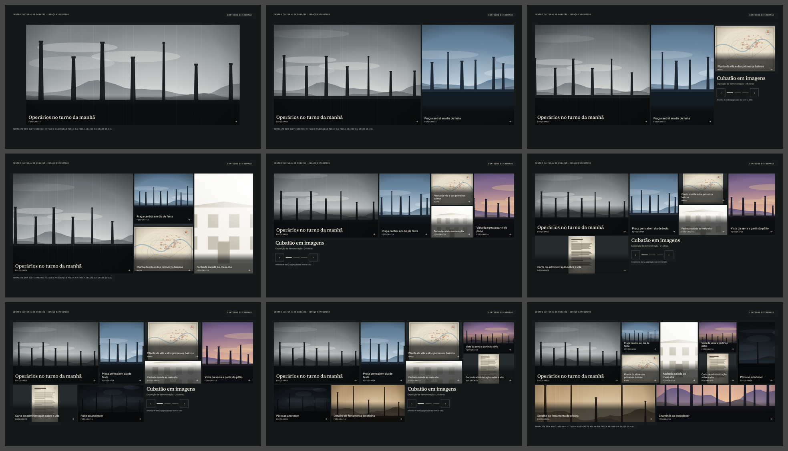
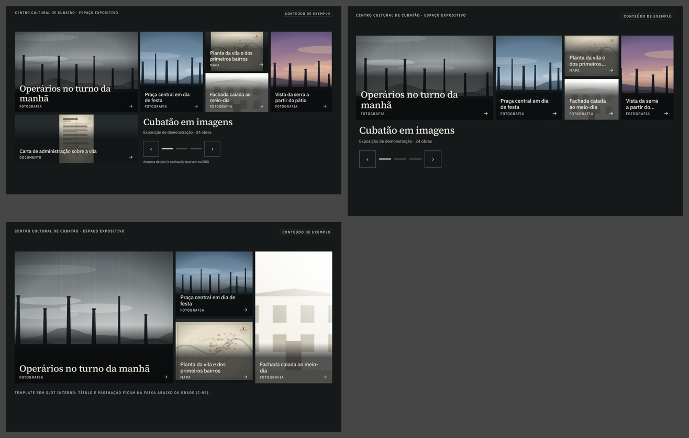
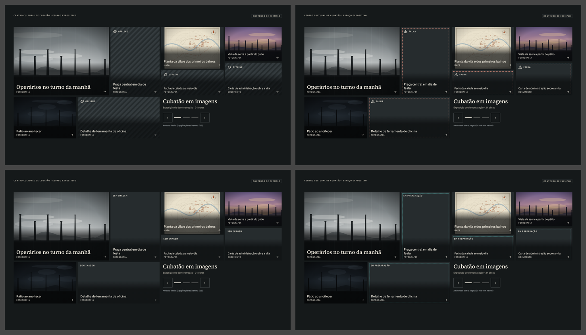
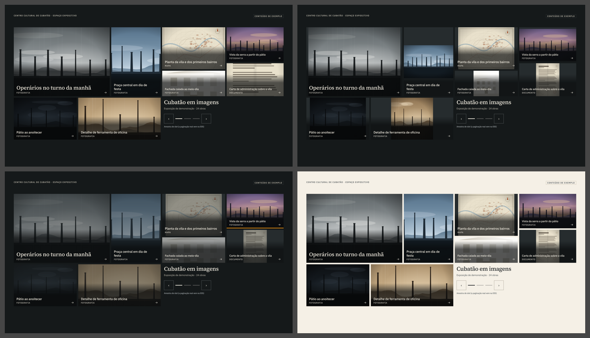
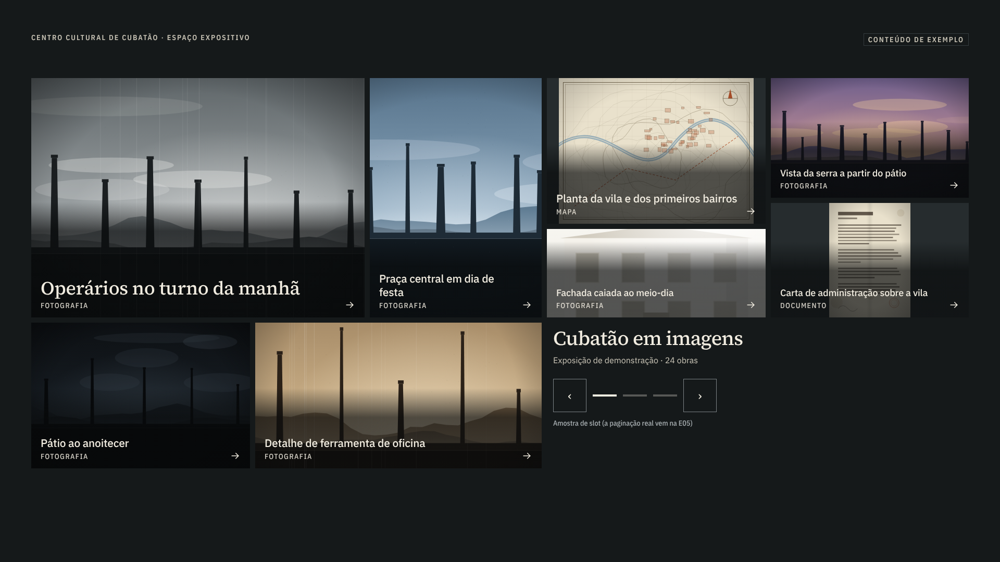
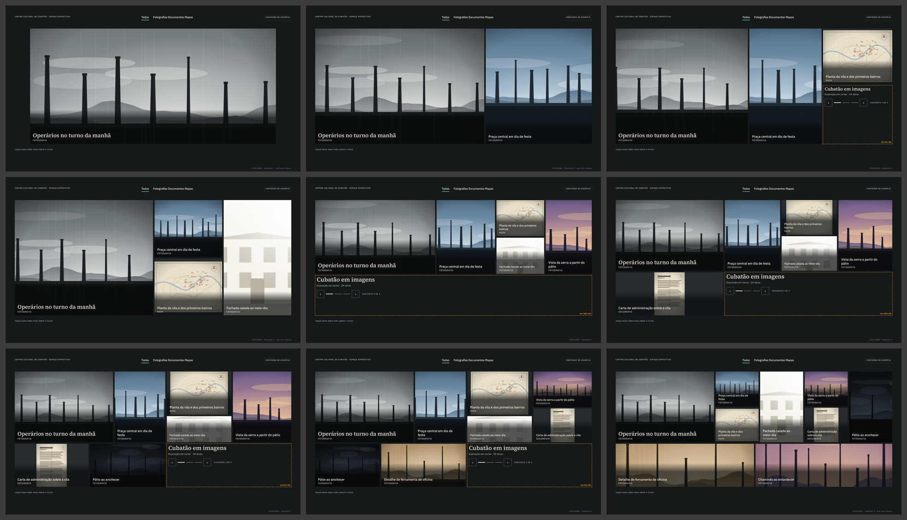
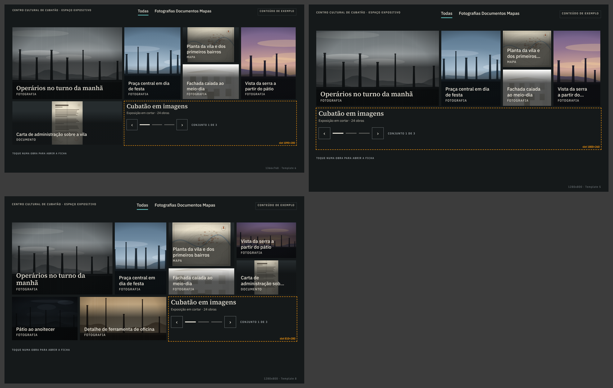

# Etapa 04 — Mosaico e legenda

**Fase:** 2 — Espaço Expositivo (MVP) · **Data:** 16/11/2026 · **Estado:** Documentada (testada no ambiente do Claude; aguardando implementação e validação local)
**Próxima etapa:** E05 — Catálogo e paginação. **Não será iniciada sem sua aprovação.**

## 1. Objetivo

Entregar o mosaico do Espaço Expositivo e a legenda sobre a imagem, fiéis ao Design System (Handoff §5 e §11; DS p. 21 e 38): templates 1–9 como dados com testes geométricos, grade proporcional, tile interativo com enquadramento `cover`/`contain`, estados de conteúdo, recuo da camada de imagem, legenda com degradê (ADR-004) e script de contraste. Inclui as decisões **C-05** (slots editoriais) e **C-06** (adaptação a tablets), aprovadas por você, registradas no ADR-014.

## 2. Pré-requisitos

- E03 aprovada e mesclada na `main` (confirmado por você).
- Windows 11, VS Code, PowerShell; Node 24.21.0, npm 11.19.0, Git 2.55.0.
- Árvore de trabalho limpa (`git status`) antes de aplicar os arquivos.

## 3. Contexto técnico

- **Requisitos atendidos:** Handoff §5 (templates e coordenadas), §11 (método de contraste), ADR-003 (coordenadas normativas), ADR-004 (degradê da legenda), P-01 (recuo apenas da camada de imagem), N-07 parcial (templates 1–9; balanceamento de 10+ obras fica para a E05).
- **Decisões aprovadas nesta etapa (C-05, C-06):**
  - **C-05:** slot editorial com título e paginação onde há área livre (templates 3, 5, 6, 7, 8); nos templates 1, 2, 4 e 9 a paginação fica em uma faixa de rodapé abaixo da grade.
  - **C-06:** escala proporcional `(larguraDaViewport − 2×margem)/1800`; margens 60/36/32 px (largura ≥1600 / ≥1300 / tablet); espaço entre tiles mantido em 10 px; template escolhido pelo número de itens em tablets (1366×768 com ≤6 itens → T6; 1280×800 com ≤5 → T5); títulos não-hero com ≥20 px em tablets (tokens complementares `tile-compact-title-size/line`).
- **Arquitetura:** o layout é uma função pura (`computeMosaicLayout(template, areaWidth)`) que devolve retângulos em px; o componente apenas posiciona. A largura é medida por `clientWidth` + `ResizeObserver` (ignora transformações) ou pela prop `width`.
- **Novo pacote interno `@ccc/ui`** (ADR-014): `Caption`, `ArtworkTile`, `Mosaic`, utilitários de enquadramento. Consumido como código-fonte TS (ADR-001).
- **Acessibilidade (objetivo WCAG 2.2 AA, sem declaração de conformidade):** tile é `<button>` nativo; nome acessível "título. meta[. mensagem de estado]"; `aria-current` na seleção; a legenda é decorativa (`aria-hidden`).
- **Contraste:** método do Handoff §11 (rasteriza o tile sem legenda em canvas, aplica o degradê, mede o pior pixel sob o retângulo do texto). Funções puras com testes unitários; a rasterização só roda no navegador (`mosaic.html`).
- **Não incluído:** catálogo, paginação funcional e conteúdo dos slots (E05), ficha da obra (E06), inatividade, Firebase, offline.

## 4. Dependências

Nenhum pacote externo novo. Entra um workspace interno:

| Pacote | Versão | Onde é usado | Motivo |
| --- | --- | --- | --- |
| `@ccc/ui` | 0.1.0 (workspace) | `@ccc/espaco-expositivo` | Componentes compartilhados (legenda, tile, mosaico) |

`@ccc/ui` usa `react`/`react-dom` 19.3.1 e `@types/react(-dom)` 19.3.0, já presentes no monorepo. `npm audit --omit=dev`: 0 vulnerabilidades.

## 5. Estrutura de diretórios (após a etapa)

```text
packages/
  design-tokens/src/
    mosaic/            # NOVO: templates.ts, layout.ts, mosaic.test.ts
    build/generate.ts  # MODIFICADO
    source/complementary-tokens.json  # MODIFICADO
    generated/{tokens.css,catalog.ts} # REGENERADOS
    index.ts           # MODIFICADO
  ui/                  # NOVO workspace @ccc/ui
    src/{image,caption,artwork-tile,mosaic,test}/
apps/espaco-expositivo/
  mosaic.html          # NOVO (página de laboratório, só desenvolvimento)
  src/mosaic-lab/      # NOVO
docs/decisoes/ADR-014-mosaico-slots-tablets-e-pacote-ui.md   # NOVO
docs/desenvolvimento/etapas/assets/etapa-04/                 # NOVO (capturas e JSON de contraste)
```

## 6. Arquivos

**Novos:** 30 arquivos de código e documentação transcritos na seção 8.1 (conteúdo integral), mais 8 arquivos em `assets/etapa-04/` (capturas e `contraste-sintetico.json`) e este documento. **Modificados:** `packages/design-tokens/src/index.ts`, `.../build/generate.ts`, `.../source/complementary-tokens.json` (seção 8.2), `apps/espaco-expositivo/package.json`, `package-lock.json` e `packages/design-tokens/src/generated/{tokens.css,catalog.ts}` (regenerados; usar os do .zip), e a documentação (`README.md`, `CLAUDE.md`, `docs/arquitetura/estrutura-monorepo.md` v1.3, `docs/decisoes/README.md`, `docs/decisoes/ADR-003-templates-normativos.md`, `docs/desenvolvimento/{progresso.md,pendencias.md}`, `docs/desenvolvimento/etapas/etapa-03.md` — correção dos comandos `npm run test -w @ccc/<pacote>`; todos no .zip). **Removidos:** nenhum.

## 7. Ordem de implementação (PowerShell, na raiz do repositório)

```powershell
git switch main
git pull
git status                                   # deve estar limpo
git switch -c feat/etapa-04-mosaico-legenda

# 1) Extraia o .zip da etapa sobre a raiz do repositório, substituindo os arquivos existentes.

# 2) Instale exatamente o que está no lockfile (há um workspace novo)
npm ci

# 3) Confirme tokens e conteúdo
npm run tokens:check -w @ccc/design-tokens
npm run content:check -w @ccc/espaco-expositivo
# Se content:check acusar SVGs "diferentes" (metadados C2PA injetados no download, K-16):
#   npm run content:generate -w @ccc/espaco-expositivo

# 4) Verificação completa
npm run check

# 5) Laboratório do mosaico
npm run dev -w @ccc/espaco-expositivo -- --port 5173
# abra http://localhost:5173/mosaic.html e clique em "Medir contraste"
```

Parâmetros de URL do laboratório: `template` (1–9), `viewport` (1920, 1366, 1280…), `theme`, `fit` (cover/contain), `state`, `recede`, `selected`, `scale`, `bare`, `autorun=contrast`.

## 8. Implementação completa — conteúdo integral dos arquivos

### 8.1. Arquivos novos

### `packages/design-tokens/src/mosaic/templates.ts`

```ts
/**
 * Templates de mosaico 1–9 (Handoff Técnico §5.1 e §5.2).
 *
 * As coordenadas são normativas (ADR-003) e estão no espaço de referência 1920×1080.
 * Aqui elas são convertidas para o espaço da própria área do mosaico (1800×750, origem em 0,0)
 * para que o layout seja independente da margem e do cabeçalho de cada tela.
 *
 * Slots editoriais e adaptação a tablets: decisões C-05 e C-06 (ADR-014).
 */

/** Retângulo no espaço da área do mosaico (px de referência, origem no canto superior esquerdo). */
export interface MosaicRect {
  readonly x: number;
  readonly y: number;
  readonly w: number;
  readonly h: number;
}

export type MosaicTemplateId = 1 | 2 | 3 | 4 | 5 | 6 | 7 | 8 | 9;

export interface MosaicTemplate {
  readonly id: MosaicTemplateId;
  readonly name: string;
  /** Número de obras que o gabarito acomoda (igual a `tiles.length`). */
  readonly count: number;
  /** Ladrilhos; o primeiro é sempre o herói. */
  readonly tiles: readonly MosaicRect[];
  /**
   * Slot editorial (C-05): retângulo livre reservado a título da exposição e paginação.
   * `null` quando a grade ocupa toda a área; nesse caso a paginação vai para a faixa abaixo da grade.
   */
  readonly slot: MosaicRect | null;
}

/** Área do mosaico em 1920×1080 (Handoff §5): x 60–1860, y 150–900. */
export const MOSAIC_AREA = { x: 60, y: 150, w: 1800, h: 750 } as const;

/** Intervalo entre ladrilhos (px). */
export const MOSAIC_GAP = 10;

/** Margem lateral por largura de referência (Handoff §5.5). */
export const MOSAIC_MARGIN_BY_WIDTH = { 1920: 60, 1366: 36, 1280: 32 } as const;

/** Ladrilho com menor lado abaixo deste valor (px de referência) usa o bloco de texto "pequeno". */
export const SMALL_TILE_THRESHOLD = 250;

/** Converte coordenadas de tela (1920×1080) para o espaço da área do mosaico. */
function r(x: number, y: number, w: number, h: number): MosaicRect {
  return { x: x - MOSAIC_AREA.x, y: y - MOSAIC_AREA.y, w, h };
}

export const MOSAIC_TEMPLATES: Readonly<Record<MosaicTemplateId, MosaicTemplate>> = {
  1: {
    id: 1,
    name: 'Obra única',
    count: 1,
    tiles: [r(160, 150, 1600, 750)],
    slot: null,
  },
  2: {
    id: 2,
    name: 'Duas obras',
    count: 2,
    tiles: [r(60, 150, 1100, 750), r(1170, 150, 690, 750)],
    slot: null,
  },
  3: {
    id: 3,
    name: 'Três obras',
    count: 3,
    tiles: [r(60, 150, 860, 750), r(930, 150, 470, 750), r(1410, 150, 450, 360)],
    slot: r(1410, 520, 450, 380),
  },
  4: {
    id: 4,
    name: 'Quatro obras',
    count: 4,
    tiles: [
      r(60, 150, 900, 750),
      r(970, 150, 440, 370),
      r(970, 530, 440, 370),
      r(1420, 150, 440, 750),
    ],
    slot: null,
  },
  5: {
    id: 5,
    name: 'Cinco obras',
    count: 5,
    tiles: [
      r(60, 150, 780, 480),
      r(850, 150, 380, 480),
      r(1240, 150, 310, 235),
      r(1240, 395, 310, 235),
      r(1560, 150, 300, 480),
    ],
    slot: r(60, 640, 1800, 260),
  },
  6: {
    id: 6,
    name: 'Seis obras',
    count: 6,
    tiles: [
      r(60, 150, 700, 460),
      r(770, 150, 360, 460),
      r(1140, 150, 360, 225),
      r(1140, 385, 360, 225),
      r(1510, 150, 350, 460),
      r(60, 620, 700, 280),
    ],
    slot: r(770, 620, 1090, 280),
  },
  7: {
    id: 7,
    name: 'Sete obras',
    count: 7,
    tiles: [
      r(60, 150, 640, 460),
      r(710, 150, 330, 460),
      r(1050, 150, 420, 280),
      r(1050, 440, 420, 170),
      r(1480, 150, 380, 460),
      r(60, 620, 480, 280),
      r(550, 620, 490, 280),
    ],
    slot: r(1050, 620, 810, 280),
  },
  8: {
    id: 8,
    name: 'Oito obras',
    count: 8,
    tiles: [
      r(60, 150, 640, 460),
      r(710, 150, 330, 460),
      r(1050, 150, 420, 280),
      r(1050, 440, 420, 170),
      r(1480, 150, 380, 230),
      r(1480, 390, 380, 220),
      r(60, 620, 420, 280),
      r(490, 620, 550, 280),
    ],
    slot: r(1050, 620, 810, 280),
  },
  9: {
    id: 9,
    name: 'Nove obras',
    count: 9,
    tiles: [
      r(60, 150, 640, 460),
      r(710, 150, 280, 225),
      r(710, 385, 280, 225),
      r(1000, 150, 280, 460),
      r(1290, 150, 280, 225),
      r(1290, 385, 280, 225),
      r(1580, 150, 280, 460),
      r(60, 620, 900, 280),
      r(970, 620, 890, 280),
    ],
    slot: null,
  },
};

export const MOSAIC_TEMPLATE_IDS: readonly MosaicTemplateId[] = [1, 2, 3, 4, 5, 6, 7, 8, 9];

/** Gabarito correspondente ao número de obras do conjunto (1–9). */
export function templateForCount(count: number): MosaicTemplate {
  if (!Number.isInteger(count) || count < 1 || count > 9) {
    throw new RangeError(`O mosaico comporta de 1 a 9 obras; recebido: ${String(count)}.`);
  }
  return MOSAIC_TEMPLATES[count as MosaicTemplateId];
}

/** Participação do herói na área do mosaico (0–1). */
export function heroShare(template: MosaicTemplate): number {
  const hero = template.tiles[0];
  if (!hero) {
    throw new Error(`Template ${String(template.id)} sem ladrilhos.`);
  }
  return (hero.w * hero.h) / (MOSAIC_AREA.w * MOSAIC_AREA.h);
}
```

### `packages/design-tokens/src/mosaic/layout.ts`

```ts
import type { MosaicRect, MosaicTemplate } from './templates.ts';
import { MOSAIC_AREA, MOSAIC_GAP, SMALL_TILE_THRESHOLD } from './templates.ts';

/** Classe de tamanho do ladrilho: define o bloco de texto da legenda (Handoff §3.3). */
export type TileSizeClass = 'hero' | 'medium' | 'small';

export interface LayoutTile {
  readonly index: number;
  /** Retângulo em px, relativo ao canto superior esquerdo da área do mosaico. */
  readonly rect: MosaicRect;
  readonly sizeClass: TileSizeClass;
}

export interface MosaicLayout {
  /** Fator de escala em relação à área de referência (1800 px de largura). */
  readonly scale: number;
  readonly width: number;
  readonly height: number;
  readonly tiles: readonly LayoutTile[];
  readonly slot: MosaicRect | null;
}

export type ViewportProfileName = 'wide' | 'compact' | 'tablet';

/** Perfil de projeto por largura de tela (Handoff §5.5; valores são referências, pendência P-06/P-08). */
export interface ViewportProfile {
  readonly name: ViewportProfileName;
  /** Resolução de referência do perfil. */
  readonly reference: string;
  readonly margin: number;
  /** Itens simultâneos (Espaço Expositivo e Futuro). */
  readonly maxItems: number;
  /** Itens simultâneos na Biblioteca Digital (modo Galeria). */
  readonly maxItemsLibrary: number;
}

const PROFILES: Readonly<Record<ViewportProfileName, ViewportProfile>> = {
  wide: { name: 'wide', reference: '1920×1080', margin: 60, maxItems: 8, maxItemsLibrary: 9 },
  compact: { name: 'compact', reference: '1366×768', margin: 36, maxItems: 6, maxItemsLibrary: 6 },
  tablet: { name: 'tablet', reference: '1280×800', margin: 32, maxItems: 5, maxItemsLibrary: 5 },
};

/** Escolhe o perfil de projeto mais próximo da largura da tela (C-06). */
export function viewportProfile(viewportWidth: number): ViewportProfile {
  if (viewportWidth >= 1600) return PROFILES.wide;
  if (viewportWidth >= 1300) return PROFILES.compact;
  return PROFILES.tablet;
}

function scaleRect(rect: MosaicRect, scale: number, shrink: number): MosaicRect {
  return {
    x: rect.x * scale,
    y: rect.y * scale,
    w: rect.w * scale - shrink,
    h: rect.h * scale - shrink,
  };
}

/**
 * Calcula o layout em pixels de um template para uma largura de área.
 *
 * As coordenadas de referência são escaladas proporcionalmente (C-06) e o intervalo entre
 * ladrilhos é mantido em 10 px: cada retângulo perde `gap − gap × escala` na largura e na altura.
 * Em escala 1 (1800 px) o resultado é idêntico às coordenadas do Handoff §5.2.
 * Acima da escala 1 o intervalo cresce proporcionalmente (nunca fica menor que 10 px).
 */
export function computeMosaicLayout(template: MosaicTemplate, areaWidth: number): MosaicLayout {
  if (!(areaWidth > 0)) {
    throw new RangeError(`Largura da área do mosaico inválida: ${String(areaWidth)}.`);
  }
  const scale = areaWidth / MOSAIC_AREA.w;
  const shrink = Math.max(0, MOSAIC_GAP - MOSAIC_GAP * scale);
  const tiles = template.tiles.map((ref, index): LayoutTile => {
    const sizeClass: TileSizeClass =
      index === 0 ? 'hero' : Math.min(ref.w, ref.h) < SMALL_TILE_THRESHOLD ? 'small' : 'medium';
    return { index, rect: scaleRect(ref, scale, shrink), sizeClass };
  });
  return {
    scale,
    width: areaWidth,
    height: MOSAIC_AREA.h * scale,
    tiles,
    slot: template.slot ? scaleRect(template.slot, scale, shrink) : null,
  };
}
```

### `packages/design-tokens/src/mosaic/mosaic.test.ts`

```ts
import { describe, expect, it } from 'vitest';
import { computeMosaicLayout, viewportProfile } from './layout.ts';
import type { MosaicRect, MosaicTemplate } from './templates.ts';
import {
  heroShare,
  MOSAIC_AREA,
  MOSAIC_GAP,
  MOSAIC_TEMPLATE_IDS,
  MOSAIC_TEMPLATES,
  templateForCount,
} from './templates.ts';

const ALL: readonly MosaicTemplate[] = MOSAIC_TEMPLATE_IDS.map((id) => MOSAIC_TEMPLATES[id]);

function inside(rect: MosaicRect, w: number, h: number, eps = 1e-6): boolean {
  return (
    rect.x >= -eps && rect.y >= -eps && rect.x + rect.w <= w + eps && rect.y + rect.h <= h + eps
  );
}

/** Distância entre dois retângulos (0 se se sobrepõem em ambos os eixos). */
function separation(a: MosaicRect, b: MosaicRect): { dx: number; dy: number } {
  const dx = Math.max(b.x - (a.x + a.w), a.x - (b.x + b.w));
  const dy = Math.max(b.y - (a.y + a.h), a.y - (b.y + b.h));
  return { dx, dy };
}

describe('templates 1–9 (Handoff §5.2)', () => {
  it('expõe nove templates cujo número de ladrilhos é o próprio identificador', () => {
    expect(MOSAIC_TEMPLATE_IDS).toHaveLength(9);
    for (const t of ALL) {
      expect(t.tiles).toHaveLength(t.id);
      expect(t.count).toBe(t.id);
    }
  });

  it('mantém todos os ladrilhos e slots dentro da área 1800×750', () => {
    for (const t of ALL) {
      for (const tile of t.tiles) expect(inside(tile, MOSAIC_AREA.w, MOSAIC_AREA.h)).toBe(true);
      if (t.slot) expect(inside(t.slot, MOSAIC_AREA.w, MOSAIC_AREA.h)).toBe(true);
    }
  });

  it('não tem sobreposição e respeita o intervalo de 10 px entre ladrilhos e slot', () => {
    for (const t of ALL) {
      const rects = t.slot ? [...t.tiles, t.slot] : [...t.tiles];
      for (let i = 0; i < rects.length; i += 1) {
        for (let j = i + 1; j < rects.length; j += 1) {
          const { dx, dy } = separation(rects[i] as MosaicRect, rects[j] as MosaicRect);
          // Sem sobreposição: separados em pelo menos um eixo; e, se separados, a distância mínima é o intervalo.
          expect(
            Math.max(dx, dy),
            `template ${String(t.id)} (${String(i)},${String(j)})`,
          ).toBeGreaterThanOrEqual(MOSAIC_GAP);
        }
      }
    }
  });

  it('o herói é o primeiro ladrilho e é o maior de cada template com 3+ obras', () => {
    for (const t of ALL.filter((x) => x.id >= 3)) {
      const areas = t.tiles.map((tile) => tile.w * tile.h);
      expect(Math.max(...areas)).toBe(areas[0]);
    }
  });

  it('reproduz a participação do herói do Handoff §5.1', () => {
    const expected: Record<number, number> = {
      1: 0.889,
      2: 0.611,
      3: 0.478,
      4: 0.5,
      5: 0.277,
      6: 0.239,
      7: 0.218,
      8: 0.218,
      9: 0.218,
    };
    for (const t of ALL) {
      expect(heroShare(t)).toBeCloseTo(expected[t.id] as number, 3);
    }
  });

  it('T9 respeita o herói mínimo de 20 %', () => {
    expect(heroShare(MOSAIC_TEMPLATES[9])).toBeGreaterThanOrEqual(0.2);
  });

  it('slots editoriais (C-05): só existem onde há área livre', () => {
    const withSlot = ALL.filter((t) => t.slot !== null).map((t) => t.id);
    expect(withSlot).toEqual([3, 5, 6, 7, 8]);
    expect(MOSAIC_TEMPLATES[8].slot).toEqual({ x: 990, y: 470, w: 810, h: 280 });
  });

  it('ocupação: ladrilhos e slot cobrem ao menos 90 % da área nos templates com slot', () => {
    for (const t of ALL.filter((x) => x.slot)) {
      const covered =
        t.tiles.reduce((s, r) => s + r.w * r.h, 0) + (t.slot ? t.slot.w * t.slot.h : 0);
      expect(covered / (MOSAIC_AREA.w * MOSAIC_AREA.h)).toBeGreaterThan(0.9);
    }
  });

  it('templateForCount escolhe o gabarito pelo número de obras e rejeita valores fora de 1–9', () => {
    expect(templateForCount(5).id).toBe(5);
    expect(() => templateForCount(0)).toThrow(RangeError);
    expect(() => templateForCount(10)).toThrow(RangeError);
    expect(() => templateForCount(2.5)).toThrow(RangeError);
  });
});

describe('computeMosaicLayout', () => {
  it('em escala 1 devolve exatamente as coordenadas do Handoff (T8)', () => {
    const layout = computeMosaicLayout(MOSAIC_TEMPLATES[8], 1800);
    expect(layout.scale).toBe(1);
    expect(layout.height).toBe(750);
    expect(layout.tiles[0]?.rect).toEqual({ x: 0, y: 0, w: 640, h: 460 });
    expect(layout.tiles[7]?.rect).toEqual({ x: 430, y: 470, w: 550, h: 280 });
    expect(layout.slot).toEqual({ x: 990, y: 470, w: 810, h: 280 });
  });

  it('classifica herói, médio e pequeno', () => {
    const t8 = computeMosaicLayout(MOSAIC_TEMPLATES[8], 1800).tiles.map((t) => t.sizeClass);
    expect(t8).toEqual(['hero', 'medium', 'medium', 'small', 'small', 'small', 'medium', 'medium']);
    const t1 = computeMosaicLayout(MOSAIC_TEMPLATES[1], 1800).tiles.map((t) => t.sizeClass);
    expect(t1).toEqual(['hero']);
  });

  it('mantém o intervalo de 10 px e os ladrilhos dentro da área em larguras de tablet', () => {
    for (const width of [1294, 1216, 1800, 1920]) {
      for (const t of ALL) {
        const layout = computeMosaicLayout(t, width);
        const rects = layout.slot
          ? [...layout.tiles.map((x) => x.rect), layout.slot]
          : layout.tiles.map((x) => x.rect);
        for (const rect of rects)
          expect(inside(rect, layout.width, layout.height, 1e-6)).toBe(true);
        for (let i = 0; i < rects.length; i += 1) {
          for (let j = i + 1; j < rects.length; j += 1) {
            const { dx, dy } = separation(rects[i] as MosaicRect, rects[j] as MosaicRect);
            expect(Math.max(dx, dy)).toBeGreaterThanOrEqual(MOSAIC_GAP - 1e-6);
          }
        }
      }
    }
  });

  it('altura proporcional: 1800×750', () => {
    expect(computeMosaicLayout(MOSAIC_TEMPLATES[6], 1294).height).toBeCloseTo(
      (1294 * 750) / 1800,
      6,
    );
  });

  it('rejeita largura inválida', () => {
    expect(() => computeMosaicLayout(MOSAIC_TEMPLATES[6], 0)).toThrow(RangeError);
    expect(() => computeMosaicLayout(MOSAIC_TEMPLATES[6], Number.NaN)).toThrow(RangeError);
  });

  it('critério de tablet (C-06): menor lado ≥ 150 px nos templates permitidos pelo perfil', () => {
    const cases = [
      { viewport: 1366, margin: 36 },
      { viewport: 1280, margin: 32 },
    ];
    for (const { viewport, margin } of cases) {
      const profile = viewportProfile(viewport);
      expect(profile.margin).toBe(margin);
      for (const t of ALL.filter((x) => x.id <= profile.maxItems)) {
        const layout = computeMosaicLayout(t, viewport - 2 * profile.margin);
        for (const tile of layout.tiles) {
          expect(
            Math.min(tile.rect.w, tile.rect.h),
            `T${String(t.id)} @${String(viewport)}`,
          ).toBeGreaterThanOrEqual(150);
        }
      }
    }
  });
});

describe('viewportProfile (Handoff §5.5)', () => {
  it('mapeia larguras para perfis, margens e itens simultâneos', () => {
    expect(viewportProfile(1920)).toMatchObject({
      name: 'wide',
      margin: 60,
      maxItems: 8,
      maxItemsLibrary: 9,
    });
    expect(viewportProfile(1366)).toMatchObject({ name: 'compact', margin: 36, maxItems: 6 });
    expect(viewportProfile(1280)).toMatchObject({ name: 'tablet', margin: 32, maxItems: 5 });
    expect(viewportProfile(1600).name).toBe('wide');
    expect(viewportProfile(1299).name).toBe('tablet');
  });
});
```

### `packages/ui/package.json`

```json
{
  "name": "@ccc/ui",
  "version": "0.1.0",
  "private": true,
  "type": "module",
  "description": "Componentes React compartilhados do ecossistema (mosaico, imagem interativa, legenda e estados de conteúdo)",
  "exports": {
    ".": "./src/index.ts"
  },
  "scripts": {
    "typecheck": "tsc --noEmit",
    "test": "vitest run"
  },
  "dependencies": {
    "@ccc/design-tokens": "0.1.0",
    "@ccc/types": "0.1.0",
    "react": "19.3.1",
    "react-dom": "19.3.1"
  },
  "devDependencies": {
    "@types/react": "19.3.0",
    "@types/react-dom": "19.3.0"
  }
}
```

### `packages/ui/tsconfig.json`

```json
{
  "extends": "../../tsconfig.base.json",
  "compilerOptions": {
    "types": ["vite/client"],
    "erasableSyntaxOnly": true
  },
  "include": ["src", "vitest.config.ts"]
}
```

### `packages/ui/vitest.config.ts`

```ts
import { defineConfig } from 'vitest/config';

export default defineConfig({
  test: {
    environment: 'jsdom',
    setupFiles: ['./src/test/setup.ts'],
    include: ['src/**/*.test.{ts,tsx}'],
    restoreMocks: true,
    css: { modules: { classNameStrategy: 'non-scoped' } },
  },
});
```

### `packages/ui/src/index.ts`

```ts
export { ArtworkTile } from './artwork-tile/ArtworkTile.tsx';
export type { ArtworkTileProps } from './artwork-tile/ArtworkTile.tsx';
export { CONTENT_STATE_COPY, ContentStateArt } from './artwork-tile/ContentStateArt.tsx';
export type { TileContentState } from './artwork-tile/ContentStateArt.tsx';
export { Caption } from './caption/Caption.tsx';
export type { CaptionDensity, CaptionProps } from './caption/Caption.tsx';
export { Mosaic } from './mosaic/Mosaic.tsx';
export type { MosaicItem, MosaicProps, MosaicTile } from './mosaic/Mosaic.tsx';
export { computeImagePlacement, cropFraction, objectPosition } from './image/placement.ts';
export type { ImagePlacement } from './image/placement.ts';
```

### `packages/ui/src/test/setup.ts`

```ts
import '@testing-library/jest-dom/vitest';
import { cleanup } from '@testing-library/react';
import { afterEach } from 'vitest';

afterEach(() => {
  cleanup();
});
```

### `packages/ui/src/image/placement.ts`

```ts
import type { FocalPoint, ImageFit } from '@ccc/types';

/** Retângulo ocupado pela imagem dentro do ladrilho (px, origem no canto do ladrilho). */
export interface ImagePlacement {
  x: number;
  y: number;
  width: number;
  height: number;
}

const CENTER: FocalPoint = { x: 0.5, y: 0.5 };

/** Valor CSS de `object-position` para um ponto focal (0–1). Sem ponto focal: centro. */
export function objectPosition(focalPoint: FocalPoint | undefined): string {
  const p = focalPoint ?? CENTER;
  const pct = (v: number): string => `${String(Math.round(clamp01(v) * 10000) / 100)}%`;
  return `${pct(p.x)} ${pct(p.y)}`;
}

function clamp01(v: number): number {
  return Math.min(1, Math.max(0, v));
}

/**
 * Calcula onde a imagem é desenhada, reproduzindo `object-fit` e `object-position`:
 * - `cover` preenche o ladrilho e pode cortar; o ponto focal decide o recorte.
 * - `contain` mostra a imagem inteira, sem distorção e sem corte, centralizada.
 *
 * Usada nos testes e na medição de contraste do harness (mesma geometria do CSS).
 */
export function computeImagePlacement(
  imageWidth: number,
  imageHeight: number,
  tileWidth: number,
  tileHeight: number,
  fit: ImageFit,
  focalPoint?: FocalPoint,
): ImagePlacement {
  if (!(imageWidth > 0 && imageHeight > 0 && tileWidth > 0 && tileHeight > 0)) {
    throw new RangeError('As dimensões da imagem e do ladrilho devem ser positivas.');
  }
  const scale =
    fit === 'cover'
      ? Math.max(tileWidth / imageWidth, tileHeight / imageHeight)
      : Math.min(tileWidth / imageWidth, tileHeight / imageHeight);
  const width = imageWidth * scale;
  const height = imageHeight * scale;
  const p = fit === 'cover' ? (focalPoint ?? CENTER) : CENTER;
  return {
    x: (tileWidth - width) * clamp01(p.x),
    y: (tileHeight - height) * clamp01(p.y),
    width,
    height,
  };
}

/** Fração da imagem que fica fora do ladrilho (0 = nada cortado). Só `cover` corta. */
export function cropFraction(
  imageWidth: number,
  imageHeight: number,
  tileWidth: number,
  tileHeight: number,
  fit: ImageFit,
): number {
  if (fit === 'contain') return 0;
  const p = computeImagePlacement(imageWidth, imageHeight, tileWidth, tileHeight, 'cover');
  return 1 - (tileWidth * tileHeight) / (p.width * p.height);
}
```

### `packages/ui/src/image/placement.test.ts`

```ts
import { describe, expect, it } from 'vitest';
import { computeImagePlacement, cropFraction, objectPosition } from './placement.ts';

describe('computeImagePlacement', () => {
  it('cover: preenche o ladrilho e centraliza o recorte por padrão', () => {
    // imagem 1600×1200 em ladrilho 640×460 → escala 0,4 (largura), altura 480 → sobra 20 px em cada lado
    const p = computeImagePlacement(1600, 1200, 640, 460, 'cover');
    expect(p.width).toBeCloseTo(640, 6);
    expect(p.height).toBeCloseTo(480, 6);
    expect(p.x).toBeCloseTo(0, 6);
    expect(p.y).toBeCloseTo(-10, 6);
  });

  it('cover: o ponto focal desloca o recorte', () => {
    const top = computeImagePlacement(1600, 1200, 640, 460, 'cover', { x: 0.5, y: 0 });
    const bottom = computeImagePlacement(1600, 1200, 640, 460, 'cover', { x: 0.5, y: 1 });
    expect(top.y).toBeCloseTo(0, 6);
    expect(bottom.y).toBeCloseTo(-20, 6);
  });

  it('contain: nunca corta nem distorce e centraliza', () => {
    const p = computeImagePlacement(1200, 1600, 640, 460, 'contain');
    expect(p.height).toBeCloseTo(460, 6);
    expect(p.width).toBeCloseTo(345, 6);
    expect(p.x).toBeCloseTo((640 - 345) / 2, 6);
    expect(p.y).toBeCloseTo(0, 6);
    expect(p.width / p.height).toBeCloseTo(1200 / 1600, 6);
  });

  it('contain ignora o ponto focal', () => {
    const a = computeImagePlacement(1200, 1600, 640, 460, 'contain', { x: 0, y: 0 });
    const b = computeImagePlacement(1200, 1600, 640, 460, 'contain');
    expect(a).toEqual(b);
  });

  it('rejeita dimensões inválidas', () => {
    expect(() => computeImagePlacement(0, 10, 10, 10, 'cover')).toThrow(RangeError);
    expect(() => computeImagePlacement(10, 10, 10, -1, 'contain')).toThrow(RangeError);
  });
});

describe('cropFraction', () => {
  it('é 0 em contain e positivo em cover quando as proporções diferem', () => {
    expect(cropFraction(1200, 1600, 640, 460, 'contain')).toBe(0);
    expect(cropFraction(1200, 1600, 640, 460, 'cover')).toBeGreaterThan(0.4);
    expect(cropFraction(1600, 1200, 640, 480, 'cover')).toBeCloseTo(0, 6);
  });
});

describe('objectPosition', () => {
  it('formata o ponto focal em porcentagem e limita a 0–100 %', () => {
    expect(objectPosition(undefined)).toBe('50% 50%');
    expect(objectPosition({ x: 0.25, y: 0.8 })).toBe('25% 80%');
    expect(objectPosition({ x: -1, y: 2 })).toBe('0% 100%');
  });
});
```

### `packages/ui/src/caption/Caption.tsx`

```tsx
import type { TileSizeClass } from '@ccc/design-tokens';
import styles from './Caption.module.css';

export type CaptionDensity = 'standard' | 'compact';

export interface CaptionProps {
  title: string;
  /** Tipo e crédito, em uma linha (ex.: "Fotografia · Histórica"). */
  meta: string;
  size: TileSizeClass;
  /** `compact` (tablets): título de ladrilhos não heróis com mínimo de 20 px (C-06). */
  density?: CaptionDensity;
}

/**
 * Legenda sobre imagem: degradê com platô de 68 % (ADR-004) e texto sobre o bloco.
 * O degradê pertence ao ladrilho e nunca reduz a opacidade da imagem ou do texto.
 * Decorativa para tecnologias assistivas: o nome acessível vem do ladrilho.
 */
export function Caption({ title, meta, size, density = 'standard' }: CaptionProps) {
  const className = [styles.caption, styles[size], density === 'compact' ? styles.compact : '']
    .filter(Boolean)
    .join(' ');
  return (
    <div className={className} data-caption-size={size} aria-hidden="true">
      <div className={styles.shade} />
      <div className={styles.text}>
        <span className={styles.title}>{title}</span>
        <span className={styles.meta}>{meta}</span>
      </div>
      <svg className={styles.arrow} viewBox="0 0 24 24" width="20" height="20" focusable="false">
        <path
          d="M4 12h15m-6-6 6 6-6 6"
          fill="none"
          stroke="currentColor"
          strokeWidth="1.75"
          strokeLinecap="square"
        />
      </svg>
    </div>
  );
}
```

### `packages/ui/src/caption/Caption.module.css`

```css
/*
 * Legenda sobre imagem (Handoff §3.3 e §11).
 * Altura do degradê = mín(altura do ladrilho; bloco + 14 + 10 + 56). Plateau de 68 % cobre o bloco + 10 px.
 */
.caption {
  position: absolute;
  inset: auto 0 0 0;
  height: min(100%, var(--_gradient-height));
  color: var(--color-text-on-media);
  pointer-events: none;
}

.hero {
  --_gradient-height: var(--caption-gradient-height-hero);
  --_title-font: var(--type-tile-title-hero);
  --_title-lines: 3;
}

.medium {
  --_gradient-height: var(--caption-gradient-height-medium);
  --_title-font: var(--type-tile-title);
  --_title-lines: 2;
}

.small {
  --_gradient-height: var(--caption-gradient-height-small);
  --_title-font: var(--type-tile-title-small);
  --_title-lines: 2;
}

/* Tablets: título dos ladrilhos não heróis com no mínimo 20 px. */
.compact.medium,
.compact.small {
  --_title-font: 500 var(--tile-compact-title-size) / var(--tile-compact-title-line)
    var(--font-sans);
}

.shade {
  position: absolute;
  inset: 0;
  background: linear-gradient(
    to top,
    rgb(var(--caption-gradient-rgb) / var(--caption-gradient-plateau-opacity)) 0,
    rgb(var(--caption-gradient-rgb) / var(--caption-gradient-plateau-opacity))
      calc(100% - var(--caption-gradient-fade-length)),
    rgb(var(--caption-gradient-rgb) / 0) 100%
  );
}

.text {
  position: absolute;
  left: var(--caption-text-margin-left);
  right: var(--caption-text-margin-right);
  bottom: var(--caption-gradient-base-padding);
  display: flex;
  flex-direction: column;
  gap: var(--space-1);
}

.title {
  display: -webkit-box;
  overflow: hidden;
  -webkit-box-orient: vertical;
  -webkit-line-clamp: var(--_title-lines);
  line-clamp: var(--_title-lines);
  font: var(--_title-font);
  letter-spacing: var(--tracking-title);
  overflow-wrap: anywhere;
}

.meta {
  overflow: hidden;
  font: var(--type-tile-meta);
  letter-spacing: var(--tracking-caps);
  text-overflow: ellipsis;
  text-transform: uppercase;
  white-space: nowrap;
  opacity: var(--caption-meta-opacity);
}

.arrow {
  position: absolute;
  right: var(--caption-text-margin-left);
  bottom: var(--caption-gradient-base-padding);
}
```

### `packages/ui/src/caption/Caption.test.tsx`

```tsx
import { render } from '@testing-library/react';
import { describe, expect, it } from 'vitest';
import { Caption } from './Caption.tsx';

describe('Caption', () => {
  it('mostra título e meta e se declara decorativa (o nome acessível vem do ladrilho)', () => {
    const { container } = render(<Caption title="Praça central" meta="Fotografia" size="medium" />);
    const root = container.firstElementChild;
    expect(root).toHaveAttribute('aria-hidden', 'true');
    expect(root).toHaveAttribute('data-caption-size', 'medium');
    expect(root).toHaveTextContent('Praça central');
    expect(root).toHaveTextContent('Fotografia');
  });

  it('aplica a densidade compacta só quando pedida', () => {
    const standard = render(<Caption title="A" meta="B" size="small" />).container
      .firstElementChild;
    const compact = render(<Caption title="A" meta="B" size="small" density="compact" />).container
      .firstElementChild;
    expect(standard?.className).not.toMatch(/compact/);
    expect(compact?.className).toMatch(/compact/);
  });
});
```

### `packages/ui/src/artwork-tile/ContentStateArt.tsx`

```tsx
import type { ReactElement } from 'react';
import styles from './ArtworkTile.module.css';

/** Estados de conteúdo de um ladrilho (Handoff §9). `ready` = imagem disponível. */
export type TileContentState = 'ready' | 'no-image' | 'offline' | 'failed' | 'unpublished';

type NonReadyState = Exclude<TileContentState, 'ready'>;

interface StateCopy {
  /** Rótulo curto visível no ladrilho. */
  label: string;
  /** Mensagem pública (ou `null` quando o estado não é exibido ao visitante). */
  message: string | null;
}

/** Textos oficiais do Handoff §9. Código e detalhes técnicos ficam só nos registros do Dashboard. */
export const CONTENT_STATE_COPY: Readonly<Record<NonReadyState, StateCopy>> = {
  'no-image': { label: 'Sem imagem', message: 'Sem imagem para esta obra.' },
  offline: { label: 'Offline', message: 'Este arquivo ainda não está neste equipamento.' },
  failed: { label: 'Falha', message: 'Não foi possível abrir agora. Tente outra obra.' },
  unpublished: { label: 'Em preparação', message: null },
};

function Icon({ state }: { state: NonReadyState }): ReactElement | null {
  const common = {
    viewBox: '0 0 24 24',
    width: 28,
    height: 28,
    fill: 'none',
    stroke: 'currentColor',
    strokeWidth: 1.75,
    strokeLinecap: 'square' as const,
    focusable: false,
    'aria-hidden': true,
  };
  switch (state) {
    case 'offline':
      return (
        <svg {...common}>
          <path d="M20 8v5h-5M4 16v-5h5M6.3 9A7 7 0 0 1 18 7.5M17.7 15A7 7 0 0 1 6 16.5" />
        </svg>
      );
    case 'failed':
      return (
        <svg {...common}>
          <path d="M12 4 3 20h18L12 4Zm0 6v5m0 2.5v.5" />
        </svg>
      );
    default:
      return null;
  }
}

/**
 * Tratamento visual de um estado de conteúdo, desenhado dentro do ladrilho.
 * Nunca depende só de cor: há rótulo textual, ícone ou padrão em todos os estados.
 */
export function ContentStateArt({ state }: { state: NonReadyState }) {
  const copy = CONTENT_STATE_COPY[state];
  return (
    <div
      className={`${styles.stateArt} ${styles[`state-${state}`]}`}
      data-content-state={state}
      aria-hidden="true"
    >
      <div className={styles.stateBody}>
        <Icon state={state} />
        <span className={styles.stateLabel}>{copy.label}</span>
      </div>
    </div>
  );
}
```

### `packages/ui/src/artwork-tile/ArtworkTile.tsx`

```tsx
import { useState } from 'react';
import type { CSSProperties } from 'react';
import type { TileSizeClass } from '@ccc/design-tokens';
import type { FocalPoint, ImageFit } from '@ccc/types';
import { objectPosition } from '../image/placement.ts';
import { Caption } from '../caption/Caption.tsx';
import type { CaptionDensity } from '../caption/Caption.tsx';
import { CONTENT_STATE_COPY, ContentStateArt } from './ContentStateArt.tsx';
import type { TileContentState } from './ContentStateArt.tsx';
import styles from './ArtworkTile.module.css';

export interface ArtworkTileProps {
  title: string;
  /** Tipo e crédito em uma linha, já formatados (ex.: "Fotografia · Histórica"). */
  meta: string;
  size: TileSizeClass;
  density?: CaptionDensity;
  /** Estado de conteúdo vindo dos dados; o ladrilho também passa a `failed` se a imagem não carregar. */
  state?: TileContentState;
  imageUrl?: string;
  fit?: ImageFit;
  focalPoint?: FocalPoint;
  /** Obra selecionada: barra âmbar de 4 px na base (nunca só cor: a barra é uma forma). */
  selected?: boolean;
  /** Recuo de imagem secundária: reduz só a camada de imagem (P-01); título e controles ficam a 100 %. */
  receded?: boolean;
  /** Um único toque: a seleção e a abertura da ficha são tratadas por quem usa o componente (E05/E06). */
  onSelect?: () => void;
  style?: CSSProperties;
}

/**
 * Imagem interativa (ladrilho de obra): imagem, legenda, estados de conteúdo, foco e seleção.
 * É um botão nativo: foco por teclado, Enter/Espaço e toque funcionam sem código adicional.
 */
export function ArtworkTile({
  title,
  meta,
  size,
  density = 'standard',
  state = 'ready',
  imageUrl,
  fit = 'cover',
  focalPoint,
  selected = false,
  receded = false,
  onSelect,
  style,
}: ArtworkTileProps) {
  // Guarda a URL que falhou: se a URL mudar, a nova tentativa começa limpa.
  const [failedUrl, setFailedUrl] = useState<string | null>(null);
  const hasImage = state === 'ready' && imageUrl !== undefined && imageUrl !== '';
  const effectiveState: TileContentState = !hasImage
    ? state === 'ready'
      ? 'no-image'
      : state
    : failedUrl === imageUrl
      ? 'failed'
      : 'ready';

  const stateMessage =
    effectiveState === 'ready' ? null : CONTENT_STATE_COPY[effectiveState].message;
  const accessibleName = [title, meta, stateMessage]
    .filter((part) => part !== null && part !== '')
    .join('. ');

  const className = [styles.tile, receded ? styles.receded : ''].filter(Boolean).join(' ');

  return (
    <button
      type="button"
      className={className}
      style={style}
      aria-label={accessibleName}
      aria-current={selected ? 'true' : undefined}
      data-state={effectiveState}
      data-size={size}
      data-selected={selected ? 'true' : 'false'}
      data-receded={receded ? 'true' : 'false'}
      onClick={onSelect}
    >
      <span className={styles.media}>
        {effectiveState === 'ready' ? (
           {
              setFailedUrl(imageUrl ?? null);
            }}
          />
        ) : (
          <ContentStateArt state={effectiveState} />
        )}
      </span>
      <Caption title={title} meta={meta} size={size} density={density} />
      {selected ? <span className={styles.bar} data-selected-bar="" aria-hidden="true" /> : null}
    </button>
  );
}
```

### `packages/ui/src/artwork-tile/ArtworkTile.module.css`

```css
.tile {
  position: absolute;
  display: block;
  margin: 0;
  padding: 0;
  overflow: hidden;
  border: 0;
  border-radius: var(--radius-none);
  background: var(--color-surface-tile-no-image);
  color: var(--color-text-on-media);
  font: inherit;
  text-align: left;
  cursor: pointer;
  touch-action: manipulation;
  -webkit-tap-highlight-color: transparent;
  transition: transform var(--motion-micro) var(--ease-out);
}

.tile:active {
  transform: scale(0.992);
}

/* Camada de imagem: é a única que recua (P-01). Legenda, barra e foco não herdam a opacidade. */
.media {
  position: absolute;
  inset: 0;
  display: block;
  transition: opacity var(--motion-standard) var(--ease-out);
}

.receded .media {
  opacity: var(--opacity-image-secondary);
}

.image {
  position: absolute;
  inset: 0;
  display: block;
  width: 100%;
  height: 100%;
  user-select: none;
}

/* Barra de seleção: fica na base, fora da área do texto (Handoff §11, item 8). */
.bar {
  position: absolute;
  inset: auto 0 0 0;
  height: var(--selected-bar-height);
  background: var(--selected-bar-color);
}

/* Estados de conteúdo (Handoff §9). */
.stateArt {
  position: absolute;
  inset: 0;
  display: flex;
  align-items: flex-start;
  justify-content: flex-start;
  padding: var(--space-4);
  background: var(--color-surface-tile-no-image);
  color: var(--color-text-on-media);
}

.stateBody {
  display: flex;
  align-items: center;
  gap: var(--space-2);
}

.stateLabel {
  font: var(--type-eyebrow);
  letter-spacing: var(--tracking-eyebrow);
  text-transform: uppercase;
}

.state-offline {
  background: repeating-linear-gradient(
    135deg,
    var(--color-basalto-700) 0 12px,
    var(--color-basalto-600) 12px 24px
  );
}

.state-failed::after,
.state-unpublished::after {
  position: absolute;
  inset: var(--space-2);
  border: 2px dashed var(--color-guara-300);
  content: '';
  pointer-events: none;
}

.state-unpublished::after {
  border-style: dotted;
  border-color: var(--color-turquesa-400);
}

@media (prefers-reduced-motion: reduce) {
  .tile,
  .media {
    transition: none;
  }

  .tile:active {
    transform: none;
  }
}
```

### `packages/ui/src/artwork-tile/ArtworkTile.test.tsx`

```tsx
import { fireEvent, render, screen } from '@testing-library/react';
import { describe, expect, it, vi } from 'vitest';
import { ArtworkTile } from './ArtworkTile.tsx';

const base = { title: 'Operários no turno da manhã', meta: 'Fotografia', size: 'hero' as const };

describe('ArtworkTile', () => {
  it('é um botão com nome acessível "título. meta" e dispara onSelect em um único clique', () => {
    const onSelect = vi.fn();
    render(<ArtworkTile {...base} imageUrl="/a.svg" onSelect={onSelect} />);
    const button = screen.getByRole('button', { name: 'Operários no turno da manhã. Fotografia' });
    fireEvent.click(button);
    expect(onSelect).toHaveBeenCalledTimes(1);
  });

  it('mostra a imagem com o enquadramento e o ponto focal pedidos', () => {
    const { container } = render(
      <ArtworkTile {...base} imageUrl="/a.svg" fit="contain" focalPoint={{ x: 0.2, y: 0.9 }} />,
    );
    const img = container.querySelector('img');
    expect(img).not.toBeNull();
    expect(img?.style.objectFit).toBe('contain');
    expect(img?.style.objectPosition).toBe('20% 90%');
    expect(img).toHaveAttribute('src', '/a.svg');
  });

  it('assume o estado "sem imagem" quando não há URL', () => {
    render(<ArtworkTile {...base} />);
    const button = screen.getByRole('button');
    expect(button).toHaveAttribute('data-state', 'no-image');
    expect(button).toHaveAccessibleName(/Sem imagem para esta obra\./);
    expect(screen.queryByRole('img')).toBeNull();
  });

  it('trata os estados offline, falha e em preparação com rótulo textual', () => {
    const { rerender, container } = render(<ArtworkTile {...base} state="offline" />);
    expect(container.querySelector('[data-content-state="offline"]')).toHaveTextContent('Offline');
    expect(screen.getByRole('button')).toHaveAccessibleName(/ainda não está neste equipamento/);

    rerender(<ArtworkTile {...base} state="failed" />);
    expect(container.querySelector('[data-content-state="failed"]')).toHaveTextContent('Falha');
    expect(screen.getByRole('button')).toHaveAccessibleName(/Não foi possível abrir agora/);

    rerender(<ArtworkTile {...base} state="unpublished" />);
    expect(container.querySelector('[data-content-state="unpublished"]')).toHaveTextContent(
      'Em preparação',
    );
  });

  it('passa a "falha" quando a imagem não carrega e se recupera com outra URL', () => {
    const { container, rerender } = render(<ArtworkTile {...base} imageUrl="/quebrada.svg" />);
    const img = container.querySelector('img');
    expect(img).not.toBeNull();
    fireEvent.error(img as HTMLImageElement);
    expect(screen.getByRole('button')).toHaveAttribute('data-state', 'failed');

    rerender(<ArtworkTile {...base} imageUrl="/ok.svg" />);
    expect(screen.getByRole('button')).toHaveAttribute('data-state', 'ready');
  });

  it('seleção: barra de 4 px e aria-current; sem seleção não há barra', () => {
    const { container, rerender } = render(<ArtworkTile {...base} imageUrl="/a.svg" selected />);
    expect(container.querySelector('[data-selected-bar]')).not.toBeNull();
    expect(screen.getByRole('button')).toHaveAttribute('aria-current', 'true');
    rerender(<ArtworkTile {...base} imageUrl="/a.svg" />);
    expect(container.querySelector('[data-selected-bar]')).toBeNull();
    expect(screen.getByRole('button')).not.toHaveAttribute('aria-current');
  });

  it('recuo: marca o ladrilho, mas a legenda continua fora da camada recuada', () => {
    const { container } = render(<ArtworkTile {...base} imageUrl="/a.svg" receded />);
    expect(screen.getByRole('button')).toHaveAttribute('data-receded', 'true');
    const media = container.querySelector('span[class*="media"]');
    const caption = container.querySelector('[data-caption-size]');
    expect(media).not.toBeNull();
    expect(caption).not.toBeNull();
    // A legenda não é descendente da camada de imagem (que é a única com opacidade reduzida).
    expect(media?.contains(caption)).toBe(false);
  });

  it('é acionável por teclado (Enter e Espaço nativos do botão)', () => {
    const onSelect = vi.fn();
    render(<ArtworkTile {...base} imageUrl="/a.svg" onSelect={onSelect} />);
    const button = screen.getByRole('button');
    button.focus();
    expect(button).toHaveFocus();
  });
});
```

### `packages/ui/src/mosaic/useElementWidth.ts`

```ts
import { useLayoutEffect, useState } from 'react';
import type { RefObject } from 'react';

/** Mede a largura de um elemento e acompanha mudanças (ResizeObserver quando disponível). */
export function useElementWidth(ref: RefObject<HTMLElement | null>, override?: number): number {
  const [width, setWidth] = useState(0);

  useLayoutEffect(() => {
    if (override !== undefined) return undefined;
    const element = ref.current;
    if (!element) return undefined;
    const measure = (): void => {
      // clientWidth ignora transformações (escala de pré-visualização), ao contrário de getBoundingClientRect.
      setWidth(element.clientWidth);
    };
    measure();
    if (typeof ResizeObserver === 'undefined') return undefined;
    const observer = new ResizeObserver(measure);
    observer.observe(element);
    return () => {
      observer.disconnect();
    };
  }, [ref, override]);

  return override ?? width;
}
```

### `packages/ui/src/mosaic/Mosaic.tsx`

```tsx
import { useMemo, useRef } from 'react';
import type { ReactNode } from 'react';
import { computeMosaicLayout, templateForCount } from '@ccc/design-tokens';
import { ArtworkTile } from '../artwork-tile/ArtworkTile.tsx';
import type { ArtworkTileProps } from '../artwork-tile/ArtworkTile.tsx';
import type { CaptionDensity } from '../caption/Caption.tsx';
import { useElementWidth } from './useElementWidth.ts';
import styles from './Mosaic.module.css';

export type MosaicTile = Omit<
  ArtworkTileProps,
  'size' | 'density' | 'selected' | 'receded' | 'onSelect' | 'style'
>;

export interface MosaicItem {
  id: string;
  tile: MosaicTile;
}

export interface MosaicProps {
  /** De 1 a 9 itens; o gabarito é escolhido pelo número de itens (sem algoritmo dinâmico). */
  items: readonly MosaicItem[];
  selectedId?: string | null;
  /** Com uma obra selecionada, recua só a imagem das demais (P-01). */
  recedeOthers?: boolean;
  /** `compact` nos tablets (C-06). */
  density?: CaptionDensity;
  onSelect?: (id: string) => void;
  /** Conteúdo do slot editorial (título da exposição e paginação), quando o template tem slot (C-05). */
  slot?: ReactNode;
  /** Rótulo acessível do conjunto de obras. */
  label?: string;
  /** Largura em px; se ausente, é medida a partir do elemento. */
  width?: number;
}

/**
 * Mosaico: distribui as obras em gabaritos predefinidos 1–9, em escala proporcional à largura.
 * A ordem do DOM é a ordem das obras (herói primeiro), o que define a ordem de foco por teclado.
 */
export function Mosaic({
  items,
  selectedId = null,
  recedeOthers = false,
  density = 'standard',
  onSelect,
  slot,
  label = 'Obras',
  width,
}: MosaicProps) {
  const ref = useRef<HTMLDivElement>(null);
  const measured = useElementWidth(ref, width);

  const template = items.length > 0 ? templateForCount(items.length) : null;
  const layout = useMemo(
    () => (template && measured > 0 ? computeMosaicLayout(template, measured) : null),
    [template, measured],
  );

  const rootStyle = {
    ...(width !== undefined ? { width: `${String(width)}px` } : {}),
    ...(layout ? { height: `${String(layout.height)}px` } : {}),
  };

  return (
    <div ref={ref} className={styles.mosaic} style={rootStyle} role="group" aria-label={label}>
      {layout
        ? items.map((item, index) => {
            const placed = layout.tiles[index];
            if (!placed) return null;
            const isSelected = selectedId === item.id;
            return (
              <ArtworkTile
                key={item.id}
                {...item.tile}
                size={placed.sizeClass}
                density={density}
                selected={isSelected}
                receded={recedeOthers && selectedId !== null && !isSelected}
                {...(onSelect ? { onSelect: () => onSelect(item.id) } : {})}
                style={{
                  left: `${String(placed.rect.x)}px`,
                  top: `${String(placed.rect.y)}px`,
                  width: `${String(placed.rect.w)}px`,
                  height: `${String(placed.rect.h)}px`,
                }}
              />
            );
          })
        : null}
      {layout?.slot && slot !== undefined && slot !== null ? (
        <div
          className={styles.slot}
          data-mosaic-slot=""
          style={{
            left: `${String(layout.slot.x)}px`,
            top: `${String(layout.slot.y)}px`,
            width: `${String(layout.slot.w)}px`,
            height: `${String(layout.slot.h)}px`,
          }}
        >
          {slot}
        </div>
      ) : null}
    </div>
  );
}
```

### `packages/ui/src/mosaic/Mosaic.module.css`

```css
.mosaic {
  position: relative;
  width: 100%;
  aspect-ratio: 1800 / 750;
}

.slot {
  position: absolute;
  display: flex;
  flex-direction: column;
  overflow: hidden;
}
```

### `packages/ui/src/mosaic/Mosaic.test.tsx`

```tsx
import { fireEvent, render, screen } from '@testing-library/react';
import { describe, expect, it, vi } from 'vitest';
import { MOSAIC_TEMPLATES } from '@ccc/design-tokens';
import { Mosaic } from './Mosaic.tsx';
import type { MosaicItem } from './Mosaic.tsx';

function items(n: number): MosaicItem[] {
  return Array.from({ length: n }, (_, i) => ({
    id: `obra-${String(i + 1)}`,
    tile: {
      title: `Obra ${String(i + 1)}`,
      meta: 'Fotografia',
      imageUrl: `/img-${String(i + 1)}.svg`,
    },
  }));
}

function px(value: string): number {
  return Number.parseFloat(value);
}

describe('Mosaic', () => {
  it('escolhe o gabarito pelo número de obras e posiciona os ladrilhos (T8 em 1800 px)', () => {
    render(<Mosaic items={items(8)} width={1800} label="Obras da exposição" />);
    const group = screen.getByRole('group', { name: 'Obras da exposição' });
    const tiles = screen.getAllByRole('button');
    expect(tiles).toHaveLength(8);
    expect(group.style.height).toBe('750px');
    const hero = MOSAIC_TEMPLATES[8].tiles[0];
    const first = tiles[0];
    expect(first).toBeDefined();
    expect(px((first as HTMLElement).style.left)).toBe(hero?.x);
    expect(px((first as HTMLElement).style.width)).toBe(hero?.w);
    expect(first).toHaveAttribute('data-size', 'hero');
  });

  it.each([1, 2, 3, 4, 5, 6, 7, 8, 9])('renderiza %i obra(s) sem sobreposição', (n) => {
    render(<Mosaic items={items(n)} width={1294} />);
    const rects = screen.getAllByRole('button').map((el) => ({
      x: px(el.style.left),
      y: px(el.style.top),
      w: px(el.style.width),
      h: px(el.style.height),
    }));
    expect(rects).toHaveLength(n);
    for (let i = 0; i < rects.length; i += 1) {
      for (let j = i + 1; j < rects.length; j += 1) {
        const a = rects[i];
        const b = rects[j];
        if (!a || !b) throw new Error('retângulo ausente');
        const overlapX = a.x < b.x + b.w && b.x < a.x + a.w;
        const overlapY = a.y < b.y + b.h && b.y < a.y + a.h;
        expect(overlapX && overlapY).toBe(false);
      }
    }
  });

  it('um clique em um ladrilho informa o id da obra', () => {
    const onSelect = vi.fn();
    render(<Mosaic items={items(3)} width={1800} onSelect={onSelect} />);
    fireEvent.click(screen.getByRole('button', { name: /Obra 2/ }));
    expect(onSelect).toHaveBeenCalledWith('obra-2');
  });

  it('seleção e recuo: só as demais obras recuam, a selecionada mostra a barra', () => {
    render(<Mosaic items={items(4)} width={1800} selectedId="obra-2" recedeOthers />);
    const tiles = screen.getAllByRole('button');
    expect(tiles.map((t) => t.getAttribute('data-receded'))).toEqual([
      'true',
      'false',
      'true',
      'true',
    ]);
    expect(tiles[1]).toHaveAttribute('aria-current', 'true');
  });

  it('sem seleção, nada recua mesmo com recedeOthers', () => {
    render(<Mosaic items={items(4)} width={1800} recedeOthers />);
    for (const tile of screen.getAllByRole('button'))
      expect(tile).toHaveAttribute('data-receded', 'false');
  });

  it('slot editorial: aparece só em templates com slot (C-05)', () => {
    const { rerender, container } = render(
      <Mosaic items={items(8)} width={1800} slot={<p>Cubatão em imagens</p>} />,
    );
    const slot = container.querySelector<HTMLElement>('[data-mosaic-slot]');
    expect(slot).not.toBeNull();
    expect(slot).toHaveTextContent('Cubatão em imagens');
    expect(px(slot?.style.left ?? '')).toBe(990);
    expect(px(slot?.style.width ?? '')).toBe(810);

    rerender(<Mosaic items={items(9)} width={1800} slot={<p>Cubatão em imagens</p>} />);
    expect(container.querySelector('[data-mosaic-slot]')).toBeNull();
  });

  it('densidade compacta chega às legendas', () => {
    const { container } = render(<Mosaic items={items(6)} width={1294} density="compact" />);
    const captions = container.querySelectorAll('[data-caption-size]');
    expect(captions).toHaveLength(6);
    const nonHero = Array.from(captions).filter(
      (c) => c.getAttribute('data-caption-size') !== 'hero',
    );
    expect(nonHero.every((c) => /compact/.test(c.className))).toBe(true);
  });

  it('sem obras renderiza só a área; mais de 9 obras é erro de programação', () => {
    render(<Mosaic items={[]} width={1800} label="vazio" />);
    expect(screen.getByRole('group', { name: 'vazio' })).toBeEmptyDOMElement();
    expect(() => render(<Mosaic items={items(10)} width={1800} />)).toThrow(RangeError);
  });

  it('mantém a ordem do DOM igual à ordem das obras (ordem de foco)', () => {
    render(<Mosaic items={items(5)} width={1800} />);
    expect(screen.getAllByRole('button').map((b) => b.getAttribute('aria-label'))).toEqual([
      'Obra 1. Fotografia',
      'Obra 2. Fotografia',
      'Obra 3. Fotografia',
      'Obra 4. Fotografia',
      'Obra 5. Fotografia',
    ]);
  });
});
```

### `apps/espaco-expositivo/mosaic.html`

```html
<!doctype html>
<html lang="pt-BR">
  <head>
    <meta charset="UTF-8" />
    <meta name="viewport" content="width=device-width, initial-scale=1.0" />
    <title>Laboratório do mosaico</title>
  </head>
  <body>
    <div id="root"></div>
    <script type="module" src="/src/mosaic-lab/main.tsx"></script>
  </body>
</html>
```

### `apps/espaco-expositivo/src/mosaic-lab/main.tsx`

```tsx
import { StrictMode } from 'react';
import { createRoot } from 'react-dom/client';
import { createLocalRepository } from '@ccc/data-access';
import '@ccc/design-tokens/styles.css';
import '../styles/global.css';
import { MosaicLab } from './MosaicLab';

const container = document.getElementById('root');

if (!container) {
  throw new Error('Elemento #root não encontrado em mosaic.html.');
}

const repository = createLocalRepository({ baseUrl: `${import.meta.env.BASE_URL}content/` });

createRoot(container).render(
  <StrictMode>
    <MosaicLab repository={repository} />
  </StrictMode>,
);
```

### `apps/espaco-expositivo/src/mosaic-lab/MosaicLab.tsx`

```tsx
import { useEffect, useMemo, useState } from 'react';
import type { ExhibitionRepository } from '@ccc/data-access';
import { MOSAIC_TEMPLATES, MOSAIC_TEMPLATE_IDS, viewportProfile } from '@ccc/design-tokens';
import type { MosaicTemplateId, ThemeName } from '@ccc/design-tokens';
import type { Artwork, Exhibition, ImageFit, WorkKind } from '@ccc/types';
import { Mosaic } from '@ccc/ui';
import type { MosaicItem, TileContentState } from '@ccc/ui';
import { runContrastReport } from './measure.ts';
import type { ContrastReport, MeasureImage } from './measure.ts';
import styles from './MosaicLab.module.css';

/**
 * Harness de desenvolvimento (`mosaic.html`, fora do build de produção): permite ver os templates
 * 1–9 nas resoluções de referência, alternar temas, enquadramento, estados e recuo, e medir o
 * contraste das legendas pelo método do Handoff §11. Não é uma tela do produto.
 */

const VIEWPORTS = [
  { id: '1920x1080', width: 1920, height: 1080, top: 150 },
  { id: '1366x768', width: 1366, height: 768, top: 104 },
  { id: '1280x800', width: 1280, height: 800, top: 112 },
] as const;

type ViewportId = (typeof VIEWPORTS)[number]['id'];
type FitMode = 'contract' | ImageFit;
type StateMode = 'none' | 'no-image' | 'offline' | 'failed' | 'unpublished';

const KIND_LABEL: Record<WorkKind, string> = {
  photo: 'Fotografia',
  document: 'Documento',
  map: 'Mapa',
  audio: 'Áudio',
  video: 'Vídeo',
};

interface LoadedWork {
  artwork: Artwork;
  url: string | null;
  status: TileContentState;
}

/** Estado inicial opcional pela URL (ex.: `?template=6&viewport=1366x768&theme=papel`), útil para capturas. */
function queryParam(name: string): string | null {
  return new URLSearchParams(window.location.search).get(name);
}

function oneOf<T extends string>(value: string | null, allowed: readonly T[], fallback: T): T {
  return allowed.find((candidate) => candidate === value) ?? fallback;
}

function toError(reason: unknown): Error {
  return reason instanceof Error ? reason : new Error(String(reason));
}

async function loadWorks(
  repository: ExhibitionRepository,
  exhibition: Exhibition,
): Promise<LoadedWork[]> {
  return Promise.all(
    exhibition.artworks.map(async (artwork): Promise<LoadedWork> => {
      if (!artwork.image) return { artwork, url: null, status: 'no-image' };
      const resolution = await repository.resolveAssetUrl(artwork.image.assetId);
      if (resolution.status === 'available') {
        return { artwork, url: resolution.url, status: 'ready' };
      }
      const status: TileContentState =
        resolution.status === 'offline-unavailable'
          ? 'offline'
          : resolution.status === 'unpublished'
            ? 'unpublished'
            : 'failed';
      return { artwork, url: null, status };
    }),
  );
}

function buildItems(works: readonly LoadedWork[], fit: FitMode, forced: StateMode): MosaicItem[] {
  return works.map(({ artwork, url, status }, index) => {
    // O estado forçado vale para as obras de índice ímpar (alterna com ladrilhos normais).
    const state: TileContentState =
      forced !== 'none' && index % 2 === 1 ? (forced === 'no-image' ? 'no-image' : forced) : status;
    const image = artwork.image;
    return {
      id: artwork.id,
      tile: {
        title: artwork.title,
        meta: KIND_LABEL[artwork.kind],
        state,
        ...(url !== null && state === 'ready' ? { imageUrl: url } : {}),
        fit: fit === 'contract' ? (image?.fit ?? 'cover') : fit,
        ...(image?.focalPoint ? { focalPoint: image.focalPoint } : {}),
      },
    };
  });
}

function SlotSample({
  title,
  subtitle,
  total,
}: {
  title: string;
  subtitle: string;
  total: number;
}) {
  return (
    <div className={styles.slotSample}>
      <p className={styles.slotTitle}>{title}</p>
      <p className={styles.slotSubtitle}>
        {subtitle} · {String(total)} obras
      </p>
      <div className={styles.slotPager} aria-hidden="true">
        <span className={styles.pagerArrow}>‹</span>
        <span className={styles.pagerSegmentOn} />
        <span className={styles.pagerSegment} />
        <span className={styles.pagerSegment} />
        <span className={styles.pagerArrow}>›</span>
      </div>
      <p className={styles.slotNote}>Amostra de slot (a paginação real vem na E05)</p>
    </div>
  );
}

function ContrastPanel({ works }: { works: readonly LoadedWork[] }) {
  const [report, setReport] = useState<ContrastReport | Error | null>(null);
  const [running, setRunning] = useState(false);

  const candidates = useMemo<MeasureImage[]>(
    () =>
      works.flatMap(({ artwork, url }) =>
        artwork.image && url !== null
          ? [
              {
                id: artwork.id,
                url,
                width: artwork.image.width,
                height: artwork.image.height,
                fit: artwork.image.fit ?? 'cover',
                ...(artwork.image.focalPoint ? { focalPoint: artwork.image.focalPoint } : {}),
              },
            ]
          : [],
      ),
    [works],
  );

  const run = (): void => {
    setRunning(true);
    runContrastReport(candidates)
      .then((value) => {
        setReport(value);
      })
      .catch((reason: unknown) => {
        setReport(toError(reason));
      })
      .finally(() => {
        setRunning(false);
      });
  };

  // `?autorun=contrast` executa a medição ao abrir a página (usado na verificação automatizada).
  const autorun = new URLSearchParams(window.location.search).get('autorun') === 'contrast';
  useEffect(() => {
    if (!autorun || candidates.length === 0) return undefined;
    let cancelled = false;
    runContrastReport(candidates)
      .then((value) => {
        if (!cancelled) setReport(value);
      })
      .catch((reason: unknown) => {
        if (!cancelled) setReport(toError(reason));
      });
    return () => {
      cancelled = true;
    };
  }, [autorun, candidates]);

  return (
    <section className={styles.panel} aria-labelledby="contrast-title">
      <h2 id="contrast-title" className={styles.panelTitle}>
        Contraste das legendas (Handoff §11)
      </h2>
      <p className={styles.hint}>
        Rasteriza o ladrilho sem legenda, aplica o degradê e toma o pixel mais claro do retângulo do
        texto. Imagens sintéticas de demonstração: o resultado não vale para o acervo real (P-04).
      </p>
      <button
        type="button"
        className={styles.button}
        onClick={run}
        disabled={running || candidates.length === 0}
      >
        {running ? 'Medindo…' : 'Medir contraste'}
      </button>
      {report instanceof Error ? <p role="alert">Falha na medição: {report.message}</p> : null}
      {report && !(report instanceof Error) ? (
        <div id="contrast-report" data-ready="true">
          <table className={styles.table}>
            <thead>
              <tr>
                <th>Modo</th>
                <th>Combinações</th>
                <th>Pior título</th>
                <th>Pior meta (88 %)</th>
                <th>Mín. p99 (info)</th>
                <th>Título &lt; 4,5</th>
                <th>Meta &lt; 4,5</th>
              </tr>
            </thead>
            <tbody>
              {report.modes.map((m) => (
                <tr key={m.mode} data-mode={m.mode}>
                  <td>{m.mode}</td>
                  <td>{m.combinations}</td>
                  <td data-field="worstTitle">{m.worstTitle.toFixed(2)}:1</td>
                  <td data-field="worstMeta">{m.worstMeta.toFixed(2)}:1</td>
                  <td data-field="minP99">{m.minP99Title.toFixed(2)}:1</td>
                  <td data-field="titleBelow">{m.titleBelow45}</td>
                  <td data-field="metaBelow">{m.metaBelow45}</td>
                </tr>
              ))}
            </tbody>
          </table>
          <p className={styles.hint}>
            Imagens usadas (luminância média):{' '}
            {report.images.map((i) => `${i.id} (${i.meanLuminance.toFixed(2)})`).join(', ')}
          </p>
          <pre className={styles.json} id="contrast-json">
            {JSON.stringify(report, null, 1)}
          </pre>
        </div>
      ) : null}
    </section>
  );
}

export function MosaicLab({ repository }: { repository: ExhibitionRepository }) {
  const [exhibitionId, setExhibitionId] = useState<string | null>(null);
  const [exhibitions, setExhibitions] = useState<{ id: string; title: string }[]>([]);
  const [works, setWorks] = useState<LoadedWork[]>([]);
  const [exhibition, setExhibition] = useState<Exhibition | null>(null);
  const [error, setError] = useState<Error | null>(null);

  const [viewportId, setViewportId] = useState<ViewportId>(() =>
    oneOf(
      queryParam('viewport'),
      VIEWPORTS.map((v) => v.id),
      '1920x1080',
    ),
  );
  const [templateId, setTemplateId] = useState<MosaicTemplateId>(() => {
    const requested = Number(queryParam('template'));
    return MOSAIC_TEMPLATE_IDS.find((id) => id === requested) ?? 8;
  });
  const [theme, setTheme] = useState<ThemeName>(() =>
    oneOf(queryParam('theme'), ['galeria', 'papel'] as const, 'galeria'),
  );
  const [fit, setFit] = useState<FitMode>(() =>
    oneOf(queryParam('fit'), ['contract', 'cover', 'contain'] as const, 'contract'),
  );
  const [forced, setForced] = useState<StateMode>(() =>
    oneOf(
      queryParam('state'),
      ['none', 'no-image', 'offline', 'failed', 'unpublished'] as const,
      'none',
    ),
  );
  const [showSlot, setShowSlot] = useState(true);
  const [recede, setRecede] = useState(() => queryParam('recede') === '1');
  const [selectedId, setSelectedId] = useState<string | null>(() => queryParam('selected'));

  useEffect(() => {
    let cancelled = false;
    repository
      .listExhibitions()
      .then((index) => {
        if (cancelled) return;
        setExhibitions(index.exhibitions.map((e) => ({ id: e.id, title: e.title })));
        setExhibitionId(index.defaultExhibitionId);
      })
      .catch((reason: unknown) => {
        if (!cancelled) setError(toError(reason));
      });
    return () => {
      cancelled = true;
    };
  }, [repository]);

  useEffect(() => {
    if (exhibitionId === null) return undefined;
    let cancelled = false;
    repository
      .loadExhibition(exhibitionId)
      .then(async (loaded) => {
        const resolved = await loadWorks(repository, loaded);
        if (cancelled) return;
        setExhibition(loaded);
        setWorks(resolved);
        setSelectedId(queryParam('selected'));
      })
      .catch((reason: unknown) => {
        if (!cancelled) setError(toError(reason));
      });
    return () => {
      cancelled = true;
    };
  }, [repository, exhibitionId]);

  useEffect(() => {
    document.documentElement.dataset['theme'] = theme;
  }, [theme]);

  const viewport = VIEWPORTS.find((v) => v.id === viewportId) ?? VIEWPORTS[0];
  const profile = viewportProfile(viewport.width);
  const template = MOSAIC_TEMPLATES[templateId];
  const maxByProfile = profile.maxItems;
  const items = useMemo(
    () => buildItems(works.slice(0, template.count), fit, forced),
    [works, template.count, fit, forced],
  );

  if (error) {
    return (
      <main className={styles.page}>
        <p role="alert">Não foi possível carregar o conteúdo: {error.message}</p>
      </main>
    );
  }

  const areaWidth = viewport.width - 2 * profile.margin;
  // `?scale=1` mostra a moldura em tamanho real (capturas); por padrão ela se ajusta à janela.
  const requestedScale = Number(queryParam('scale'));
  const scale = requestedScale > 0 ? requestedScale : Math.min(1, 1180 / viewport.width);
  const tooMany = template.count > maxByProfile;
  // `?bare=1` mostra só a moldura (capturas de tela).
  const bare = queryParam('bare') === '1';

  return (
    <main className={bare ? styles.pageBare : styles.page}>
      {bare ? null : (
        <>
          <h1 className={styles.title}>Laboratório do mosaico — ferramenta de desenvolvimento</h1>
          <p className={styles.hint}>
            Não faz parte do produto. Imagens de demonstração. Perfil de {profile.reference}: margem{' '}
            {profile.margin} px, até {maxByProfile} itens simultâneos (Handoff §5.5).
          </p>

          <div className={styles.controls} role="group" aria-label="Controles">
            <label>
              Exposição{' '}
              <select
                value={exhibitionId ?? ''}
                onChange={(e) => {
                  setExhibitionId(e.target.value);
                }}
              >
                {exhibitions.map((e) => (
                  <option key={e.id} value={e.id}>
                    {e.title}
                  </option>
                ))}
              </select>
            </label>
            <label>
              Resolução{' '}
              <select
                value={viewportId}
                onChange={(e) => {
                  setViewportId(e.target.value as ViewportId);
                }}
              >
                {VIEWPORTS.map((v) => (
                  <option key={v.id} value={v.id}>
                    {v.width}×{v.height}
                  </option>
                ))}
              </select>
            </label>
            <label>
              Template{' '}
              <select
                value={templateId}
                onChange={(e) => {
                  setTemplateId(Number(e.target.value) as MosaicTemplateId);
                }}
              >
                {MOSAIC_TEMPLATE_IDS.map((id) => (
                  <option key={id} value={id}>
                    {id} — {MOSAIC_TEMPLATES[id].name}
                  </option>
                ))}
              </select>
            </label>
            <label>
              Tema{' '}
              <select
                value={theme}
                onChange={(e) => {
                  setTheme(e.target.value as ThemeName);
                }}
              >
                <option value="galeria">Galeria</option>
                <option value="papel">Papel</option>
              </select>
            </label>
            <label>
              Enquadramento{' '}
              <select
                value={fit}
                onChange={(e) => {
                  setFit(e.target.value as FitMode);
                }}
              >
                <option value="contract">Conforme o conteúdo</option>
                <option value="cover">Forçar cover</option>
                <option value="contain">Forçar contain</option>
              </select>
            </label>
            <label>
              Estado nas obras ímpares{' '}
              <select
                value={forced}
                onChange={(e) => {
                  setForced(e.target.value as StateMode);
                }}
              >
                <option value="none">Nenhum</option>
                <option value="no-image">Sem imagem</option>
                <option value="offline">Offline</option>
                <option value="failed">Falha</option>
                <option value="unpublished">Em preparação</option>
              </select>
            </label>
            <label>
              <input
                type="checkbox"
                checked={showSlot}
                onChange={(e) => {
                  setShowSlot(e.target.checked);
                }}
              />{' '}
              Mostrar slot
            </label>
            <label>
              <input
                type="checkbox"
                checked={recede}
                onChange={(e) => {
                  setRecede(e.target.checked);
                }}
              />{' '}
              Recuar as demais ao selecionar
            </label>
          </div>
        </>
      )}

      {tooMany && !bare ? (
        <p className={styles.warning} role="status">
          Atenção: o perfil {profile.reference} comporta até {maxByProfile} itens; o template{' '}
          {templateId} é mostrado só para estudo.
        </p>
      ) : null}

      <div
        className={styles.stageBox}
        style={{
          width: `${String(viewport.width * scale)}px`,
          height: `${String(viewport.height * scale)}px`,
        }}
      >
        <div
          className={styles.frame}
          data-viewport={viewport.id}
          style={{
            width: `${String(viewport.width)}px`,
            height: `${String(viewport.height)}px`,
            transform: `scale(${String(scale)})`,
          }}
        >
          <div
            className={styles.frameHeader}
            style={{
              left: `${String(profile.margin)}px`,
              right: `${String(profile.margin)}px`,
              top: `${String(viewport.top - 86)}px`,
            }}
          >
            <span>CENTRO CULTURAL DE CUBATÃO · ESPAÇO EXPOSITIVO</span>
            <span className={styles.demoTag}>CONTEÚDO DE EXEMPLO</span>
          </div>
          <div
            className={styles.mosaicBox}
            style={{
              left: `${String(profile.margin)}px`,
              top: `${String(viewport.top)}px`,
              width: `${String(areaWidth)}px`,
            }}
          >
            <Mosaic
              items={items}
              width={areaWidth}
              density={profile.name === 'wide' ? 'standard' : 'compact'}
              selectedId={selectedId}
              recedeOthers={recede}
              onSelect={(id) => {
                setSelectedId((current) => (current === id ? null : id));
              }}
              label={`Obras — template ${String(templateId)}`}
              slot={
                showSlot && exhibition ? (
                  <SlotSample
                    title={exhibition.title}
                    subtitle={exhibition.subtitle ?? exhibition.summary}
                    total={works.length}
                  />
                ) : null
              }
            />
          </div>
          {template.slot === null ? (
            <p
              className={styles.frameFooter}
              style={{
                left: `${String(profile.margin)}px`,
                top: `${String(viewport.top + (750 * areaWidth) / 1800 + 24)}px`,
              }}
            >
              Template sem slot interno: título e paginação ficam na faixa abaixo da grade (C-05).
            </p>
          ) : null}
        </div>
      </div>

      {bare ? null : <ContrastPanel works={works} />}
    </main>
  );
}
```

### `apps/espaco-expositivo/src/mosaic-lab/MosaicLab.module.css`

```css
.page {
  display: grid;
  gap: var(--space-4);
  min-height: 100%;
  padding: var(--space-6) var(--space-8);
  background: var(--color-surface-page);
  color: var(--color-text-primary);
  font: var(--type-body);
}

.pageBare {
  min-height: 100%;
  background: var(--color-surface-page);
}

.title {
  margin: 0;
  font: var(--type-title-md);
}

.hint {
  margin: 0;
  color: var(--color-text-secondary);
  font: var(--type-body-dense);
}

.warning {
  margin: 0;
  padding-left: var(--space-3);
  border-left: var(--border-selected-bar) solid var(--color-brand-accent);
  font: var(--type-body-dense);
}

.controls {
  display: flex;
  flex-wrap: wrap;
  gap: var(--space-4);
  align-items: center;
  font: var(--type-label);
}

.controls select {
  min-height: 32px;
  padding: 0 var(--space-2);
  border: 1px solid var(--color-border-strong);
  border-radius: var(--radius-none);
  background: var(--color-surface-raised);
  color: var(--color-text-primary);
  font: inherit;
}

.stageBox {
  position: relative;
  overflow: hidden;
  border: 1px solid var(--color-border-default);
}

.pageBare .stageBox {
  border: 0;
}

.frame {
  position: absolute;
  top: 0;
  left: 0;
  overflow: hidden;
  background: var(--color-surface-page);
  transform-origin: top left;
}

.frameHeader {
  position: absolute;
  display: flex;
  justify-content: space-between;
  color: var(--color-text-secondary);
  font: var(--type-eyebrow);
  letter-spacing: var(--tracking-eyebrow);
}

.demoTag {
  padding: 3px var(--space-2);
  border: 1px solid var(--color-border-default);
}

.mosaicBox {
  position: absolute;
}

.frameFooter {
  position: absolute;
  margin: 0;
  color: var(--color-text-muted);
  font: var(--type-eyebrow);
  letter-spacing: var(--tracking-eyebrow);
  text-transform: uppercase;
}

.slotSample {
  padding: var(--space-2) var(--space-3);
}

.slotTitle {
  margin: 0;
  font: var(--type-title-lg);
  letter-spacing: var(--tracking-display);
}

.slotSubtitle {
  margin: var(--space-2) 0 0;
  color: var(--color-text-secondary);
  font: var(--type-caption-editorial);
}

.slotPager {
  display: flex;
  gap: var(--space-3);
  align-items: center;
  margin-top: var(--space-5);
}

.pagerArrow {
  display: grid;
  width: var(--touch-comfort);
  height: var(--touch-comfort);
  border: 1px solid var(--color-border-strong);
  place-content: center;
  font-size: 24px;
}

.pagerSegment,
.pagerSegmentOn {
  width: 46px;
  height: 4px;
  background: var(--color-text-primary);
  opacity: 0.3;
}

.pagerSegmentOn {
  opacity: 1;
}

.slotNote {
  margin: var(--space-3) 0 0;
  color: var(--color-text-muted);
  font: var(--type-meta);
}

.panel {
  display: grid;
  gap: var(--space-3);
  max-width: 1180px;
}

.panelTitle {
  margin: 0;
  font: var(--type-title-sm);
}

.button {
  justify-self: start;
  min-height: 40px;
  padding: 0 var(--space-5);
  border: 1px solid var(--color-border-strong);
  border-radius: var(--radius-none);
  background: transparent;
  color: var(--color-text-primary);
  font: var(--type-button-dense);
  cursor: pointer;
}

.button:disabled {
  opacity: var(--opacity-disabled);
  cursor: default;
}

.table {
  border-collapse: collapse;
  font: var(--type-data-sm);
}

.table th,
.table td {
  padding: var(--space-1) var(--space-3);
  border-bottom: 1px solid var(--color-border-subtle);
  text-align: left;
}

.json {
  max-height: 240px;
  margin: 0;
  overflow: auto;
  font: var(--type-data-sm);
}
```

### `apps/espaco-expositivo/src/mosaic-lab/MosaicLab.test.tsx`

```tsx
import { render, screen, waitFor, within } from '@testing-library/react';
import userEvent from '@testing-library/user-event';
import { describe, expect, it } from 'vitest';
import type { ExhibitionRepository } from '@ccc/data-access';
import type { Artwork, Exhibition } from '@ccc/types';
import { MosaicLab } from './MosaicLab';

function artwork(n: number, image: boolean): Artwork {
  const id = `obra-${String(n)}`;
  return {
    id,
    kind: n % 3 === 0 ? 'map' : 'photo',
    title: `Obra ${String(n)}`,
    categoryId: 'fotografias',
    personIds: [],
    description: 'Descrição.',
    dateLabel: null,
    sourceLabel: null,
    creditLabel: null,
    image: image
      ? { assetId: `a/${id}`, width: 1600, height: 900, alt: `Alt ${id}`, fit: 'cover' }
      : null,
    playback: null,
    order: n,
    published: true,
  };
}

function repository(): ExhibitionRepository {
  const exhibition: Exhibition = {
    schemaVersion: 1,
    id: 'demo',
    title: 'Exposição de teste',
    subtitle: 'Subtítulo de teste',
    summary: 'Resumo.',
    demo: true,
    cover: null,
    about: { paragraphs: ['Texto.'], credits: [] },
    categories: [{ id: 'fotografias', label: 'Fotografias' }],
    people: [],
    artworks: Array.from({ length: 9 }, (_, i) => artwork(i + 1, i !== 1)),
  };
  return {
    listExhibitions: () =>
      Promise.resolve({
        schemaVersion: 1,
        defaultExhibitionId: 'demo',
        exhibitions: [{ id: 'demo', title: 'Exposição de teste', path: 'demo/exhibition.json' }],
      }),
    getContentVersion: () => Promise.resolve('teste'),
    loadExhibition: () => Promise.resolve(exhibition),
    resolveAssetUrl: (assetId) =>
      Promise.resolve({ status: 'available', url: `/x/${assetId}.svg` }),
  };
}

describe('MosaicLab', () => {
  it('abre com o template 8, mostra o slot e identifica-se como ferramenta de desenvolvimento', async () => {
    render(<MosaicLab repository={repository()} />);
    expect(screen.getByRole('heading', { name: /Laboratório do mosaico/ })).toBeInTheDocument();
    await waitFor(() => {
      expect(screen.getAllByRole('button', { name: /^Obra \d/ })).toHaveLength(8);
    });
    expect(screen.getByText('Exposição de teste', { selector: 'p' })).toBeInTheDocument();
  });

  it('a obra sem imagem aparece com o estado "sem imagem"', async () => {
    render(<MosaicLab repository={repository()} />);
    const tile = await screen.findByRole('button', { name: /Obra 2\. Fotografia\. Sem imagem/ });
    expect(tile).toHaveAttribute('data-state', 'no-image');
  });

  it('trocar o template muda o número de ladrilhos e remove o slot quando o template não tem', async () => {
    const user = userEvent.setup();
    render(<MosaicLab repository={repository()} />);
    await screen.findAllByRole('button', { name: /^Obra \d/ });
    await user.selectOptions(screen.getByLabelText('Template'), '9');
    await waitFor(() => {
      expect(screen.getAllByRole('button', { name: /^Obra \d/ })).toHaveLength(9);
    });
    expect(screen.queryByText(/Amostra de slot/)).toBeNull();
    expect(screen.getByText(/Template sem slot interno/)).toBeInTheDocument();
  });

  it('avisa quando o template excede os itens simultâneos do perfil de tablet', async () => {
    const user = userEvent.setup();
    render(<MosaicLab repository={repository()} />);
    await screen.findAllByRole('button', { name: /^Obra \d/ });
    await user.selectOptions(screen.getByLabelText('Resolução'), '1280x800');
    expect(await screen.findByRole('status')).toHaveTextContent(/comporta até 5 itens/);
  });

  it('um toque seleciona a obra (aria-current) e o segundo toque desfaz', async () => {
    const user = userEvent.setup();
    render(<MosaicLab repository={repository()} />);
    const first = await screen.findByRole('button', { name: /^Obra 1\./ });
    await user.click(first);
    expect(first).toHaveAttribute('aria-current', 'true');
    await user.click(first);
    expect(first).not.toHaveAttribute('aria-current');
  });

  it('aplica o tema escolhido ao documento', async () => {
    const user = userEvent.setup();
    render(<MosaicLab repository={repository()} />);
    await screen.findAllByRole('button', { name: /^Obra \d/ });
    await user.selectOptions(screen.getByLabelText('Tema'), 'papel');
    expect(document.documentElement.dataset['theme']).toBe('papel');
  });

  it('mostra a mensagem de erro quando o conteúdo não carrega', async () => {
    const broken: ExhibitionRepository = {
      ...repository(),
      listExhibitions: () => Promise.reject(new Error('sem conexão')),
    };
    render(<MosaicLab repository={broken} />);
    const alert = await screen.findByRole('alert');
    expect(within(alert).getByText(/sem conexão/)).toBeInTheDocument();
  });
});
```

### `apps/espaco-expositivo/src/mosaic-lab/contrast.ts`

```ts
/**
 * Contraste de legendas pelo método único do Handoff §11 (pior caso na área do texto).
 * Funções puras sobre pixels sRGB (0–255); a rasterização do ladrilho fica em `measure.ts`.
 */

export type Rgb = readonly [number, number, number];

/** Texto da legenda sobre mídia (`color-text-on-media`). */
export const CAPTION_TEXT: Rgb = [0xf1, 0xec, 0xe0];

/** Cor-base do degradê (`--caption-gradient-rgb`) e opacidade do platô (ADR-004). */
export const CAPTION_SHADE: Rgb = [8, 10, 11];
export const PLATEAU_OPACITY = 0.68;
export const META_OPACITY = 0.88;

function channelToLinear(value: number): number {
  const c = value / 255;
  return c <= 0.04045 ? c / 12.92 : ((c + 0.055) / 1.055) ** 2.4;
}

/** Luminância relativa (WCAG 2.x). */
export function relativeLuminance(rgb: Rgb): number {
  return (
    0.2126 * channelToLinear(rgb[0]) +
    0.7152 * channelToLinear(rgb[1]) +
    0.0722 * channelToLinear(rgb[2])
  );
}

/** Razão de contraste entre duas luminâncias: (L_texto + 0,05) / (L_fundo + 0,05), com L_texto ≥ L_fundo. */
export function contrastFromLuminance(textLuminance: number, backgroundLuminance: number): number {
  const lighter = Math.max(textLuminance, backgroundLuminance);
  const darker = Math.min(textLuminance, backgroundLuminance);
  return (lighter + 0.05) / (darker + 0.05);
}

/** Compõe `top` com opacidade `alpha` sobre `bottom`. */
export function compositeOver(top: Rgb, alpha: number, bottom: Rgb): Rgb {
  return [
    top[0] * alpha + bottom[0] * (1 - alpha),
    top[1] * alpha + bottom[1] * (1 - alpha),
    top[2] * alpha + bottom[2] * (1 - alpha),
  ];
}

export interface CaptionContrast {
  /** Luminância do pixel mais claro da área do texto (critério de decisão). */
  worstLuminance: number;
  /** Percentil 99 da luminância (apenas informativo). */
  p99Luminance: number;
  /** Razão do título (texto a 100 %) contra o pior pixel. */
  titleRatio: number;
  /** Razão do título contra o percentil 99 (apenas informativo). */
  p99TitleRatio: number;
  /** Razão da meta (texto a 88 %) contra o pior pixel. */
  metaRatio: number;
}

/** Retângulo (px) dentro do ladrilho. */
export interface PixelRect {
  x: number;
  y: number;
  w: number;
  h: number;
}

/**
 * Mede o contraste da legenda: percorre os pixels RGBA do retângulo do texto, toma o mais claro
 * e calcula as razões do título e da meta (texto a 88 % composto sobre esse pixel).
 */
export function measureCaptionContrast(
  rgba: Uint8ClampedArray | readonly number[],
  imageWidth: number,
  rect: PixelRect,
): CaptionContrast {
  const x0 = Math.max(0, Math.floor(rect.x));
  const y0 = Math.max(0, Math.floor(rect.y));
  const x1 = Math.min(imageWidth, Math.ceil(rect.x + rect.w));
  const rows = Math.floor(rgba.length / 4 / imageWidth);
  const y1 = Math.min(rows, Math.ceil(rect.y + rect.h));
  if (x1 <= x0 || y1 <= y0) {
    throw new RangeError('Retângulo de medição vazio ou fora da imagem.');
  }

  const luminances: number[] = [];
  let worst = -1;
  let worstPixel: Rgb = [0, 0, 0];
  for (let y = y0; y < y1; y += 1) {
    for (let x = x0; x < x1; x += 1) {
      const i = (y * imageWidth + x) * 4;
      const px: Rgb = [rgba[i] ?? 0, rgba[i + 1] ?? 0, rgba[i + 2] ?? 0];
      const l = relativeLuminance(px);
      luminances.push(l);
      if (l > worst) {
        worst = l;
        worstPixel = px;
      }
    }
  }
  luminances.sort((a, b) => a - b);
  const p99 =
    luminances[Math.min(luminances.length - 1, Math.floor(luminances.length * 0.99))] ?? worst;
  const textL = relativeLuminance(CAPTION_TEXT);
  const metaL = relativeLuminance(compositeOver(CAPTION_TEXT, META_OPACITY, worstPixel));
  return {
    worstLuminance: worst,
    p99Luminance: p99,
    titleRatio: contrastFromLuminance(textL, worst),
    p99TitleRatio: contrastFromLuminance(textL, p99),
    metaRatio: contrastFromLuminance(metaL, worst),
  };
}

/** Piso analítico do título: pixel branco puro sob o platô (Handoff §11, item 7). */
export function analyticTitleFloor(): number {
  const underPlateau = compositeOver(CAPTION_SHADE, PLATEAU_OPACITY, [255, 255, 255]);
  return contrastFromLuminance(relativeLuminance(CAPTION_TEXT), relativeLuminance(underPlateau));
}

/** Retângulo do bloco de texto dentro do ladrilho (margens 18 / 46 / 14 px; altura por tamanho). */
export function captionTextRect(
  tileWidth: number,
  tileHeight: number,
  blockHeight: number,
  margins = { left: 18, right: 46, bottom: 14 },
): PixelRect {
  const h = Math.min(blockHeight, tileHeight - margins.bottom);
  return {
    x: margins.left,
    y: tileHeight - margins.bottom - h,
    w: tileWidth - margins.left - margins.right,
    h,
  };
}
```

### `apps/espaco-expositivo/src/mosaic-lab/contrast.test.ts`

```ts
import { describe, expect, it } from 'vitest';
import {
  analyticTitleFloor,
  captionTextRect,
  compositeOver,
  contrastFromLuminance,
  measureCaptionContrast,
  relativeLuminance,
} from './contrast.ts';

function solid(w: number, h: number, rgb: [number, number, number]): Uint8ClampedArray {
  const data = new Uint8ClampedArray(w * h * 4);
  for (let i = 0; i < w * h; i += 1) {
    data.set([rgb[0], rgb[1], rgb[2], 255], i * 4);
  }
  return data;
}

describe('relativeLuminance e contraste', () => {
  it('branco = 1, preto = 0 e razão 21:1 entre eles', () => {
    expect(relativeLuminance([255, 255, 255])).toBeCloseTo(1, 6);
    expect(relativeLuminance([0, 0, 0])).toBe(0);
    expect(contrastFromLuminance(1, 0)).toBeCloseTo(21, 6);
  });

  it('é simétrica (a ordem dos argumentos não importa)', () => {
    expect(contrastFromLuminance(0.1, 0.8)).toBeCloseTo(contrastFromLuminance(0.8, 0.1), 12);
  });

  it('compositeOver mistura linearmente', () => {
    expect(compositeOver([0, 0, 0], 0.5, [255, 255, 255])).toEqual([127.5, 127.5, 127.5]);
  });
});

describe('piso analítico do título (Handoff §11, item 7)', () => {
  it('fica entre 6,0 e 6,1: pixel branco sob o platô de 68 %', () => {
    const floor = analyticTitleFloor();
    expect(floor).toBeGreaterThan(6.0);
    expect(floor).toBeLessThan(6.1);
  });
});

describe('measureCaptionContrast', () => {
  it('em fundo uniforme, o pior pixel é o próprio fundo', () => {
    const data = solid(100, 40, [20, 20, 20]);
    const m = measureCaptionContrast(data, 100, { x: 10, y: 5, w: 50, h: 20 });
    expect(m.worstLuminance).toBeCloseTo(relativeLuminance([20, 20, 20]), 9);
    expect(m.titleRatio).toBeGreaterThan(m.metaRatio);
    expect(m.titleRatio).toBeGreaterThan(10);
  });

  it('um único pixel claro dentro do retângulo domina o resultado; fora dele, não', () => {
    const data = solid(100, 40, [10, 10, 10]);
    const inside = (20 * 100 + 30) * 4;
    data.set([255, 255, 255, 255], inside);
    const dominated = measureCaptionContrast(data, 100, { x: 10, y: 5, w: 50, h: 30 });
    expect(dominated.worstLuminance).toBeCloseTo(1, 6);
    expect(dominated.titleRatio).toBeLessThan(1.5);

    const outside = measureCaptionContrast(data, 100, { x: 40, y: 5, w: 50, h: 10 });
    expect(outside.worstLuminance).toBeCloseTo(relativeLuminance([10, 10, 10]), 9);
  });

  it('p99 nunca excede o pior pixel', () => {
    const data = solid(60, 30, [30, 40, 50]);
    data.set([200, 200, 200, 255], 4 * 100);
    const m = measureCaptionContrast(data, 60, { x: 0, y: 0, w: 60, h: 30 });
    expect(m.p99Luminance).toBeLessThanOrEqual(m.worstLuminance);
    expect(m.p99TitleRatio).toBeGreaterThanOrEqual(m.titleRatio);
  });

  it('rejeita retângulo vazio', () => {
    expect(() =>
      measureCaptionContrast(solid(10, 10, [0, 0, 0]), 10, { x: 20, y: 0, w: 5, h: 5 }),
    ).toThrow(RangeError);
  });
});

describe('captionTextRect', () => {
  it('aplica as margens 18 / 46 / 14 px do Handoff', () => {
    expect(captionTextRect(640, 460, 142)).toEqual({ x: 18, y: 304, w: 576, h: 142 });
  });

  it('limita a altura ao ladrilho quando ele é baixo', () => {
    const rect = captionTextRect(420, 170, 142);
    expect(rect.h).toBe(142);
    expect(rect.y).toBe(14);
    const tiny = captionTextRect(300, 100, 142);
    expect(tiny.h).toBe(86);
    expect(tiny.y).toBe(0);
  });
});
```

### `apps/espaco-expositivo/src/mosaic-lab/measure.ts`

```ts
import { MOSAIC_TEMPLATE_IDS, MOSAIC_TEMPLATES, computeMosaicLayout } from '@ccc/design-tokens';
import type { TileSizeClass } from '@ccc/design-tokens';
import type { FocalPoint, ImageFit } from '@ccc/types';
import { computeImagePlacement } from '@ccc/ui';
import {
  CAPTION_SHADE,
  PLATEAU_OPACITY,
  captionTextRect,
  measureCaptionContrast,
  relativeLuminance,
} from './contrast.ts';
import type { CaptionContrast } from './contrast.ts';

/**
 * Medição de contraste das legendas no navegador (Handoff §11): rasteriza o ladrilho SEM legenda,
 * aplica o degradê, mede o retângulo do texto e toma o pixel mais claro.
 * Requer canvas; por isso roda no harness (`mosaic.html`) e não no Vitest/jsdom.
 */

export interface MeasureImage {
  id: string;
  url: string;
  width: number;
  height: number;
  fit: ImageFit;
  focalPoint?: FocalPoint;
}

export interface MeasureCombination extends CaptionContrast {
  templateId: number;
  tileIndex: number;
  sizeClass: TileSizeClass;
  imageId: string;
  mode: 'cover' | 'contain';
  tileWidth: number;
  tileHeight: number;
}

export interface ModeSummary {
  mode: 'cover' | 'contain';
  combinations: number;
  worstTitle: number;
  worstMeta: number;
  minP99Title: number;
  titleBelow45: number;
  metaBelow45: number;
  worst: MeasureCombination;
}

export interface ContrastReport {
  generatedWith: string;
  areaWidth: number;
  images: { id: string; meanLuminance: number }[];
  modes: ModeSummary[];
}

const BLOCK_HEIGHT: Record<TileSizeClass, number> = { hero: 142, medium: 74, small: 66 };
const BG_NO_IMAGE = '#262C2E';

function loadImage(url: string): Promise<HTMLImageElement> {
  return new Promise((resolve, reject) => {
    const img = new Image();
    img.onload = () => {
      resolve(img);
    };
    img.onerror = () => {
      reject(new Error(`Falha ao carregar ${url}`));
    };
    img.src = url;
  });
}

function drawTile(
  ctx: CanvasRenderingContext2D,
  img: HTMLImageElement,
  source: MeasureImage,
  mode: 'cover' | 'contain',
  w: number,
  h: number,
  sizeClass: TileSizeClass,
): void {
  ctx.fillStyle = BG_NO_IMAGE;
  ctx.fillRect(0, 0, w, h);
  const p = computeImagePlacement(source.width, source.height, w, h, mode, source.focalPoint);
  ctx.drawImage(img, p.x, p.y, p.width, p.height);
  // Degradê: altura = mín(ladrilho; bloco + 14 + 10 + 56); platô de 68 % e fade de 56 px (ADR-004).
  const gh = Math.min(h, BLOCK_HEIGHT[sizeClass] + 14 + 10 + 56);
  const top = h - gh;
  const [r, g, b] = CAPTION_SHADE;
  const grad = ctx.createLinearGradient(0, h, 0, top);
  const plateauEnd = Math.max(0, Math.min(1, (gh - 56) / gh));
  grad.addColorStop(0, `rgba(${String(r)},${String(g)},${String(b)},${String(PLATEAU_OPACITY)})`);
  grad.addColorStop(
    plateauEnd,
    `rgba(${String(r)},${String(g)},${String(b)},${String(PLATEAU_OPACITY)})`,
  );
  grad.addColorStop(1, `rgba(${String(r)},${String(g)},${String(b)},0)`);
  ctx.fillStyle = grad;
  ctx.fillRect(0, top, w, gh);
}

function meanLuminance(img: HTMLImageElement): number {
  const canvas = document.createElement('canvas');
  canvas.width = 48;
  canvas.height = 36;
  const ctx = canvas.getContext('2d', { willReadFrequently: true });
  if (!ctx) throw new Error('Canvas 2D indisponível.');
  ctx.drawImage(img, 0, 0, 48, 36);
  const data = ctx.getImageData(0, 0, 48, 36).data;
  let sum = 0;
  for (let i = 0; i < data.length; i += 4) {
    sum += relativeLuminance([data[i] ?? 0, data[i + 1] ?? 0, data[i + 2] ?? 0]);
  }
  return sum / (data.length / 4);
}

/** Escolhe até `count` imagens com luminâncias médias bem distribuídas (da mais escura à mais clara). */
export function pickDistinctImages(
  candidates: readonly (MeasureImage & { mean: number })[],
  count: number,
): (MeasureImage & { mean: number })[] {
  const sorted = [...candidates].sort((a, b) => a.mean - b.mean);
  if (sorted.length <= count) return sorted;
  const picked: (MeasureImage & { mean: number })[] = [];
  for (let k = 0; k < count; k += 1) {
    const item = sorted[Math.round((k * (sorted.length - 1)) / (count - 1))];
    if (item) picked.push(item);
  }
  return picked;
}

/**
 * Mede todos os gabaritos 1–9 × todos os ladrilhos × imagens × cover/contain (1920×1080).
 * Com 9 imagens são 405 combinações por modo (Handoff §11, item 6).
 */
export async function runContrastReport(
  candidates: readonly MeasureImage[],
  imageCount = 9,
): Promise<ContrastReport> {
  const loaded = await Promise.all(
    candidates.map(async (c) => {
      const img = await loadImage(c.url);
      return { source: c, img, mean: meanLuminance(img) };
    }),
  );
  const chosen = pickDistinctImages(
    loaded.map((l) => ({ ...l.source, mean: l.mean })),
    imageCount,
  );
  const byId = new Map(loaded.map((l) => [l.source.id, l.img]));

  const results: MeasureCombination[] = [];
  const canvas = document.createElement('canvas');
  const ctx = canvas.getContext('2d', { willReadFrequently: true });
  if (!ctx) throw new Error('Canvas 2D indisponível.');

  for (const templateId of MOSAIC_TEMPLATE_IDS) {
    const layout = computeMosaicLayout(MOSAIC_TEMPLATES[templateId], 1800);
    for (const tile of layout.tiles) {
      const w = Math.round(tile.rect.w);
      const h = Math.round(tile.rect.h);
      canvas.width = w;
      canvas.height = h;
      for (const source of chosen) {
        const img = byId.get(source.id);
        if (!img) continue;
        for (const mode of ['cover', 'contain'] as const) {
          drawTile(ctx, img, source, mode, w, h, tile.sizeClass);
          const data = ctx.getImageData(0, 0, w, h).data;
          const rect = captionTextRect(w, h, BLOCK_HEIGHT[tile.sizeClass]);
          const contrast = measureCaptionContrast(data, w, rect);
          results.push({
            ...contrast,
            templateId,
            tileIndex: tile.index,
            sizeClass: tile.sizeClass,
            imageId: source.id,
            mode,
            tileWidth: w,
            tileHeight: h,
          });
        }
      }
    }
  }

  const modes: ModeSummary[] = (['cover', 'contain'] as const).map((mode) => {
    const subset = results.filter((r) => r.mode === mode);
    const worst = subset.reduce((a, b) => (b.titleRatio < a.titleRatio ? b : a));
    return {
      mode,
      combinations: subset.length,
      worstTitle: Math.min(...subset.map((r) => r.titleRatio)),
      worstMeta: Math.min(...subset.map((r) => r.metaRatio)),
      minP99Title: Math.min(...subset.map((r) => r.p99TitleRatio)),
      titleBelow45: subset.filter((r) => r.titleRatio < 4.5).length,
      metaBelow45: subset.filter((r) => r.metaRatio < 4.5).length,
      worst,
    };
  });

  return {
    generatedWith: 'canvas 2D, 1920×1080 (área 1800×750), imagens de demonstração',
    areaWidth: 1800,
    images: chosen.map((c) => ({ id: c.id, meanLuminance: c.mean })),
    modes,
  };
}
```

### `docs/decisoes/ADR-014-mosaico-slots-tablets-e-pacote-ui.md`

````md
# ADR-014 — Mosaico: slots editoriais, adaptação a tablets, pacote `@ccc/ui` e medição de contraste (E04)

- **Status:** Aceita (decisões C-05 e C-06 aprovadas pelo desenvolvedor em 16/11/2026; implementação aguardando validação local)
- **Data:** 16/11/2026
- **Dependências:** ADR-003 (templates normativos), ADR-004 (gradiente), ADR-007, ADR-013

## Contexto

O Handoff §5.2 traz coordenadas apenas para 1920×1080 e vários templates não preenchem a área 1800×750 (C-05). Para 1366×768 e 1280×800 só há número de itens e margem (C-06). A única referência visual de slot é a página 38 do PDF (T8). A E04 precisava decidir esses pontos antes de consolidar o componente.

## Decisões aprovadas

### C-05 — Slots editoriais

1. O **slot editorial** é o retângulo livre de cada template, reservado a título da exposição e paginação:

   | Template | Slot (espaço da área 1800×750) | Tamanho                        |
   | -------- | ------------------------------ | ------------------------------ |
   | T3       | x 1350, y 370                  | 450×380                        |
   | T5       | x 0, y 490                     | 1800×260                       |
   | T6       | x 710, y 470                   | 1090×280                       |
   | T7       | x 990, y 470                   | 810×280                        |
   | T8       | x 990, y 470                   | 810×280 (documentado na p. 38) |

   T1, T2, T4 e T9 não têm slot: a grade ocupa toda a área.

2. **Template com slot:** título, subtítulo e paginação ficam no slot (segue a p. 38).
3. **Template sem slot:** a paginação vai para a **faixa abaixo da grade**, com o mesmo desenho. Os slots dos T3, T5, T6 e T7 e a faixa são **propostas** derivadas das áreas livres; só o T8 está documentado visualmente no Design System.
4. **Risco registrado (K-13):** a paginação muda de posição entre conjuntos com templates diferentes (por exemplo 9 obras → 5+4: T5 tem slot e T4 não). Alternativa recusada: paginação fixa no rodapé. Revisar com teste de toque em equipamento real (P-05).

### C-06 — Tablets

5. Cada template é escrito em coordenadas de referência e escalado **proporcionalmente** à largura da área: `escala = (largura da tela − 2 × margem) / 1800`. Margens: 60 px (1920), 36 px (1366), 32 px (1280).
6. O **intervalo de 10 px é mantido** em todas as escalas (cada retângulo perde `10 − 10 × escala` px). Acima da escala 1 o intervalo cresce proporcionalmente.
7. O template é escolhido pelo **número de itens**, conforme o Handoff §5.5: 1366×768 até 6 itens (T6); 1280×800 até 5 (T5). Perfil por largura: ≥ 1600 px "wide"; ≥ 1300 "compact"; abaixo disso "tablet" (valores de referência, P-06/P-08).
8. **Critério novo (hipótese a validar em hardware):** nos tablets o **menor lado de ladrilho é ≥ 150 px** nos templates permitidos por perfil (medido: 159 px no T6 a 1366 e 156 px no T5 a 1280). O mínimo de 230 px do Handoff §8 continua sem aplicação nos templates (ADR-003).
9. Título de ladrilhos não heróis ≥ 20 px nos tablets (Handoff §5.5): tokens complementares `tile-compact-title-size/line` (20/24 px), gerados pelo pipeline de tokens sem editar o JSON oficial.
10. Valores de moldura da tela (topo da grade: 150 px em 1920, 104 px em 1366, 112 px em 1280; cabeçalho e rodapé) são **propostas de harness**, não normativas. A tela real é da E05.

## Decisões técnicas da implementação

11. **Dados dos templates em `@ccc/design-tokens`** (`src/mosaic/templates.ts`), no espaço da própria área (origem 0,0), derivados do Handoff §5.2, com testes geométricos: dentro da área, sem sobreposição, intervalo ≥ 10 px, % do herói igual ao Handoff §5.1, T9 ≥ 20 %, slots só nos templates 3, 5, 6, 7 e 8.
12. **Layout como função pura** (`computeMosaicLayout`) que devolve retângulos em px; o componente só aplica posições. Sem algoritmo dinâmico.
13. **Classe de tamanho do ladrilho** (define o bloco de texto 142/74/66 px): herói = primeiro; "pequeno" se o menor lado de referência < **250 px**; senão "médio". **Hipótese** (o Handoff não define o critério); verificada pela medição de contraste.
14. **Novo pacote `@ccc/ui`** (previsto na estrutura do monorepo): `Mosaic`, `ArtworkTile` (imagem interativa), `Caption`, `ContentStateArt`, `computeImagePlacement`. Dependências: `@ccc/design-tokens`, `@ccc/types`, `react`, `react-dom` (mesmas versões exatas do app; nenhuma dependência nova no lockfile além do workspace).
15. **Ladrilho = `<button>` nativo.** Nome acessível "título. meta" (mais a mensagem do estado); `aria-current` na obra selecionada; foco pelo anel duplo global; um toque chama `onSelect` (a abertura da ficha é da E05/E06). A legenda é decorativa para tecnologias assistivas (o nome vem do botão).
16. **Recuo (P-01):** só a camada de imagem usa `--opacity-image-secondary` (0,55). Legenda, barra de seleção e foco não herdam a opacidade.
17. **Estados de conteúdo (Handoff §9):** sem imagem, offline, falha e em preparação, cada um com rótulo textual, ícone ou padrão (nunca só cor) e textos públicos do Handoff. Uma imagem que falha ao carregar passa a "falha"; mudando a URL, tenta de novo.
18. **Largura medida por `clientWidth`** (ignora transformações de escala), com `ResizeObserver` quando existe; a propriedade `width` permite fixar o valor (testes e harness).
19. **Medição de contraste no navegador** (`mosaic.html`): rasteriza o ladrilho sem legenda em canvas 2D, aplica o degradê, mede o retângulo do texto e toma o pixel mais claro (Handoff §11). Funções puras (luminância, razão, pior pixel, piso analítico) têm testes no Vitest; a rasterização só roda no navegador. Sem nova dependência.
20. **`mosaic.html`** é ferramenta de desenvolvimento (fora do build), como `tokens.html` e `content.html`. Aceita parâmetros de URL para capturas (`template`, `viewport`, `theme`, `fit`, `state`, `recede`, `selected`, `scale`, `bare`, `autorun=contrast`).

## Alternativas consideradas

- **Paginação sempre fixa no rodapé** (recusada na C-05): estável para o toque, mas contraria a p. 38 e deixa áreas vazias.
- **Nenhum slot** (recusada): uniforme, porém empobrece os templates de 5 a 8 itens.
- **Reduzir itens para manter 230 px nos tablets** (recusada na C-06): ladrilhos maiores, mas mais conjuntos e afastamento dos números do Handoff §5.5.
- **Gabaritos próprios para tablet** (recusada): exigiria redesenho autorizado.
- **Posicionamento por porcentagem/`cqw` em CSS:** dispensa JavaScript, mas não mantém o intervalo de 10 px e depende de suporte a unidades de contêiner no navegador do painel (P-08, N-13).
- **Biblioteca de visão computacional ou Puppeteer para contraste:** dependência pesada; o canvas do navegador basta.

## Consequências

- A E05 usa `Mosaic` e `templateForCount`; decide onde mora a paginação quando não há slot e implementa o balanceamento de 10+ obras (N-07).
- Os valores de moldura e o critério de 150 px dependem de validação em hardware (P-05, P-06, P-08).
- O resultado do contraste vale só para imagens sintéticas (P-04); repetir com acervo real.
- Recalculado o piso analítico do título (pixel branco puro sob o platô de 68 %): **6,02:1**, e não 6,06:1 como no Handoff §11 (K-12).
````

### 8.2. Arquivos modificados (código)

`package-lock.json` e `packages/design-tokens/src/generated/{tokens.css,catalog.ts}` são gerados pelo npm e pelo `tokens:build` (use os do .zip).

### `packages/design-tokens/src/index.ts`

```ts
import type { ThemeName } from './build/generate.ts';
import { THEME_NAMES } from './build/generate.ts';

export { tokenCatalog } from './generated/catalog.ts';
export type { TokenCatalog } from './build/generate.ts';
export type { ThemeName };

export const THEMES: readonly ThemeName[] = THEME_NAMES;

/** Tema padrão das aplicações museográficas (Decisões Vigentes: Galeria). */
export const DEFAULT_THEME: ThemeName = 'galeria';

export function isThemeName(value: unknown): value is ThemeName {
  return typeof value === 'string' && (THEME_NAMES as readonly string[]).includes(value);
}

/** Nome da variável CSS de um token (ex.: `cssVar('color-text-primary')` → `var(--color-text-primary)`). */
export function cssVar(tokenName: string): string {
  return `var(--${tokenName})`;
}

export {
  MOSAIC_AREA,
  MOSAIC_GAP,
  MOSAIC_MARGIN_BY_WIDTH,
  MOSAIC_TEMPLATES,
  MOSAIC_TEMPLATE_IDS,
  SMALL_TILE_THRESHOLD,
  heroShare,
  templateForCount,
} from './mosaic/templates.ts';
export type { MosaicRect, MosaicTemplate, MosaicTemplateId } from './mosaic/templates.ts';
export { computeMosaicLayout, viewportProfile } from './mosaic/layout.ts';
export type {
  LayoutTile,
  MosaicLayout,
  TileSizeClass,
  ViewportProfile,
  ViewportProfileName,
} from './mosaic/layout.ts';
```

### `packages/design-tokens/src/source/complementary-tokens.json`

```json
{
  "version": "2.0.0-c1",
  "note": "Tokens complementares ao design-tokens.json oficial. O JSON oficial NÃO é modificado (ADR-004). Cada grupo registra sua origem.",
  "captionGradient": {
    "source": "Handoff Técnico §3.3 e §11 (ADR-004: a metodologia do Handoff prevalece sobre as paradas percentuais do JSON)",
    "colorRgb": "8 10 11",
    "plateauOpacity": 0.68,
    "plateauMargin": 10,
    "fadeLength": 56,
    "basePadding": 14,
    "textMarginLeft": 18,
    "textMarginRight": 46,
    "textBlockHeight": { "hero": 142, "medium": 74, "small": 66 },
    "metaOpacity": 0.88
  },
  "tileCompact": {
    "source": "Handoff Técnico §5.5 (1366×768: título ≥ 20 px). Valor mínimo para legendas não heróis em tablets; decisão C-06, ADR-014",
    "titleSize": 20,
    "titleLine": 24
  },
  "focusRing": {
    "source": "Handoff Técnico §3.3 (anel duplo: interno rgba(8,10,11,.85) 3 px + externo turquesa-400 3 px)",
    "innerColor": "rgb(8 10 11 / 0.85)",
    "outerColor": "turquesa-400",
    "width": 3
  },
  "selectedBar": {
    "source": "design-tokens.json (color.selected-bar: âmbar-500, 4 px)",
    "color": "ambar-500",
    "height": 4
  },
  "semanticColors": {
    "source": "Decisão registrada na E02: o JSON define tile-no-image apenas para Galeria; o PDF (p. 14) e o Handoff §2 mantêm o mesmo tratamento do acervo nos dois temas",
    "tokens": {
      "surface-tile-no-image": { "galeria": "#262C2E", "papel": "#262C2E" }
    }
  },
  "colorScheme": {
    "source": "Decisão registrada na E02: informa ao navegador o esquema de cores nativo de cada tema",
    "galeria": "dark",
    "papel": "light"
  }
}
```

### `packages/design-tokens/src/build/generate.ts`

```ts
import complementary from '../source/complementary-tokens.json' with { type: 'json' };

/**
 * Gera o CSS (variáveis) e o catálogo TypeScript a partir do JSON oficial do Design System
 * e dos tokens complementares. Funções puras: sem acesso a arquivos (o CLI cuida de E/S).
 */

export const THEME_NAMES = ['galeria', 'papel'] as const;
export type ThemeName = (typeof THEME_NAMES)[number];

type JsonObject = Record<string, unknown>;

export interface OfficialTokens {
  version: string;
  color: {
    primitive: Record<string, string>;
    semantic: Record<string, Record<ThemeName, string>>;
  } & JsonObject;
  typography: {
    families: Record<string, string>;
    styles: Record<
      string,
      { fontSize: number; lineHeight: number; fontWeight: number; family: string }
    >;
    letterSpacing: Record<string, string>;
  } & JsonObject;
  spacing: Record<string, string>;
  radius: Record<string, number | string>;
  border: Record<string, number>;
  opacity: Record<string, number>;
  motion: { duration: Record<string, number>; easing: Record<string, string> };
  touch: Record<string, number>;
  mosaic: {
    area: Record<string, number | string>;
    gap: number;
    margin: number;
    'max-items-per-set': Record<string, number>;
    'hero-area-share': Record<string, number>;
    'caption-gradient-height': Record<string, number>;
  };
  inactivity: Record<string, number | string>;
  breakpoint: Record<string, number>;
  z: Record<string, number>;
}

export interface TokenCatalog {
  version: string;
  themes: readonly ThemeName[];
  colorPrimitive: string[];
  colorSemantic: string[];
  fontFamilies: string[];
  typeStyles: {
    name: string;
    family: string;
    size: number;
    line: number;
    weight: number;
  }[];
  space: string[];
  radius: string[];
  border: string[];
  opacity: string[];
  motion: string[];
  ease: string[];
  touch: string[];
  breakpoint: string[];
  z: string[];
}

export interface GeneratedTokens {
  css: string;
  catalog: TokenCatalog;
}

const px = (value: number): string => (value === 0 ? '0' : `${String(value)}px`);

type Declaration = readonly [name: string, value: string];

function declarations(
  prefix: string,
  entries: Record<string, string | number>,
  unit: 'px' | 'ms' | '',
): Declaration[] {
  return Object.entries(entries).map(([key, raw]) => {
    const value =
      typeof raw === 'number'
        ? unit === 'px'
          ? px(raw)
          : unit === 'ms'
            ? `${String(raw)}ms`
            : String(raw)
        : raw;
    return [`--${prefix}-${key}`, value] as const;
  });
}

function block(selector: string, decls: readonly Declaration[], comment?: string): string {
  const lines = decls.map(([name, value]) => `  ${name}: ${value};`);
  const head = comment ? `/* ${comment} */\n` : '';
  return `${head}${selector} {\n${lines.join('\n')}\n}\n`;
}

function assertNoDuplicates(all: readonly Declaration[]): void {
  const seen = new Set<string>();
  for (const [name] of all) {
    if (seen.has(name)) {
      throw new Error(`Token duplicado na geração: ${name}`);
    }
    seen.add(name);
  }
}

export function generateTokens(official: OfficialTokens): GeneratedTokens {
  const cg = complementary.captionGradient;
  const rootDecls: Declaration[] = [];

  // Cores primitivas
  const colorPrimitive = Object.keys(official.color.primitive);
  rootDecls.push(...declarations('color', official.color.primitive, ''));

  // Tipografia
  rootDecls.push(...declarations('font', official.typography.families, ''));
  rootDecls.push(...declarations('tracking', official.typography.letterSpacing, ''));
  const typeStyles = Object.entries(official.typography.styles).map(([name, s]) => ({
    name,
    family: s.family,
    size: s.fontSize,
    line: s.lineHeight,
    weight: s.fontWeight,
  }));
  for (const s of typeStyles) {
    rootDecls.push([`--type-${s.name}-family`, `var(--font-${s.family})`]);
    rootDecls.push([`--type-${s.name}-size`, px(s.size)]);
    rootDecls.push([`--type-${s.name}-line`, px(s.line)]);
    rootDecls.push([`--type-${s.name}-weight`, String(s.weight)]);
    rootDecls.push([
      `--type-${s.name}`,
      `${String(s.weight)} ${px(s.size)}/${px(s.line)} var(--font-${s.family})`,
    ]);
  }

  // Espaçamento, raio, borda, opacidade
  const radius = Object.fromEntries(
    Object.entries(official.radius).filter(
      (entry): entry is [string, number] => typeof entry[1] === 'number',
    ),
  );
  rootDecls.push(...declarations('space', official.spacing, ''));
  rootDecls.push(...declarations('radius', radius, 'px'));
  rootDecls.push(...declarations('border', official.border, 'px'));
  rootDecls.push(...declarations('opacity', official.opacity, ''));

  // Movimento
  rootDecls.push(...declarations('motion', official.motion.duration, 'ms'));
  rootDecls.push(...declarations('ease', official.motion.easing, ''));

  // Toque
  rootDecls.push(...declarations('touch', official.touch, 'px'));

  // Mosaico
  const { x, y, w, h } = official.mosaic.area as Record<string, number>;
  rootDecls.push(
    ['--mosaic-area-x', px(x ?? 0)],
    ['--mosaic-area-y', px(y ?? 0)],
    ['--mosaic-area-w', px(w ?? 0)],
    ['--mosaic-area-h', px(h ?? 0)],
    ['--mosaic-gap', px(official.mosaic.gap)],
    ['--mosaic-margin', px(official.mosaic.margin)],
  );
  rootDecls.push(...declarations('mosaic-max-items', official.mosaic['max-items-per-set'], ''));
  rootDecls.push(...declarations('mosaic-hero-share', official.mosaic['hero-area-share'], ''));
  const captionHeight = official.mosaic['caption-gradient-height'];
  rootDecls.push(
    ['--mosaic-caption-gradient-height-max', px(captionHeight['max-px'] ?? 0)],
    ['--mosaic-caption-gradient-height-max-share', String(captionHeight['max-share'] ?? 0)],
  );

  // Inatividade (somente valores numéricos)
  rootDecls.push(
    ...declarations(
      'inactivity',
      Object.fromEntries(
        Object.entries(official.inactivity).filter(([, v]) => typeof v === 'number'),
      ),
      '',
    ),
  );

  // Breakpoints (referência: variáveis CSS não funcionam em @media) e z-index
  rootDecls.push(...declarations('breakpoint', official.breakpoint, 'px'));
  rootDecls.push(...declarations('z', official.z, ''));

  // Complementares (ADR-004 e demais)
  const blockH = cg.textBlockHeight;
  rootDecls.push(
    ['--caption-gradient-rgb', cg.colorRgb],
    ['--caption-gradient-plateau-opacity', String(cg.plateauOpacity)],
    ['--caption-gradient-plateau-margin', px(cg.plateauMargin)],
    ['--caption-gradient-fade-length', px(cg.fadeLength)],
    ['--caption-gradient-base-padding', px(cg.basePadding)],
    ['--caption-text-margin-left', px(cg.textMarginLeft)],
    ['--caption-text-margin-right', px(cg.textMarginRight)],
    ['--caption-meta-opacity', String(cg.metaOpacity)],
    ['--caption-block-height-hero', px(blockH.hero)],
    ['--caption-block-height-medium', px(blockH.medium)],
    ['--caption-block-height-small', px(blockH.small)],
  );
  for (const size of ['hero', 'medium', 'small'] as const) {
    rootDecls.push([
      `--caption-gradient-height-${size}`,
      `calc(var(--caption-block-height-${size}) + var(--caption-gradient-base-padding) + var(--caption-gradient-plateau-margin) + var(--caption-gradient-fade-length))`,
    ]);
  }
  rootDecls.push(
    ['--tile-compact-title-size', px(complementary.tileCompact.titleSize)],
    ['--tile-compact-title-line', px(complementary.tileCompact.titleLine)],
    ['--focus-ring-width', px(complementary.focusRing.width)],
    ['--focus-ring-inner-color', complementary.focusRing.innerColor],
    ['--focus-ring-outer-color', `var(--color-${complementary.focusRing.outerColor})`],
    [
      '--focus-ring',
      '0 0 0 var(--focus-ring-width) var(--focus-ring-inner-color), 0 0 0 calc(var(--focus-ring-width) * 2) var(--focus-ring-outer-color)',
    ],
    ['--selected-bar-height', px(complementary.selectedBar.height)],
    ['--selected-bar-color', `var(--color-${complementary.selectedBar.color})`],
  );

  assertNoDuplicates(rootDecls);

  // Temas (cores semânticas)
  const semanticNames = Object.keys(official.color.semantic);
  const extra = complementary.semanticColors.tokens as Record<string, Record<ThemeName, string>>;
  for (const name of Object.keys(extra)) {
    if (semanticNames.includes(name)) {
      throw new Error(`Token complementar conflita com o oficial: ${name}`);
    }
  }
  const colorSemantic = [...semanticNames, ...Object.keys(extra)];

  const themeBlocks = THEME_NAMES.map((theme) => {
    const decls: Declaration[] = [['color-scheme', complementary.colorScheme[theme]]];
    for (const name of semanticNames) {
      const value = official.color.semantic[name]?.[theme];
      if (value === undefined) {
        throw new Error(`Token semântico sem valor para o tema ${theme}: ${name}`);
      }
      decls.push([`--color-${name}`, value]);
    }
    for (const [name, values] of Object.entries(extra)) {
      decls.push([`--color-${name}`, values[theme]]);
    }
    assertNoDuplicates(decls);
    const selector =
      theme === 'galeria' ? `:root,\n[data-theme='galeria']` : `[data-theme='${theme}']`;
    return block(selector, decls, `Tema ${theme}`);
  });

  const header = `/*
 * GERADO AUTOMATICAMENTE por scripts/build-tokens.ts — NÃO EDITE.
 * Fontes: docs/design-system/design-tokens.json (v${official.version}) e
 * packages/design-tokens/src/source/complementary-tokens.json (v${complementary.version}).
 * Regenerar: npm run tokens:build -w @ccc/design-tokens
 */
`;

  const css = [
    header,
    block(':root', rootDecls, 'Tokens independentes de tema'),
    ...themeBlocks,
  ].join('\n');

  const catalog: TokenCatalog = {
    version: official.version,
    themes: THEME_NAMES,
    colorPrimitive,
    colorSemantic,
    fontFamilies: Object.keys(official.typography.families),
    typeStyles,
    space: Object.keys(official.spacing),
    radius: Object.keys(radius),
    border: Object.keys(official.border),
    opacity: Object.keys(official.opacity),
    motion: Object.keys(official.motion.duration),
    ease: Object.keys(official.motion.easing),
    touch: Object.keys(official.touch),
    breakpoint: Object.keys(official.breakpoint),
    z: Object.keys(official.z),
  };

  return { css, catalog };
}

export function renderCatalogModule(catalog: TokenCatalog): string {
  return `// GERADO AUTOMATICAMENTE por scripts/build-tokens.ts — NÃO EDITE.
import type { TokenCatalog } from '../build/generate.ts';

export const tokenCatalog: TokenCatalog = ${JSON.stringify(catalog, null, 2)};
`;
}
```

### `apps/espaco-expositivo/package.json`

```json
{
  "name": "@ccc/espaco-expositivo",
  "version": "0.1.0",
  "private": true,
  "type": "module",
  "scripts": {
    "dev": "vite",
    "build": "tsc --noEmit && vite build",
    "preview": "vite preview",
    "typecheck": "tsc --noEmit",
    "test": "vitest run",
    "test:watch": "vitest",
    "content:generate": "node scripts/demo-content/generate.ts",
    "content:check": "node scripts/demo-content/generate.ts --check"
  },
  "devDependencies": {
    "@types/react": "19.3.0",
    "@types/react-dom": "19.3.0",
    "@vitejs/plugin-react": "6.3.0",
    "vite": "8.3.8"
  },
  "dependencies": {
    "@ccc/data-access": "0.1.0",
    "@ccc/design-tokens": "0.1.0",
    "@ccc/types": "0.1.0",
    "@ccc/ui": "0.1.0",
    "react": "19.3.1",
    "react-dom": "19.3.1"
  }
}
```

### 8.3. Arquivos de documentação e gerados (no .zip)

`package-lock.json`, `packages/design-tokens/src/generated/{tokens.css,catalog.ts}`, `README.md`, `CLAUDE.md`, `docs/arquitetura/estrutura-monorepo.md`, `docs/decisoes/README.md`, `docs/decisoes/ADR-003-templates-normativos.md`, `docs/desenvolvimento/progresso.md`, `docs/desenvolvimento/pendencias.md`, `docs/desenvolvimento/etapas/etapa-03.md`. São documentos de acompanhamento e saídas geradas; aplique-os a partir do .zip.

## 9. Explicações técnicas

- **Templates como dados.** As coordenadas do Handoff §5.2 foram convertidas para o espaço da área (1800×750, origem 0,0) e testadas: cobertura sem sobreposição, espaço ≥10 px, participação do hero, presença de slot só nos templates 3/5/6/7/8 (ADR-003).
- **Escala e espaço.** Em larguras menores a grade escala por `(largura−2×margem)/1800`, mas o espaço entre tiles permanece 10 px (a grade encolhe por `shrink = max(0, 10−10·escala)`), evitando tiles colados.
- **Classe de tamanho.** Hero = primeiro tile; "pequeno" se o menor lado de referência < 250 px, senão "médio" (hipótese K-15). A classe define o bloco do degradê (142/74/66 px).
- **Legenda.** Degradê com platô de 68% e esmaecimento de 56 px (ADR-004); altura = min(tile, bloco+14+10+56). Título #F1ECE0; metadados a 88%.
- **Recuo (P-01).** Apenas a camada de imagem recua (opacidade 0,55 via token); texto e barra âmbar de 4 px permanecem.
- **Estados de conteúdo.** sem imagem, offline, falha, não publicado — com texto, ícone e padrão (nunca só cor), textos do Handoff §9. `onError` da imagem leva ao estado "falha".
- **Medição de contraste.** O piso analítico do título é 6,02:1 (K-12 registra a divergência com os 6,06 do Handoff). Métrica sintética em canvas; não é declaração de conformidade WCAG (K-14).
- **Pacote `@ccc/ui`.** Criado agora porque o tile e a legenda já são reutilizados por catálogo, ficha e Linha do Tempo (ADR-014); não há dependência circular (ui → design-tokens, types).

## 10. Testes executados e resultados reais

Ambiente do Claude (Linux). Nada foi executado em Windows/PowerShell.

| Verificação | Node 24.21.0 / npm 11.19.0 | Node 22.23.4 / npm 10.9.9 |
| --- | --- | --- |
| `npm ci` em cópia limpa | Aprovado | Aprovado |
| `npm run typecheck` | Aprovado | Aprovado |
| `npm run lint` | Aprovado (0 erros) | Aprovado |
| `npm run format:check` | Aprovado | Aprovado |
| `npm run test -w @ccc/espaco-expositivo` | **48/48** | 48/48 |
| `npm run test -w @ccc/data-access` | **18/18** | 18/18 |
| `npm run test -w @ccc/design-tokens` | **39/39** | 39/39 |
| `npm run test -w @ccc/types` | **23/23** | 23/23 |
| `npm run test -w @ccc/ui` | **34/34** | 34/34 |
| `npm run build` | Aprovado | Aprovado |
| `npm run tokens:check` | Aprovado | Aprovado |
| `npm run content:check` | Aprovado | Aprovado |
| `npm audit --omit=dev` | 0 vulnerabilidades | — |

Total: **162 testes aprovados** (E03 tinha 95; +67 novos).

**Contraste (sintético, canvas em Chrome headless).** 405 combinações (imagens × templates/tamanhos, `cover`), pior título **6,16:1**, pior metadado **5,21:1**, menor p99 do título 6,23:1; `contain`: 6,23 / 5,26 / 6,25; **0 combinações abaixo de 4,5**. Dados em `assets/etapa-04/contraste-sintetico.json`. Limitações: imagens procedurais, não fotografias reais; sem validação em tela de tablet (K-14, K-17).

## 11. Validação visual

Capturas em `docs/desenvolvimento/etapas/assets/etapa-04/` (Chrome headless, Linux):









**Resultado:** composição e hierarquia coincidem qualitativamente com DS p. 38 e p. 21. **Não validado:** renderização no Windows, em tablet real, e comparação pixel a pixel com o PDF. As capturas são geradas pelo laboratório; conteúdo de slot e paginação são placeholders até a E05.

## 12. Problemas conhecidos

Ver `docs/desenvolvimento/pendencias.md`:

- **K-12:** piso analítico 6,02 vs. 6,06 do Handoff — divergência registrada; aguarda sua decisão.
- **K-13:** a paginação muda de lugar entre templates (slot vs. rodapé).
- **K-14:** contraste apenas sintético; sem alegação WCAG.
- **K-15:** hipóteses — classe "pequeno" a 250 px, mínimo de 150 px em tablets, valores do quadro.
- **K-16:** metadados C2PA injetados em SVG/PNG entregues; regenerar com `content:generate`.
- **K-17:** medição de canvas só no navegador (não roda em jsdom).
- Persistem K-01 a K-11; N-07 (balanceamento de 10+ obras) fica para a E05.

## 13. Problemas comuns

| Sintoma | Causa provável | Solução |
| --- | --- | --- |
| `content:check` lista SVGs "diferentes" | Metadados C2PA adicionados ao baixar (K-16) | `npm run content:generate -w @ccc/espaco-expositivo` |
| `npm ci` reclama do lockfile | Lockfile antigo | Use o `package-lock.json` do .zip |
| `tokens:check` falha | `tokens.css`/`catalog.ts` desatualizados | `npm run tokens:build -w @ccc/design-tokens` ou use os do .zip |
| `/mosaic.html` em branco | Servidor fora da porta/raiz | `npm run dev -w @ccc/espaco-expositivo -- --port 5173` |
| "Medir contraste" demora | 405 combinações rasterizadas | Aguarde; use `autorun=contrast` para execução única |
| `npm run test — @ccc/…` falha | Travessão em vez de `-w` | Use `npm run test -w @ccc/<pacote>` |

## 14. Checklist de implementação local

- [ ] Branch `feat/etapa-04-mosaico-legenda` criada a partir da `main` com a E03.
- [ ] Arquivos do .zip aplicados.
- [ ] `npm ci` sem erros.
- [ ] `tokens:check` e `content:check` OK (regenerar SVGs se necessário).
- [ ] `npm run check` OK (162 testes).
- [ ] `mosaic.html`: templates 1–9 conferidos contra o DS p. 38.
- [ ] `mosaic.html?template=6&viewport=1366` e `template=5&viewport=1280`: tiles legíveis e ≥150 px.
- [ ] Estados (offline, falha, sem imagem, não publicado) e recuo/seleção conferidos.
- [ ] "Medir contraste": mínimos próximos de 6,16 (título) e 5,21 (meta) no seu Chrome.
- [ ] Decidir K-12 (6,02 × 6,06), K-13 e K-15.

## 15. Critérios de aceite

1. Templates 1–9 como dados, com testes geométricos e coordenadas do Handoff.
2. Mosaico proporcional, com espaço de 10 px e perfis wide/compact/tablet (C-06).
3. Tile acessível com legenda, degradê (ADR-004), `cover`/`contain`, recuo (P-01) e estados.
4. Script de contraste com resultados reais e limitações declaradas.
5. `npm run check` aprovado localmente; sem regressão da E03.
6. ADR-014 registrado; C-05 e C-06 documentadas.

## 16. Versionamento (sugestão — você executa)

```powershell
git add .
git status
git commit -m "feat(ui): mosaico, legenda e tile de obra" -m "Adiciona templates 1-9 como dados, layout proporcional, pacote @ccc/ui (Caption, ArtworkTile, Mosaic), estados de conteudo, medicao de contraste e laboratorio mosaic.html. ADR-014 (C-05, C-06)." -m "Co-Authored-By: Claude Sonnet 5.5 <noreply@anthropic.com>" -m "Claude-Session: https://claude.ai/code/session_01FyewJtWWWKaCoEb6gEBgM6"
git push -u origin feat/etapa-04-mosaico-legenda
# após aprovação e merge (squash): nenhuma tag de marco nesta etapa
```

## 17. Próxima etapa

**E05 — Catálogo e paginação:** conteúdo dos slots, paginação funcional, balanceamento de 10+ obras (N-07), filtros por categoria. **Aguardando sua validação e aprovação da E04; não será iniciada antes.**
